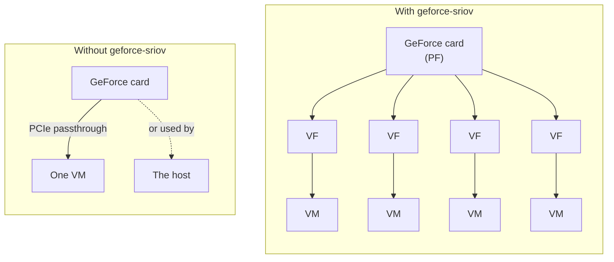
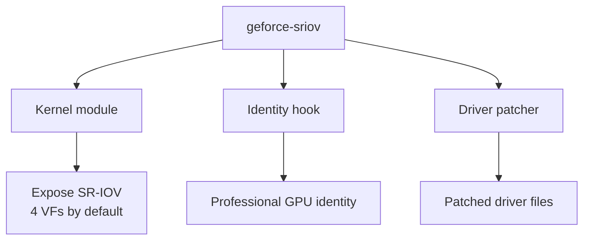
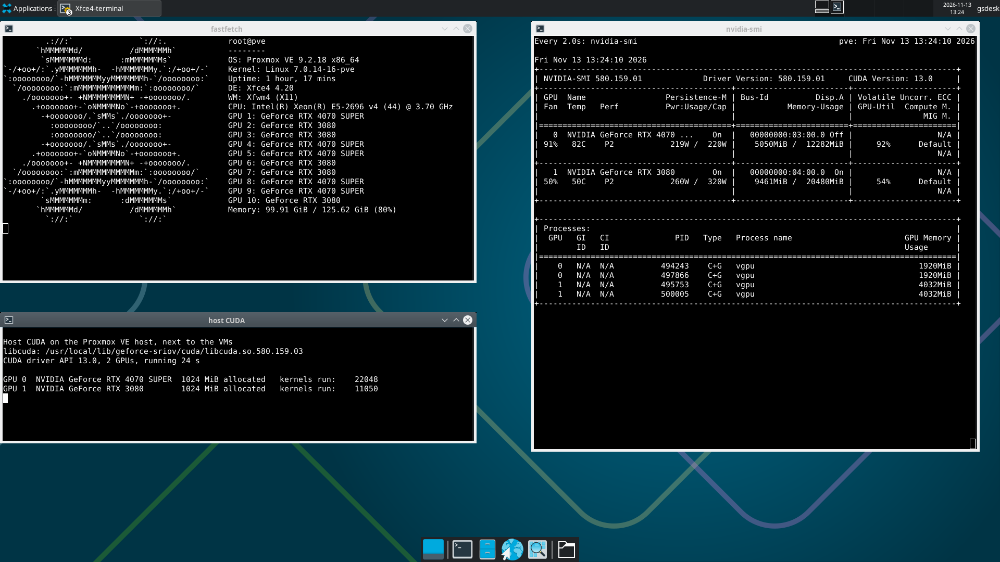
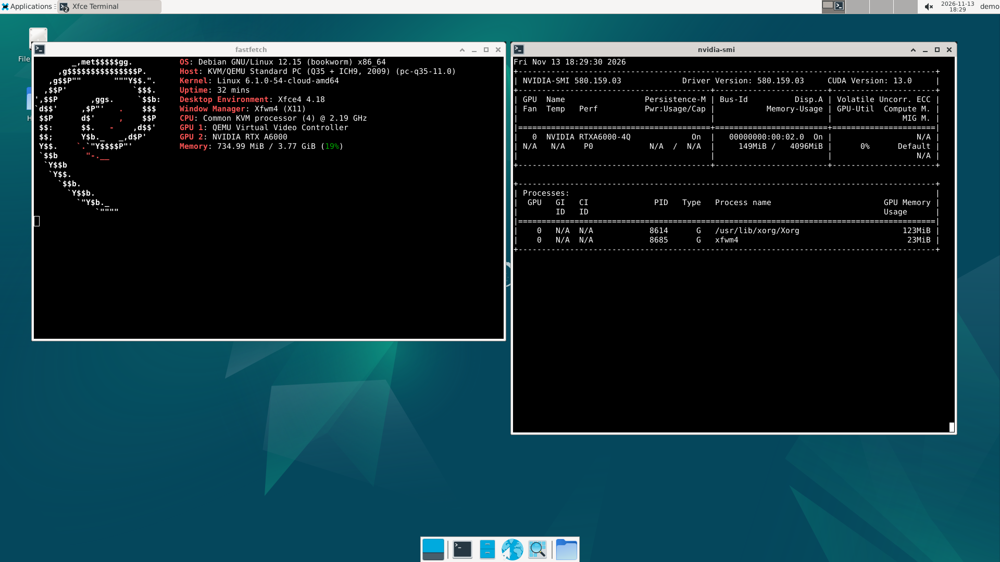
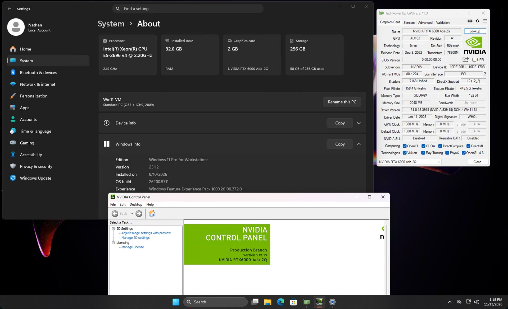
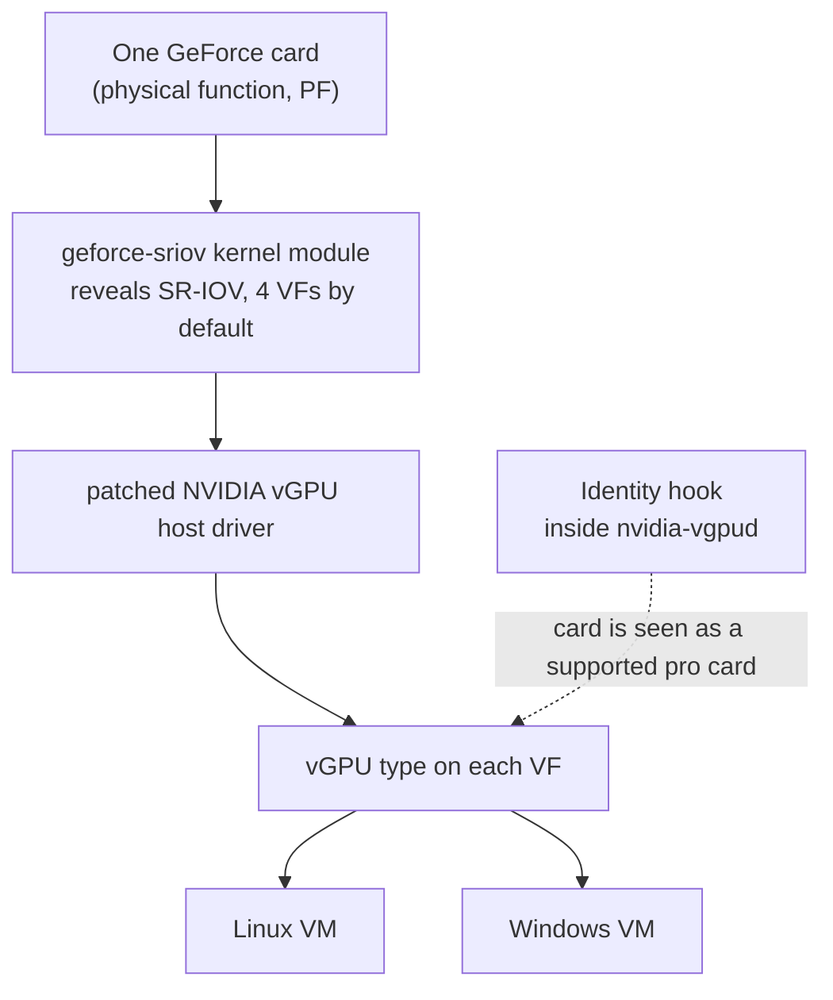

# geforce-sriov

geforce-sriov lets several virtual machines share one NVIDIA GeForce card through NVIDIA's vGPU software.
Each VM can use its own SR-IOV virtual function (VF).

## Motivation

Normally a GeForce card belongs to one VM or to the host.
NVIDIA's vGPU software can split a card among several VMs, but it offers that only on the professional cards.
The supported GeForce cards have the same SR-IOV capability (the PCIe feature that vGPU builds on), but they hide it from the Linux kernel.
geforce-sriov automates the steps that make it usable:

- it reveals the hidden capability to the kernel,
- it prepares your own copy of NVIDIA's driver files,
- it makes the card look like its professional counterpart to NVIDIA's vGPU software, and
- it creates and configures the virtual functions at each boot.

The command `geforce-sriov setup` does the driver work and the VF configuration. It asks you for what it needs, such as the path of NVIDIA's vGPU host driver package (a `.run` file) and which GPUs to use.
Setting up the guests is still your job.



These terms appear throughout the documentation (see the [glossary](docs/glossary.md) for more terms):

| Term | Meaning |
|---|---|
| Host | The machine that holds the GPU and runs the VMs: a Linux KVM host such as Proxmox VE |
| Guest, VM | A virtual machine running on the host |
| GPU | The GeForce card |
| SR-IOV | A PCI feature that lets one device present several lightweight copies of itself |
| PF (physical function) | The GeForce card itself, as the host sees it |
| VF (virtual function) | One copy of the card created by SR-IOV. Each VF is handed to one VM |
| vGPU | The virtual GPU a VM gets through its VF, using NVIDIA's vGPU software |
| vGPU type (profile) | The fixed memory size of a vGPU, for example `RTXA6000-4Q` with 4 GB of VRAM |

geforce-sriov has three parts:



> [!IMPORTANT]
> geforce-sriov is **NOT** a vBIOS flasher or a licensing tool. It does not distribute any NVIDIA
> software.

> [!NOTE]
> **Status: beta.** Ampere and Ada GPUs are supported; see [supported cards](docs/devices.md#generations).
> Expect a lot of changes while geforce-sriov is in beta. To upgrade to a newer version, [uninstall geforce-sriov completely](#upgrading-from-an-earlier-version), power the machine off and on, and install the new version fresh ([Upgrading](docs/installation.md#upgrading)).
>
> Please submit a
> [compatibility report](https://github.com/noon-at-cgn/geforce-sriov/issues/new?template=compatibility-report.yml)
> to help verify more hardware, whether it works or not.

## Safety and reversibility

geforce-sriov changes software only.
It does **not** write firmware (vBIOS), it makes **no** permanent hardware change, and it does **not** supply NVIDIA software or vGPU licensing.

- Installed files stay until you run `uninstall`.
- The runtime setup (the VFs and the vGPU types) is gone after every reboot or power-off, and the boot units apply it again at each boot.
- `uninstall` removes what it installed and restores NVIDIA's original module, so you do not need to reinstall the operating system. It keeps files you changed.

See [Changes and reversibility](docs/technical-reference.md#changes-and-reversibility) for every file and setting.

## Disclaimer

Use at your own risk. This project is provided as is, without warranty of any kind, under the MIT
licence (the kernel module under GPL-2.0-only OR MIT; see [LICENSE](LICENSE)). I am not responsible
or liable for any damage, data loss, hardware failure, instability, downtime or voided warranty
that results from using it.

## Screenshots

<table>
  <tr>
    <td width="33%"><a href="docs/images/host.png"></a></td>
    <td width="33%"><a href="docs/images/linux-guest-ampere.png"></a></td>
    <td width="33%"><a href="docs/images/windows-guest-ada.jpg"></a></td>
  </tr>
  <tr>
    <td>Proxmox VE host: the desktop is drawn by the GPU, and nvidia-smi lists the vGPU processes</td>
    <td>Debian 12 guest on an Ampere card: the desktop is drawn by the vGPU</td>
    <td>Windows 11 guest on an Ada card: the vGPU in Settings, GPU-Z and the NVIDIA Control Panel</td>
  </tr>
</table>

## What you need

- A card from the [device table](docs/devices.md#generations), and a vGPU licence setup of your own.
- A Linux host (x86_64) with KVM and libvirt or QEMU, the IOMMU on, and a kernel 6.8 or later with livepatch support (see the [glossary](docs/glossary.md#livepatch)). `install --dry-run` checks everything else it needs (kernel headers, DKMS, a C compiler; see [What install --dry-run and status check](docs/installation.md#what-install---dry-run-and-status-check)).
- NVIDIA's files from the table below, downloaded with your own NVIDIA entitlement (the right to download NVIDIA's vGPU software). geforce-sriov does not include or download any NVIDIA software.

What to download, and when you need it:

| Feature | What to download | Exact version | Needed when |
|---|---|---|---|
| vGPU host driver | NVIDIA vGPU host driver for Linux KVM, the `.run` file `NVIDIA-Linux-x86_64-580.159.01-vgpu-kvm.run`, from the NVIDIA vGPU software 19.5 download (NVIDIA Licensing Portal) | 580.159.01 | Always |
| Host CUDA | NVIDIA's Linux driver package: NVIDIA's Linux driver 580.159.03 as a `.run` file. Either the vGPU guest driver from the same vGPU software 19.5 download (`NVIDIA-Linux-x86_64-580.159.03-grid.run`) or NVIDIA's GeForce Linux driver, [`NVIDIA-Linux-x86_64-580.159.03.run`](https://download.nvidia.com/XFree86/Linux-x86_64/580.159.03/NVIDIA-Linux-x86_64-580.159.03.run) from NVIDIA's public Unix driver archive | 580.159.03 | You turn host CUDA on (`--host-cuda`) |
| Host display and desktop on the boot display GPU | The Linux driver package (above) and NVIDIA's public kernel module source: [open-gpu-kernel-modules](https://github.com/NVIDIA/open-gpu-kernel-modules), tag [580.159.03](https://github.com/NVIDIA/open-gpu-kernel-modules/archive/refs/tags/580.159.03.tar.gz) | 580.159.03 for both | A GPU you select is the boot display GPU. The desktop libraries come from the Linux driver package; the public kernel module source is used only for the display modules |

Pass the Linux driver package as a `.run` file (`--companion-file PATH`) or as an extracted directory (`--companion-source DIR`), and the public kernel module source as a tarball or a directory (`--nvkms-source PATH`).

The versions geforce-sriov targets:

| Part | Ampere | Ada |
|---|---|---|
| Host driver | 580.159.01 (vGPU software 19.5) | Same |
| Linux guest | 580.159.03 | 535.230.02 (vGPU 16.9) |
| Windows guest | 582.53 | 539.19 (vGPU 16.9) |
| Guest driver setting (required) | `RMSetVgpuGspPluginOffloadMode=0`, a setting of NVIDIA's guest driver: a modprobe option in a Linux guest, a registry value in a Windows guest. Without it the guest driver fails (`RmInitAdapter failed` on Linux, Code 43 on Windows) | Same |
| Default vGPU type | 525, RTXA6000-2Q, 2048 MiB | 942, RTX6000-Ada-2Q, 2048 MiB |

Use these versions. Other host or guest driver versions are **not guaranteed to work**; see [Supported software stack](docs/installation.md#supported-software-stack) for what `install` does with another version and [Guests](docs/installation.md#guests) for guest setup.

## Quick start

### Upgrading from an earlier version

New to geforce-sriov? Skip to [Install](#install).

If an earlier version of geforce-sriov is installed, remove it completely before you install this one:

1. Stop the VMs that use the GPUs.
2. Run `sudo geforce-sriov uninstall`, then run any command it prints.
3. Power the machine off and on.
4. Install this version as described in [Install](#install).

To remove geforce-sriov without installing a new version, do steps 1 to 3. Details: [Uninstall](docs/installation.md#uninstall).

### Install

You need NVIDIA's vGPU host driver `.run` file (`NVIDIA-Linux-x86_64-580.159.01-vgpu-kvm.run`) from your NVIDIA entitlement (the right to download NVIDIA's vGPU software), and a supported card.
For the boot display GPU or host CUDA, also get the files in the table under [What you need](#what-you-need).

```sh
make
sudo ./geforce-sriov setup    # first run, before the power cycle
# power the machine off and on (a cold power cycle, not a reboot)
sudo ./geforce-sriov setup    # second run, after it
```

`setup` prompts for any required options you omitted:

- The path of the vGPU host driver `.run` file, when no NVIDIA driver is installed.
- Acceptance of NVIDIA's licence.
- The GPUs to use, when more than one qualifies.
- The path of the Linux driver package (580.159.03) and of NVIDIA's public kernel module source (`open-gpu-kernel-modules`, tag 580.159.03), if you select the boot display GPU.
- Whether to build NVIDIA's CUDA module for the host too, so CUDA programs can run on the host. If you say yes, it needs the Linux driver package as well ([Host CUDA](docs/installation.md#host-cuda)).
- Consent to keep a laptop GPU powered when it is idle, if you select one. This turns off D3cold, the state in which a laptop cuts power to an idle GPU ([Laptop support](docs/laptops.md#consent)).

If a prerequisite is missing, `setup` stops and names the required action.
For example, if `nouveau` is loaded, it tells you to blacklist it and power the machine off and on first.
For non-interactive setup, see [One command from a clean host](docs/installation.md#one-command-from-a-clean-host).

The second run checks every VF and completes any startup steps that did not run at boot.

Next, [create your VM](docs/installation.md#create-a-vm).
On later boots, the boot units restore the VFs automatically.
See the [installation guide](docs/installation.md) for each step and its expected output.
See [Uninstall](docs/installation.md#uninstall) to remove everything.

To move from another version of geforce-sriov, uninstall that version first, power the machine off and on, then install this one.
`install`, `setup` and `uninstall` stop before they write anything while another version is installed ([Upgrading](docs/installation.md#upgrading)).

Selection and recovery:

- You can pick several GPUs at the prompt, or pass one `--device BDF` per card, up to 32. Ampere and
  Ada cards can share a host ([Combining generations](docs/devices.md#combining-generations)).
- The boot display GPU can be selected too ([Boot display GPU](docs/installation.md#boot-display-gpu)).
- If the host stops responding or a card disappears from `lspci`, power the machine fully off and on, and do **not** rescan the PCI bus. See [The one rule](docs/recovery.md#the-one-rule) for the reason.

> [!IMPORTANT]
> Choose vGPU types (also called profiles) that fit your card's physical VRAM.
> The type list comes from the professional card and includes types larger than your card.
> All running vGPUs must fit in VRAM together, with room left for the host driver.
> For example, four `4Q` vGPUs need 16 GB plus the host driver's share: they fit a 24 GB card and do not fit a 16 GB card.
>
> Set the type per generation with `type_ada=` and `type_ampere=` in `/etc/geforce-sriov/config` ([Choosing a vGPU type](docs/installation.md#choosing-a-vgpu-type)).

## How it works



| Part | What it does |
|---|---|
| Kernel module `geforce_sriov` (DKMS) | Makes the kernel see the hidden SR-IOV feature of the cards you choose, and presents four virtual functions per card by default (`vfs` in the config sets the count; more than 4 per card is not available) |
| Boot units `geforce-sriov-livepatch.service`, `geforce-sriov-activate.service` | The first loads the `geforce_sriov` kernel module (a livepatch: it replaces three PCI functions of the running kernel) and then NVIDIA's `nvidia` module, before udev (the service that loads drivers for detected hardware) starts, so nothing else binds your chosen cards first. The second runs `activate`: it creates the VFs and sets the vGPU types before your VMs autostart. Guest autostart starts after activation has finished and does not wait for it to succeed, so a guest that uses a vGPU can fail to start until the VFs are up |
| CLI `geforce-sriov` | Checks the host, installs everything including the driver patch, and brings up the VFs and vGPU types |
| Identity hook `libgeforce_sriov.so` | Lets `nvidia-vgpud` (NVIDIA's daemon that registers the vGPU types of each GPU) accept your GeForce card as its professional counterpart so it offers vGPU types |
| Driver patcher `geforce-sriov-patch` | Used by `install` to patch your own copies of `nv-kernel.o_binary` (the precompiled part of NVIDIA's kernel module) and `libnvidia-vgpu.so` (NVIDIA's vGPU plugin). See [Revisions](docs/driver-patch.md#revisions) for each change |

## Boot display GPU

The boot display GPU is the card that shows the BIOS/UEFI startup messages and the Linux text console.
On a single-NVIDIA-GPU host, that card is usually the boot display.
Check it with:

```bash
cat /sys/bus/pci/devices/0000:01:00.0/boot_vga
```

Replace `0000:01:00.0` with your GPU's PCI address from `lspci | grep -i nvidia`.
A value of `1` means the GPU is marked as the boot display.

You select it like any other card.
`activate` hands the console to NVIDIA's display modules (`nvidia-modeset` and `nvidia-drm`), so the console stays on. It refuses the card unless the installed build of NVIDIA's kernel module includes them.
`install` builds them when a selected GPU is the boot display.
That needs the Linux driver package (580.159.03) and NVIDIA's public kernel module source (`open-gpu-kernel-modules`, tag 580.159.03) ([Boot display GPU](docs/installation.md#boot-display-gpu)).
On a laptop, see [Display](docs/laptops.md#display) for which display setups make the NVIDIA GPU the boot display.

## Supported cards and driver versions

Ampere and Ada are supported, and so is every card in the device table, laptop GPUs included ([Laptop support](docs/laptops.md)).
See [Supported cards](docs/devices.md#generations) for the full list and [Ampere](docs/ampere.md) and [Ada](docs/ada.md) for generation-specific details.

## Documentation

| Page | What it covers |
|---|---|
| [Installation](docs/installation.md) | Everything from before you start to uninstall: the checks before installing, install, the cold boot, creating a VM, and what the checks cover |
| [Supported cards](docs/devices.md) | The supported device table |
| [Ampere](docs/ampere.md), [Ada](docs/ada.md) | Generation-specific behaviour, host stacks, guest drivers and limits |
| [Laptop support](docs/laptops.md) | Laptop GPUs: the listed IDs, display wiring, keeping the GPU powered (D3cold), interrupts (MSI-X), PCIe function addressing (ARI) and VF counts |
| [What install does to NVIDIA's files](docs/driver-patch.md) | The patches `install` makes to your copies of NVIDIA's files, with their digests, the manual path with `--driver=skip`, and what to do after an update |
| [Configuration and commands](docs/configuration.md) | Config file keys, commands and exit codes, systemd units, module parameters |
| [Boot display GPU](docs/installation.md#boot-display-gpu) | Sharing the card that shows the boot screen |
| [Symptoms](docs/recovery.md#symptoms), [Recovery](docs/recovery.md) | Fixes for common problems, when a cold power cycle is needed (the one rule), the file that blocks activation after an unfinished run (the activation lock), and what not to do |
| [Glossary](docs/glossary.md), [Technical reference](docs/technical-reference.md), [Identity hook](hook/README.md) | Terms, how each part works, how the hook works, and what the CLI does under the hood |
| [Compatibility reports](docs/compatibility.md), [Community reports](docs/community-reports.md) | How to report whether your hardware works, and the setups people have reported so far |
| [Changelog](CHANGELOG.md) | The release notes |

## Related projects

geforce-sriov uses SR-IOV virtual functions rather than mdev (mediated devices), and targets Ampere
and Ada cards. Other projects take different routes:

- [polloloco/vgpu-proxmox](https://gitlab.com/polloloco/vgpu-proxmox): an install guide and driver
  patches for NVIDIA vGPU on Proxmox VE, using mdev. It covers consumer Maxwell 2.0 (except the
  GTX 970), Pascal and Turing cards and says RTX 30xx and 40xx cards will not work. Use it for
  Turing and older cards, which geforce-sriov does not cover.
- [DualCoder/vgpu_unlock](https://github.com/DualCoder/vgpu_unlock) and
  [mbilker/vgpu_unlock-rs](https://github.com/mbilker/vgpu_unlock-rs): the original vGPU unlock for
  consumer cards, which presents a GeForce card to NVIDIA's vGPU software as a supported professional
  model. Maxwell to Turing, mdev. The identity hook in geforce-sriov follows the same idea.
- [Nium32/VGPU-MDEV-RTX-3090](https://github.com/Nium32/VGPU-MDEV-RTX-3090): NVIDIA vGPU on a
  GeForce RTX 3090 through the legacy mdev path, with driver 535.309.01 on Linux 6.1 or 6.5. It
  documents a scheduler fix and a list of approaches that failed. Same chip family as the Ampere
  cards here, with a different mechanism.
- [olealgoritme/blackwell-vgpu-unlock](https://github.com/olealgoritme/blackwell-vgpu-unlock):
  patches and scripts for one SR-IOV vGPU on a GeForce RTX 5090 with driver 580.159.01. Its README
  reports compute in a Linux guest and lists graphics, Windows guests and more than one VF as not
  working.
- [bird/vgpu-unlock-blackwell](https://github.com/bird/vgpu-unlock-blackwell): a write-up of an
  RTX 5090 attempt on driver 595.58.03. It reports that the host-side steps work and that the GPU
  firmware then stops on registers that are missing on consumer silicon.

## License

- MIT ([LICENSE](LICENSE)).
- The kernel module and its shared device table (`kernel/`, `include/gs_devices.h`) are `GPL-2.0-only OR MIT` ([LICENSES/](LICENSES/)).
- See [NOTICE](NOTICE) for third-party notices.
- NVIDIA and GeForce are trademarks of NVIDIA Corporation. This project is not affiliated with NVIDIA.
