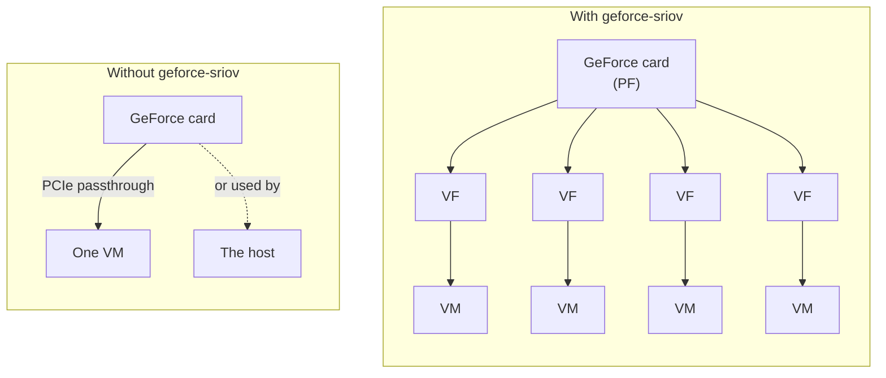
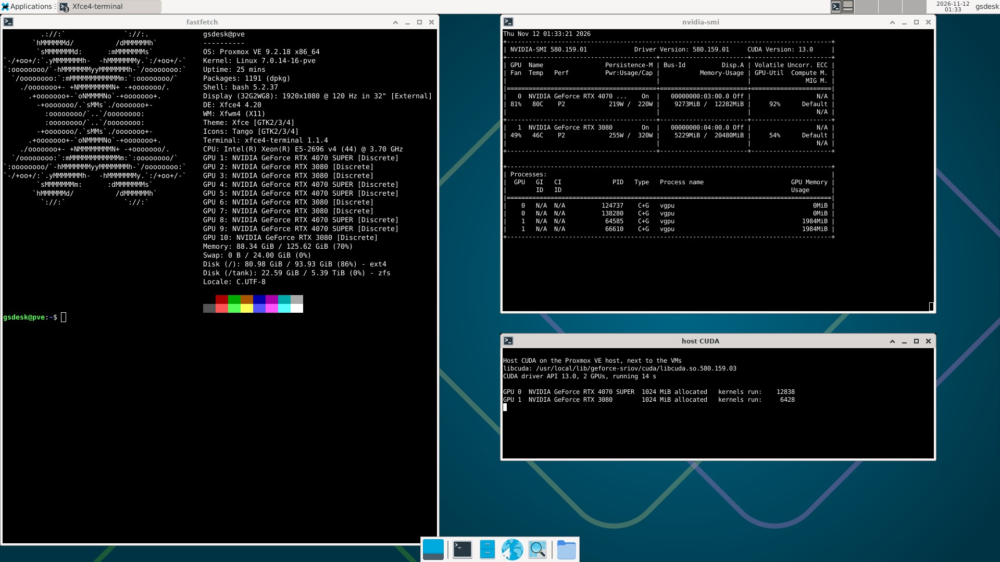
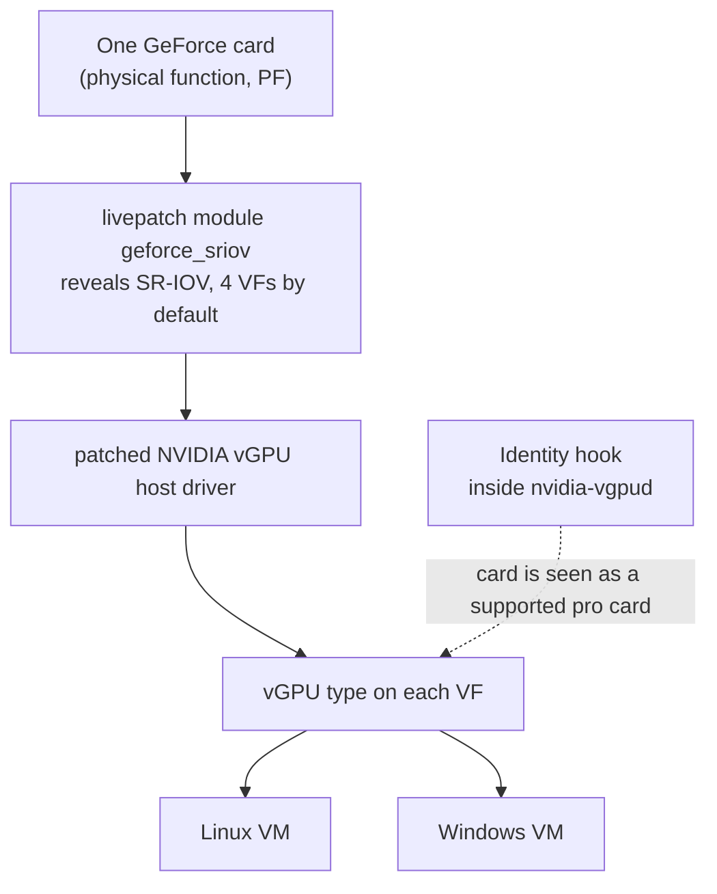
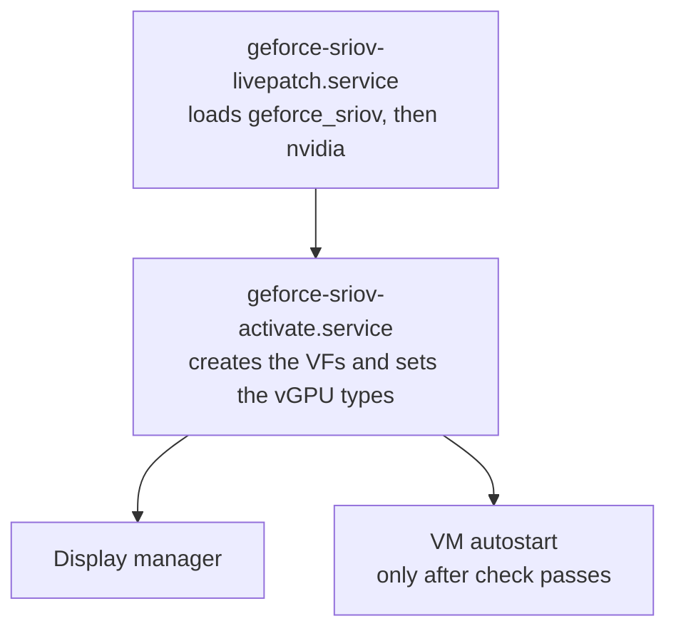
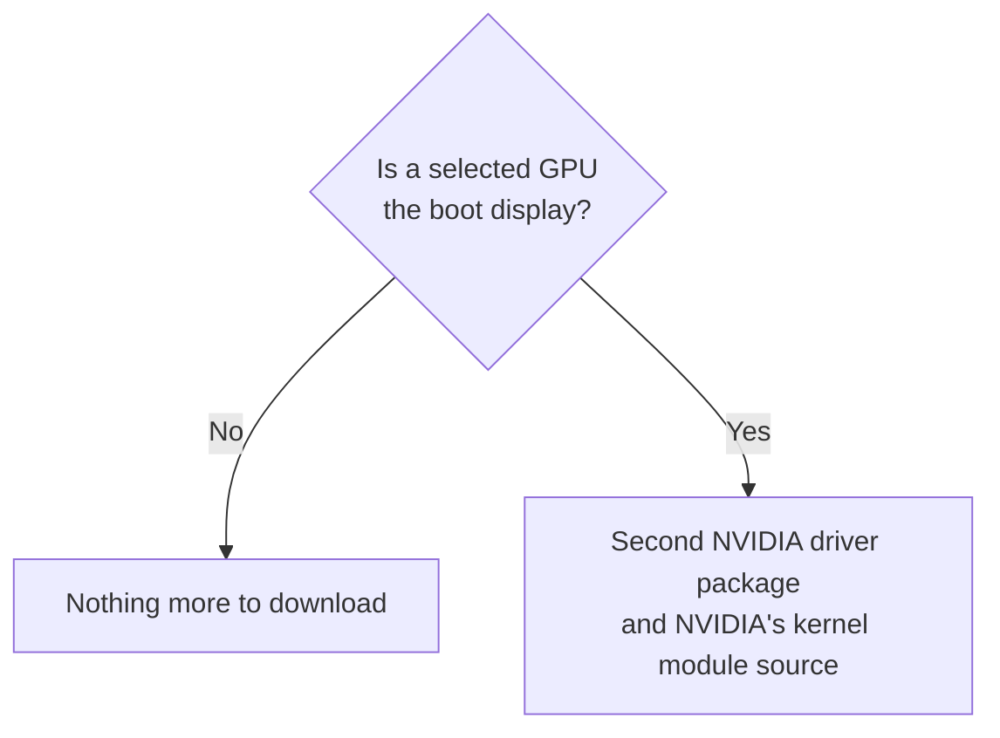

# geforce-sriov

geforce-sriov lets several virtual machines share one NVIDIA GeForce card on a Linux KVM host such as Proxmox VE.
It works with NVIDIA's vGPU software, which you obtain from NVIDIA, and gives each VM its own slice of the card.

## Motivation

Normally a GeForce card belongs to one VM or to the host.
NVIDIA's vGPU software can split a card among several VMs, but it offers that only on the professional cards.
The supported GeForce cards have the same SR-IOV capability (the PCIe feature that vGPU builds on), but they hide it from the Linux kernel.
geforce-sriov automates the steps that make it usable:

- it reveals the hidden capability to the kernel,
- it prepares your own copy of NVIDIA's driver files,
- it makes the card look like its professional counterpart to NVIDIA's vGPU software, and
- it creates and configures the virtual functions at each boot.

`setup` handles the driver and the VF configuration, and asks you for what it needs, such as where NVIDIA's package is and which GPUs to use.
Setting up the guests is still your job.



These terms appear throughout the documentation (the [glossary](docs/glossary.md) has more):

| Term | Meaning |
|---|---|
| Host | The machine that holds the GPU and runs the VMs: a Linux KVM host such as Proxmox VE |
| Guest, VM | A virtual machine running on the host |
| GPU | The GeForce card |
| SR-IOV | A PCI feature that lets one device present several lightweight copies of itself |
| PF (physical function) | The GeForce card itself, as the host sees it |
| VF (virtual function) | One copy of the card created by SR-IOV. Each VF is handed to one VM |
| vGPU | The virtual GPU a VM gets through its VF, using NVIDIA's vGPU software |
| vGPU type (profile) | The fixed size of a vGPU, for example `RTXA6000-4Q` with 4 GB of VRAM. All VFs of a card carry the same type |

## Safety and reversibility

geforce-sriov changes software only.
It does **not** write firmware (vBIOS), it makes **no** permanent hardware change, and it does **not** supply NVIDIA software or vGPU licensing.

- Installed files stay on disk across reboots until you run `uninstall`: a patched copy of NVIDIA's kernel module (`nvidia.ko`), a patched copy of NVIDIA's vGPU library, the geforce-sriov config file, two systemd services and the driver option files in `/etc/modprobe.d/`.
- The runtime setup (the loaded `geforce_sriov` kernel module, the VFs and the vGPU types) is gone after every reboot or power-off, and two boot services apply it again at each boot.

`uninstall` removes the files it installed and restores NVIDIA's original module (`nvidia.ko`) from a backup that it verifies first, so you do not need to reinstall the operating system.
It **keeps** files you changed and files it did not install.
[Changes and reversibility](docs/technical-reference.md#changes-and-reversibility) lists every item.

> [!NOTE]
> **Status: beta.** Ampere (RTX 30 series) and Ada (RTX 40 series) GPUs are supported. Blackwell (RTX 50 series) GPUs are **not** expected to work with the
> current implementation, and references to Blackwell in these docs are for experiments only. See
> [supported cards](docs/devices.md#generations).
>
> Please submit a
> [compatibility report](https://github.com/noon-at-cgn/geforce-sriov/issues/new?template=compatibility-report.yml)
> to help verify more hardware, whether it works or not.

## Disclaimer

Use at your own risk. This project is provided as is, without warranty of any kind, under the MIT
licence (the livepatch module `geforce_sriov` under GPL-2.0-only OR MIT; see [LICENSE](LICENSE)). I am not responsible
or liable for any damage, data loss, hardware failure, instability, downtime or voided warranty
that results from using it.

## Screenshots

<table>
  <tr>
    <td width="33%"><a href="docs/images/proxmox-host.png"></a></td>
    <td width="33%"><a href="docs/images/ampere/debian-guest.png"></a></td>
    <td width="33%"><a href="docs/images/ampere/windows11-guest.jpg"></a></td>
  </tr>
  <tr>
    <td>Proxmox VE host: vGPU driver merged with host CUDA and display</td>
    <td>Debian 12 guest with the vGPU: specs and nvidia-smi</td>
    <td>Windows 11 guest: NVIDIA Control Panel and GPU-Z on the vGPU</td>
  </tr>
</table>

## What you need

- NVIDIA's vGPU host driver package for Linux KVM. You obtain it from NVIDIA with your own entitlement, the right to download NVIDIA's vGPU software. The recommended version is vGPU software 19.5 with host driver 580.159.01.
- A vGPU licence for your guests. You set that up yourself.
- A card from the [device table](docs/devices.md#generations).
- A Linux host with:
  - x86_64 and kernel 6.8 or later with livepatch support,
  - KVM and libvirt or QEMU,
  - kernel headers, DKMS (which rebuilds kernel modules for each new kernel), a C compiler, `make` and `pciutils`, and
  - the IOMMU turned on (the hardware that keeps each VM's device access separate, which lets a VF be passed to a VM).

  `setup` checks all of this before it changes anything ([What doctor checks](docs/installation.md#what-doctor-checks)).
- If the card you share is the boot display GPU, which it is when it is the host's only GPU: a second NVIDIA driver package and NVIDIA's public kernel module source, both version 580.159.03 ([The boot display GPU](#the-boot-display-gpu)).
  CUDA on the host needs the second driver package as well ([Host CUDA](docs/installation.md#host-cuda)).

> [!IMPORTANT]
> geforce-sriov does **not** include, download or provide any NVIDIA software, and it does **not** provide vGPU licensing.
> You obtain both from NVIDIA.

The recommended versions are the ones that were tested:

| Part | Ampere | Ada |
|---|---|---|
| Host driver | 580.159.01 (vGPU software 19.5) | Same |
| Linux guest | 580.159.03 | 535.230.02 (vGPU 16.9) |
| Windows guest | 582.53 | 539.19 (vGPU 16.9) |
| Setting inside every guest | `RMSetVgpuGspPluginOffloadMode=0` ([Guests](docs/installation.md#guests)) | Same |
| Default vGPU type | 525, RTXA6000-2Q, 2048 MiB | 942, RTX6000-Ada-2Q, 2048 MiB |

Host driver 580.159.01 is the version confirmed to work.
Other versions are **not guaranteed to work**, but you can try one on a best-effort basis: `install` tells you which version it found and carries on only if its patches still apply to it.
`setup` asks first (the default is no), and `--allow-unsupported-driver` answers yes without asking.
[Supported software stack](docs/installation.md#supported-software-stack) has the full table, and [Guests](docs/installation.md#guests) covers guest setup.

## Quick start

By the end of this section the card is split into virtual functions (VFs), each VF carries a vGPU type, and you can attach the VFs to VMs.
[Getting started](docs/getting-started.md) has the same path as numbered steps with a link per step.

Have a way back **before** you change the host:

- SSH access to the host from another machine. If the GPU you share also drives the host's monitor, the screen can go blank for a while during setup, and SSH keeps the host manageable while only the display is out.
- A backup of your VM configs and of any data you cannot recreate.
- A bootable USB installer for the host, as a last resort. Recovery normally needs only a power cycle ([Recovery](docs/recovery.md)).
- A way to switch the host fully off and on: the power button, a smart plug or a remote management port.

Download `geforce-sriov-<version>.tar.gz` and `SHA256SUMS` from the [latest release](https://github.com/noon-at-cgn/geforce-sriov/releases/latest), then run this in the folder that holds both files, with `<version>` replaced by the release number and no angle brackets. Run the host commands as root: on Proxmox VE you are already `root`, and on other distributions put `sudo` in front.

```sh
sha256sum -c SHA256SUMS
tar xzf geforce-sriov-<version>.tar.gz
cd geforce-sriov-<version>
make
./geforce-sriov setup
```

`setup` asks you for the location of NVIDIA's `.run` package and for the GPUs to use, then installs its files, creates the VFs and checks each VF.
If it asks you to power the machine off and on, do that and run `geforce-sriov setup` again. A power cycle means switching the machine fully off and on, **not** rebooting.
Then [create your VM](docs/installation.md#create-a-vm) and install the guest driver.
On later boots, the boot units bring the VFs back by themselves. A kernel update needs `geforce-sriov rebuild` before the first boot of the new kernel ([After a kernel update](docs/installation.md#after-a-kernel-update)); until the VFs are up, the host's guest autostart does not run.

The [installation guide](docs/installation.md) covers each step in detail, and [Uninstall](docs/installation.md#uninstall) removes everything.
To skip both boot units for one boot, add `geforce_sriov.skip` to the kernel command line ([Turn features off](docs/recovery.md#turn-features-off)).
If the host stops responding, read [the power-cycle rule](docs/recovery.md#the-one-rule) first.

> [!IMPORTANT]
> Pick vGPU types that fit your card's VRAM.
> The number in a vGPU type name is its VRAM allocation: a `4Q` vGPU type gives each vGPU 4 GB.
> The professional card's vGPU type list can include types larger than your card, and the host driver needs some VRAM too, so you **cannot** assign all of it.
> As an illustration of the arithmetic, one `8Q` vGPU asks for 8 GB of a 12 GB card and leaves nominal room for the host, while three `4Q` vGPUs ask for all 12 GB before the host takes any.
> Whether a vGPU type starts also depends on the driver's per-VF allocation limits.
>
> Set the vGPU type per generation with `type_ada=` and `type_ampere=` in `/etc/geforce-sriov/config` ([Choosing a vGPU type](docs/installation.md#choosing-a-vgpu-type)).

## How it works

Two gaps stand between a GeForce card and a vGPU.
Consumer cards hide SR-IOV from the Linux kernel, and NVIDIA's vGPU software offers vGPU types only for professional cards.
geforce-sriov closes both without touching the card's firmware.
At each boot, two systemd services apply the runtime setup again, so `setup` is the only manual step.



geforce-sriov has three parts, and `setup` installs all of them: the livepatch module (`geforce_sriov`), the identity hook and the driver patcher.

| Term | Meaning |
|---|---|
| Livepatch module `geforce_sriov` | A kernel module, code loaded into the Linux kernel and built with DKMS for each kernel. It makes the kernel see the hidden SR-IOV feature of the cards you choose, and it presents four VFs per card by default |
| DKMS | A Linux tool that rebuilds kernel modules for each newly installed kernel, so the `geforce_sriov` module keeps working after kernel updates. NVIDIA's patched module (`nvidia.ko`) needs `geforce-sriov rebuild` ([After a kernel update](docs/installation.md#after-a-kernel-update)) |
| Livepatch | A kernel feature that replaces a few kernel functions in the running system without a reboot. The `geforce_sriov` module is a livepatch |
| Boot unit | A systemd service that runs at boot. The livepatch, VFs and vGPU types are runtime state, lost at every reboot, so `geforce-sriov-livepatch.service` and `geforce-sriov-activate.service` apply them again each time |
| Identity hook `libgeforce_sriov.so` | A small library that lets `nvidia-vgpud`, NVIDIA's vGPU daemon, accept your GeForce card as its professional counterpart, so that it offers vGPU types |
| Driver patcher `geforce-sriov-patch` | The tool `install` uses to patch your own copies of NVIDIA's module (`nvidia.ko`) and vGPU plugin ([Byte patches](docs/driver-patch.md#byte-patches)) |
| CLI `geforce-sriov` | The command you run. It checks the host, installs everything including the driver patch, and brings up the VFs and vGPU types |
| Boot display GPU | The card that shows the BIOS/UEFI screen at power-on and the host's display, a text console or a desktop ([The boot display GPU](#the-boot-display-gpu)) |

Each boot runs in this order:



## The boot display GPU

The boot display GPU is the card that shows the BIOS/UEFI screen at power-on and then drives the host's display: the Linux text console or a graphical desktop.
On a host with one NVIDIA card, that is usually the card you want to share.
It can serve VFs like any other selected card, and its display stays on while it does.
To keep the display working, geforce-sriov builds NVIDIA's display modules (the kernel modules that draw the screen) and hands the screen over to them during `activate`.
NVIDIA's vGPU host package has **no** display modules, because it is meant for hosts that only run VMs.
That is why the display build needs a second NVIDIA driver package and NVIDIA's public kernel module source:

| What you provide | What geforce-sriov uses it for |
|---|---|
| A second NVIDIA driver package, version 580.159.03: the Linux vGPU guest driver or the GeForce driver | The source of the display modules (`nvidia-modeset` and `nvidia-drm`), and of `nvidia-uvm` for [host CUDA](docs/installation.md#host-cuda) |
| NVIDIA's public kernel module source ([open-gpu-kernel-modules](https://github.com/NVIDIA/open-gpu-kernel-modules)), tag 580.159.03 | The display core (NVKMS) inside `nvidia-modeset`, compiled from source |

`setup` asks for the second driver package and the kernel module source when you select the boot display GPU. [Boot display card](docs/installation.md#boot-display-card) says where to get them.

Display output goes **only** to the boot display GPU. A VF or another card never drives a display.

To check whether a card is the boot display, read its `boot_vga` flag:

```bash
cat /sys/bus/pci/devices/0000:01:00.0/boot_vga
```

Replace `0000:01:00.0` with your GPU's PCI address from `lspci | grep -i nvidia`.
A value of `1` means the GPU is the boot display.



On a laptop, [Display](docs/laptops.md#display) explains which display setups make the GPU the boot display.

## Supported cards

Ampere and Ada GPUs are supported, laptop GPUs included.
[Supported cards](docs/devices.md#generations) has the full list, [Laptop support](docs/laptops.md) covers laptops, and [Ampere](docs/ampere.md) and [Ada](docs/ada.md) have generation-specific notes.

## Documentation

| Page | What is in it |
|---|---|
| [Getting started](docs/getting-started.md) | The short path from download to a VM with a vGPU, one link per step |
| [Installation](docs/installation.md) | The full guide: setup from preparation to uninstall, options, creating a VM, guest drivers and the host checks |
| [Supported cards](docs/devices.md) | The list of supported GPUs |
| [Ampere](docs/ampere.md), [Ada](docs/ada.md) | Notes for each GPU generation: host setup, guest drivers and limits |
| [Laptop support](docs/laptops.md) | Laptop quirks: which GPUs are listed, display setups and power settings |
| [NVIDIA driver setup](docs/driver-patch.md) | The changes `install` makes to your copies of NVIDIA's driver files, the manual path and what to do after an update |
| [Configuration and commands](docs/configuration.md) | The config file, commands and exit codes, systemd units and module parameters |
| [Boot display card](docs/installation.md#boot-display-card) | Sharing the GPU that shows the boot screen, and the second driver package and kernel module source it needs |
| [Symptoms](docs/recovery.md#symptoms), [Recovery](docs/recovery.md) | Fixes for common problems and how to get the host back |
| [Glossary](docs/glossary.md) | Short definitions of the terms used in these docs |
| [Technical reference](docs/technical-reference.md), [Identity hook](hook/README.md) | Implementation details for readers who want to know how each part works |
| [Compatibility reports](docs/compatibility.md), [Community reports](docs/community-reports.md) | How to report whether your hardware works, and the setups people have reported so far |
| [Changelog](CHANGELOG.md) | The release notes |

## Related projects

geforce-sriov uses SR-IOV virtual functions rather than mdev (mediated devices), and targets Ampere
and Ada cards. Other projects take different routes:

- [polloloco/vgpu-proxmox](https://gitlab.com/polloloco/vgpu-proxmox): an install guide and driver
  patches for NVIDIA vGPU on Proxmox VE, using mdev. It covers consumer Maxwell 2.0 (except the
  GTX 970), Pascal and Turing cards and says RTX 30xx and 40xx cards will not work. Use it for
  Turing and older cards, which geforce-sriov does not cover.
- [DualCoder/vgpu_unlock](https://github.com/DualCoder/vgpu_unlock) and
  [mbilker/vgpu_unlock-rs](https://github.com/mbilker/vgpu_unlock-rs): the original vGPU unlock for
  consumer cards, which presents a GeForce card to NVIDIA's vGPU software as a supported professional
  model. Maxwell to Turing, mdev. The identity hook in geforce-sriov follows the same idea.
- [Nium32/VGPU-MDEV-RTX-3090](https://github.com/Nium32/VGPU-MDEV-RTX-3090): NVIDIA vGPU on a
  GeForce RTX 3090 through the legacy mdev path, with driver 535.309.01 on Linux 6.1 or 6.5. It
  documents a scheduler fix and a list of approaches that failed. Same chip family as the Ampere
  cards here, with a different mechanism.
- [olealgoritme/blackwell-vgpu-unlock](https://github.com/olealgoritme/blackwell-vgpu-unlock):
  patches and scripts for one SR-IOV vGPU on a GeForce RTX 5090 with driver 580.159.01. Its README
  reports compute in a Linux guest and lists graphics, Windows guests and more than one VF as not
  working. Blackwell is not expected to work with geforce-sriov.
- [bird/vgpu-unlock-blackwell](https://github.com/bird/vgpu-unlock-blackwell): a write-up of an
  RTX 5090 attempt on driver 595.58.03. It reports that the host-side steps work and that the GPU
  firmware then stops on registers that are missing on consumer silicon. Blackwell is not expected to
  work with geforce-sriov.

## License

- MIT ([LICENSE](LICENSE)).
- The livepatch module `geforce_sriov` and its shared device table (`kernel/`, `include/gs_devices.h`) are `GPL-2.0-only OR MIT` ([LICENSES/](LICENSES/)).
- Third-party notices are in [NOTICE](NOTICE).
- NVIDIA and GeForce are trademarks of NVIDIA Corporation. This project is not affiliated with NVIDIA.
