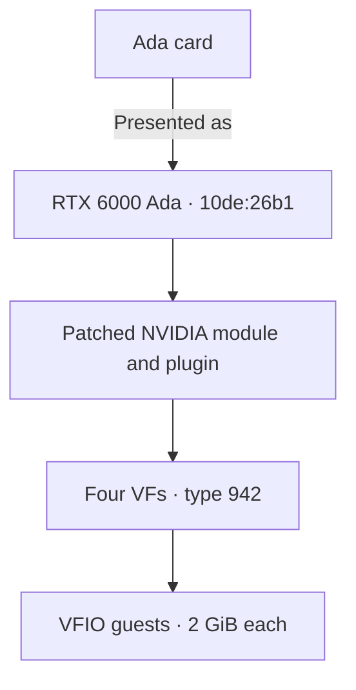
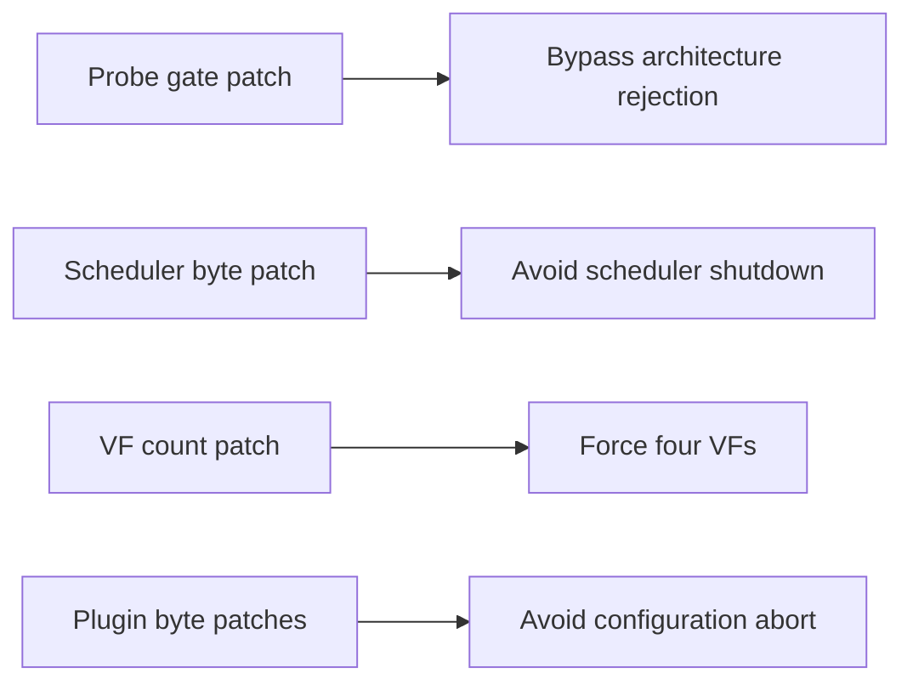
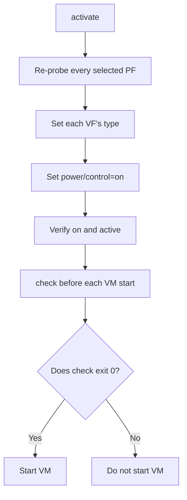

# Ada support

This page covers Ada GPUs such as the RTX 4090 or RTX 4070 SUPER.
geforce-sriov splits a card into virtual functions (VFs), and each VF backs one vGPU, a slice of the GPU that you attach to one VM.
It presents the card to NVIDIA's vGPU software as a professional RTX 6000 Ada.

## What you need to know

- Every Ada card is presented as the RTX 6000 Ada and gets 4 VFs by default. The default vGPU type is 942 (RTX6000-Ada-2Q, 2 GB).
- Use host driver 580.159.01 with GSP off (`install` sets that up), a Linux guest driver 535.230.02 and a Windows guest driver 539.19. Other versions are **not** guaranteed to work ([Guests and VMs](#guests-and-vms) lists what else was tested).
- Ada needs more host-side work than Ampere, and `install` does it for you ([NVIDIA host driver setup](#nvidia-host-driver-setup)).
- Later VFs have higher framebuffer slots, so put VMs with a large vGPU type on the lower VFs ([Choosing a vGPU type](#choosing-a-vgpu-type)).
- The memory of every VF is **reserved from boot**, about 8 of 12 GiB with four 2 GiB VFs, so a stopped VM can always start again ([Reserved VM memory](#reserved-vm-memory)).
- Every guest needs the setting `RMSetVgpuGspPluginOffloadMode=0` ([Guests and VMs](#guests-and-vms)).
- The limits of this generation are in [Known limits](#known-limits).

## At a glance

Key facts for this generation; the terms in the table are explained below it.

| Item | Value |
|---|---|
| Device IDs | Every Ada row in [devices.md](devices.md#rows). Tested card: `10de:2783` (RTX 4070 SUPER, AD104) |
| Laptop GPUs | Supported through the same path as the desktop cards ([Laptop support](laptops.md)). No laptop GPU has been tested |
| Presented as | RTX 6000 Ada, `10de:26b1` |
| VFs per card | 4 |
| Host driver | NVIDIA vGPU software 19.5, host driver 580.159.01, vGPU-KVM proprietary build, CPU-side mode with `NVreg_EnableGpuFirmware=0`, GSP not used |
| vGPU plugin | The patched plugin copy this package makes from the 580.159.01 stock plugin (SHA-256 `aa4fdeb5…`) |
| NVIDIA's module | `nvidia.ko` built from the 580.159.01 object with its three byte patches |
| Linux guest | 535.230.02 (vGPU 16.9) |
| Windows guest | 539.19 (vGPU 16.9) |
| Guest setting | `RMSetVgpuGspPluginOffloadMode=0` |
| Default vGPU type | 942, RTX6000-Ada-2Q, 2048 MiB |
| Status | supported |

Terms in the table:

- *Presented as* is the professional card that NVIDIA's vGPU software is told this card is, with its PCI device ID (the model number a card reports on the PCI bus).
- *vGPU-KVM* is NVIDIA's host package for KVM hypervisors.
- *CPU-side mode* means the driver does its management work on the host CPU instead of the GPU's on-board firmware processor ([GSP](glossary.md)).
- *The five byte patches* are small changes to a few bytes of NVIDIA's own files that `install` makes in copies of your files: three in NVIDIA's module and two in the vGPU plugin ([NVIDIA host driver setup](#nvidia-host-driver-setup)).
- *Guest setting* is a driver option you set inside the guest ([Guests and VMs](#guests-and-vms)).

The driver versions above are the recommended, tested ones.
Other versions are not guaranteed to work ([supported software stack](installation.md#supported-software-stack)).

## How it works

The overall mechanism is the same for every card: a livepatch (a kernel module that changes the running kernel, see the [glossary](glossary.md)) reveals the SR-IOV feature the card hides, the identity hook presents the card as a professional board, and `activate` creates the VFs and sets their type.
The README gives the short version ([How it works](../README.md#how-it-works)) and the [technical reference](technical-reference.md#how-it-works) the full one.

Ada needs more host-side work than Ampere, because NVIDIA's vGPU host driver does not accept an Ada card as it ships.
`install` makes a few small byte-level changes, called byte patches, to copies of your own NVIDIA files ([NVIDIA host driver setup](#nvidia-host-driver-setup)), and each one removes a different obstacle:

- Architecture check: NVIDIA's stock proprietary module (`nvidia.ko`) does not accept Ada on a vGPU host.
  Its device check, `rm_is_supported_device` (part of the driver's resource manager, RM), returns `NV_ERR_NOT_SUPPORTED` (`0x56`) for any chip architecture above `0x17`, and Ada is `0x19`.
  The probe gate patch replaces a two-byte conditional jump in that check with two NOPs (instructions that do nothing).
  With GSP (the GPU's on-board firmware processor) off, the driver then runs on the CPU.
- Scheduler: The scheduler patch is the same two-byte change Ampere uses.
  Without it, a callback in the driver disables the GPU's runlist scheduler and guest work stalls.
- VF count: NVIDIA's driver reads an Ada card's TotalVFs (how many VFs the card says it can have) from the hardware and accepts vGPUs only up to that count.
  Most Ada cards report 1.
  The VF-count patch replaces a 16-bit load inside `kbifCacheVFInfo`, a driver function, with the constant 4.
- Plugin: Without the plugin patch, the stock plugin (NVIDIA's vGPU library, `libnvidia-vgpu.so`) makes `nvidia-vgpu-mgr` abort the vGPU configuration (`0x1f`) on Ada, and the instance does not start.

With the default vGPU type:



### With the other generation

A host can hold Ada and Ampere cards together: select each card with its own `--device`.
The shared NVIDIA module (`nvidia.ko`), the one patched plugin, the per-generation types (`type_ada`, 942 by default) and the host-wide recovery rule are described once in [Combining generations](devices.md#combining-generations).
For Ada, the practical effect is that the plugin copy and the byte patches for NVIDIA's module above also serve the Ampere card, and NVIDIA's module forces four VFs on it too.
See [Ampere](ampere.md#with-the-other-generation) for the Ampere side.

<a name="choosing-a-profile"></a>

### Choosing a vGPU type

A vGPU type sets how much of the card's VRAM each vGPU gets. NVIDIA also calls a vGPU type a profile.
The name ends in the size: in `RTX6000-Ada-2Q`, the `2Q` means 2 GB.
The card offers the RTX 6000 Ada types.
Its Q types are:

| Type | Name ends in | Size |
|---|---|---|
| 941 | 1Q | 1 GiB. Does **not** work with this host setup, see below |
| 942 | 2Q | 2 GiB |
| 943 | 3Q | 3 GiB |
| 944 | 4Q | 4 GiB |
| 945 | 6Q | 6 GiB |
| 946 | 8Q | 8 GiB |
| 947 | 12Q | 12 GiB |
| 948 | 16Q | 16 GiB |
| 949 | 24Q | 24 GiB |
| 950 | 48Q | 48 GiB |

Type 941 (1Q) does **not** work with this host setup: the guest driver 535.230.02 logs `RmInitAdapter failed! (0x25:0x1e:1480)` and `nvidia-smi` in the guest finds no device (tested 2026-11-11). Use 942 or a larger type.

NVS-class types are offered too.
The list is **not** filtered by the card's memory, so pick a vGPU type that fits your VRAM.
Set the type with `type_ada=` in the config; every VF of the card gets it.
How to pick a size, and why a vGPU type that looks like it fits can still fail, is in [Choosing a vGPU type](installation.md#choosing-a-vgpu-type).

On Ada there is one more constraint.
Each VF has a fixed framebuffer slot (the part of the card's VRAM its vGPU uses), and a later VF's slot ends higher in the card's memory.
With a large type, the last VFs may not start a VM, so put VMs on the lower VFs.
`activate` names the VFs whose slot ends near the top of the card's memory.
That line is a hint, not a limit.

<a name="host-stack"></a>

## NVIDIA host driver setup

`install` applies the three byte patches for NVIDIA's module and two plugin byte patches to copies of your own `nv-kernel.o_binary` and `libnvidia-vgpu.so`, rebuilds and installs `nvidia.ko`, and points the plugin symlink at the patched copy.
The five byte patches, in order, are the scheduler, the probe gate and the VF count for NVIDIA's module, then the placement patch and the framebuffer patch for the plugin.
Offsets, bytes, digest checks, the comparison with a stock build and the manual path for `--driver=skip` are in [driver-patch.md](driver-patch.md#byte-patches) ([what install does](driver-patch.md#what-install-does)).
`activate` checks that the symlink resolves to the patched plugin copy.

Ada-specific:

- `install` writes the GSP-off option for NVIDIA's module, `options nvidia NVreg_EnableGpuFirmware=0`, to `/etc/modprobe.d/` (where driver parameters are set) unless a file there already sets it to 0. `nvidia-smi -q` then shows `GSP Firmware Version: N/A`.
- NVIDIA's open flavour always uses GSP and is **not** supported on Ada ([NVIDIA driver flavour](devices.md#nvidia-driver-flavour)).
- For other host driver versions, see [Status of every row](devices.md#status-of-every-row).
- To have `install` take NVIDIA's `.run` package as well, see `--driver-file`, `--accept-nvidia-license` and `--nvidia-source` in [Automated setup](installation.md#automated-setup).

Until both NVIDIA's patched module and the plugin copy are in place, `activate` refuses on 580.159.01 and the Ada stack cannot be completed.
On another host driver version, which is not guaranteed to work, it warns and continues.

Each change addresses a different host-side restriction:



## Bring-up differences

Ada follows [Cold boot](installation.md#cold-boot): the activate unit runs `activate --boot` at boot, and `check` gates every VM start.
Without the unit, run `activate` yourself.
If a selected card is the boot display GPU, `activate` also hands its display to NVIDIA's display modules ([Boot display card](installation.md#boot-display-card)).

```sh
sudo geforce-sriov activate --dry-run         # preflight checks only, then prints the steps; changes nothing
sudo geforce-sriov activate                   # after a boot where the activate unit did not run
geforce-sriov check                           # before every VM start
```

Exit codes and `--type` are in [commands](configuration.md#commands).

- `activate` creates the VFs if they are missing, loads `nvidia_vgpu_vfio`, restarts `nvidia-vgpud` and `nvidia-vgpu-mgr` in order, re-probes each selected PF (the card itself, making the driver attach to it again), sets the vGPU type on every VF, powers each VF on and reads the result back.
  Restart those daemons through `activate` **only**.
- A card takes one vGPU size at a time.
  Writing a larger type to a VF while the other VFs hold a smaller one fails with EIO, and `creatable_vgpu_types` on that VF (the file that lists the types a VF accepts) lists only the smaller types.
  `activate` sets the same type on every VF of a card.
- `nvidia_vgpu_vfio` keeps the vGPU type table of a card's first registration after a boot.
  If the professional card the GeForce card is presented as changes on a running host, `activate` refuses the new type (`type 911 is not in nvidia/creatable_vgpu_types`) until the next cold boot ([Symptoms](recovery.md#symptoms)).
- Both commands act on every selected Ada or Ampere card.
  They refuse without changing anything when a card in scope is not in the device table (a Blackwell card, for example).
  The daemon restart is host-wide, so `activate` also refuses while a GPU not selected in `bdfs` has VFs enabled.
- `activate` writes `/run/geforce-sriov/activating` before its first change and removes it once every VF reads back `on` and `active`.
  `check` reports `NOT READY` while the file exists.
  Exit 5 leaves the activation lock set and needs a cold power cycle first ([the power-cycle rule](recovery.md#the-one-rule)).
- Run `activate` only while no VM start is pending, for example before the VMs autostart.
  Restarting `nvidia-vgpu-mgr` ends any vGPU on the host.
- `activate` needs NVIDIA's driver to grant `unbindLock` (the driver's way of saying that no program holds the GPU).
  A client such as `nvidia-smi`, `nvidia-persistenced` or a CUDA program that holds the GPU makes it stop with exit 1.

### The VF power gate

Every VF needs `power/control=on` and `runtime_status=active` (the Linux runtime power settings of the VF: `on` keeps it awake, `auto` lets it suspend) after the last PF re-probe, and `activate` sets and verifies both.
With `auto`, a VF suspends between attaches and the next guest start fails with `RmInitAdapter failed! (0x11:0x45)` (`NV_ERR_IRQ_NOT_FIRING`).

A `nvidia-vgpu-mgr` restart or a PF re-probe on any card can put VFs back to `auto`.
After either, stop the VMs that use a vGPU on any card of the host, set their VFs' type back to `0`, and run `activate` again.
A udev rule (a rule the device manager runs when devices change) or a systemd `ExecStartPost` that writes `on` is **no** replacement.

The power settings must be applied after the last PF re-probe:



### The `check` gate

`geforce-sriov check [--device BDF]... [--type N]` changes nothing and needs no root.
It prints one line per VF:

```text
OK <VF> (VF of <PF>): driver=nvidia type=942 expected=942 power/control=on runtime_status=active
```

It prints `NOT READY` and exits 1 when `/run/geforce-sriov/activating` exists, when the activation lock `/var/lib/geforce-sriov/prepare-attempt` (the file that blocks activation after an incomplete run, see [the activation lock](recovery.md#the-activation-lock)) is set, when it cannot tell whether either file exists, or when a VF or PF is not ready.
**Never** start a VM on a VF marked `NOT READY`.

`check` is a point-in-time read and takes no lock, so run it right before the VM start.
A matching type shows that the types were registered, not that `activate` ran in this boot.

## Guests and VMs

The package installs nothing in a guest.
The steps shared by every card are in [Guests](installation.md#guests).
The 16.9 drivers below come from an older vGPU release than the host driver.
They are the drivers that ran on the tested card, and NVIDIA does not pair that branch with this host driver, so other guest versions are not guaranteed to work.

| Guest | Driver | Required guest setting |
|---|---|---|
| Linux | 535.230.02 (vGPU 16.9) | `options nvidia NVreg_RegistryDwords="RMSetVgpuGspPluginOffloadMode=0"` in `/etc/modprobe.d/`. Without it the guest driver loops `RmInitAdapter failed! (0x22:0x65:897)` |
| Windows | 539.19 (vGPU 16.9) | DWORD `RMSetVgpuGspPluginOffloadMode` = `0` in the display adapter's class key ([Guests](installation.md#guests) has the commands). Without it the device shows Code 43 |

Two more results from the tested card, an RTX 4070 SUPER:

- The Windows guest driver 582.53 (vGPU 19.5) was also tested on Ada, and it runs CUDA. 539.19 remains the recommended Windows driver.
- The Linux guest driver 580.159.03 (vGPU 19.5) does **not** run CUDA in an Ada guest with this host setup. Use 535.230.02.

Each VF is passed to QEMU as a plain VFIO device (VFIO is how Linux hands a PCI device to a VM), with the vGPU type already set on the VF and no mdev, the older vGPU mechanism ([Create a VM](installation.md#create-a-vm)).
The argument is the same on every host.
On Proxmox VE, the host of the tested card, it goes in a raw `args` line rather than `hostpci…,mdev=`:

```text
args: -device vfio-pci,host=<VF>,enable-migration=off
```

Give every VFIO device `enable-migration=off`.
Without it, a plain VM stop logs migration errors and QEMU resets the device.
The stop completes either way, but the option avoids those messages.
You need to handle licensing separately.

## Screenshots

<a href="images/ada/proxmox-host.png"></a>

The Proxmox VE host runs driver 580.159.01.
`nvidia-smi` shows two vGPU processes on the Ada card, each using 2016 MiB.

<a href="images/ada/debian-guest.png"></a>

The Debian 12 guest shows `NVIDIA RTX6000-Ada-2Q` with 2048 MiB and guest driver 535.230.02.

<a href="images/ada/windows11-guest.jpeg"></a>

The Windows 11 guest shows `NVIDIA RTX 6000 Ada-2Q` with 2 GB.
NVIDIA Control Panel and GPU-Z report guest driver 539.19.

## Reserved VM memory

### What it is

On an Ada card, geforce-sriov **reserves the memory of every VF from boot**, whether its VM is running or not.
Each VF has a fixed range of the card's VRAM, its framebuffer slot, and its vGPU always uses that range.
With four VFs of the default type (2 GiB each), about 8 of the 12 GiB on an RTX 4070 SUPER are reserved.
Host programs, such as a host CUDA job, can use the rest.

| VFs and type | Reserved | Left for host programs (RTX 4070 SUPER, 12 GiB) |
|---|---|---|
| 4 VFs of 2 GiB (default) | about 8 GiB | about 4 GiB |
| 2 VFs of 2 GiB (`vfs=2`) | about 4 GiB | about 8 GiB |
| reservation off (`fb_slots=off`) | only the memory of running VMs | everything else |

A running VM uses its own reserved range, so starting a VM does **not** take more memory.

### Why it is needed

NVIDIA's driver treats the range of a stopped VM as free memory.
Without the reservation, a host program can take that range while the VM is stopped.
The VM then **fails to start** until the program frees the memory, and the host journal shows `Failed to alloc guest FB memory`.
With the reservation, a stopped VM can always start again.

### How it works

- `activate` reserves the range of every VF as soon as it sets the vGPU types, at boot and whenever you run it.
- When a VM starts, NVIDIA's vGPU manager receives the reserved range of its VF. When the VM stops, the range stays reserved for its next start.
- A host program that asks for memory gets it from outside the reserved ranges, or is told that the card has no free memory.

You do not need to do anything. `geforce-sriov status` shows one line for each Ada card:

```text
framebuffer slots: 4 held (1 in use, 3 free)
```

`in use` counts the ranges whose VM is running.
When a range is **not** held, the line names the reason and what to do, which is usually `sudo geforce-sriov activate` while no VM start is pending.
A range that is not held is never an error: its VM starts as it did before 0.3.0, and can fail to start only while a host program has its memory.

### What you see in nvidia-smi

On the host, `nvidia-smi` counts the reserved memory for the card, not for the VMs:

- The memory used on the Ada card includes every reserved range, also those of stopped VMs.
- The vGPU process of each Ada VM shows **0 MiB**, because the memory it uses was reserved before the VM started.

Each guest still has its full vGPU memory. Ampere cards have no fixed ranges, so their vGPU processes show their memory as before.

### How to change it

- **Fewer VFs** reserve less: set `vfs=2` in `/etc/geforce-sriov/config` (or run `sudo ./geforce-sriov install --vfs 2` from the source folder), then power the machine off and on. `vfs` applies to **every** selected card, Ampere included ([Configuration file](configuration.md#configuration-file)).
- **A smaller vGPU type** reserves less per VF. Type 941 (1 GiB) does **not** work on Ada, so 942 (2 GiB) is the smallest ([Choosing a vGPU type](#choosing-a-vgpu-type)).
- **Turn the reservation off** with `fb_slots=off` in `/etc/geforce-sriov/config`, then run `sudo geforce-sriov activate`.
  The ranges are released, so host programs can use all memory that running VMs do not use, but a stopped VM may then fail to start while a host program uses its memory ([Configuration file](configuration.md#configuration-file)).

How it works internally is in the [technical reference](technical-reference.md#the-framebuffer-slot-owner).

## Known limits

- The memory of every VF stays reserved, also while its VM is stopped, so host programs get only the rest: about 4 of 12 GiB on an RTX 4070 SUPER with four 2 GiB VFs ([Reserved VM memory](#reserved-vm-memory)).
- Holding the slots is tested with host driver 580.159.01. With another host driver version it is best effort: `install` builds NVIDIA's module without it when its checks do not pass, and `status` then says so.
- On an Ada card that is also the boot display GPU, holding the slots has **not** been tested.
- vGPU type 941 (RTX6000-Ada-1Q) does **not** work: the guest driver does not initialise ([Choosing a vGPU type](#choosing-a-vgpu-type)).
- `vfs` accepts values from 1 up to the card's ceiling (`geforce-sriov doctor` shows it).
  NVIDIA's patched driver uses at most 4 VFs per card.
  The VFs take functions 4 to 7 of the card's slot, and ARI decoding in the GPU beyond function 7 does **not** work ([Capability positions](devices.md#capability-positions-per-generation)).
- The open flavour and the GSP route are **not** supported ([NVIDIA driver flavour](devices.md#nvidia-driver-flavour)).
