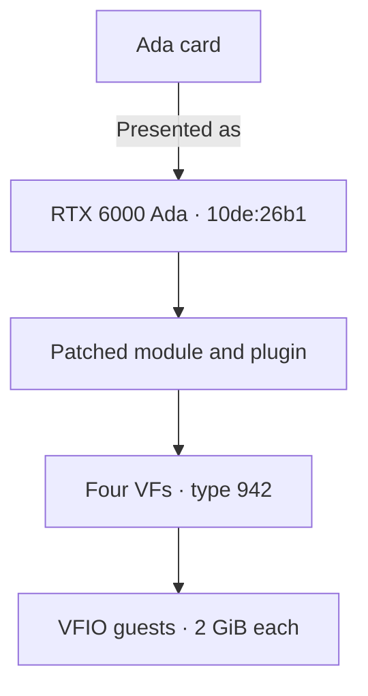
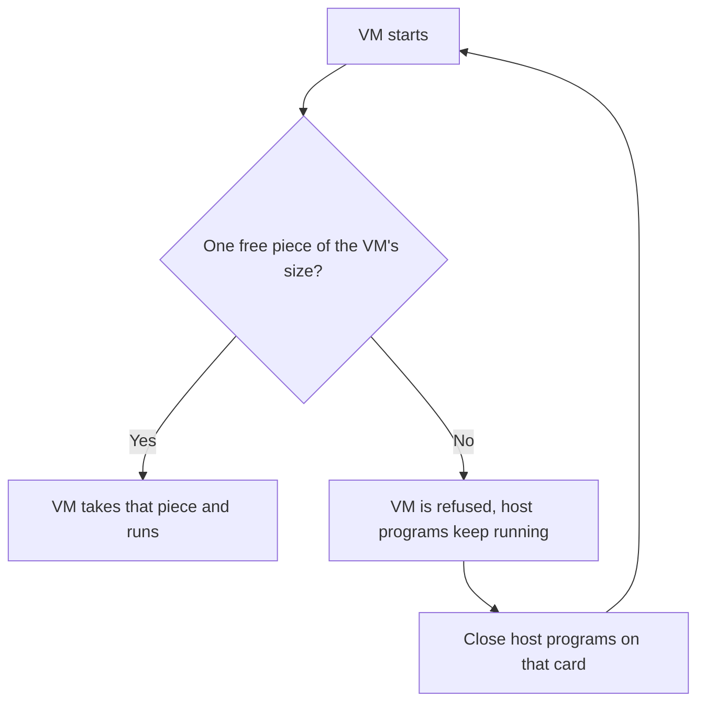
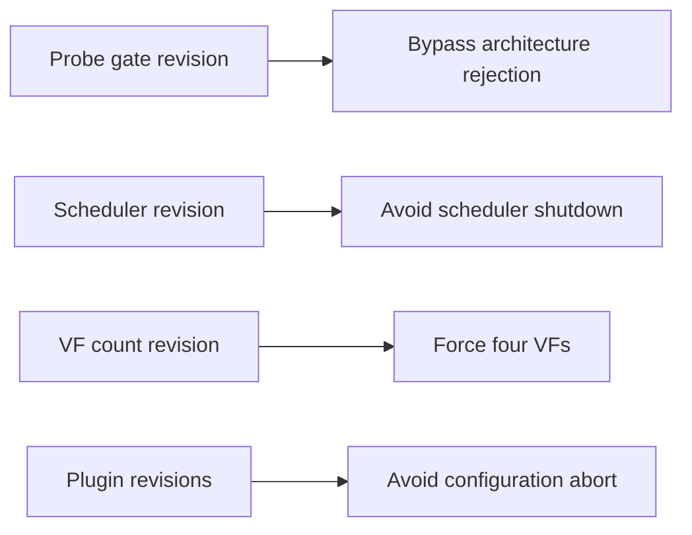
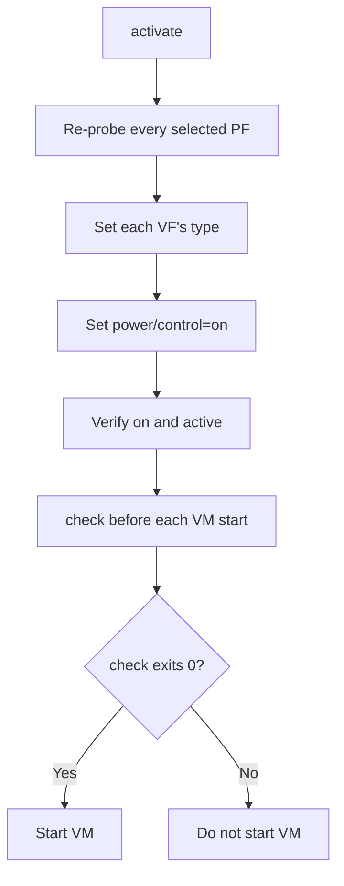

# Ada support

## At a glance

| Item | Value |
|---|---|
| Device IDs | Every Ada row in [devices.md](devices.md#rows). Example card: `10de:2783` (RTX 4070 SUPER, AD104) |
| Laptop GPUs | Supported through the same path as the desktop cards ([Laptop support](laptops.md)). No laptop GPU has been tested |
| Presented as | RTX 6000 Ada, `10de:26b1` |
| VFs per card | 4 |
| Host driver | NVIDIA vGPU software 19.5, host driver 580.159.01, vGPU-KVM proprietary build, CPU-side mode with `NVreg_EnableGpuFirmware=0`, GSP not used |
| vGPU plugin | The patched plugin copy geforce-sriov makes from the 580.159.01 stock plugin (SHA-256 `aa4fdeb5…`) |
| Host module | `nvidia.ko` built from the 580.159.01 object with four revisions: the scheduler, the probe gate, the VF count and the change for VM video memory ([VM video memory](#vm-video-memory)) |
| Linux guest | 535.230.02 (vGPU 16.9) |
| Windows guest | 539.19 (vGPU 16.9) |
| Guest setting | `RMSetVgpuGspPluginOffloadMode=0` |
| Default vGPU type | 942, RTX6000-Ada-2Q, 2048 MiB |
| Status | supported |

## How it works

- NVIDIA's vGPU stack does not list the GeForce and some workstation cards.
  geforce-sriov reveals the card's hidden SR-IOV virtual functions (VFs) and presents it to that stack as an RTX 6000 Ada, regardless of its model.
- NVIDIA's stock host module refuses Ada cards on a vGPU host; `install` removes that check. With GSP off, the driver then runs on the CPU.
- Without the scheduler change, guest GPU work stalls. It is the same change Ampere uses.
- Most Ada cards report 1 VF; `install` makes NVIDIA's driver accept 4.
- The stock vGPU plugin stops an Ada vGPU from starting; the patched copy does not.

The symbols, codes and byte details are in [Revisions](driver-patch.md#revisions).

With the default type:



### With the other generation

A host can hold Ada and Ampere cards together.
Select each card with its own `--device`; no other setting is needed.
See [Ampere](ampere.md#with-the-other-generation) for the Ampere side.

- One module and one plugin serve both generations, alone or together, with the same bring-up procedure.
  Both use the patched plugin copy.
  On 580.159.01, `activate` refuses any other plugin: the stock one, the earlier Ada-only copy and an earlier copy with only the plugin placement change.
  On another host driver version, which is **not guaranteed to work**, it prints that and continues.
- The module forces four VFs on every card bound to it, so an Ampere card beside an Ada card presents four VFs too.
- Each generation has its own type: `type_ada` and `type_ampere` in the config, by default 942 on Ada and 525 on Ampere.
- `--type` is refused on a mixed selection ([commands](configuration.md#commands)).
  Set the two config keys instead, or narrow `check` to one generation with `--device`.
- `status` and `install --dry-run` warn when a selection mixes Ada with another generation.
  Apart from `--type`, nothing refuses a mixed host.
- The recovery rule is host-wide: if any card disappears from `lspci` or the host cannot be reached, cold power cycle the whole machine ([the one rule](recovery.md#the-one-rule)).

<a id="choosing-a-profile"></a>
### Choosing a vGPU type

A vGPU type, also called a profile, sets how much of the card's memory each vGPU gets.
The card offers the RTX 6000 Ada types.
Its Q types are:

| Type | Profile | Size |
|---|---|---|
| 941 | 1Q | 1 GiB |
| 942 | 2Q | 2 GiB |
| 943 | 3Q | 3 GiB |
| 944 | 4Q | 4 GiB |
| 945 | 6Q | 6 GiB |
| 946 | 8Q | 8 GiB |
| 947 | 12Q | 12 GiB |
| 948 | 16Q | 16 GiB |
| 949 | 24Q | 24 GiB |
| 950 | 48Q | 48 GiB |

NVS-class types are offered too.
The list is not filtered by the card's memory.
Set the type with `type_ada=` in the config; every VF of the card gets it ([Choosing a vGPU type](configuration.md#choosing-a-vgpu-type)).

> [!IMPORTANT]
> Choose vGPU types (also called profiles) that fit your card's physical VRAM.
> All the vGPUs you run at once must fit in the VRAM together, with some room left over because the host driver uses part of the memory too.
> For example, four `4Q` vGPUs need 16 GB plus the host driver's share: they fit a 24 GB card and do not fit a 16 GB card.

Without the VM video memory change, each VF has a fixed framebuffer slot, and a later VF's slot ends higher in the card's memory.
geforce-sriov builds the VM video memory change into the module whenever a selected card is Ada, so an Ada VM has no fixed slot and takes a free piece of video memory when it starts ([VM video memory](#vm-video-memory)).
Until you power the machine off and on after `install`, the module that was loaded before stays in use and its slots still apply; `status` and `check` say which is the case.
A VM does not start when the card holds no free piece of its size.
`activate` names the VFs whose slot ends near the top of the card's memory only for a card whose VFs still have fixed slots; with the VM video memory change it prints no such line.

The 1 GiB type (941) works: the guest sees 1024 MiB and runs CUDA.

## VM video memory

With the VM video memory change, an Ada VM has no fixed range of the card's video memory.
When it starts, it takes one contiguous free piece of the size of its type, as an Ampere VM does.
`install` builds the change into `nvidia.ko` ([Revisions](driver-patch.md#revisions)).
It makes the card report `Homogeneous Placements: Not Supported`.

`install` applies it when a selected card is Ada: alone, or with an Ampere card, because the module is shared.
It is not applied when only Ampere cards are selected.
There is no config key and no option for it.

What you see on a module that carries the change:

- `nvidia-smi -q` shows `Homogeneous Placements: Not Supported` for the Ada card.
- `placement_id` of each Ada VF (`/sys/bus/pci/devices/<vf>/nvidia/placement_id`) reads `Not Applicable`.
  With fixed slots it read 0, 2, 4 and 6.
- The `nvidia-vgpu-mgr` log shows `placement Id: 0xffff`.
- `status` and `check` read `placement_id` of each Ada VF with VFs enabled and print one line, without running `nvidia-smi`:
  - `VM video memory: taken from free memory when a VM starts (placement_id: Not Applicable)`
  - `VM video memory: fixed slots (placement_id 0, 2, 4, 6): the loaded nvidia.ko does not carry the Ada placement change. Run sudo geforce-sriov install, then power the machine off and on`
  - `VM video memory: placement_id could not be read`

  The line is informational.
  Ampere cards print no line.

Behaviour with the VM video memory change on driver 580.159.01:

- `Homogeneous Placements: Not Supported`, `placement_id` `Not Applicable` on every Ada VF and `placement Id: 0xffff` in the manager log.

Because a VM needs one contiguous free piece of its size, a full or fragmented card can refuse a VM.
With 2112 MiB free in one piece a 2 GiB VM starts; split into two pieces of 1056 MiB it does not.
The VM is refused, not the host program.
`nvidia-vgpu-mgr` logged the same lines as with a full card: `Failed to alloc guest FB memory`, `NVOS status 0x51` and `vmiope_process_configuration failed with 0x1a`.
The VM started again once the held memory was released.
A slot can no longer be chosen by hand.



Memory left to right, `#` in use, `.` free:

```text
starts:   [####........####]   one free piece, large enough
refused:  [##....####....##]   same free memory, in two pieces
```

With fixed slots, a host program in the slot of a stopped VM keeps that VM from starting, even when it holds only a little memory there.
With the change, the VM starts.

The host desktop and host CUDA put video memory on the card they use.
With `ProbeAllGpus` set to false, which the installed X output-class file does, the X log probes only the boot display GPU, and Xorg and the window manager still hold the Ada device node open (X11 only).
The desktop and the CUDA library are installed by [Host desktop](installation.md#host-desktop) and [Host CUDA](installation.md#host-cuda).

geforce-sriov has no switch to go back to fixed slots.
To get them back, uninstall, power the machine off and on, and install the previous release (0.3.0).
With another driver version and an Ada card, `install` stops when it cannot make the VM video memory change.
The mechanism, the admission rule and the refusal text are in [Ada VM placement](technical-reference.md#ada-vm-placement).

## Host stack

`install` applies the NVIDIA changes to copies of your own files:

- It applies the three module revisions, and for a selected Ada card the placement revision, in the order below to a copy of your own `nv-kernel.o_binary`, then rebuilds and installs `nvidia.ko`.
- It applies the two plugin revisions to a copy of your own `libnvidia-vgpu.so` and points the symlink at it.
- It writes the GSP-off module option.

`install` checks every step. On 580.159.01 each result must match a recorded SHA-256 digest.
Another version is built best effort and is **not guaranteed to work**; a file `install` cannot patch is refused with the reason ([Supported inputs](driver-patch.md#supported-inputs)).
The finished module is compared with your stock module, and any other difference is refused ([Compare with a stock build](driver-patch.md#compare-with-a-stock-build)).
The offsets, bytes and commands are on one page:

1. Scheduler ([revisions](driver-patch.md#revisions))
2. Probe gate ([revisions](driver-patch.md#revisions))
3. VF count ([revisions](driver-patch.md#revisions))
4. Ada placement ([revisions](driver-patch.md#revisions))
5. Plugin placement change ([revisions](driver-patch.md#revisions))
6. Plugin, framebuffer change ([revisions](driver-patch.md#revisions))

With `install --driver=skip`, you must perform the same steps yourself ([The manual path](driver-patch.md#the-manual-path)).
`activate` checks that the symlink resolves to the patched plugin copy.

- Module option: `options nvidia NVreg_EnableGpuFirmware=0`, which `install` writes to `/etc/modprobe.d/` unless a file there already sets it to 0.
  `nvidia-smi -q` then shows `GSP Firmware Version: N/A`.
- NVIDIA's open flavour always uses GSP and is not supported on Ada.
- Use the host and guest driver versions in the [supported software stack](installation.md#supported-software-stack).
  Other versions are **not guaranteed to work**.
  `install` builds another host driver version best effort when it finds the code it patches (`setup` asks first, and `--allow-unsupported-driver` answers yes).
  580.159.01 is the only confirmed version, and an Ada build stops unless it finds the code it changes for VM video memory exactly once.
  On the manual path (`--driver=skip`), `status`, `check` and `activate` print that the host driver is not guaranteed to work and continue.
- To have `install` take NVIDIA's `.run` package as well, see `--driver-file`,
  `--accept-nvidia-license` and `--nvidia-source` in
  [One command from a clean host](installation.md#one-command-from-a-clean-host).

Until both the module and the plugin copy are in place, `activate` refuses on 580.159.01 and the Ada stack cannot be completed.
On another host driver version, which is **not guaranteed to work**, it prints that and continues.

Each change addresses a different host-side restriction:



## Bring-up differences

Ada follows [Cold boot](installation.md#cold-boot): the activate unit runs `activate --boot` at boot, and `check` gates every VM start.
Without the unit, run `activate` yourself.
A boot display GPU is handled inside `activate`: it is refused unless the display modules are installed, and the activation transaction hands off its console ([Boot display GPU](installation.md#boot-display-gpu)).

```sh
sudo geforce-sriov activate --dry-run         # preflight checks only, then prints the steps; changes nothing
sudo geforce-sriov activate                   # after a boot where the activate unit did not run
geforce-sriov check                           # before every VM start
```

Exit codes and `--type` are in [commands](configuration.md#commands).

- `activate` creates the VFs if they are missing, loads `nvidia_vgpu_vfio`, restarts `nvidia-vgpud` and `nvidia-vgpu-mgr` in order, re-probes each selected PF, sets the vGPU type on every VF, powers each VF on and reads the result back.
  Restart those daemons through `activate` only.
- A card takes one vGPU size at a time.
  Once one VF carries a type, the other VFs of the card list only types of that size in `creatable_vgpu_types`, and writing another size fails with EIO.
  `activate` sets the same type on every VF of a card.
- `nvidia_vgpu_vfio` keeps the vGPU type table of a card's first registration after a boot.
  After a change of identity, `activate` refuses the new target's types (`type N is not in nvidia/creatable_vgpu_types`) until you power the machine off and on ([Symptoms](recovery.md#symptoms)).
- Both commands act on every selected Ada or Ampere card.
  They refuse without changing anything when a card in scope is not in the device table.
  The daemon restart is host-wide, so `activate` also refuses while a GPU not selected in `bdfs` has VFs enabled.
- `activate` writes `/run/geforce-sriov/activating` before its first change and removes it once every VF reads back `on` and `active`.
  `check` reports `NOT READY` while the file exists.
  Exit 5 leaves the activation lock set and requires a cold power cycle first ([the one rule](recovery.md#the-one-rule)).
- Run `activate` only while no VM start is pending, for example before the VMs autostart.
  Restarting `nvidia-vgpu-mgr` ends any vGPU on the host.
- `activate` stops with exit 1 while a program such as `nvidia-smi`, `nvidia-persistenced` or a CUDA program holds the GPU.

### The VF power gate

Every VF needs `power/control=on` and `runtime_status=active` after the last PF re-probe, and `activate` sets and verifies both.
With `auto`, a VF suspends between attaches and the next guest start fails with `RmInitAdapter failed! (0x11:0x45)` (`NV_ERR_IRQ_NOT_FIRING`).
With `on`, every re-attach works.

A `nvidia-vgpu-mgr` restart or a PF re-probe on any card can put VFs back to `auto`.
After either, stop the VMs that use a vGPU on any card of the host, set their VFs' type back to `0`, and run `activate` again.
A udev rule or a systemd `ExecStartPost` that writes `on` is no replacement.

The power settings must be applied after the last PF re-probe:



### The `check` gate

`geforce-sriov check [--device BDF]... [--type N]` changes nothing and needs no root.
It prints one line per VF:

```text
OK <VF> (VF of <PF>): driver=nvidia type=942 expected=942 power/control=on runtime_status=active
```

It prints `NOT READY` and exits 1 when `/run/geforce-sriov/activating` exists, when the activation lock `/var/lib/geforce-sriov/prepare-attempt` is set, when it cannot tell whether either file exists, or when a VF or PF is not ready.
Start no VM on a VF marked `NOT READY`.

`check` is a point-in-time read and takes no lock, so run it right before the VM start.
A matching type shows that the types were registered, not that `activate` ran in this boot.

## Guests and VMs

geforce-sriov installs nothing in a guest.
The steps shared by every card are in [Guests](installation.md#guests).
The 16.9 drivers below come from an older vGPU release than the host driver.
They are the confirmed guest drivers for Ada. The 16.9 branch is outside NVIDIA's supported matrix for this host driver.

| Guest | Driver | Required guest setting |
|---|---|---|
| Linux | 535.230.02 (vGPU 16.9) | `options nvidia NVreg_RegistryDwords="RMSetVgpuGspPluginOffloadMode=0"` in `/etc/modprobe.d/`. Without it the guest driver loops `RmInitAdapter failed! (0x22:0x65:897)` |
| Windows | 539.19 (vGPU 16.9) | DWORD `RMSetVgpuGspPluginOffloadMode` = `0` in the adapter's class key and in `HKLM\SYSTEM\CurrentControlSet\Services\nvlddmkm`. Without it the device shows Code 43 |

A Windows guest on an Ada card can also use driver 582.53 (vGPU software 19.5), which runs CUDA.
A Linux guest cannot use the 19.5 driver (580.159.03) for CUDA on an Ada card: it does not run CUDA in an Ada guest, so use 535.230.02.

Each VF is passed to QEMU as a plain VFIO device, with the vGPU type already set on the VF and no mdev ([Create a VM](installation.md#create-a-vm)).
The argument is the same on every host.
On Proxmox VE it goes in a raw `args` line rather than `hostpci…,mdev=`:

```text
args: -device vfio-pci,host=<VF>,enable-migration=off
```

Give every VFIO device `enable-migration=off`.
Without it, a plain VM stop makes `nvidia-vgpu-vfio` return an error to QEMU's migration handshake and QEMU resets the device.
The stop completes either way, but the option avoids those messages.
You must handle licensing separately.

## Screenshots

<a href="images/ada/proxmox-host.png"></a>

The Proxmox VE host runs driver 580.159.01.
`nvidia-smi` shows two vGPU processes on the Ada card, each using 2016 MiB.

<a href="images/ada/debian-guest.png"></a>

The Debian 12 guest shows `NVIDIA RTX6000-Ada-2Q` with 2048 MiB and guest driver 535.230.02.

<a href="images/ada/windows11-guest.jpeg"></a>

The Windows 11 guest shows `NVIDIA RTX 6000 Ada-2Q` with 2 GB.
NVIDIA Control Panel and GPU-Z report guest driver 539.19.

## Known limits

- `vfs` accepts values from 1 to the card's ceiling (16 on Ampere and `28b0`, 4 on other Ada cards); NVIDIA's patched driver uses at most 4 VFs per card.
  The VFs take functions 4 to 7 of the card's slot, and ARI decoding in the GPU beyond function 7 does not work.
- The open flavour and the GSP route are not supported.
