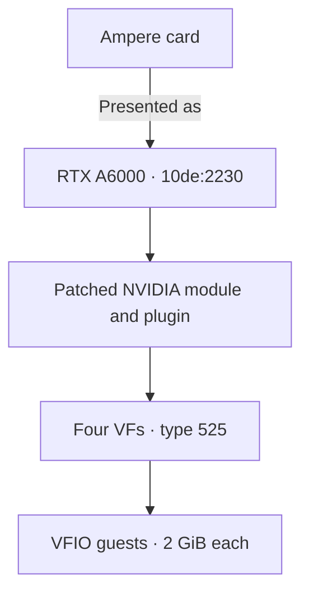
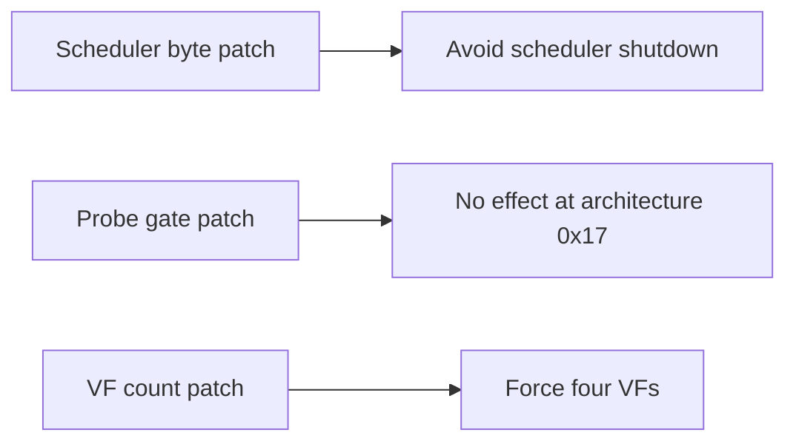
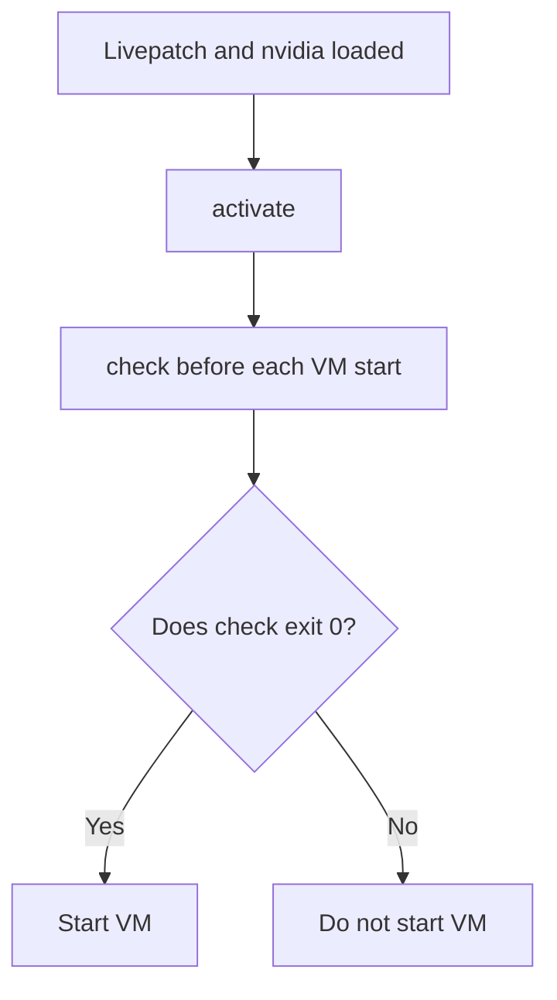

# Ampere support

This page covers Ampere GPUs such as the RTX 3080 or RTX 3090.
geforce-sriov splits a card into virtual functions (VFs), and each VF backs one vGPU, a slice of the GPU that you attach to one VM.
It presents the card to NVIDIA's vGPU software as a professional RTX A6000.

## What you need to know

- Every Ampere card is presented as the RTX A6000 and gets 4 VFs by default. The default vGPU type is 525 (RTXA6000-2Q, 2 GB).
- Use host driver 580.159.01, a Linux guest driver 580.159.03 and a Windows guest driver 582.53. Other versions are **not** guaranteed to work.
- Every guest needs the setting `RMSetVgpuGspPluginOffloadMode=0` ([Guests and VMs](#guests-and-vms)).
- Pick a vGPU type that fits your card's VRAM ([Choosing a vGPU type](#choosing-a-vgpu-type)).
- The limits of this generation are in [Known limits](#known-limits).

## At a glance

Key facts for this generation; the terms in the table are explained below it.

| Item | Value |
|---|---|
| Device IDs | Every Ampere row in [devices.md](devices.md#rows). Tested card: `10de:2206` (RTX 3080 20GB) |
| Laptop GPUs | Supported through the same path as the desktop cards ([Laptop support](laptops.md)). No laptop GPU has been tested |
| Presented as | RTX A6000, `10de:2230` |
| VFs per card | 4 |
| Host driver | NVIDIA vGPU software 19.5, host driver 580.159.01, vGPU-KVM proprietary build, CPU-side mode with `NVreg_EnableGpuFirmware=0`, GSP not used |
| vGPU plugin | The patched plugin copy this package makes from the 580.159.01 stock plugin (SHA-256 `aa4fdeb5…`) |
| NVIDIA's module | `nvidia.ko` built from the 580.159.01 object with its three byte patches |
| Linux guest | 580.159.03 |
| Windows guest | 582.53 |
| Guest setting | `RMSetVgpuGspPluginOffloadMode=0` |
| Default vGPU type | 525, RTXA6000-2Q, 2048 MiB |
| Status | supported |

Terms in the table:

- *Presented as* is the professional card that NVIDIA's vGPU software is told this card is, with its PCI device ID (the model number a card reports on the PCI bus).
- *vGPU-KVM* is NVIDIA's host package for KVM hypervisors.
- *CPU-side mode* means the driver does its management work on the host CPU instead of the GPU's on-board firmware processor ([GSP](glossary.md)).
- *The five byte patches* are small changes to a few bytes of NVIDIA's own files that `install` makes in copies of your files: three in NVIDIA's module and two in the vGPU plugin ([byte patches](driver-patch.md#byte-patches)).
- *Guest setting* is a driver option you set inside the guest ([Guests and VMs](#guests-and-vms)).

The driver versions above are the recommended, tested ones.
Other versions are not guaranteed to work ([supported software stack](installation.md#supported-software-stack)).

## How it works

The overall mechanism is the same for every card: a livepatch (a kernel module that changes the running kernel, see the [glossary](glossary.md)) reveals the [SR-IOV](glossary.md) feature the card hides, the identity hook presents the card as a professional board, and `activate` creates the VFs and sets their type.
The README gives the short version ([How it works](../README.md#how-it-works)) and the [technical reference](technical-reference.md#how-it-works) the full one.
Three things are specific to Ampere:

- Identity: Every Ampere card is presented as the RTX A6000, whatever its model, and its default type is 525 (RTXA6000-2Q), which takes 2048 MiB per vGPU.
- NVIDIA host driver setup: Ampere uses the same three byte patches for NVIDIA's module (`nvidia.ko`) and the same patched plugin copy as Ada ([byte patches](driver-patch.md#byte-patches)).
  Without the scheduler patch, a callback in the driver disables the GPU's runlist scheduler (the part that schedules work on the GPU) and guest work stalls.
  The VF-count patch forces a total of 4 VFs (TotalVFs, how many VFs the card says it can have) on every TU/GA/AD card (Turing, Ampere and Ada chips) bound to NVIDIA's module.
  Ampere cards report 16, and 4 is the count the package presents.
- Probe gate: The Ada probe-gate patch makes no difference on Ampere, because it only lifts a check that Ampere cards already pass.

With the default vGPU type:

### With the other generation

A host can hold Ampere and Ada cards together: select each card with its own `--device`.
The shared NVIDIA module (`nvidia.ko`), the one patched plugin, the per-generation types (`type_ampere`, 525 by default) and the host-wide recovery rule are described once in [Combining generations](devices.md#combining-generations).
For Ampere, the practical effect is that NVIDIA's module forces four VFs on every card bound to it, so an Ampere card beside an Ada card still presents four.
See [Ada](ada.md#with-the-other-generation) for the Ada side.

### Choosing a vGPU type

A vGPU type sets how much of the card's VRAM each vGPU gets. NVIDIA also calls a vGPU type a profile.
The name ends in the size: in `RTXA6000-2Q`, the `2Q` means 2 GB.
The card offers the RTX A6000 types.
Its Q types are:

| Type | Name ends in | Size |
|---|---|---|
| 524 | 1Q | 1 GiB |
| 525 | 2Q | 2 GiB |
| 526 | 3Q | 3 GiB |
| 527 | 4Q | 4 GiB |
| 528 | 6Q | 6 GiB |
| 529 | 8Q | 8 GiB |
| 530 | 12Q | 12 GiB |
| 531 | 16Q | 16 GiB |
| 532 | 24Q | 24 GiB |
| 533 | 48Q | 48 GiB |

NVS-class types are offered too.
The list is **not** filtered by the card's memory, so pick a vGPU type that fits your VRAM.
Set the type with `type_ampere=` in the config; every VF of the card gets it.
How to pick a size, and why a vGPU type that looks like it fits can still fail, is in [Choosing a vGPU type](installation.md#choosing-a-vgpu-type).

## NVIDIA host driver setup

`install` applies the same three byte patches for NVIDIA's module and two plugin byte patches as on Ada ([NVIDIA host driver setup on Ada](ada.md#nvidia-host-driver-setup)), and writes the GSP-off driver parameter `options nvidia NVreg_EnableGpuFirmware=0` to `/etc/modprobe.d/` unless a file there already sets it to 0.
The build mechanics (digest checks, the comparison with a stock build, the manual path for `--driver=skip`) are in [driver-patch.md](driver-patch.md#what-install-does).
For other host driver versions, see [Status of every row](devices.md#status-of-every-row).
To have `install` take NVIDIA's `.run` package as well, see `--driver-file`, `--accept-nvidia-license` and `--nvidia-source` in [Automated setup](installation.md#automated-setup).

The byte patches for the shared NVIDIA module have these effects on Ampere (details in [How it works](#how-it-works)):

## Bring-up differences

Ampere follows [Cold boot](installation.md#cold-boot).
If a selected card is the boot display GPU, `activate` also hands its display to NVIDIA's display modules ([Boot display card](installation.md#boot-display-card)).
After the boot units have loaded the livepatch and NVIDIA's driver, the same `activate` and `check` steps apply as on Ada ([Ada bring-up differences](ada.md#bring-up-differences)):

## Guests and VMs

The package installs nothing in a guest.
Use the drivers in the [supported stack](installation.md#supported-software-stack) and set `RMSetVgpuGspPluginOffloadMode=0` as [Guests](installation.md#guests) describes: a modprobe option (a line in `/etc/modprobe.d/`) in a Linux guest, a registry DWORD in a Windows guest.

Each VF backs one vGPU of the default type.
Attach it as a plain VFIO device, which is how Linux hands a PCI device to a VM ([Create a VM](installation.md#create-a-vm)).
You need to handle licensing separately.

## Screenshots

All three show an Ampere setup with NVIDIA's vGPU host driver 580.159.01.

`nvidia-smi` on the Proxmox VE host lists two physical Ampere cards, at `03:00.0` and `04:00.0`.
Three vGPUs were running, each a 4 GiB vGPU (4032 MiB in the process list).

A Debian 12 guest desktop.
`fastfetch` on the left shows the guest's specs.
On the right, `nvidia-smi` shows the vGPU as `NVIDIA RTXA6000-4Q` with 4096 MiB and guest driver 580.159.03, with a CUDA test program running on it.

A Windows 11 guest.
Settings > About, the NVIDIA Control Panel (version 582.53) and GPU-Z all show the vGPU as `NVIDIA RTXA6000-4Q` with 4 GB.
GPU-Z reports the device as `10DE 2230 - 10DE 14FF`, which is the vendor and device ID, then the subsystem vendor and ID.

The guests see a vGPU type called `RTXA6000-4Q`, not the GeForce name: geforce-sriov presents the card to NVIDIA's vGPU software as the professional board (RTX A6000) whose vGPU types it uses.
The Windows screenshot was taken in a guest with its own licence setup.
Licensing is outside this project.

## Performance

The same PyTorch benchmark ran on one memory-modded RTX 3080 20GB in two places: on the host, using the card's physical GPU directly, and in a VM with one 4 GiB vGPU on the same card.
Nothing else ran on the card.

| Benchmark | Host (LXC, physical GPU) | VM (vGPU) | VM / host |
|---|---|---|---|
| FP32 matmul (TFLOPS) | 20.47 | 20.54 | 1.003 |
| FP16 matmul, tensor cores (TFLOPS) | 58.35 | 58.54 | 1.003 |
| Device memory copy (GB/s) | 681.7 | 704.4 | 1.033 |

Each value is the median of three runs.
A VM / host value above 1 means the VM was faster.
On matmul, the vGPU in the VM performed within 1% of the host.
The memory copy was 3% faster in the VM.
The card's memory clock was 2.7% higher during the VM runs (9501 MHz against 9251 MHz), close to the memory-copy difference.

Method:

- Host: an LXC container on the Proxmox VE host, running CUDA on the card's physical GPU next to
  NVIDIA's vGPU host driver 580.159.01.
- VM: one 4 GiB vGPU (`RTXA6000-4Q`) with guest driver 580.159.03.
- Both sides used the same Debian root file system, the same PyTorch environment, the same four
  pinned host CPU cores and 8 GiB of memory.
- Workloads: a 4096 × 4096 matrix multiply in FP32 and in FP16, and a 1 GiB copy within the GPU's memory.
  Each was timed over a 15 s window, after one warm-up run, and its results were checked.
- The SM clock was about 1905 MHz throughout, power stayed at the card's 320 W limit, and the peak
  temperature was 66 °C, with no thermal throttling.

## Known limits

- `vfs` accepts values from 1 to the card's ceiling, 16 on Ampere.
  NVIDIA's patched driver uses at most 4 VFs per card.
  The VFs take functions 4 to 7 of the card's slot, and ARI decoding in the GPU beyond function 7 does **not** work ([Capability positions](devices.md#capability-positions-per-generation)).
- The open driver flavour and the GSP route are **not** supported ([NVIDIA driver flavour](devices.md#nvidia-driver-flavour)).
