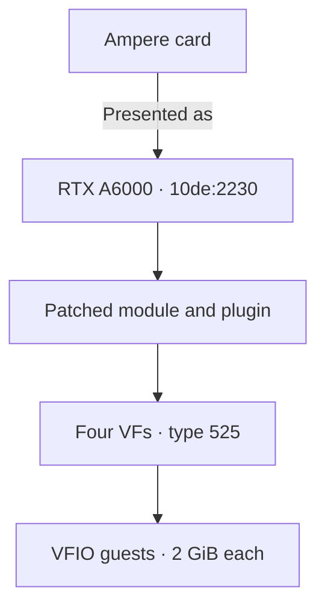
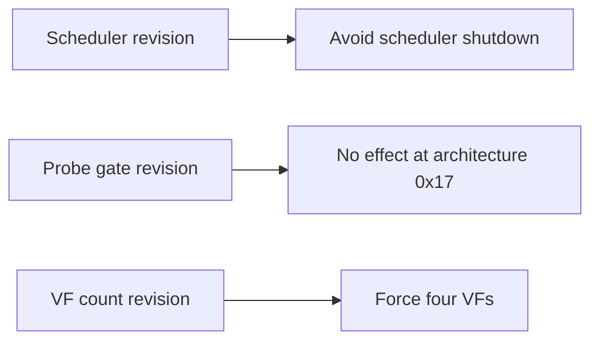
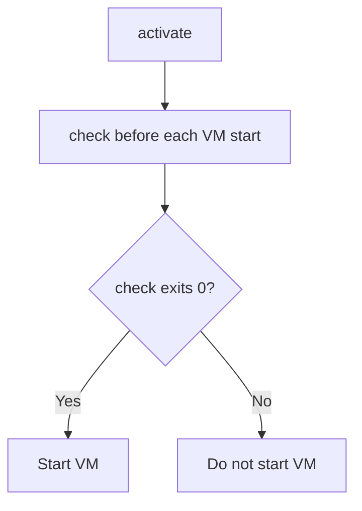

# Ampere support

## At a glance

| Item | Value |
|---|---|
| Device IDs | Every Ampere row in [devices.md](devices.md#rows). Example card: `10de:2206` (RTX 3080 20GB) |
| Laptop GPUs | Supported through the same path as the desktop cards ([Laptop support](laptops.md)). No laptop GPU has been tested |
| Presented as | RTX A6000, `10de:2230` |
| VFs per card | 4 |
| Host driver | NVIDIA vGPU software 19.5, host driver 580.159.01, proprietary vGPU-KVM build. It runs on the CPU with `NVreg_EnableGpuFirmware=0`, so GSP is not used |
| vGPU plugin | The patched plugin copy geforce-sriov makes from the 580.159.01 stock plugin (SHA-256 `aa4fdeb5…`) |
| Host module | `nvidia.ko` built from the 580.159.01 object with the three revisions |
| Linux guest | 580.159.03 |
| Windows guest | 582.53 |
| Guest setting | `RMSetVgpuGspPluginOffloadMode=0` |
| Default vGPU type | 525, RTXA6000-2Q, 2048 MiB |
| Status | supported |

## How it works

- NVIDIA's vGPU stack does not list the GeForce cards.
  geforce-sriov reveals the card's hidden SR-IOV virtual functions (VFs). It presents the card to that stack as the RTX A6000, whatever its model.
- Ampere uses the same host stack as Ada: three object revisions and the patched plugin copy. See [revisions](driver-patch.md#revisions).
  Without the scheduler revision, guest GPU work stalls.
  The VF count revision forces 4 VFs on every card bound to the module, which is the count Ampere uses.
- The Ada probe-gate revision has no effect on Ampere.
  It replaces a two-byte conditional jump in an architecture check that rejects an architecture above `0x17`.
  An Ampere card is architecture `0x17`, so that branch was never taken.
- The default type, 525 (RTXA6000-2Q), takes 2048 MiB per vGPU.

With the default type:

### With the other generation

A host can hold Ampere and Ada cards together.
Select each card with its own `--device`. No other setting is needed.
See [Ada](ada.md#with-the-other-generation) for the Ada side.

- One module and one plugin serve both generations, alone or together, with the same bring-up procedure.
  Both use the patched plugin copy.
  On 580.159.01, `activate` refuses any plugin other than the patched copy, NVIDIA's stock plugin included.
  On another host driver version, `activate` prints that the version is **not guaranteed to work** and continues.
- The module forces four VFs on every card bound to it, so an Ampere card beside an Ada card presents four VFs too.
- Each generation has its own type: `type_ada` and `type_ampere` in the config, by default 942 on Ada and 525 on Ampere.
- `--type` is refused on a mixed selection ([commands](configuration.md#commands)).
  Set the two config keys instead, or narrow `check` to one generation with `--device`.
- `status` and `install --dry-run` warn when a selection mixes Ada with another generation.
  Apart from `--type`, nothing refuses a mixed host.
- The recovery rule is host-wide. If any card disappears from `lspci` or the host cannot be reached, cold power cycle the whole machine. See [the one rule](recovery.md#the-one-rule).

### Choosing a vGPU type

A vGPU type, also called a profile, sets how much of the card's memory each vGPU gets.
The card offers the RTX A6000 types.
Its Q types are:

| Type | Profile | Size |
|---|---|---|
| 524 | 1Q | 1 GiB |
| 525 | 2Q | 2 GiB |
| 526 | 3Q | 3 GiB |
| 527 | 4Q | 4 GiB |
| 528 | 6Q | 6 GiB |
| 529 | 8Q | 8 GiB |
| 530 | 12Q | 12 GiB |
| 531 | 16Q | 16 GiB |
| 532 | 24Q | 24 GiB |
| 533 | 48Q | 48 GiB |

NVS-class types are offered too.
The list is not filtered by the card's memory.
Set the type with `type_ampere=` in the config. Every VF of the card gets it. See [Choosing a vGPU type](configuration.md#choosing-a-vgpu-type).

> [!IMPORTANT]
> Choose vGPU types that fit your card's physical VRAM.
> All the vGPUs you run at once must fit in the VRAM together, with some room left over because the host driver uses part of the memory too.
> For example, four `4Q` vGPUs need 16 GB plus the host driver's share. They fit a 24 GB card and do not fit a 16 GB card.

## Host stack

`install` applies the NVIDIA changes to copies of your own files:

- It applies the three object revisions to a copy of your own `nv-kernel.o_binary`, in order. When an Ada card is selected, it adds one more. A build with the display modules applies the display revision after the last one. It then builds and installs `nvidia.ko` from the output of the last one. See [revisions](driver-patch.md#revisions).
- It applies the two plugin revisions to a copy of your own `libnvidia-vgpu.so` and points the symlink `libnvidia-vgpu.so` at the plugin copy.
- It writes the module option.

`install` checks every step. On 580.159.01 each result must match a recorded SHA-256 digest.
Another version is built best effort and is **not guaranteed to work**. A file `install` cannot patch is refused with the reason. See [Supported inputs](driver-patch.md#supported-inputs).
The finished module is compared with your stock module, and any other difference is refused. See [Compare with a stock build](driver-patch.md#compare-with-a-stock-build).
When no selected GPU is Ada, the VM video memory change is **not** applied.
On a mixed host the module carries it. See [VM video memory](ada.md#vm-video-memory).
With `--driver=skip`, you must perform those steps yourself. See [The manual path](driver-patch.md#the-manual-path).

- Module option: `options nvidia NVreg_EnableGpuFirmware=0`. `install` writes it to
  `/etc/modprobe.d/` unless a file there already sets it to 0.
- Plugin: the patched plugin copy, the same one Ada uses. See [Ada host stack](ada.md#host-stack).
- Use the host and guest driver versions in the [supported software stack](installation.md#supported-software-stack).
  Other versions are **not guaranteed to work**.
  `install` builds another host driver version best effort when it finds the code it patches. `setup` asks first, and `--allow-unsupported-driver` answers yes. 580.159.01 is the only confirmed version.
  On the manual path (`--driver=skip`), `status`, `check` and `activate` print that the host driver is not guaranteed to work and continue.
- To have `install` take NVIDIA's `.run` package as well, see `--driver-file`,
  `--accept-nvidia-license` and `--nvidia-source` in
  [One command from a clean host](installation.md#one-command-from-a-clean-host).

The shared module's revisions have these effects on Ampere:

## Bring-up differences

Ampere follows [Cold boot](installation.md#cold-boot).
A boot display GPU is handled inside `activate`. It is refused unless the display modules are installed, and the activation transaction hands off its console. See [Boot display GPU](installation.md#boot-display-gpu).
The same activation and VM-start gates apply:

## Guests and VMs

geforce-sriov installs nothing in a guest.
Use the drivers in the [supported stack](installation.md#supported-software-stack) and set `RMSetVgpuGspPluginOffloadMode=0`. It is a modprobe option in a Linux guest and a registry DWORD in a Windows guest. See [Guests](installation.md#guests).

Each VF backs one vGPU of the default type.
Attach it as a plain VFIO device. See [Create a VM](installation.md#create-a-vm).
You must handle licensing separately.

## Screenshots

All three show an Ampere setup with NVIDIA's vGPU host driver 580.159.01.

`nvidia-smi` on the Proxmox VE host lists two physical Ampere cards.
Three vGPUs were running. Each was a 4 GiB vGPU, shown as 4032 MiB in the process list.

A Debian 12 guest desktop.
`fastfetch` on the left shows the guest's specs.
On the right, `nvidia-smi` shows the vGPU as `NVIDIA RTXA6000-4Q` with 4096 MiB and guest driver 580.159.03. A CUDA test program is running on it.

A Windows 11 guest.
Settings > About, the NVIDIA Control Panel and GPU-Z all show the vGPU as `NVIDIA RTXA6000-4Q` with 4 GB. The Control Panel is version 582.53.
GPU-Z reports the device as `10DE 2230 - 10DE 14FF`.

The guests see a vGPU profile called `RTXA6000-4Q`, not the GeForce name. geforce-sriov presents the card to NVIDIA's vGPU software as the professional RTX A6000, and the guests get that board's profiles.
The Windows screenshot was taken in a guest with its own licence setup.
Licensing is outside this project.

## Performance: vGPU VM vs host

The same PyTorch benchmark ran on one memory-modded RTX 3080 20GB in two places. One run was on the host, using the card's physical GPU directly. The other was in a VM with one 4 GiB vGPU on the same card.
Nothing else ran on the card.

| Benchmark | Host (LXC, physical GPU) | VM (vGPU) | VM / host |
|---|---|---|---|
| FP32 matmul (TFLOPS) | 20.47 | 20.54 | 1.003 |
| FP16 matmul, tensor cores (TFLOPS) | 58.35 | 58.54 | 1.003 |
| Device memory copy (GB/s) | 681.7 | 704.4 | 1.033 |

Each value is the median of three runs.
A VM / host value above 1 means the VM was faster.
On matmul, the vGPU in the VM performed within 1% of the host.
The memory copy was 3% faster in the VM.
The card's memory clock was 2.7% higher during the VM runs, 9501 MHz against 9251 MHz. That is close to the memory-copy difference.

Method:

- Host: an LXC container on the Proxmox VE host, running CUDA on the card's physical GPU next to
  NVIDIA's vGPU host driver 580.159.01.
- VM: one 4 GiB vGPU (`RTXA6000-4Q`) with guest driver 580.159.03.
- Both sides used the same Debian root file system, the same PyTorch environment, the same four
  pinned host CPU cores and 8 GiB of memory.
- Workloads: a 4096 × 4096 matrix multiply in FP32 and in FP16, and a 1 GiB copy within the GPU's memory.
  Each was timed over a 15 s window, after one warm-up run, and its results were checked.
- The SM clock was about 1905 MHz throughout. Power stayed at the card's 320 W limit, and the peak
  temperature was 66 °C. There was no thermal throttling.

## Known limits

- `vfs` accepts values from 1 to the card's ceiling: 16 on Ampere and `28b0`, 4 on other Ada cards. NVIDIA's patched driver uses at most 4 VFs per card.
- NVIDIA's open kernel module, and running the driver on the GPU's own processor (GSP), are not supported.
