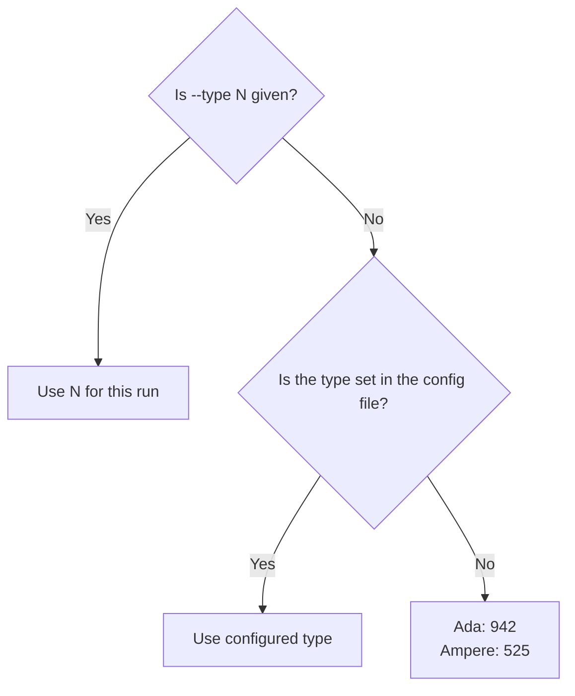
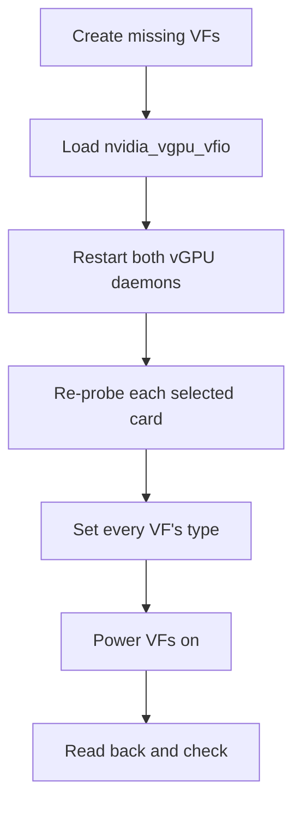
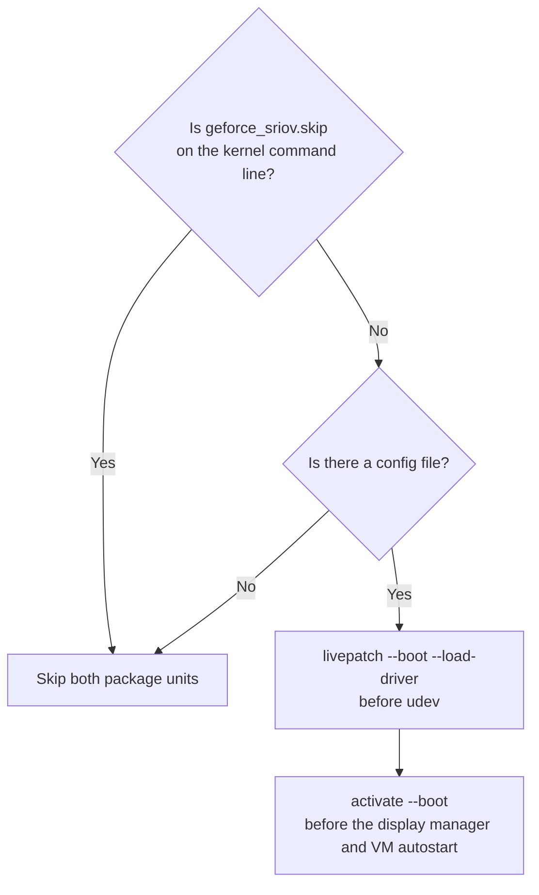

# Configuration and commands

This page is the reference for an installed host: the configuration file, every command and its options, exit codes, the systemd units and the parameters of the livepatch module (`geforce_sriov`).
For the first install, follow the [installation guide](installation.md) instead.
For what to do when something fails, see [Recovery](recovery.md).
Terms such as PF, BDF, VF, vGPU, livepatch, ARI, DKMS and the activation lock are explained in the [Glossary](glossary.md).

## Common changes

The most frequent changes, each with the command to use.
The full reference follows below.

- VFs per card: set `vfs=N` in `/etc/geforce-sriov/config`, or run `sudo ./geforce-sriov install --vfs N` from the source folder, which writes it.
  The default is 4, and the ceiling is the card's own count ([Configuration file](#configuration-file)).
  Power the machine fully off and on afterwards.
- vGPU type (the size of each vGPU): set `type_ada=N` or `type_ampere=N` in the config.
  Stop the VMs, write `0` to `nvidia/current_vgpu_type` of every VF of the card, then run `sudo geforce-sriov activate`. No power cycle is needed ([Choosing a vGPU type](#choosing-a-vgpu-type)).
- Display on or off for the boot display GPU: run `sudo ./geforce-sriov install --display` or `--no-display` from the source folder.
  `--display` needs the second NVIDIA driver package and NVIDIA's public kernel module source ([Boot display card](installation.md#boot-display-card)).
- Host CUDA on or off: run `sudo ./geforce-sriov install --host-cuda` or `--no-host-cuda` from the source folder.
  `--host-cuda` needs the second NVIDIA driver package ([Host CUDA](installation.md#host-cuda)).
- Applying a change: the switches and the VF count are read once, when the livepatch module loads at boot, so changing them takes a cold power cycle, **not** a reboot.
  A vGPU type change takes only `activate`. [Turn features off](recovery.md#turn-features-off) lists the switch for each symptom.

## Configuration file

The configuration file holds your card selection, the feature switches, the VF count and the vGPU type for each generation.
`install` writes it, and you can edit it afterwards.

- The path is `/etc/geforce-sriov/config`.
  `doctor`, `status`, `check`, `activate`, `livepatch` and `uninstall` read the path in `$GEFORCE_SRIOV_CONFIG` instead when it is set.
  `install` always uses `/etc/geforce-sriov/config`, and `setup` refuses a `$GEFORCE_SRIOV_CONFIG` that names an existing file other than that one.
- The file holds one `key=value` per line, with `#` comments and no spaces.
  A repeated key is refused.
  The identity hook (the small library that presents each selected card as a professional card to NVIDIA's vGPU software, see the [Glossary](glossary.md)) reads the same file.
- The file must be owned by root and **not** writable by group or others.
  Commands refuse it otherwise, because a root daemon acts on what it says.
- An annotated copy is installed as `/usr/local/share/geforce-sriov/config.example` ([config/config.example](../config/config.example)).

| Key | Values | Default | Meaning |
|---|---|---|---|
| `bdfs` | 1-8 card addresses (PCI addresses such as `0000:03:00.0`, as `lspci -D` prints them), comma-separated | none | Cards that the livepatch module, `activate` and the hook act on. The rebuilt `nvidia.ko` applies to every card bound to it, selected or not ([Install steps](driver-patch.md#what-install-does)) |
| `display` | `auto`/`on`/`off` | `auto` | `auto` builds NVIDIA's display modules (`nvidia-modeset` and `nvidia-drm`, which keep the screen working) when a selected GPU is the boot display, the card that shows the BIOS/UEFI screen at power-on. `on` asks for them explicitly, but they are built only when a selected GPU is the boot display, because the display goes only to that card. `off` builds none. The build needs a second NVIDIA driver package and NVIDIA's public kernel module source ([Boot display card](installation.md#boot-display-card)) |
| `host_cuda` | `on`/`off` | `off` | Builds `nvidia-uvm`, NVIDIA's kernel module for CUDA, and installs NVIDIA's CUDA library (`libcuda`) from the second NVIDIA driver package, so CUDA programs can run on the host. Needs that package ([Host CUDA](installation.md#host-cuda)) |
| `fb_slots` | `auto`/`on`/`off` | `auto` | Ada cards only. `auto` and `on` keep each VF's framebuffer slot (its range of the card's VRAM) reserved, so a host program cannot take the memory of a stopped VM. The slots stay reserved while the VMs are stopped. `off` releases them at the next `activate`, and `install` and `rebuild` then build NVIDIA's module without that code ([Reserved VM memory](ada.md#reserved-vm-memory)) |
| `ari` | `on`/`off` | `on` | Reveal the card's hidden ARI capability (a PCIe addressing extension that lets one card expose more functions, which the VFs need) and turn on ARI forwarding in the bridge above it (the PCIe port the card plugs into). `pci=noari` on the kernel command line forces it off. ARI decoding in the GPU hardware does not work, so `vfs` defaults to 4 either way |
| `msix` | `on`/`off` | `on` | Reveal the card's hidden MSI-X interrupts (the interrupt mechanism the card's functions use to signal the CPU) |
| `vfs` | 1 up to the card's ceiling (below) | `4` | VFs (virtual functions, the slices of a card, one per VM) presented per selected card. `install --vfs N` writes it |
| `identity` | `on`/`off` | `off` (`install` sets `on`) | Let the hook present the selected cards to NVIDIA's vGPU software as their professional counterpart (the RTX A6000 for Ampere, the RTX 6000 Ada for Ada), which the software accepts and a GeForce card it does not |
| `identity_force_host` | `on`/`off` | `off` (`install` sets `on`) | Let the hook also report vGPU host mode for the selected cards, the driver mode that serves vGPUs to VMs |
| `sriov_manage` | absolute path | `/usr/lib/nvidia/sriov-manage` | NVIDIA's script for creating VFs, which `activate` runs for a card that has none |
| `type_ada` | vGPU type ID | `942` | The vGPU type that `activate` sets on each VF of an Ada card and that `check` expects ([Choosing a vGPU type](#choosing-a-vgpu-type)) |
| `type_ampere` | vGPU type ID | `525` | The same for an Ampere card |
| `d3cold` | `off` | none (no consent) | Records consent to keep the selected laptop GPUs powered. D3cold is the PCIe state in which an idle GPU is powered off, which erases its VF setup. Without the key, `setup` and `activate` refuse the run and `doctor` fails if a laptop GPU is selected. `install --disable-d3cold` writes the key, and any value other than `off` is refused ([Consent](laptops.md#consent)) |

The ceiling for `vfs` is the card's hardware default (its TotalVFs, the VF count the card itself advertises), except on an Ada card that reports 1.
On those Ada cards, the VF-count byte patch of NVIDIA's patched module (a small change to a few bytes of NVIDIA's driver, see [Byte patches](driver-patch.md#byte-patches)) sets the ceiling to 4, and NVIDIA's patched driver uses at most 4 VFs per card.
`install` and `doctor` refuse a `vfs` above the ceiling and warn about a value above 4.
`doctor` shows both counts, for example "hardware default 1, geforce-sriov presents 4 (default)".

A file that contains `experimental_vfs` or `twin_id` is refused as a whole, because those keys do not exist (for example `line 5: unknown key 'twin_id'; delete this line`).
`boot_display_release` is obsolete in the same way: a config that contains it is refused, `install` removes the line from a config it wrote, and `display` replaces it.

The switches and the VF count are read once, when the `geforce_sriov` kernel module loads early in boot.
To change them, edit the file (or run `install` again), then power the machine fully off and on, as for the first boot after install.
This takes a cold power cycle, **not** a reboot ([Reboot or power-off](recovery.md#reboot-or-power-off)).
[Turn features off](recovery.md#turn-features-off) lists the switch to use for each symptom.

### Choosing a vGPU type

A vGPU type (NVIDIA also calls it a profile) sets how much of the card's VRAM each vGPU gets, and every VF of a card carries the same type.
`activate` and `check` use the first applicable value in this order:



The boot unit, `setup` and a plain `activate` or `check` use the file, so set the type there to keep it across boots.
`--type N` applies to one run and requires a selection of one generation.
On a mixed host, the two keys give each generation its own type.
An unknown value in the file is refused with its line number, for example `line 4: type_ada must be a vGPU type ID from 1 to 999999, as nvidia/creatable_vgpu_types lists it`.

[Choosing a vGPU type](installation.md#choosing-a-vgpu-type) in the installation guide covers how to pick a type, the steps to change a card's size, and why the types must fit your card's VRAM.
In short, the type list comes from the professional card and the tool does not filter it, so a type that looks like it fits can still fail on the driver's per-VF allocation limits.
To see what a card offers, run `nvidia-smi vgpu -s` before a type is set, or use the lists in [Ada](ada.md#choosing-a-vgpu-type) and [Ampere](ampere.md#choosing-a-vgpu-type).

On an Ada card, each VF has a fixed framebuffer slot (the range of the card's VRAM that the VF uses as its video memory), and the slot of a later VF ends higher in the card's memory.
With a large type, the last VFs may not start a VM even when the card is otherwise empty and the type is set.
After setting the types, `activate` prints one line for such a card, for example:

```text
0000:03:00.0: with type 946 the VFs 0000:03:00.5, 0000:03:00.6 and 0000:03:00.7 may not start: their framebuffer slots end near the top of the card's 16376 MiB. Put VMs on the lower VFs, or choose a smaller type.
```

This message is advisory: `activate` still sets the type and its exit status does not change.
It needs NVIDIA's `/usr/share/nvidia/vgpu/vgpuConfig.xml` (the file that lists the vGPU types) and `nvidia-smi`; without either, it prints nothing.
Ampere cards get no such line.

## Commands

| Command | Root | Purpose |
|---|---|---|
| [`geforce-sriov devices`](#devices) | no | Print the device table |
| [`geforce-sriov doctor`](#doctor) | no | Inspect the host without changes |
| [`geforce-sriov status`](#status) | no | Show card state and next steps |
| [`geforce-sriov setup`](#setup) | yes | Run the guided setup |
| [`geforce-sriov install`](#install) | yes | Install files and driver changes, from the source folder |
| [`geforce-sriov rebuild`](#rebuild) | yes | Build NVIDIA's patched module again after a kernel update |
| [`geforce-sriov activate`](#activate) | yes | Bring the selected GPUs up: create and configure VFs |
| [`geforce-sriov livepatch`](#livepatch) | yes | Load the livepatch (the `geforce_sriov` kernel module that reveals the SR-IOV feature the card hides) and, for the boot unit, NVIDIA's driver |
| [`geforce-sriov check`](#check) | no | Check readiness before VM start |
| [`geforce-sriov uninstall`](#uninstall) | yes | Remove files and restore stock files |
| [`geforce-sriov-patch`](#driver-patcher) | no | Inspect, apply or revert driver patches |

Exit codes:

| Code | Meaning |
|---|---|
| 0 | Ok |
| 1 | Failed |
| 2 | Usage error |
| 3 | Refused (nothing changed) |
| 4 | Another `geforce-sriov` is running |
| 5 | Activation lock set (cold power cycle needed) |

`install` exits 1, **not** 3, when it fails or refuses after it has written anything.
Exit 5 always means the activation lock is set (the marker file that stops `activate` after an unfinished attempt); [The activation lock](recovery.md#the-activation-lock) explains what to do.

### devices

`geforce-sriov devices` prints the device table: the cards the package knows, which [Supported cards](devices.md) describes.

### doctor

`geforce-sriov doctor` checks the host and cards and shows what `activate` would do.
It changes nothing, so run it before `install` and whenever something looks wrong.
[What doctor checks](installation.md#what-doctor-checks) explains each check from the user's side, and [doctor and status](technical-reference.md#doctor-and-status) covers the implementation.

Options:

- `--device BDF`, repeatable.
- `--display` or `--no-display`, `--host-cuda` or `--no-host-cuda`, `--companion-file PATH` or `--companion-source DIR`, `--nvkms-source PATH`: check the build `install` will make with those options.
  `doctor` fails when the build needs a file that is missing, such as the second NVIDIA driver package or NVIDIA's kernel module source.
- `--disable-d3cold`: assess the selected laptop GPUs as if D3cold consent were recorded by `install --disable-d3cold`.
  It needs at least one laptop GPU among those assessed; otherwise `doctor` exits 2.
- `--nvidia-source DIR`, `--driver-file PATH` or `--driver=skip`: check the host as `install` with that option will leave it.
- `--sysfs-root PATH`.
- `--config FILE`.

The recommended host driver version is 580.159.01.
Any other version is not guaranteed to work and gets a warning, **not** a failure.

#### Configuration and module reports

Without a config file, `doctor` reports:

- Without `--device`: `[INFO] config: /etc/geforce-sriov/config absent; defaults apply and no device is selected`.
- With `--device`: `… absent; the selected devices come from --device`.

It says whether the installed `nvidia.ko` is the build `install` made.
Before `install` has built NVIDIA's module on the host (no record and no install manifest), it says `[INFO] NVIDIA's module has not been built on this host yet; install builds it`. On such a host, what is not installed yet (the livepatch module, the boot units, the `nvidia-vgpud` drop-in) is also `[INFO]`, not `[WARN]`.

When the installed `nvidia.ko` is the build `install` made but the loaded `nvidia` module is not, it warns:
`the running nvidia module (build-id …) is not the installed one (…); power the machine off and on to load it`.

#### Activation and service warnings

While `/run/geforce-sriov/activating` exists, it warns:
`/run/geforce-sriov/activating exists: geforce-sriov activate is running or did not finish; check reports NOT READY until activate succeeds`.

When a file in `/etc/modprobe.d/` (the rules for loading kernel modules) still holds `nvidia` back, it warns that the livepatch unit cannot load the driver and names the file, or the two lines to remove.

When another drop-in of `nvidia-vgpud` or `nvidia-vgpu-mgr` sets `LD_PRELOAD` (the setting that makes a process load a library first, which is how the hook gets loaded), it warns:
`<file> sets LD_PRELOAD for <unit> and overrides the geforce-sriov identity hook. Remove it or point it at <hook path>.`
The package's own `geforce-sriov.conf` is excluded.
In `nvidia-vgpud.service.d`, only a file that systemd reads after `geforce-sriov.conf` counts, because the last `LD_PRELOAD` wins.

### status

`geforce-sriov status` shows each selected card's state and next step, so it is the quickest way to see where a host stands.
It exits 0 when every selected VF is ready, the activation lock is clear and the installed build matches what `display` and `host_cuda` ask for, and 1 otherwise.
[`check`](#check) is the per-VM-start gate.

Options:

- `--device BDF`, repeatable.
- `--sysfs-root PATH`.
- `--config FILE`.

Each Ada or Ampere card's line says whether the installed `nvidia.ko` is the build `install` made.
It adds the warning about the loaded `nvidia` module under the same conditions as [doctor](#doctor).
In that case the first next step is `next: power the machine off and on (the running nvidia module is not the installed one)`, and `status` exits 1.

While `/run/geforce-sriov/activating` exists, `status` prints `activate: /run/geforce-sriov/activating exists (activate is running or did not finish)` and exits 1.
Unless the loaded `nvidia` module is not the installed build, it also prints `` next: stop every VM that uses a vGPU, then run `geforce-sriov activate` ``.

### setup

`geforce-sriov setup` is the guided path from a clean host to ready VFs.
Run it as root.
It asks you for the information it needs (the package location, which GPUs to use, and so on), installs and configures the package and NVIDIA's patched module and plugin, brings the GPUs up and checks every VF.
It creates no VM.
[Automated setup](installation.md#automated-setup) walks through it as a user.

A cold power cycle (switching the machine fully off and on) splits the run in two parts:

1. Before the power cycle, `setup` asks its questions, then runs `doctor` and `install`.
   `install` copies the package's files, selects the cards, sets the VF count, patches and installs NVIDIA's module and vGPU plugin (the library that `nvidia-vgpu-mgr` loads to run vGPUs), and enables the two boot units.
   If NVIDIA's driver is not loaded yet, `setup` carries on in the same run with `activate` and `check`.
   If it is already loaded, `setup` tells you to power the machine off and on.
2. Run the same command again after the power cycle.
   `setup` runs `check`.
   If the VFs are not ready, it runs `doctor`, `install` when needed, `activate` and `check`.

`activate` creates the VFs, sets their vGPU type and powers them on, and `check` confirms that each VF is ready.

Options:

- `--device BDF`, repeatable: a card to select.
- `--vfs N`: VFs per card.
- `--display` or `--no-display`, `--host-cuda` or `--no-host-cuda`.
- `--companion-file PATH` or `--companion-source DIR`: NVIDIA's second driver package, as a `.run` file or an extracted copy ([Display and host CUDA builds](driver-patch.md#display-and-host-cuda-builds)).
- `--nvkms-source PATH`: NVIDIA's public kernel module source, a directory or a tarball.
- `--driver=skip`, `--driver-file PATH`, `--accept-nvidia-license`, `--nvidia-source DIR`.
- `--disable-d3cold`: records consent for laptop GPUs ([Consent](laptops.md#consent)).
- `--allow-unsupported-driver`: continue without asking when the host driver version is not the recommended 580.159.01.
  `install` ignores it.
- `--interactive` or `--no-prompt`.

`setup` passes each option to whichever of `doctor`, `install`, `activate` and `check` take it.

#### First install

Before a first install, `setup` asks for anything the options did not supply.
It asks when its input is a terminal or with `--interactive`, and `--no-prompt` never asks.
An option that answers a question skips it.
The questions come in this order:

1. The path to NVIDIA's vGPU host driver package (a `.run` file), if the host has no NVIDIA driver yet.
2. Whether to accept NVIDIA's licence and run NVIDIA's installer from that package.
   Answering no makes `install` extract the package and stop before it builds NVIDIA's module.
3. Which GPUs to select, as `all`, a number or numbers separated by commas.
   With exactly one eligible card, `setup` selects it without asking.
4. If any selected GPU is a laptop GPU, the D3cold notice, and whether to disable D3cold for those GPUs; the default is no.
   Answering yes passes `--disable-d3cold` to `doctor` and `install`, and declining stops `setup` with exit 3 before any step ([Consent](laptops.md#consent)).
   If `setup` cannot prompt, you must pass `--disable-d3cold`; otherwise it stops the same way.
5. Whether to build NVIDIA's CUDA module, so CUDA programs can run on the host; the default is no ([Host CUDA](installation.md#host-cuda)).
6. If a selected GPU is the boot display and the display build is on, or you chose host CUDA, the path to NVIDIA's second driver package.
   For the display build it also asks for the path to NVIDIA's public kernel module source.
   Answering `none` to the second driver package leaves those modules out.
   Without a terminal, or with `--no-prompt`, `setup` stops before installing and names the options to pass.

Then `setup` prints what it will run with, and the `setup --no-prompt` command that repeats the run without questions.

Before it changes anything, `setup` checks the host driver version.
The recommended version, 580.159.01, goes ahead.
Any other version is not guaranteed to work, so `setup` names it and asks whether to continue; the default is no.
`--allow-unsupported-driver` answers yes.
With `--no-prompt` or without a terminal, `setup` stops unless you pass that option.
`setup` refuses NVIDIA's open driver flavour in every case.

#### Installed host

Run the same command again after the power cycle.
On an installed host:

- `setup` reuses the config and runs `install` again only if the request or the host needs it.
- A `--device` selection that differs from the configured `bdfs` is refused.
- If a laptop GPU is selected and the config lacks D3cold consent, `setup` asks for it before `doctor`.
  Accepting or passing `--disable-d3cold` runs `install --driver=skip --disable-d3cold` and ends the run, and declining stops `setup` with exit 3.
- If a display manager (the service that shows the graphical login, such as gdm or sddm) is using a selected GPU, `setup` asks before it stops the manager for `activate`, and starts it again afterwards.
  With `--no-prompt` it refuses and prints the commands to run yourself.
- If the cards are not ready and the loaded `nvidia` module is not the installed build, `setup` runs `doctor` and `install`, then stops before `activate`.
  It exits 0, because the install completed, and tells you to power the machine off and on, then run `setup` again.

If NVIDIA's driver was already loaded when `setup` first installed, the livepatch could not load before it.
`setup` then finishes the install and asks for the power cycle ([Cold boot](installation.md#cold-boot)).

### install

`geforce-sriov install` puts the package on the host: it installs files, selects cards, sets the VF count, patches and installs NVIDIA's module and plugin, and enables the boot units.
After the build of NVIDIA's module succeeds, installation writes the vGPU drop-in and config.
With the display or host CUDA build on, it also builds those modules ([Boot display card](installation.md#boot-display-card), [Host CUDA](installation.md#host-cuda)).
Use it directly instead of `setup` when you want to run the steps one at a time ([Install](installation.md#install)).

Options:

- `--device BDF`, repeatable.
- `--display` or `--no-display`, `--host-cuda` or `--no-host-cuda`.
- `--companion-file PATH` or `--companion-source DIR`: NVIDIA's second driver package, as a `.run` file or an extracted copy.
- `--nvkms-source PATH`: NVIDIA's public kernel module source, a directory or a tarball.
- `--disable-d3cold`: records D3cold consent as `d3cold=off` for the selected laptop GPUs.
  Needs at least one selected laptop GPU.
  Passing `--device` without this option removes consent from the config.
- `--vfs N`.
- `--driver=skip`.
- `--driver-file PATH`: NVIDIA's `.run` package.
- `--accept-nvidia-license`: run NVIDIA's installer with that package.
- `--nvidia-source DIR`: NVIDIA's kernel tree.
- `--prefix PATH`.
- `--destdir PATH` (or `DESTDIR`): only stage files below `PATH`.
- `--source DIR`: install from this built tree instead of the binary's own directory.
- `--ari=on|off` and `--msix=on|off`.

Its output ends with the next steps: check `doctor`, power the machine fully off and on, and after the boot `geforce-sriov status` shows each GPU and its next step. Under `setup` it prints no next steps, because `setup` prints one closing block.
`install` runs from the source folder you built in. Run from the installed copy, it stops without changes and names `rebuild`.
When the build needs the second NVIDIA driver package or NVIDIA's public kernel module source, `install` keeps a copy for later kernels.
See [Install details](technical-reference.md#install-details), [Automated setup](installation.md#automated-setup) and [`--driver`](#--driver).

### rebuild

`sudo geforce-sriov rebuild [--kernel RELEASE]` builds NVIDIA's patched module and plugin again after a kernel update ([After a kernel update](installation.md#after-a-kernel-update)).
It runs from the installed copy, builds for the running kernel or for the installed kernel that `--kernel RELEASE` names, and needs no file paths: it builds the features the config selects, from the copies of the second NVIDIA driver package and NVIDIA's public kernel module source that `install` kept.
After a kernel update, use `--kernel` with the new release before you boot it, so one power cycle is enough.
Before it builds NVIDIA's module, it makes sure the livepatch module `geforce_sriov` is installed for that kernel, and runs `dkms install -m geforce-sriov -v <version> -k <kernel>` when it is not. If that fails, `rebuild` stops, names the command and leaves NVIDIA's module for that kernel as it was.
It stops without changes when the config is invalid or one of those kept copies is missing or was changed, and the message tells you to run `install` again from the source folder with that file.
When NVIDIA's own module for the kernel is not built yet, it tells you to install the kernel's headers and build it with `dkms install nvidia/<version> -k <kernel>` first.
After a successful rebuild, power the machine off and on.

### activate

`geforce-sriov activate` is the command to run after a boot.
It acts on every Ada and Ampere card selected by `bdfs`, and takes no `--device`.
Normally the activate unit has already run it ([Systemd units](#systemd-units)).

Options:

- `--type N`: set one type on every selected card for this run.
- `--dry-run`: run the checks and print what activation would do, without changing anything.
- `--boot`: used by the activate unit, which has a start timeout of 600 s.
  It never prompts and never stops a display manager, and it does nothing when `geforce_sriov.skip` is on the kernel command line (the options the bootloader passes to the kernel).
- `--stop-display-manager`: allow stopping a running display manager and starting it again.
  The boot unit never passes it.
- `--clear-lock`: clear the activation lock of an unfinished activation, only after a cold power cycle.
  It takes no other option ([The activation lock](recovery.md#the-activation-lock)).

The activation order is:



The two vGPU daemons are NVIDIA's `nvidia-vgpud` and `nvidia-vgpu-mgr`, and a re-probe makes the driver take over the card again.

Types follow [Choosing a vGPU type](#choosing-a-vgpu-type): `--type N`, then the generation's config key, then 942 on Ada or 525 on Ampere.
On Ada, it prints the advisory slot line described there when a VF's slot ends near the top of the card's memory.

On a host that is already active, `activate` does not create VFs, restart the daemons or re-probe a card: it changes nothing when every VF is ready, and otherwise it only sets the missing types and VF power state or loads the missing display and CUDA modules ([activate and the VF power gate](technical-reference.md#activate-and-the-vf-power-gate)).

#### Driver and selection checks

- It needs the patched plugin copy (SHA-256 `aa4fdeb5…`).
  On 580.159.01 it refuses the stock copy and an earlier copy with only the placement patch.
  On another host driver version, which is not guaranteed to work, it warns and continues.
- It refuses when the install record (where `install` notes which `nvidia.ko` it built) does not name the installed `nvidia.ko` for the running kernel, including a record made on another kernel.
  `install` on the running kernel rewrites the record.
  With no record at all, it only warns.
- If the loaded `nvidia` module is not the installed build, it prints [doctor](#doctor)'s warning about the loaded `nvidia` module and continues.
- It refuses a card in scope that is not in the device table.
- It refuses while a GPU outside `bdfs` has VFs.

See [Cold boot](installation.md#cold-boot) and [Combining generations](devices.md#combining-generations).

### check

Run `geforce-sriov check` before every VM start on Ada and Ampere.
It reads the state of each selected card's VFs and changes nothing.

Options:

- `--device BDF`, repeatable.
- `--type N`.
- `--daemon-ready`: the test the `nvidia-vgpud` drop-in runs before the daemon starts.
  It refuses while the activation lock is set, a selected card is missing, its VFs are not all enabled and bound to `nvidia`, or a BAR is unassigned (a BAR is an address range that the PCI bus gives to the card's memory or registers; the card is unusable without it).

It exits 0 only when every VF of every selected card:

- is on `nvidia`;
- has `power/control=on` (the VF is never put to sleep);
- has `runtime_status=active` (the VF is awake);
- on a laptop GPU, answers a read of its PCI config space (the register block the PCI bus uses to identify and control a device) at offset `0x08`;
- has the expected type: `--type N`, else `type_ada` or `type_ampere` from the config, else 942 on Ada and 525 on Ampere.

Otherwise it exits 1, or 3 for a configuration or selection it refuses.
On a mixed Ada and Ampere selection, `check` refuses `--type` (exit 3, nothing changed), because no single type is creatable on both professional counterparts.
`activate` does the same.
Omit `--type` and use the two generation keys instead.

Its `nvidia.ko` line adds the warning about the loaded `nvidia` module under the same conditions as [doctor](#doctor).
That warning does not change the exit status.
See [The VF power gate](technical-reference.md#activate-and-the-vf-power-gate) and [Ada](ada.md).

### uninstall

`geforce-sriov uninstall [--unload]` removes what `install` put there.
It restores the stock `nvidia.ko` and plugin when they still match what `install` wrote, points the plugin link back at the stock plugin and removes the modprobe files and guest-autostart drop-ins it wrote ([Modprobe files](installation.md#modprobe-files)).
Another file that sets the option stays.

Removal reports:

- The plugin copy it removes: `removed <path>`.
- A link to a file this package did not install stays: `left <link>: it points to <target>, which this package did not install`.
- A leftover hold file from 0.2.x is removed if unchanged. Any other file in `/etc/modprobe.d/` that holds `nvidia` back is named but not removed.

It restores the stock `nvidia.ko` for every kernel that geforce-sriov built for.
Once the stock `nvidia.ko` is back, it removes the backups it used, the kept build inputs and the empty `build/` and `stock/` directories.
It removes `/var/lib/geforce-sriov/` when nothing is left in it.
For each kernel whose backup stays, it prints a `restore <kernel release>: cp … && depmod -a <kernel release>` line.

If restoration fails, `uninstall` exits 1, keeps `geforce-sriov-driver` and every backup, and prints `NVIDIA's module was not restored: <reason>` with two ways to finish by hand.
If `geforce-sriov-driver` changed since install, `uninstall` does not run it, exits 1 and keeps the script and every backup.
[Remove the package](recovery.md#remove-the-package) gives the removal order and the safety conditions of `--unload`.

### Driver patcher

- `geforce-sriov-patch inspect|apply|revert …`
- `geforce-sriov-patch ada list|inspect|apply|revert …`

`install` drives the patcher for you, so you need it directly only on the manual path.
See [Driver patcher](driver-patch.md) and [Byte patches](driver-patch.md#byte-patches).

### --driver

`--driver` decides whether `install` also does the NVIDIA driver work.
By default it does ([Install steps](driver-patch.md#what-install-does)):

- It patches your own `nv-kernel.o_binary` (the closed-source object inside NVIDIA's driver) with the three byte patches ([Byte patches](driver-patch.md#byte-patches)).
- It rebuilds `nvidia.ko` and, for the plain build, requires its `.text` (the code section) to differ from your stock `nvidia.ko` at exactly the expected offsets: the eight recorded ones on 580.159.01, and for another version the ones the patch tool reports (a display build is checked differently, see [driver-patch.md](driver-patch.md)).
- It backs up the stock `nvidia.ko` and installs the patched one.
- It places the patched plugin copy.
- It writes the GSP-off option for NVIDIA's module (GSP is the GPU System Processor, a chip on the card that runs part of NVIDIA's driver; the option makes the driver run without it).

`--driver=skip` skips the driver work and installs only the rest.
You then need to provide NVIDIA's patched module, plugin and option ([The manual path](driver-patch.md#the-manual-path)); on 580.159.01, `activate` refuses until they are in place.
On a host whose `nvidia.ko` you already patched by hand, `--driver=skip` keeps that `nvidia.ko` as it is.

Other host driver versions are not guaranteed to work.
`install` reports the version and continues only when it finds every place it patches.
On the manual path, `doctor`, `check` and `activate` warn about another host driver version and continue ([Supported software stack](installation.md#supported-software-stack)).

`install` reads NVIDIA's kernel tree from `/usr/src/nvidia-<version>`, where NVIDIA's package puts it when installed with DKMS (the framework that rebuilds kernel modules for each new kernel).
Use `--nvidia-source DIR` to name another tree, for example the `kernel/` directory of a package you extracted yourself.

`--driver-file PATH` takes NVIDIA's own `.run` package and uses its `kernel/` tree.
Combining it with `--nvidia-source` or `--driver=skip` is a usage error (exit 2).
By default, the package is only extracted (`sh PATH --extract-only`).
NVIDIA's installer for the vGPU userspace runs only when you also pass `--accept-nvidia-license`, which records your acceptance of NVIDIA's licence.
Both options are described in [Automated setup](installation.md#automated-setup).

## Systemd units



| Unit | When it runs | What it does |
|---|---|---|
| `geforce-sriov-livepatch.service` | Once per boot, before `systemd-udevd` (the service that loads drivers for detected hardware) and NVIDIA's services | Loads the livepatch module (`geforce_sriov`) with the configured cards and switches, waits for the livepatch, then loads `nvidia`. It removes and rescans nothing. Skipped when the config is missing or the kernel command line has `geforce_sriov.skip`; that boot has no NVIDIA driver |
| `geforce-sriov-activate.service` | Once per boot, after the livepatch unit and before the display manager, `libvirt-guests.service` and `pve-guests.service` | Runs `geforce-sriov activate --boot`. It never prompts and never stops a running display manager. Skipped in the same cases |
| `nvidia-vgpud.service.d/geforce-sriov.conf` (drop-in) | Whenever `nvidia-vgpud` starts | Loads the hook into `nvidia-vgpud` only (through `LD_PRELOAD`), and starts the daemon only when `geforce-sriov check --daemon-ready` finds the selected VFs enabled and bound |
| `libvirt-guests.service.d/` and `pve-guests.service.d/` drop-ins (`geforce-sriov.conf`) | When that unit is present | Order guest autostart after the activate unit, require it, and run `geforce-sriov check` first, so a failed activation keeps guests from starting |

A drop-in is a small settings file that adds to an existing systemd unit without editing the unit itself.

`nvidia-vgpud.service` and `nvidia-vgpu-mgr.service` are NVIDIA's units and not part of this package ([NVIDIA's vGPU daemon units](installation.md#nvidias-vgpu-daemon-units)).

### livepatch

`geforce-sriov livepatch --boot [--load-driver] [--config FILE]` is the command behind the livepatch unit, which has a start timeout of 300 s.
It loads the livepatch module (`geforce_sriov`) and waits for the livepatch to take effect, and with `--load-driver` it then loads `nvidia`.
`--boot` is required.
It removes and rescans nothing.
It refuses when the livepatch module `geforce_sriov` is already loaded with other parameters, when no GPU is selected, or when the activation lock is from this boot or its boot ID cannot be read.
An activation lock from an earlier boot stays set but does not block this early load.

If NVIDIA's driver is not loaded and you want the livepatch without running `activate`, run it as root with the config in place.
`activate` also loads the livepatch by itself in that state.

## Module parameters

The `geforce_sriov` kernel module takes the parameters below, but they rarely need to be set by hand.
`activate` and the livepatch unit load `geforce_sriov` with `bdfs` and the switches from the configuration file (as `0`/`1`), and with `vfs=N` when the file sets a VF count.
The parameters are read-only once `geforce_sriov` is loaded (`/sys/module/geforce_sriov/parameters/`), and `geforce-sriov status` prints them.

| Parameter | Type | Default | Meaning |
|---|---|---|---|
| `bdfs` | comma-separated PFs `dddd:bb:ss.0` | none (required) | The cards that get any change (a PF is the card itself), at most 8, as named in `/sys/bus/pci/devices`. Empty refuses to load. Set from `bdfs` |
| `vfs` | 1-16 | `4` | VFs presented per listed card, at most the card's hardware TotalVFs (on Ada, 4 with the VF-count patch in NVIDIA's module). ARI decoding in the GPU does not work, so above 4 VFs `geforce_sriov` refuses to load when its check of the card's VF layout (where the VFs sit on the PCI bus) fails. Set from `vfs` |
| `ari` | `0`/`1` | `1` | Present the card's hidden ARI capability and enable ARI forwarding on the bridge above it. The livepatch module cannot see `pci=noari`, so `activate` and the livepatch unit pass `ari=0` with it. Set from `ari` |
| `msix` | `0`/`1` | `1` | Relink the card's hidden MSI-X capability at load. Set from `msix` |

What the livepatch module does with each parameter, and when it refuses to load, is described in [technical-reference.md](technical-reference.md#the-kernel-module).
