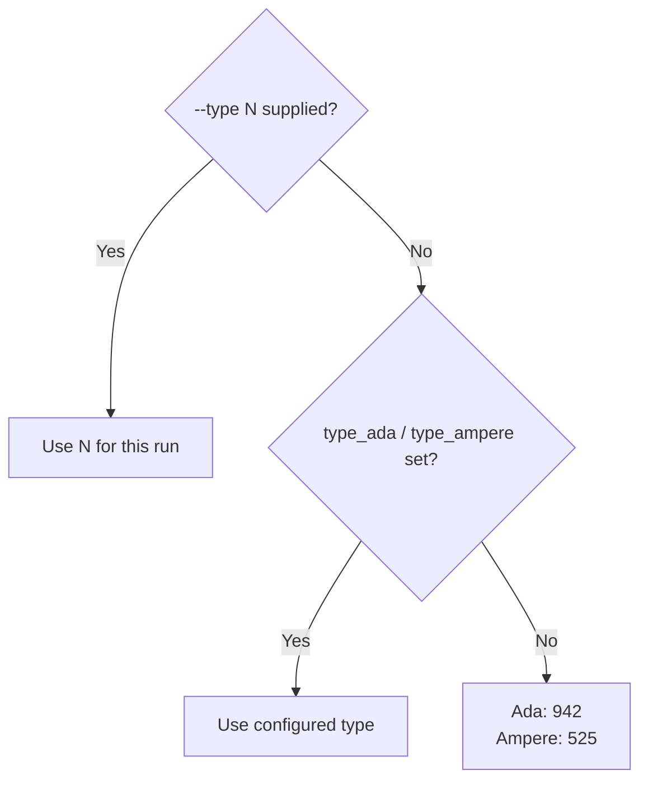
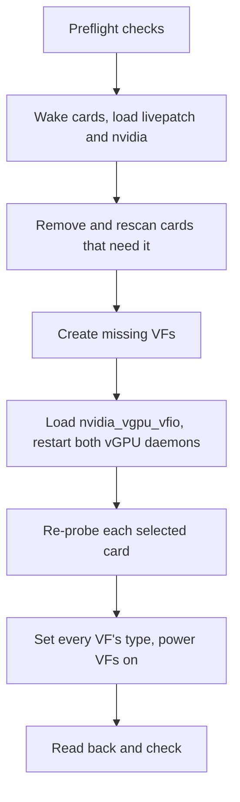
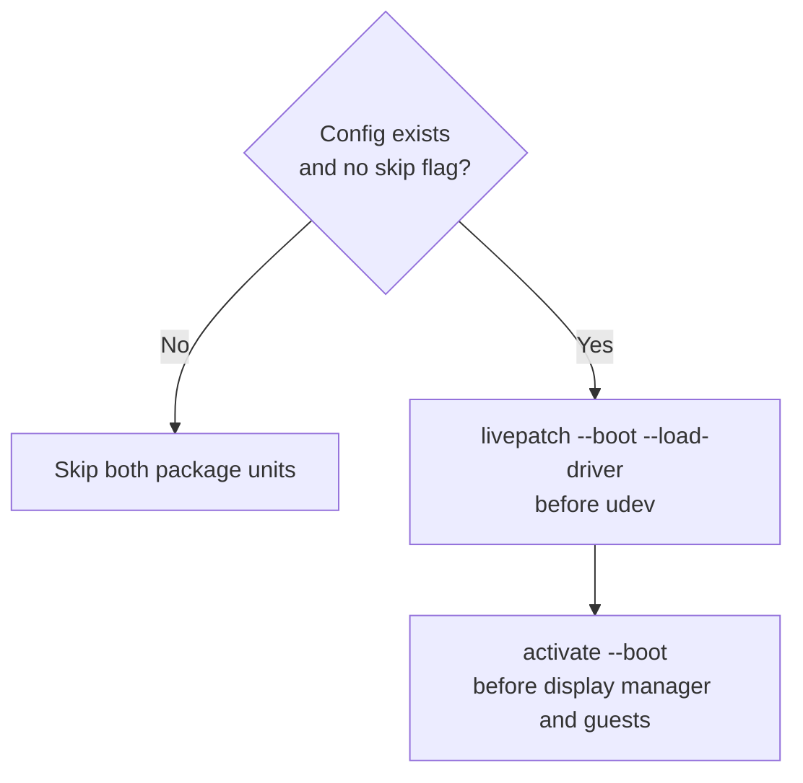

# Configuration and commands

This page covers the configuration file, commands, systemd units and kernel module parameters.
See [Configuration file](#configuration-file) for parsing and validation rules, and [Commands](#commands) for each command's complete option list.

## Common changes

The most frequent changes, each with the command to use.
The full reference follows below.

- VFs per card: set `vfs=N` in `/etc/geforce-sriov/config`, or run `sudo ./geforce-sriov install --vfs N` from the source folder, which writes it.
  The default is 4, and the ceiling is the card's own count ([Configuration file](#configuration-file)).
  Power the machine fully off and on afterwards.
- vGPU type: set `type_ada=N` or `type_ampere=N` in the config to choose the size of each vGPU.
  Stop the VMs, write `0` to `nvidia/current_vgpu_type` of every VF of the card, then run `sudo geforce-sriov activate`. No power cycle is needed ([Choosing a vGPU type](#choosing-a-vgpu-type)).
- Display on or off for the boot display GPU: run `sudo ./geforce-sriov install --display` or `--no-display` from the source folder.
  `--display` needs the Linux driver package and NVIDIA's public kernel module source ([What to download](installation.md#what-to-download)).
- Host CUDA on or off: run `sudo ./geforce-sriov install --host-cuda` or `--no-host-cuda` from the source folder.
  `--host-cuda` needs the Linux driver package ([What to download](installation.md#what-to-download)).
- Applying a change: the `geforce_sriov` kernel module reads `ari`, `msix` and the VF count once, when it loads at boot. Changing them takes a cold power cycle, **not** a reboot.
  A vGPU type change takes only `activate`. See [Turn features off](recovery.md#turn-features-off) for the switch for each symptom.

## Configuration file

The configuration file holds your card selection, feature switches, VF count and each generation's vGPU type.
`install` writes it.

- Its path is `/etc/geforce-sriov/config`.
  `status`, `check`, `activate` and `uninstall` read the path in `$GEFORCE_SRIOV_CONFIG` instead when it is set.
  `install` always uses `/etc/geforce-sriov/config`.
  `setup` refuses a `$GEFORCE_SRIOV_CONFIG` that names an existing file other than that one.
- It holds one `key=value` per line, with `#` comments and no spaces.
- It must be owned by root and not writable by group or others.
- An annotated copy is installed as `/usr/local/share/geforce-sriov/config.example`
  ([config/config.example](../config/config.example)).

| Key | Values | Default | Meaning |
|---|---|---|---|
| `bdfs` | 1–32 card addresses, comma-separated | none | Cards that the kernel module, `activate` and the hook act on. The rebuilt `nvidia.ko` applies to every card bound to it, selected or not ([What install does](driver-patch.md#what-install-does)) |
| `ari` | `on`/`off` | `on` | Reveal the card's hidden ARI capability and turn on ARI forwarding in the bridge above it. `pci=noari` on the kernel command line forces it off. More than 4 VFs per card is not available, so `vfs` defaults to 4 |
| `msix` | `on`/`off` | `on` | Reveal the card's MSI-X interrupts |
| `vfs` | 1 up to the card's ceiling (below) | `4` | VFs presented per selected card. `install --vfs N` writes it |
| `identity` | `on`/`off` | `off` (`install` sets `on`) | Let the hook present the selected cards as their generation's vGPU target, the RTX A6000 or RTX 6000 Ada |
| `identity_force_host` | `on`/`off` | `off` (`install` sets `on`) | Let the hook also report vGPU host mode for the selected cards |
| `sriov_manage` | absolute path | `/usr/lib/nvidia/sriov-manage` | NVIDIA's VF tool, which `activate` runs to create the VFs of a card that has none |
| `type_ada` | vGPU type ID | `942` | The vGPU type that `activate` sets on each VF of an Ada card and `check` expects ([Choosing a vGPU type](#choosing-a-vgpu-type)) |
| `type_ampere` | vGPU type ID | `525` | The same for an Ampere card |
| `d3cold` | `off` | none (no consent) | Records consent to keep the selected laptop GPUs powered. Without it, `activate` refuses the run if a laptop GPU is selected. `install --disable-d3cold` writes the key. Any value but `off` is refused ([Consent](laptops.md#consent)) |
| `display` | `auto`/`on`/`off` | `auto` | Build NVIDIA's display modules and hand the boot display GPU's console to them. With `auto` or `on`, they are built only when a selected GPU is the boot display. `off` never builds them ([Boot display GPU](installation.md#boot-display-gpu)) |
| `host_cuda` | `on`/`off` | `off` | Build `nvidia-uvm` and install NVIDIA's CUDA library, so that CUDA programs can run on the host. Needs the Linux driver package ([Host CUDA](installation.md#host-cuda)) |
| `host_desktop` | `auto`/`on`/`off` | `auto` | Install NVIDIA's graphics libraries for the host desktop. `auto` turns them on when the display build is in effect and the Linux driver package was given ([Host desktop](installation.md#host-desktop)) |

The ceiling for `vfs` is the card's hardware default, except on an Ada card that reports 1.
On those Ada cards, the VF-count revision of the host module sets the ceiling to 4.
NVIDIA's patched driver uses at most 4 VFs per card.
`status` and `install --dry-run` show both counts, for example "hardware default 1, geforce-sriov presents 4 (default)".

An unknown key is refused as a whole: `line N: unknown key 'KEY'`.
A key that contains `vf` adds `; the VF count key is vfs (vfs=1..16, default 4)`.

`install` and `install --dry-run` refuse a `vfs` above the ceiling and warn about a value above 4.

The module's switches and VF count are fixed when it loads.
To change them, edit the file or run `install` again, then power the machine fully off and on, as after the first install.
This requires a cold power cycle, not a reboot.

See [recovery.md](recovery.md#turn-features-off) for the switch to turn off for each symptom.

### Choosing a vGPU type

A vGPU type, also called a profile, sets how much of the card's memory each vGPU gets. For example, type 527, RTXA6000-4Q, gets 4096 MiB.
Each card runs one vGPU size: every VF of a card gets the same type.
`activate` and `check` use the first applicable value in this order:



The boot unit, `setup` and a plain `activate` or `check` use the file, so set the type there to keep it across boots.
`--type N` applies to one run and requires a selection of one generation.
On a mixed host, the two keys give each generation its own type.

To see the types a card offers, run `nvidia-smi vgpu -s` before a type is set, or use the lists in [Ada](ada.md#choosing-a-vgpu-type) and [Ampere](ampere.md#choosing-a-vgpu-type).
An unknown value in the file is refused with its line number, for example `line 4: type_ada must be a vGPU type ID from 1 to 999999, as nvidia/creatable_vgpu_types lists it`.

> [!IMPORTANT]
> Choose vGPU types that fit your card's physical VRAM.
> The type list comes from the professional card, so it includes types bigger than your card. geforce-sriov does not filter them out.
> All the vGPUs you run at once must fit in the VRAM together. Leave some room, because the host driver uses part of it too.
> For example, four `4Q` vGPUs need 16 GB plus the host driver's share: they fit a 24 GB card and do not fit a 16 GB card.

To change a card's vGPU size:

1. Stop every VM that uses one of its VFs.
2. With `nvidia-vgpu-mgr` running, write `0` to `nvidia/current_vgpu_type` of every VF of the card.
   Never write a type while `nvidia-vgpu-mgr` is stopped.
3. Set `type_ada` or `type_ampere` in the file and run `activate`.

On an Ada card whose loaded module lacks the VM video memory change ([VM video memory](ada.md#vm-video-memory)), each VF has a fixed framebuffer slot. The slot of a later VF ends higher in the card's memory.
With a large type, the last VFs may not start a VM even when the card is otherwise empty and the type is set.
With the VM video memory change there are no slots, because a VM takes free video memory when it starts. `activate` prints no line for such a card.
After setting the types, `activate` prints one line for a card without the change, for example:

```text
0000:01:00.0: with type 946 the VFs 0000:01:00.5, 0000:01:00.6 and 0000:01:00.7 may not start: their framebuffer slots end near the top of the card's 16376 MiB. Put VMs on the lower VFs, or choose a smaller type.
```

This is an advisory message: `activate` still sets the type and its exit status does not change.
The message requires NVIDIA's `/usr/share/nvidia/vgpu/vgpuConfig.xml` and `nvidia-smi`. Without either, it prints nothing.
Ampere cards get no such line.

## Commands

| Command | Root | Purpose |
|---|---|---|
| [`geforce-sriov devices`](#devices) | no | Print the device table |
| [`geforce-sriov status`](#status) | no | Show card state, host checks and next steps |
| [`geforce-sriov setup`](#setup) | yes | Run the guided setup |
| [`geforce-sriov install`](#install) | yes | Install files and driver changes |
| [`geforce-sriov install --dry-run`](#install---dry-run) | no | Check the host for an install and change nothing |
| [`geforce-sriov activate`](#activate) | yes | Create and configure VFs, or clear the activation lock |
| [`geforce-sriov livepatch`](#livepatch) | yes | Load the livepatch; the boot unit runs it |
| [`geforce-sriov check`](#check) | no | Check readiness before VM start |
| [`geforce-sriov uninstall`](#uninstall) | yes | Remove files and restore stock files |
| [`geforce-sriov rebuild`](#rebuild) | yes | Build NVIDIA's modules again for a kernel |
| `geforce-sriov --version`, `version`, `help` | no | Print the version, such as `geforce-sriov 0.4.0`, or the usage text |
| [`geforce-sriov-patch`](#driver-patcher) | no | Inspect, apply or revert driver patches |

Exit codes:

- 0: ok
- 1: failed
- 2: usage error
- 3: refused (nothing changed)
- 4: another `geforce-sriov` is running
- 5: activation lock set (cold power cycle needed)

`install` exits 1, not 3, when it fails or refuses after it has written anything.

### devices

`geforce-sriov devices` prints the device table.

### status

`geforce-sriov status` shows each selected card's state and next step, then the host checks.
It exits 0 once every selected card has every VF ready and no host check fails, and 1 otherwise.

Options:

- `--device BDF`, repeatable.
- `--sysfs-root PATH`: read a copy of a sysfs tree, for fixtures and tests.
- `--config PATH`: read another config file, for fixtures and tests.

Each Ada or Ampere card's line says whether the installed `nvidia.ko` is the driver step's build.
It compares the build-id of the installed `nvidia.ko` with the driver step's record in `/var/lib/geforce-sriov/driver-build`.
When the installed `nvidia.ko` is the driver step's build but the loaded `nvidia` module is not, it warns:
`the running nvidia module (build-id …) is not the installed one (…); power the machine off and on to load it`.
In that case:

- The first next step is `next: power the machine off and on (the running nvidia module is not the installed one)`.
- A card with SR-IOV presented but no VFs gets no next step of its own.
- `status` exits 1.

While `/run/geforce-sriov/activating` exists, it prints `activate: /run/geforce-sriov/activating exists (activate is running or did not finish)` and exits 1.
Unless the loaded module is not the installed build, it also prints `` next: stop every VM that uses a vGPU, then run `geforce-sriov activate` ``.

With the activation lock set, `status` reports a FAIL and prints ``next: after a cold power cycle, run `geforce-sriov status` and, if safe, `geforce-sriov activate --clear-lock` and `geforce-sriov activate` `` ([The activation lock](recovery.md#the-activation-lock)).

#### Other host checks

After the per-card report, `status` prints `Other host checks (OK lines are not shown):` followed by one line for each `[INFO]`, `[WARN]` or `[FAIL]` result of the checks that apply after install.
A `[FAIL]` makes `status` exit 1.
`[INFO]` and `[WARN]` only print.
The checks cover:

- the module and livepatch state, and the livepatch module for the running kernel;
- kernels that have NVIDIA's module but no livepatch module;
- IOMMU groups, `pci=noari` and whether the command runs as root;
- the activation lock;
- `nvidia` loaded at boot by `modules-load.d` or the initramfs;
- the identity hook against the loaded driver version;
- drop-ins of `nvidia-vgpud` or `nvidia-vgpu-mgr` that set `LD_PRELOAD`;
- the boot units, the vGPU plugin link and missing device nodes;
- the display, host CUDA and host desktop requests against the installed build;
- display clients and the display manager;
- config file permissions;
- for each card:
  - laptop consent and power state;
  - ARI forwarding;
  - BAR0 and the VF BARs;
  - IOMMU peers and VFs that share the PF's group;
  - MSI-X;
  - whether the resources fit;
  - a driver other than `nvidia` bound to the card;
  - mixed generations and the identity mapping.

`status` prints a plain `driver:` line for the loaded host driver version, for example `driver: NVIDIA's driver 595.91.04 is not guaranteed to work; confirmed versions: 580.159.01.`
That line is not a `[WARN]` check and does not change the exit status.
See [`status` and `install --dry-run`](technical-reference.md#status-and-install---dry-run).

#### Other status lines

`status` also prints these lines:

- `driver:` and `build:` lines: the loaded driver version, whether the installed `nvidia.ko` is the build `geforce-sriov` installed, and the features it carries. `build: confirmation=` is `confirmed-inputs` or `unconfirmed` (see [Supported inputs](driver-patch.md#supported-inputs)).
- `selection:`: a selected address now holds another card than the one `install` recorded.
  `status` exits 1 and ends with `next: run the command above, then power the machine off and on`.
  When no identity is recorded yet, it prints `selection: the card identities are not recorded yet, ...` once, with the command that records them.
- `VM video memory:` is printed inside the block of each selected Ada card when VFs are enabled. It says whether a VM takes its video memory from free memory or from a fixed slot. Each VF's `nvidia/placement_id` file shows this: NVIDIA's driver writes the fixed range there, or `Not Applicable` ([VM video memory](ada.md#vm-video-memory)).
- `host desktop:` lines: the requested and effective state, and whether the driver build accepts the installed libraries ([Host desktop](installation.md#host-desktop)).
  `host CUDA libraries:` reports the same for host CUDA ([Host CUDA](installation.md#host-cuda)).
- `kernel hook: the automatic build for kernel ... failed (...); run ...`: the build that runs when a kernel is installed failed.
  Run the command the line names, `sudo geforce-sriov rebuild --kernel RELEASE` ([`rebuild`](#rebuild)).

### setup

`geforce-sriov setup` runs the guided path from a clean host to ready VFs.
It reads the host's state, runs the next steps and says when to power the machine off and on.
It creates no VM.

Options:

- `--device BDF`, repeatable.
- `--vfs N`.
- `--interactive` or `--no-prompt`.
- `--allow-unsupported-driver`: consent to a host driver version that is not guaranteed to work. `setup` asks first, and the default answer is no.
  `install` ignores it.
- The feature and package options of `install`: `--display` or `--no-display`, `--host-cuda` or `--no-host-cuda`, `--host-desktop` or `--no-host-desktop`, `--companion-file PATH` or `--companion-source DIR`, `--nvkms-source PATH`, `--driver-file PATH`, `--nvidia-source DIR`, `--driver=skip`, `--accept-nvidia-license` and `--disable-d3cold`.

It passes options to the steps that take them.
On a first install it runs `install --dry-run`, then `install`.
On an installed host it first runs `check` and stops when every VF is ready. Otherwise it runs `install --dry-run` and, when something must change, `install`.
After installing, it runs `activate` and `check`, or tells you to power the machine off and on when the loaded `nvidia` module is not the installed build.
A FAIL in `install --dry-run` stops `setup` with `Stopped: fix what the checks above name, then run setup again. Nothing changed.`
See [One command from a clean host](installation.md#one-command-from-a-clean-host).

#### First install

Before a first install, `setup` asks for anything the options did not supply: NVIDIA's `.run` package, the licence and the cards.
It asks when its input is a terminal or with `--interactive`. `--no-prompt` never asks.

- With exactly one eligible card, it selects that card itself.
- A card that is the boot display can be selected like any other.
  `activate` refuses it unless the installed build has NVIDIA's display modules, and then hands its console to them ([What activation does](technical-reference.md#what-activation-does)).
- If a display manager holds a selected GPU, `setup` asks before it stops the display manager. `--no-prompt` never gives that consent.
- If any selected GPU is a laptop GPU, `setup` shows the D3cold notice and asks whether to disable D3cold for the selected laptop GPUs. The default is no.
  Answering yes passes `--disable-d3cold` to `install --dry-run` and `install`. Declining stops `setup` with exit 3 before any step ([Consent](laptops.md#consent)).
  If `setup` cannot prompt, you must pass `--disable-d3cold`. Otherwise it stops the same way.

#### Installed host

Run the same command again after the power cycle.
On an installed host:

- A `--device` selection that differs from the configured `bdfs` is refused.
- If a laptop GPU is selected and the config lacks D3cold consent, `setup` asks for it before `check`.
  Accepting or passing `--disable-d3cold` records it with `install --driver=skip --disable-d3cold`, and `setup` goes on. Declining stops `setup` with exit 3.
- If the install completes while the loaded `nvidia` module is not the installed build, `setup` does not bring the GPUs up.
  It prints `The install is complete. The nvidia module that is running is not the installed build, so the GPUs were not brought up.` and `Next: power the machine off and on.`

### install

`geforce-sriov install` installs files, selects cards and sets the VF count. It also patches and installs NVIDIA's module and plugin and enables the boot units.
After the driver step succeeds, installation writes the vGPU drop-in and config.
Run [`install --dry-run`](#install---dry-run) first to see what must change.

Options:

- `--device BDF`, repeatable.
- `--disable-d3cold`: records D3cold consent as `d3cold=off` for the selected laptop GPUs.
  Requires at least one selected laptop GPU.
  Passing `--device` without this option removes consent from the config.
- `--display` or `--no-display`, `--host-cuda` or `--no-host-cuda`, `--host-desktop` or `--no-host-desktop`: select the display build ([Boot display GPU](installation.md#boot-display-gpu)), host CUDA ([Host CUDA](installation.md#host-cuda)) and NVIDIA's graphics libraries for the host desktop ([Host desktop](installation.md#host-desktop)).
- `--companion-file PATH` or `--companion-source DIR`, `--nvkms-source PATH`: the build inputs for the display build and host CUDA.
- `--vfs N`.
- `--driver=skip`.
- `--driver-file PATH`: NVIDIA's `.run` package.
- `--accept-nvidia-license`: run NVIDIA's installer with that package.
- `--nvidia-source DIR`: NVIDIA's kernel tree.
- `--prefix PATH`.
- `--destdir PATH`, or `DESTDIR`: only stage files below `PATH`.
- `--source DIR`: install from this built tree instead of the binary's own directory.
- `--ari=on|off` and `--msix=on|off`.

Run from the installed copy of the program, `install` accepts a selection change: `--device`, `--disable-d3cold`, `--display` and `--no-display`.
It then checks root and the lock. It runs the driver step only when the installed build differs from the display setting or the card selection. It writes the config and the selection record, and rewrites the `TimeoutStartSec` line of the activate unit for the new number of cards. A unit edited since install is kept as it is.
It copies **no** file, and it refuses a first selection: select the first GPU from the source folder.
Any other option, such as `--host-cuda`, `--vfs` or `--companion-file`, is refused, and the refusal names `rebuild` for a new kernel.
`--dry-run` is answered before this check, so it works from the installed copy and takes the options of [`install --dry-run`](#install---dry-run).
`--source DIR` skips the check: the installed copy then installs from that tree like any other `install` run.
`--host-desktop` and `--no-host-desktop` are the exception. Given together with `--device`, `--disable-d3cold`, `--display` or `--no-display`, the installed copy accepts them but **ignores** them. Given alone, it refuses them.
Change the host desktop setting from the source folder.
With `--device`, `install` records the identity of each card it names in `/var/lib/geforce-sriov/selection`. Without it, `install` records only the addresses that have no line yet.

Its output ends with the next step, which begins `Next: power the machine off and on.`
Staging with `--destdir` notes that you run `geforce-sriov install --dry-run` on the target host.
See [Install details](technical-reference.md#install-details), [One command from a clean host](installation.md#one-command-from-a-clean-host) and [`--driver`](#--driver).

### install --dry-run

`geforce-sriov install --dry-run` checks this host for an install and changes nothing.
It writes nothing and takes no lock.

Options:

- `--device BDF`, repeatable.
- The feature and package options of `install`: `--display` or `--no-display`, `--host-cuda` or `--no-host-cuda`, `--host-desktop` or `--no-host-desktop`, `--companion-file PATH`, `--companion-source DIR`, `--nvkms-source PATH`, `--driver-file PATH`, `--nvidia-source DIR`, `--driver=skip`, `--accept-nvidia-license` and `--disable-d3cold`.
  The checks assess the host as `install` with those options will leave it.
  `--disable-d3cold` is assessed as if the consent were recorded, and exits 2 without a laptop GPU.

It refuses `--prefix`, `--destdir` (or `DESTDIR`), `--source`, `--vfs`, `--ari` and `--msix` (exit 2).

It prints `geforce-sriov 0.4.0: checks before install (sysfs root /sys)`, then one `[OK]`, `[INFO]`, `[WARN]` or `[FAIL]` line per check, and `N failure(s), N warning(s)`.
It exits 0, or 3 when a line is a `[FAIL]`.

The checks cover:

- the config summary;
- kernel headers, a C compiler and `make`;
- NVIDIA's kernel source tree, the extraction of `--driver-file` and whether `nouveau` is loaded;
- `dkms` and `systemctl`;
- the build inputs for the display build and host CUDA;
- the selected cards, laptop consent and generation notes;
- the identity plan;
- a warning when no GPU is selected.

They also cover what applies both before and after install:

- kernel livepatch support and `sriov-manage`;
- NVIDIA's `nvidia-vgpud` and `nvidia-vgpu-mgr` unit files;
- `lspci` and `setpci`;
- modprobe.d conflicts;
- per-card answers and power;
- mixed generations.

### activate

`geforce-sriov activate` is the command to run after a boot.
It acts on every Ada and Ampere card selected by `bdfs`.
Running `activate` on a host that is already active does not disturb running VMs. If every VF is ready, it changes nothing. Otherwise it only sets the missing types and VF power state, or loads a missing display or CUDA module, without restarting the daemons or re-probing a GPU.

Options:

- `--type N`: set one type on every selected card for this run.
- `--dry-run`.
- `--boot`: used by the activate unit. `install` sets the unit's start timeout from the number of selected cards and VFs, with a minimum of 900 s. It rewrites the timeout when the selection changes ([What activation does](technical-reference.md#what-activation-does)). Boot activation never prompts and never stops a running display manager.
- `--stop-display-manager`: let activation stop the display manager that holds a selected GPU and start it again at the end. Without it, activation refuses while such a manager runs.
- `--clear-lock`: clear the activation lock of an unfinished activation, only after a cold power cycle. It takes no other option ([The activation lock](recovery.md#the-activation-lock)).

The activation order is:



A selected boot display GPU is handled inside this transaction. Activation refuses it unless the installed build has NVIDIA's display modules, and then hands the console to them ([What activation does](technical-reference.md#what-activation-does)).

Types follow [Choosing a vGPU type](#choosing-a-vgpu-type): `--type N`, then the generation's config key, then 942 on Ada or 525 on Ampere.
On Ada, it prints the advisory slot line described there when a VF's slot would end near the top of the card's memory and the loaded module lacks the VM video memory change.

#### Driver and selection checks

- It needs the patched plugin copy (SHA-256 `aa4fdeb5…`).
  On 580.159.01 it refuses any plugin other than the patched copy. That includes NVIDIA's stock plugin and a copy with only the first of the two plugin changes. `install` replaces the partly patched copy.
  On another host driver version it prints `geforce-sriov: NVIDIA's driver X is not guaranteed to work; confirmed versions: 580.159.01.; continuing` and carries on. Such a version is **not guaranteed to work**.
- It refuses when the record does not name the installed `nvidia.ko` for the running kernel, including a record made on another kernel.
  `install` on the running kernel rewrites the record.
  With no record at all, it only warns.
- If the loaded `nvidia` module is not the installed build, it prints [status](#status)'s loaded-module warning and continues.
- It refuses a card in scope that is not in the device table.
- It refuses while a GPU outside `bdfs` has VFs.
- It refuses when a selected address holds another card than the one recorded in `/var/lib/geforce-sriov/selection`: `<bdf> is not the GPU that was selected`.
  Nothing is written to any GPU.
  `check`, `check --daemon-ready` and the early boot unit refuse for the same reason.
  `install --device` records each card it names. `install` without `--device` records only addresses that have no line yet.

See [Cold boot](installation.md#cold-boot) and [Combining generations](devices.md#combining-generations).

### livepatch

`geforce-sriov livepatch --boot [--load-driver] [--config FILE]` loads the livepatch module and, with `--load-driver`, then loads `nvidia`.
The livepatch boot unit runs it.
It removes and rescans no card.
It refuses when the loaded module has other parameters or when no GPU is selected. It also refuses when the activation lock is from this boot or has an unknown boot ID.

### check

Run `geforce-sriov check` before every VM start on Ada and Ampere.

Options:

- `--device BDF`, repeatable.
- `--type N`.
- `--daemon-ready`: succeed only when the selected VFs are enabled and bound.
  The `nvidia-vgpud` drop-in runs it before the daemon starts.

It exits 0 only when every VF of every selected card:

- Is on `nvidia`.
- Has `power/control=on`.
- Has `runtime_status=active`.
- On a laptop GPU, answers a config read at offset `0x08`.
- Has the expected type: `--type N`, else `type_ada` or `type_ampere` from the config, else 942 on Ada and 525 on Ampere.

Otherwise it exits 1, or 3 for a configuration or selection it refuses.
On a mixed Ada and Ampere selection, `--type` is refused with exit 3 and nothing changed. No single type is creatable on both targets.
This also applies to `activate`.
Omit `--type` and use the two generation keys instead.

Its `nvidia.ko` line adds the loaded-module warning under the same conditions as [status](#status).
That warning does not change the exit status.
See [The VF power gate](technical-reference.md#activate-and-the-vf-power-gate) and [Ada](ada.md).

### rebuild

`geforce-sriov rebuild [--kernel RELEASE]` builds NVIDIA's modules again for a kernel.
The default is the running kernel.

- It uses the inputs `install` kept and the features the config selects: display and host CUDA.
- It builds the livepatch module for that kernel first, then NVIDIA's module and plugin.
- The kernel hook runs it when a kernel is installed.
  Run it yourself after a failed automatic build, as `status` tells you.
- It must run as root from the installed copy. It takes geforce-sriov's run lock (`/run/geforce-sriov/lock`), as `install` does.
- It exits 0 on success, 3 when it refuses with nothing changed, and 1 on a failure.
  When it built something new, the next step is to power the machine off and on.

### uninstall

`geforce-sriov uninstall [--unload]` removes what `install` put there.
It restores the stock module and plugin when they still match what `install` wrote. It points the plugin link back at the stock plugin and removes the modprobe file the driver step wrote.
Another file that sets the option stays.

Removal reports:

- The plugin copy it removes: `removed <path>`.
- A link to a file this package did not install stays: `left <link>: it points to <target>, which this package did not install`.
- Another file in `/etc/modprobe.d/` that sets the option stays.
- The kernel-hook files and their logs:
  - `/etc/kernel/postinst.d/geforce-sriov`
  - `/etc/kernel/header_postinst.d/geforce-sriov`
  - the apt snippet `/etc/apt/apt.conf.d/99geforce-sriov`
  - the `kernel-install` plugin `/etc/kernel/install.d/90-geforce-sriov.install`
  - the pacman hook `/etc/pacman.d/hooks/90-geforce-sriov.hook`
  - the hook script `geforce-sriov-kernel-hook`
  - `/var/lib/geforce-sriov/kernel-hook-logs/` and `/var/lib/geforce-sriov/kernel-hook-failed/`
- NVIDIA's CUDA and graphics libraries and the files that name them to the loader and to X, including the X output-class file. `ldconfig` runs again afterwards.
- The build inputs kept for a later kernel, in `/var/lib/geforce-sriov/inputs/`, once NVIDIA's files are back.
- The selection record `/var/lib/geforce-sriov/selection`.
- The version stamp `/var/lib/geforce-sriov/format`, as the last step.
  It is kept when a step failed, so the next `install` of the same version is **not** refused.

Once the stock module is back, it removes the running kernel's backup and the empty `build/` and `stock/` directories.
It removes `/var/lib/geforce-sriov/` when nothing is left in it.
For each other kernel whose backup stays, it prints a `restore <kernel release>: cp … && depmod -a <kernel release>` line.

If restoration fails, `uninstall` exits 1 and keeps `geforce-sriov-driver` and every backup. It prints `NVIDIA's module was not restored: <reason>` with two ways to finish by hand.
If `geforce-sriov-driver` changed since install, `uninstall` does not run it, exits 1 and keeps the script and every backup.
See [Remove geforce-sriov](recovery.md#remove-geforce-sriov) for the removal order and `--unload` safety conditions.

### Driver patcher

- `geforce-sriov-patch inspect|apply|revert …`
- `geforce-sriov-patch ada list|inspect|apply|revert …`

See [Driver patcher](driver-patch.md) and [Revisions](driver-patch.md#revisions).

### --driver

`--driver` decides whether `install` also does the NVIDIA driver work.
By default it does ([What install does](driver-patch.md#what-install-does)):

- it patches your own `nv-kernel.o_binary` with the three revisions, or four when an Ada card is selected
- it rebuilds `nvidia.ko` and requires its `.text` to differ from your stock module at the eight recorded
  offsets, plus the one placement offset when an Ada card is selected.
  That comparison applies only to a build without the display modules, of the recorded version. A display build is checked by a digest of the build chain. An unrecorded version is compared at the offsets the patch tool reported.
- it backs up the stock module and installs the patched one
- it places the patched plugin copy
- it writes the GSP-off module option

`--driver=skip` skips the driver work and installs only the rest.
You must then provide the module, plugin and option ([The manual path](driver-patch.md#the-manual-path)). On 580.159.01, `activate` refuses until they are in place.
`install` carries on with another host driver version as best effort when it finds the code it patches. `setup` asks first.
580.159.01 is the only confirmed version, and other versions are **not guaranteed to work**.
On the manual path, `status`, `check` and `activate` say so and continue ([Supported software stack](installation.md#supported-software-stack)).
On a host whose `nvidia.ko` you already patched by hand, `--driver=skip` keeps that module as it is.

The driver step reads NVIDIA's kernel tree from `/usr/src/nvidia-<version>`. NVIDIA's package puts it there when installed with DKMS, the framework that rebuilds kernel modules for each new kernel.
Use `--nvidia-source DIR` to name another tree, for example the `kernel/` directory of a package you extracted yourself.

`--driver-file PATH` takes NVIDIA's own `.run` package and uses its `kernel/` tree.
Combining it with `--nvidia-source` or `--driver=skip` is a usage error with exit 2.

By default, the package is only extracted with `sh PATH --extract-only`.
NVIDIA's installer for the vGPU userspace runs only when you also pass `--accept-nvidia-license`, which records your acceptance of NVIDIA's licence.
See [One command from a clean host](installation.md#one-command-from-a-clean-host) for both options.

## Systemd units

The boot path depends on the config:



| Unit | When it runs | What it does |
|---|---|---|
| `geforce-sriov-livepatch.service` | Once per boot, before `systemd-udevd`, module autoloading and NVIDIA's services | Runs `geforce-sriov livepatch --boot --load-driver`: loads the livepatch, waits until it is enabled, then loads `nvidia`. It removes and rescans nothing. Skipped when the config is missing or the kernel command line has `geforce_sriov.skip` |
| `geforce-sriov-activate.service` | Once per boot, after `geforce-sriov-livepatch.service` and before the display manager, NVIDIA's persistence daemon and VM autostart | Runs `geforce-sriov activate --boot`: the whole activation transaction ([What activation does](technical-reference.md#what-activation-does)). Skipped in the same cases as the livepatch unit |
| `libvirt-guests.service.d` and `pve-guests.service.d` drop-ins | When those units start | Order guest autostart after the activate unit and run `geforce-sriov check` first. They do not require the activate unit. `check` cannot fail them, because it only logs which VFs are not ready, so a failed activation never keeps guests from starting |
| `nvidia-vgpud.service.d/geforce-sriov.conf` (drop-in) | Whenever `nvidia-vgpud` starts | Loads the hook into `nvidia-vgpud` only, through `LD_PRELOAD`, and runs `geforce-sriov check --daemon-ready` first |

`nvidia-vgpud.service` and `nvidia-vgpu-mgr.service` are NVIDIA's units and not part of this package ([NVIDIA's vGPU daemon units](installation.md#nvidias-vgpu-daemon-units)).

## Module parameters

The `geforce_sriov` kernel module takes the parameters below, but they rarely need to be set by hand.
`livepatch` loads the module with `bdfs` and the switches from the configuration file, as `0` or `1`. It adds `vfs=N` when the file sets a VF count.
They are read-only once the module is loaded. Find them in `/sys/module/geforce_sriov/parameters/`, or run `geforce-sriov status`.

| Parameter | Type | Default | Meaning |
|---|---|---|---|
| `bdfs` | comma-separated PFs `dddd:bb:ss.0` | none (required) | Up to 32 cards that get any change, as named in `/sys/bus/pci/devices`. Empty refuses to load. Set from `bdfs` |
| `vfs` | 1–16 | `4` | VFs presented per listed card, at most the card's hardware TotalVFs. On Ada with the VF-count host module the limit is 4. More than 4 VFs per card is not available: above 4 the module refuses to load when the card's VF layout check fails. Set from `vfs` |
| `ari` | `0`/`1` | `1` | Present the card's hidden ARI capability and enable ARI forwarding on its upstream bridge. The module cannot see `pci=noari`, so the CLI passes `ari=0` with it. Set from `ari` |
| `msix` | `0`/`1` | `1` | Relink the card's hidden MSI-X capability at load. Set from `msix` |

What the module does with each parameter, and when it refuses to load, is described in
[technical-reference.md](technical-reference.md#the-kernel-module).
