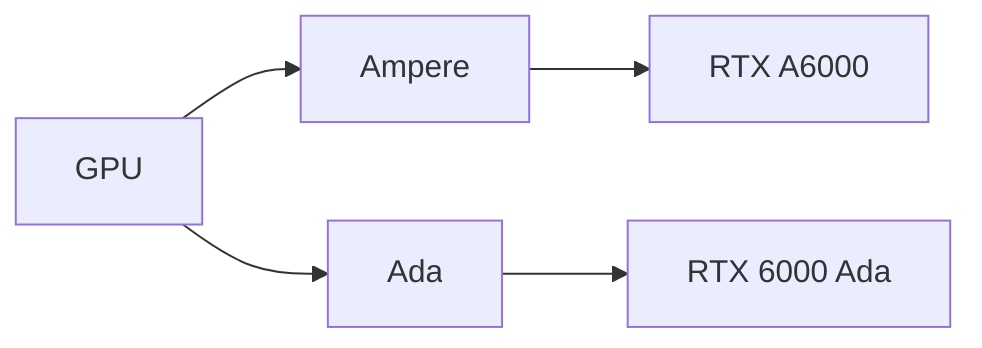

# Supported cards

The device table in `include/gs_devices.h` lists every card geforce-sriov acts on and how it treats each generation.
Three parts read it: the livepatch module (`geforce_sriov`, a [livepatch](glossary.md) that reveals the SR-IOV feature a card hides), the command line tool, and the identity hook (which presents each card to NVIDIA's software as a professional card).
`geforce-sriov devices` prints the table from the installed binary.
This page is a readable copy; if it disagrees with the header, the header wins.

Every entry is one exact PCI device ID, with no ranges.
The device ID is the 16-bit model number a card reports on the PCI bus, and `10de` is NVIDIA's vendor ID; `lspci -nn` shows both, for example `10de:2206`.
A listed ID means the tools act on that card when you select it.
A card whose ID is not listed is **never** presented or activated, and `doctor`, `install --device` and `setup` refuse it with `<BDF> (10de:<id>) is not in the device table`, where `<BDF>` is the card's PCI address such as `0000:01:00.0`.
The rebuilt `nvidia.ko` (NVIDIA's kernel driver module, patched by `install`) still applies to such a card whenever it is bound to the `nvidia` driver ([Combining generations](#combining-generations)).

## Generations

The table gives, per generation, the professional card its GeForce cards are presented as, with that card's device ID, the vGPU type used by default, and the page that documents the setup.

| Generation | Presented as | Default vGPU type | Status | Page |
|---|---|---|---|---|
| Ampere | RTX A6000, `10de:2230` | 525, RTXA6000-2Q | supported | [Ampere](ampere.md) |
| Ada | RTX 6000 Ada, `10de:26b1` | 942, RTX6000-Ada-2Q | supported | [Ada](ada.md) |

NVIDIA's vGPU software only knows professional cards, so geforce-sriov presents each GeForce card to it under the device ID in the *Presented as* column, the professional board of that generation.
The default vGPU type is what `activate` sets on every VF when you choose nothing else:

- The number is NVIDIA's type ID.
- The `2Q` in the name means a 2 GiB framebuffer (the VRAM given to each vGPU).

Blackwell GPUs are **not** expected to work with the current implementation.
NVIDIA's proprietary host driver does not support them on a vGPU host ([NVIDIA driver flavour](#nvidia-driver-flavour)).

## Status of every row

The *Status* column has one value today, **supported**: the card is in the device table, the tools act on it, and its generation page documents the setup.
It does not mean the maintainers own every card. The tested cards are named in the *At a glance* table of each generation page, and no laptop GPU has been tested.

The recommended host driver is 580.159.01 (NVIDIA vGPU software 19.5), and the recommended guest drivers are in the [supported software stack](installation.md#supported-software-stack).
Those are the tested versions; other versions are not guaranteed to work.
What the tools do with another host driver version depends on how you installed:

- `install` names the version and checks that it still finds every place it patches. If it does, it continues.
- `setup` asks first, and the default answer is no.
- On the manual path (`--driver=skip`), `doctor`, `check` and `activate` warn about the version and continue.

See [Ampere](ampere.md) and [Ada](ada.md) for hardware details.

`geforce-sriov devices` names the professional counterpart of each generation (the professional card it is presented as) once, then lists every row with its device ID, generation, die and name.

> [!IMPORTANT]
> Choose vGPU types that fit your card's VRAM.
> NVIDIA also calls a vGPU type a profile, and its name ends in the memory size: `4Q` means a 4 GB framebuffer (VRAM), so each vGPU of that type takes 4 GB of VRAM.
> The list of vGPU types comes from the professional card, so it can offer types larger than your card's memory, and there is **no** automatic VRAM check.
> For example, a GA102 card with 10 to 12 GB is presented as the 48 GB RTX A6000.
>
> All the vGPUs you run at once must fit in VRAM together, and the host driver needs some room too.
> On a 12 GB card, one `8Q` asks for 8 GB and leaves nominal room for the host, while three `4Q` ask for all 12 GB before the host takes any.
> Availability also depends on the driver's per-VF allocation limits, so a vGPU type that looks like it fits can still fail ([Choosing a vGPU type](installation.md#choosing-a-vgpu-type)).

If you have a card from this table, please submit a
[compatibility report](https://github.com/noon-at-cgn/geforce-sriov/issues/new?template=compatibility-report.yml)
whether it works or not.

## Combining generations

Ampere and Ada cards can share one host.
Select up to 8 cards with one `--device` per card.
Each card is presented as its generation's professional counterpart, and `activate` and `check` process every selected card.

Loading `nvidia` makes it take over **every** NVIDIA card on the host, and the package cannot restrict that, so the points below follow from one shared driver stack:

- One NVIDIA module (`nvidia.ko`) and one vGPU plugin serve all cards, so they get every byte patch (a small change to a few bytes of NVIDIA's own file) any selected generation needs ([Which byte patches to make](driver-patch.md#which-byte-patches-to-make)).
  Select every card you will use.
- Both generations use the patched plugin copy.
  On 580.159.01, `activate` refuses any plugin copy other than the patched one, including the stock plugin.
  On another host driver version it warns and continues.
- The rebuilt `nvidia.ko` applies to every card bound to it, selected or not, because its VF-count and scheduler byte patches are not per card.
  The VF-count patch forces 4 virtual functions (VFs, one per vGPU) on every TU/GA/AD card (Turing, Ampere and Ada chips) bound to it, whatever its row.
  `vfs` accepts values from 1 up to the card's ceiling (`geforce-sriov doctor` shows it); NVIDIA's patched driver uses at most 4 VFs per card.
- The selection (`bdfs`, the PCI addresses of the selected cards) limits what the livepatch module presents (SR-IOV), the identity hook and `activate`.
  NVIDIA's driver still takes over a card outside it, but it is not activated.
- Each generation has its own vGPU type: `type_ada` and `type_ampere` in the config, 942 on Ada and 525 on Ampere by default.
  `--type` is refused on a mixed selection (exit 3), because no single type is creatable on both professional counterparts.
  Omit it, set the two config keys, or narrow `check` to one generation with `--device`.
- `doctor` prints one `[WARN]` when a selection mixes Ada with another generation. Nothing else refuses the mix.
- `activate` restarts NVIDIA's daemons for the whole host, so it refuses while a GPU outside `bdfs` has VFs.
- The recovery rule is host-wide: if any card disappears from `lspci` or the host cannot be reached, cold power cycle the whole machine ([the power-cycle rule](recovery.md#the-one-rule)).

Host layouts (PCIe switches, shared buses, IOMMU groups, which keep each VM's device access separate, and the BAR address space the cards map) are covered in
[the technical reference](technical-reference.md#multiple-gpus-and-pci-topology).

## Rows

Rows are ordered by device ID within each generation.
*Device* is the part after `10de:`, *Die* is the GPU chip the card is built on, and *Product* is the marketing name.

| Device | Die | Product | Generation |
|---|---|---|---|
| `2203` | GA102 | GeForce RTX 3090 Ti | Ampere |
| `2204` | GA102 | GeForce RTX 3090 | Ampere |
| `2206` | GA102 | GeForce RTX 3080 | Ampere |
| `2208` | GA102 | GeForce RTX 3080 Ti | Ampere |
| `220a` | GA102 | GeForce RTX 3080 12GB | Ampere |
| `2216` | GA102 | GeForce RTX 3080 LHR | Ampere |
| `2482` | GA104 | GeForce RTX 3070 Ti | Ampere |
| `2484` | GA104 | GeForce RTX 3070 | Ampere |
| `2486` | GA104 | GeForce RTX 3060 Ti | Ampere |
| `2487` | GA104 | GeForce RTX 3060 | Ampere |
| `2488` | GA104 | GeForce RTX 3070 LHR | Ampere |
| `2489` | GA104 | GeForce RTX 3060 Ti LHR | Ampere |
| `249c` | GA104 | GeForce RTX 3080 Laptop GPU | Ampere |
| `249d` | GA104 | GeForce RTX 3070 Laptop GPU | Ampere |
| `24a0` | GA104 | GeForce RTX 3070 Ti Laptop GPU | Ampere |
| `24b0` | GA104 | RTX A4000 | Ampere |
| `24b6` | GA104 | RTX A5000 Laptop GPU | Ampere |
| `24b7` | GA104 | RTX A4000 Mobile | Ampere |
| `24b8` | GA104 | RTX A3000 Mobile | Ampere |
| `24b9` | GA104 | RTX A3000 12GB Laptop GPU | Ampere |
| `24ba` | GA104 | RTX A4500 Laptop GPU | Ampere |
| `24bb` | GA104 | RTX A3000 Laptop GPU | Ampere |
| `24dc` | GA104 | GeForce RTX 3080 Laptop GPU | Ampere |
| `24dd` | GA104 | GeForce RTX 3070 Laptop GPU | Ampere |
| `24e0` | GA104 | GeForce RTX 3070 Ti Laptop GPU | Ampere |
| `2503` | GA106 | GeForce RTX 3060 | Ampere |
| `2504` | GA106 | GeForce RTX 3060 LHR | Ampere |
| `2507` | GA106 | GeForce RTX 3050 | Ampere |
| `2520` | GA106 | GeForce RTX 3060 Laptop GPU | Ampere |
| `2523` | GA106 | GeForce RTX 3050 Ti Laptop GPU | Ampere |
| `2544` | GA106 | GeForce RTX 3060 | Ampere |
| `2560` | GA106 | GeForce RTX 3060 Laptop GPU | Ampere |
| `2563` | GA106 | GeForce RTX 3050 Ti Mobile / Max-Q | Ampere |
| `2571` | GA106 | RTX A2000 12GB | Ampere |
| `2582` | GA107 | GeForce RTX 3050 8GB | Ampere |
| `2584` | GA107 | GeForce RTX 3050 6GB | Ampere |
| `25a0` | GA107 | GeForce RTX 3050 Ti Laptop GPU | Ampere |
| `25a2` | GA107 | GeForce RTX 3050 Laptop GPU | Ampere |
| `25a5` | GA107 | GeForce RTX 3050 Mobile | Ampere |
| `25a6` | GA107 | GeForce MX570 | Ampere |
| `25a7` | GA107 | GeForce MX570 | Ampere |
| `25a9` | GA107 | GeForce RTX 2050 | Ampere |
| `25ab` | GA107 | GeForce RTX 3050 4GB Laptop GPU | Ampere |
| `25ac` | GA107 | GeForce RTX 3050 6GB Laptop GPU | Ampere |
| `25ad` | GA107 | GeForce RTX 2050 | Ampere |
| `25b8` | GA107 | RTX A2000 Mobile | Ampere |
| `25b9` | GA107 | RTX A1000 Laptop GPU | Ampere |
| `25ba` | GA107 | RTX A2000 8GB Laptop GPU | Ampere |
| `25bb` | GA107 | RTX A500 Laptop GPU | Ampere |
| `25bc` | GA107 | RTX A1000 6GB Laptop GPU | Ampere |
| `25bd` | GA107 | RTX A500 Laptop GPU | Ampere |
| `25e0` | GA107 | GeForce RTX 3050 Ti Mobile | Ampere |
| `25e2` | GA107 | GeForce RTX 3050 Mobile | Ampere |
| `25e5` | GA107 | GeForce RTX 3050 Mobile | Ampere |
| `25ec` | GA107 | GeForce RTX 3050 6GB Laptop GPU | Ampere |
| `25ed` | GA107 | GeForce RTX 2050 | Ampere |
| `25f9` | GA107 | RTX A1000 Embedded GPU | Ampere |
| `25fa` | GA107 | RTX A2000 Embedded GPU | Ampere |
| `25fb` | GA107 | RTX A500 Embedded GPU | Ampere |
| `2684` | AD102 | GeForce RTX 4090 | Ada |
| `2685` | AD102 | GeForce RTX 4090 D | Ada |
| `2689` | AD102 | GeForce RTX 4070 Ti SUPER | Ada |
| `2702` | AD103 | GeForce RTX 4080 SUPER | Ada |
| `2704` | AD103 | GeForce RTX 4080 | Ada |
| `2705` | AD103 | GeForce RTX 4070 Ti SUPER | Ada |
| `2709` | AD103 | GeForce RTX 4070 | Ada |
| `2717` | AD103 | GeForce RTX 4090 Laptop GPU | Ada |
| `2730` | AD103 | RTX 5000 Ada Generation Laptop GPU | Ada |
| `2757` | AD103 | GeForce RTX 4090 Laptop GPU | Ada |
| `2770` | AD103 | RTX 5000 Ada Generation Embedded GPU | Ada |
| `2782` | AD104 | GeForce RTX 4070 Ti | Ada |
| `2783` | AD104 | GeForce RTX 4070 SUPER | Ada |
| `2786` | AD104 | GeForce RTX 4070 | Ada |
| `2788` | AD104 | GeForce RTX 4060 Ti | Ada |
| `27a0` | AD104 | GeForce RTX 4080 Max-Q / Mobile | Ada |
| `27b1` | AD104 | RTX 4500 Ada Generation | Ada |
| `27b2` | AD104 | RTX 4000 Ada Generation | Ada |
| `27ba` | AD104 | RTX 4000 Ada Generation Laptop GPU | Ada |
| `27bb` | AD104 | RTX 3500 Ada Generation Laptop GPU | Ada |
| `27e0` | AD104 | GeForce RTX 4080 Laptop GPU | Ada |
| `27fb` | AD104 | RTX 3500 Ada Generation Embedded GPU | Ada |
| `2803` | AD106 | GeForce RTX 4060 Ti | Ada |
| `2805` | AD106 | GeForce RTX 4060 Ti 16GB | Ada |
| `2820` | AD106 | GeForce RTX 4070 Laptop GPU | Ada |
| `2838` | AD106 | RTX 3000 Ada Generation Laptop GPU | Ada |
| `2860` | AD106 | GeForce RTX 4070 Laptop GPU | Ada |
| `2882` | AD107 | GeForce RTX 4060 | Ada |
| `28a0` | AD107 | GeForce RTX 4060 Laptop GPU | Ada |
| `28a1` | AD107 | GeForce RTX 4050 Laptop GPU | Ada |
| `28b0` | AD107 | RTX 2000 / 2000E Ada Generation | Ada |
| `28b8` | AD107 | RTX 2000 Ada Laptop GPU | Ada |
| `28b9` | AD107 | RTX 1000 Ada Generation Laptop GPU | Ada |
| `28ba` | AD107 | RTX 500 Ada Generation Laptop GPU | Ada |
| `28bb` | AD107 | RTX 500 Ada Generation Laptop GPU | Ada |
| `28e0` | AD107 | GeForce RTX 4060 Laptop GPU | Ada |
| `28e1` | AD107 | GeForce RTX 4050 Laptop GPU | Ada |
| `28e3` | AD107 | GeForce RTX 3050 A Laptop GPU | Ada |

The desktop workstation rows (`24b0`, `2571`, `27b1`, `27b2`, `28b0`) carry the same hidden SR-IOV feature as the GeForce cards of their generation and are handled the same way.
The laptop and embedded rows, including workstation parts, take the same path with added power-management safeguards; see [Laptop support](laptops.md).
The Ada rows are explained in [Ada](ada.md).

## Capability positions per generation

Every PCI device describes its optional features in its [config space](glossary.md) (a block of registers it exposes to the system) as a chain of capabilities, each at a fixed offset (a hexadecimal byte position in that block).
These cards hide three of them from the kernel, and the livepatch module (`geforce_sriov`) links them back into the chain at the positions below:

- [SR-IOV](glossary.md): the feature that creates VFs.
- [ARI](glossary.md): the feature that lets a device have more than 8 functions.
- [MSI-X](glossary.md): the feature that delivers interrupts.

The last column gives the register and bit the card uses to hide MSI-X.

| Generation | SR-IOV | ARI | MSI-X | MSI-X hide bit |
|---|---|---|---|---|
| Ampere | hidden at `0xBCC` (TotalVFs 16, first VF offset 4, stride 1) | hidden at `0xC14` | `0xC8` | `0x41C` bit 29 |
| Ada | hidden at `0xBCC` (TotalVFs 1 as most Ada cards report it; the VF-count patch in NVIDIA's module makes NVIDIA's driver report 4; first VF offset 4, stride 1) | hidden at `0xC14` | `0xC8` | `0x41C` bit 29 |

Three terms in the table:

- [TotalVFs](glossary.md) is the number of VFs the card says it can have.
- A PCI slot normally has functions 0 to 7, and the PF (the card itself) is function 0.
- The first VF offset and the stride place the VFs relative to the PF's function number: with offset 4 and stride 1, the VFs take functions 4, 5, 6 and 7, which is why the default four VFs fill the slot exactly.

The VF count is a standard SR-IOV setting.
Set it with `install --vfs N` or `vfs=N` in the config, from 1 up to the card's ceiling.
If the card has no enabled VFs, `activate` enables every presented VF.

- The default is 4. ARI is enabled in software (the livepatch module presents the card's ARI capability and turns on ARI forwarding in the bridge above it, the PCIe port the card hangs from), but ARI decoding in the GPU hardware does **not** work, so above 4 VFs the livepatch module refuses to load when the card's VF layout check fails.
- The ceiling is the card's hardware default, except on an Ada card that reports 1: its ceiling is 4, set by the VF-count patch in NVIDIA's module. `doctor` then reports "hardware default 1, geforce-sriov presents 4".

The livepatch module also checks each card's reported first VF offset and stride.
It refuses to load, or the kernel sets up no SR-IOV on that card, when:

- a VF would land on the function of the PF (the card itself), or two VFs would share a function
- a VF would land beyond function 7 or on a function another device already uses
- the card's NumVFs register (how many VFs are enabled) does not read back the value the kernel wrote during setup

## NVIDIA driver flavour

NVIDIA's vGPU host package can install its kernel module (`nvidia.ko`, the driver code Linux loads) in two flavours: proprietary, with NVIDIA's closed-source GPU code, and open, built from NVIDIA's open-source kernel code.
The geforce-sriov driver patch and install path support **only** the proprietary flavour:

- Ampere: uses the proprietary flavour. The open flavour always starts the GSP (the GPU's on-board firmware processor), and on Ampere it fails at GPU start (`RmInitAdapter failed! (0x62:0x56:…)`).
- Ada: uses NVIDIA's proprietary 580.159.01 module with GSP off; the open flavour is not supported ([Ada](ada.md#nvidia-host-driver-setup)).
- Blackwell: the proprietary 580.159.01 object does not support these GPUs on a vGPU host (`… installed in this vGPU host system is not supported by proprietary nvidia.ko`).

NVIDIA's host documentation does not state this restriction on driver flavours.

## Excluded

- Turing: NVIDIA does not support SR-IOV on Turing ([NVIDIA's list of supported platforms](https://docs.nvidia.com/vgpu/20.0/grid-vgpu-release-notes-red-hat-el-kvm/validated-platforms.html)).
- Blackwell: see [Generations](#generations).
- Other professional cards: they have NVIDIA's own vGPU support and are not in the device table, so no component presents or activates them. The rebuilt `nvidia.ko` still applies to them when they are bound to `nvidia`.
