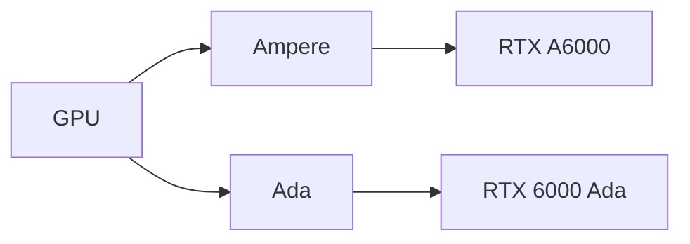

# Supported cards

The device table in `include/gs_devices.h` lists the cards geforce-sriov acts on and how it handles each generation.
The kernel module, CLI and identity hook all use this table. `geforce-sriov devices` prints it from the installed binary.
This page is a readable copy.
If it disagrees with the header, the header takes precedence.

- A listed ID means the tools will act on that card when it is selected.
- Every entry is one exact PCI device ID with vendor `10de`. There are no ranges.
- A card whose ID is not listed is not presented or activated. The rebuilt `nvidia.ko`
  still applies to it whenever it is bound to `nvidia` ([Combining generations](#combining-generations)).
  `install --dry-run`, `install --device` and `setup` refuse it with `<BDF> (10de:<id>) is not in the device
  table`.

## Generations

| Generation | Presented as | Default vGPU type | Status | Page |
|---|---|---|---|---|
| Ampere | RTX A6000, `10de:2230` | 525, RTXA6000-2Q | supported | [Ampere](ampere.md) |
| Ada | RTX 6000 Ada, `10de:26b1` | 942, RTX6000-Ada-2Q | supported | [Ada](ada.md) |

NVIDIA's vGPU software sees each card as its generation's professional target in the *Presented as* column.
The card keeps its board's subsystem ID. Both targets' stock `<pgpu>` entries use subsystem ID `0x0`, which matches any ID.

## Status of every row

Every listed card is supported. Use the host and guest driver versions in the [supported software stack](installation.md#supported-software-stack).
Other versions are **not guaranteed to work**.
580.159.01 is the only confirmed version. `install` builds another host driver version as best effort when it finds the code it patches. `setup` asks first, and `--allow-unsupported-driver` answers yes.
If you use the manual path with `--driver=skip`, `status`, `check` and `activate` print that the host driver is not guaranteed to work and continue.
See [Ampere](ampere.md) and [Ada](ada.md) for hardware details.

- `geforce-sriov devices` names the target of each generation once, then lists every row with its
  device ID, generation, die and name.
- The capability offsets of each row come from public raw config-space dumps of cards with that ID. The laptop and embedded rows without a dump use their generation's offsets ([Laptop support](laptops.md#ids-without-a-dump)).
  The kernel module re-reads and validates each header on the running card and does nothing when it does not match.

> [!IMPORTANT]
> Choose vGPU types that fit your card's physical VRAM. A type, also called a profile, has a fixed memory size.
> The target's type table is presented unchanged, so it can offer types larger than the card's memory.
> For example, a 10–12 GB GA102 card is presented as the 48 GB RTX A6000.
> There is no automatic VRAM check.
>
> The combined memory of all running vGPUs must fit in physical VRAM, with room left for the host driver.
> Four `4Q` vGPUs need 16 GB plus the host driver's share: they fit a 24 GB card and do not fit a 16 GB card ([Choosing a vGPU type](configuration.md#choosing-a-vgpu-type)).

If you have a card from this table, please submit a
[compatibility report](https://github.com/noon-at-cgn/geforce-sriov/issues/new?template=compatibility-report.yml)
whether it works or not.

## Combining generations

Ampere and Ada cards can share one host.
Select up to 32 cards with one `--device` per card.
Each uses its generation's target, and `activate` and `check` process every selected card.

- One host module and one plugin serve all cards, so every revision any selected generation needs is
  made ([Which revisions to make](driver-patch.md#which-revisions-to-make)). Loading `nvidia` binds
  every NVIDIA card on the host, so select every card you will use.
- The rebuilt `nvidia.ko` applies to every card bound to it, selected or not: its VF-count and scheduler revisions are not per card.
  The VF-count revision forces 4 virtual functions on every card bound to it, whatever its row. Each virtual function (VF) serves one vGPU.
  `vfs` accepts values from 1 to the card's ceiling: 16 on Ampere and `28b0`, 4 on other Ada cards. NVIDIA's patched driver uses at most 4 VFs per card.
- The selection, `bdfs`, limits what the kernel module presents for SR-IOV. It also limits the identity hook
  and `activate`. A card outside it is bound by NVIDIA's driver but not activated.
- `status` and `install --dry-run` print one `[WARN]` when a selection mixes Ada with another generation, and nothing refuses
  the selection itself.
- `--type` is refused on a mixed selection with exit 3, because no single type is creatable on both
  targets. Omit it for the per-generation defaults: 525 on Ampere and 942 on Ada.
- `activate` restarts NVIDIA's daemons for the whole host, so it refuses while a GPU outside `bdfs`
  has VFs.

For mixed-host startup details, see [Ampere](ampere.md#with-the-other-generation) and [Ada](ada.md#with-the-other-generation).

Host layouts such as switches, shared buses, IOMMU groups and BAR space are covered in
[the technical reference](technical-reference.md#multiple-gpus-and-pci-topology).

## Rows

| Device | Die | Product | Generation |
|---|---|---|---|
| `2203` | GA102 | GeForce RTX 3090 Ti | Ampere |
| `2204` | GA102 | GeForce RTX 3090 | Ampere |
| `2206` | GA102 | GeForce RTX 3080 | Ampere |
| `2208` | GA102 | GeForce RTX 3080 Ti | Ampere |
| `220a` | GA102 | GeForce RTX 3080 12GB | Ampere |
| `2216` | GA102 | GeForce RTX 3080 LHR | Ampere |
| `2482` | GA104 | GeForce RTX 3070 Ti | Ampere |
| `2484` | GA104 | GeForce RTX 3070 | Ampere |
| `2486` | GA104 | GeForce RTX 3060 Ti | Ampere |
| `2487` | GA104 | GeForce RTX 3060 | Ampere |
| `2488` | GA104 | GeForce RTX 3070 LHR | Ampere |
| `2489` | GA104 | GeForce RTX 3060 Ti LHR | Ampere |
| `249c` | GA104 | GeForce RTX 3080 Laptop GPU | Ampere |
| `249d` | GA104 | GeForce RTX 3070 Laptop GPU | Ampere |
| `24a0` | GA104 | GeForce RTX 3070 Ti Laptop GPU | Ampere |
| `24b0` | GA104 | RTX A4000 | Ampere |
| `24b6` | GA104 | RTX A5000 Laptop GPU | Ampere |
| `24b7` | GA104 | RTX A4000 Mobile | Ampere |
| `24b8` | GA104 | RTX A3000 Mobile | Ampere |
| `24b9` | GA104 | RTX A3000 12GB Laptop GPU | Ampere |
| `24ba` | GA104 | RTX A4500 Laptop GPU | Ampere |
| `24bb` | GA104 | RTX A3000 Laptop GPU | Ampere |
| `24dc` | GA104 | GeForce RTX 3080 Laptop GPU | Ampere |
| `24dd` | GA104 | GeForce RTX 3070 Laptop GPU | Ampere |
| `24e0` | GA104 | GeForce RTX 3070 Ti Laptop GPU | Ampere |
| `2503` | GA106 | GeForce RTX 3060 | Ampere |
| `2504` | GA106 | GeForce RTX 3060 LHR | Ampere |
| `2507` | GA106 | GeForce RTX 3050 | Ampere |
| `2520` | GA106 | GeForce RTX 3060 Laptop GPU | Ampere |
| `2523` | GA106 | GeForce RTX 3050 Ti Laptop GPU | Ampere |
| `2544` | GA106 | GeForce RTX 3060 | Ampere |
| `2560` | GA106 | GeForce RTX 3060 Laptop GPU | Ampere |
| `2563` | GA106 | GeForce RTX 3050 Ti Mobile / Max-Q | Ampere |
| `2571` | GA106 | RTX A2000 12GB | Ampere |
| `2582` | GA107 | GeForce RTX 3050 8GB | Ampere |
| `2584` | GA107 | GeForce RTX 3050 6GB | Ampere |
| `25a0` | GA107 | GeForce RTX 3050 Ti Laptop GPU | Ampere |
| `25a2` | GA107 | GeForce RTX 3050 Laptop GPU | Ampere |
| `25a5` | GA107 | GeForce RTX 3050 Mobile | Ampere |
| `25a6` | GA107 | GeForce MX570 | Ampere |
| `25a7` | GA107 | GeForce MX570 | Ampere |
| `25a9` | GA107 | GeForce RTX 2050 | Ampere |
| `25ab` | GA107 | GeForce RTX 3050 4GB Laptop GPU | Ampere |
| `25ac` | GA107 | GeForce RTX 3050 6GB Laptop GPU | Ampere |
| `25ad` | GA107 | GeForce RTX 2050 | Ampere |
| `25b8` | GA107 | RTX A2000 Mobile | Ampere |
| `25b9` | GA107 | RTX A1000 Laptop GPU | Ampere |
| `25ba` | GA107 | RTX A2000 8GB Laptop GPU | Ampere |
| `25bb` | GA107 | RTX A500 Laptop GPU | Ampere |
| `25bc` | GA107 | RTX A1000 6GB Laptop GPU | Ampere |
| `25bd` | GA107 | RTX A500 Laptop GPU | Ampere |
| `25e0` | GA107 | GeForce RTX 3050 Ti Mobile | Ampere |
| `25e2` | GA107 | GeForce RTX 3050 Mobile | Ampere |
| `25e5` | GA107 | GeForce RTX 3050 Mobile | Ampere |
| `25ec` | GA107 | GeForce RTX 3050 6GB Laptop GPU | Ampere |
| `25ed` | GA107 | GeForce RTX 2050 | Ampere |
| `25f9` | GA107 | RTX A1000 Embedded GPU | Ampere |
| `25fa` | GA107 | RTX A2000 Embedded GPU | Ampere |
| `25fb` | GA107 | RTX A500 Embedded GPU | Ampere |
| `2684` | AD102 | GeForce RTX 4090 | Ada |
| `2685` | AD102 | GeForce RTX 4090 D | Ada |
| `2689` | AD102 | GeForce RTX 4070 Ti SUPER | Ada |
| `2702` | AD103 | GeForce RTX 4080 SUPER | Ada |
| `2704` | AD103 | GeForce RTX 4080 | Ada |
| `2705` | AD103 | GeForce RTX 4070 Ti SUPER | Ada |
| `2709` | AD103 | GeForce RTX 4070 | Ada |
| `2717` | AD103 | GeForce RTX 4090 Laptop GPU | Ada |
| `2730` | AD103 | RTX 5000 Ada Generation Laptop GPU | Ada |
| `2757` | AD103 | GeForce RTX 4090 Laptop GPU | Ada |
| `2770` | AD103 | RTX 5000 Ada Generation Embedded GPU | Ada |
| `2782` | AD104 | GeForce RTX 4070 Ti | Ada |
| `2783` | AD104 | GeForce RTX 4070 SUPER | Ada |
| `2786` | AD104 | GeForce RTX 4070 | Ada |
| `2788` | AD104 | GeForce RTX 4060 Ti | Ada |
| `27a0` | AD104 | GeForce RTX 4080 Max-Q / Mobile | Ada |
| `27b1` | AD104 | RTX 4500 Ada Generation | Ada |
| `27b2` | AD104 | RTX 4000 Ada Generation | Ada |
| `27ba` | AD104 | RTX 4000 Ada Generation Laptop GPU | Ada |
| `27bb` | AD104 | RTX 3500 Ada Generation Laptop GPU | Ada |
| `27e0` | AD104 | GeForce RTX 4080 Laptop GPU | Ada |
| `27fb` | AD104 | RTX 3500 Ada Generation Embedded GPU | Ada |
| `2803` | AD106 | GeForce RTX 4060 Ti | Ada |
| `2805` | AD106 | GeForce RTX 4060 Ti 16GB | Ada |
| `2820` | AD106 | GeForce RTX 4070 Laptop GPU | Ada |
| `2838` | AD106 | RTX 3000 Ada Generation Laptop GPU | Ada |
| `2860` | AD106 | GeForce RTX 4070 Laptop GPU | Ada |
| `2882` | AD107 | GeForce RTX 4060 | Ada |
| `28a0` | AD107 | GeForce RTX 4060 Laptop GPU | Ada |
| `28a1` | AD107 | GeForce RTX 4050 Laptop GPU | Ada |
| `28b0` | AD107 | RTX 2000 / 2000E Ada Generation | Ada |
| `28b8` | AD107 | RTX 2000 Ada Laptop GPU | Ada |
| `28b9` | AD107 | RTX 1000 Ada Generation Laptop GPU | Ada |
| `28ba` | AD107 | RTX 500 Ada Generation Laptop GPU | Ada |
| `28bb` | AD107 | RTX 500 Ada Generation Laptop GPU | Ada |
| `28e0` | AD107 | GeForce RTX 4060 Laptop GPU | Ada |
| `28e1` | AD107 | GeForce RTX 4050 Laptop GPU | Ada |
| `28e3` | AD107 | GeForce RTX 3050 A Laptop GPU | Ada |

The desktop workstation rows are `24b0`, `2571`, `27b1`, `27b2` and `28b0`. They carry the same hidden SR-IOV block as the GeForce cards of their generation and are handled the same way.
The laptop and embedded rows, including workstation parts, take the same path with added power guards. See [Laptop support](laptops.md).
See [Ada](ada.md) for the Ada rows.

## Capability positions per generation

The kernel module exposes capabilities hidden in the card's PCI config space.
The table lists their positions and the register bit that hides MSI-X.

| Generation | SR-IOV | ARI | MSI-X | MSI-X hide bit |
|---|---|---|---|---|
| Ampere | hidden at `0xBCC` (TotalVFs 16, first VF offset 4, stride 1) | hidden at `0xC14` | `0xC8` | `0x41C` bit 29 |
| Ada | hidden at `0xBCC` (first VF offset 4, stride 1) | hidden at `0xC14` | `0xC8` | `0x41C` bit 29 |

TotalVFs is 1 on most Ada cards and 16 on the RTX 2000 / 2000E Ada Generation (`28b0`).
On Ada, the host module's VF-count revision makes NVIDIA's driver report 4.

The VF count is a standard SR-IOV setting.
Set it with `install --vfs N` or `vfs=N` in the config, from 1 up to the card's ceiling.
If the card has no enabled VFs, `activate` enables every presented VF.

- More than 4 VFs per card is not available, so `vfs` defaults to 4.
  ARI is enabled in software: the module presents the card's ARI capability and turns on ARI forwarding in the bridge above it. Above 4 VFs the module refuses to load when the card's VF layout check fails.
- The ceiling is the card's hardware default, except on an Ada card that reports 1: its ceiling is 4,
  set by the host module's VF-count revision. `status` and `install --dry-run` then report "hardware default 1,
  geforce-sriov presents 4".

The module also checks each card's reported first VF offset and stride.
It refuses to load, or the kernel sets up no SR-IOV on that card, when:

- a VF would land on the card's own function, or two VFs would share a function
- a VF would land beyond function 7 or on a function another device already uses
- the card's NumVFs register does not read back the value the kernel wrote during setup

## NVIDIA driver flavour

NVIDIA's vGPU host package can install its kernel module in two flavours, proprietary and open.
geforce-sriov's driver patch and install path support only the proprietary flavour.

- Ampere: uses the proprietary flavour. The open flavour always starts the GSP firmware. On Ampere that fails at GPU start (`RmInitAdapter failed! (0x62:0x56:…)`).
- Ada: uses the proprietary 580.159.01 module with GSP off. The open flavour is not supported
  ([Ada](ada.md#host-stack)).

This follows from NVIDIA's driver source and from the Ampere and Ada host stacks
([Ampere](ampere.md#host-stack), [Ada](ada.md#host-stack)). NVIDIA's host
documentation does not state it.

## Excluded

- Turing: NVIDIA does not support SR-IOV on Turing
  ([NVIDIA's list of supported platforms](https://docs.nvidia.com/vgpu/20.0/grid-vgpu-release-notes-red-hat-el-kvm/validated-platforms.html)).
- Other professional cards: they have NVIDIA's own vGPU support and are not in the device table, so
  no component presents or activates them. The rebuilt `nvidia.ko` still applies to them
  when they are bound to `nvidia`.
