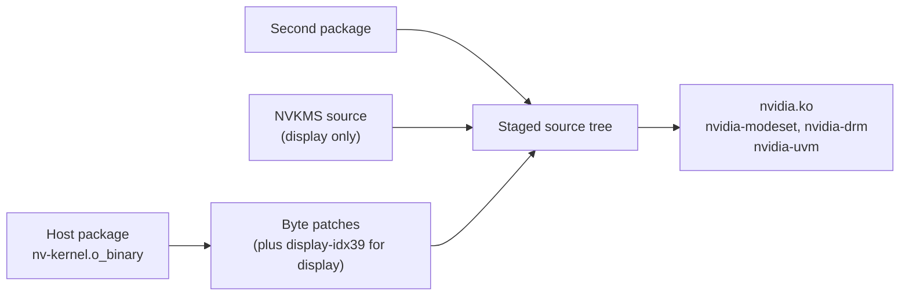

# NVIDIA driver setup

NVIDIA's vGPU host driver does not work on these cards as shipped.
`geforce-sriov install` fixes that by making a few small changes, always on copies of your own files:

- It patches a copy of NVIDIA's closed host object `nv-kernel.o_binary`, the precompiled, closed-source part of the driver ([Byte patches](#byte-patches)). A byte patch is a change of a few bytes.
- It rebuilds `nvidia.ko` from NVIDIA's own source tree, checks the build, backs up the stock `nvidia.ko` and installs the patched one.
- It patches a copy of the vGPU plugin, the user-space library `libnvidia-vgpu.so` that NVIDIA's vGPU manager loads, and points the library name at that copy.
- It writes the option for NVIDIA's module that turns GSP off (GSP is the GPU System Processor, a processor on the card that runs part of NVIDIA's driver as firmware; see the [Glossary](glossary.md)).

If you prefer to do all of that yourself, `install --driver=skip` leaves NVIDIA's files alone ([The manual path](#the-manual-path)).

> [!NOTE]
> geforce-sriov makes no permanent hardware changes and writes no firmware.
> It does not supply NVIDIA software or vGPU licensing.

Only 580.159.01 is a recommended, tested host driver ([supported software stack](installation.md#supported-software-stack)).
Other versions are not guaranteed to work ([Supported inputs](#supported-inputs)).

<a name="what-install-does"></a>

## Install steps

`install` works on one of these NVIDIA kernel source trees:

- the one installed through DKMS, which rebuilds out-of-tree kernel modules for each new kernel (for example `/usr/src/nvidia-580.159.01`);
- the `kernel/` directory extracted from the `--driver-file` package;
- the tree named by `--nvidia-source`.

It then runs these steps in order:

1. Copies NVIDIA's source tree, so the stock tree stays untouched.
2. Makes the three host-object byte patches on the copy's `nvidia/nv-kernel.o_binary`: scheduler, probe gate and VF count (the number of [VFs](glossary.md) each card presents) ([Which byte patches to make](#which-byte-patches-to-make)).
   A display build adds a fourth, `display-idx39` ([Display and host CUDA builds](#display-and-host-cuda-builds)).
   For 580.159.01 the object's SHA-256 must be the recorded one, and the result must match the recorded digest.
   For another driver version, which is not guaranteed to work, `install` continues only when it finds every patch site, as a best-effort build ([Supported inputs](#supported-inputs)).
3. Rebuilds `nvidia.ko` for the running kernel.
   The build prints `objtool` warnings (objtool is a kernel build tool that checks compiled code) about functions in NVIDIA's closed object (for example `_nv000847rm+0x9: call without frame pointer save/setup`).
   They are expected.
4. Checks the build twice:
   - The ABI check (`geforce-sriov-patch abi-check`) confirms that each built NVIDIA module fits the target kernel's binary interface (the ABI). It compares:
     - the `vermagic` string, the kernel build string that every module records and the kernel compares at load time;
     - on a kernel built with module versioning, the symbol CRCs (checksums of the signatures of the kernel functions a module uses) and the exports.
   - A plain build must also differ from NVIDIA's own module in its code (`.text`) at exactly the expected offsets: the eight recorded ones for 580.159.01, and for another version the ones the patch tool reports ([Compare with a stock build](#compare-with-a-stock-build)).
     A display build is checked instead by the digest of its patched object and by the idx 39 change in the finished `nvidia.ko`.

   If either check fails, `install` stops before anything is installed.
5. Backs up the stock `nvidia.ko` and installs the patched one in its place.
6. Makes the patched plugin copy from the stock `libnvidia-vgpu.so.<version>`: the placement patch, then the Ada framebuffer patch, each result checked against its recorded digest.
   The copy is `libnvidia-vgpu.so.580.159.01.geforce-sriov` next to the stock plugin, and `libnvidia-vgpu.so` is pointed at it.
   One plugin copy serves the Ampere and Ada cards on the host.
   A copy from an earlier install that has only the placement patch is replaced when `install` runs again.
7. Writes `options nvidia NVreg_EnableGpuFirmware=0` in `/etc/modprobe.d/geforce-sriov-nvidia.conf` (GSP off; this is a [modprobe option](glossary.md)).
   Another file in `/etc/modprobe.d/` that already sets the option to `0` is accepted and kept, and `install` then writes no file of its own.
   A file it wrote in an earlier install stays until `uninstall`.
   A file that sets any other value makes `install` stop, naming the file and the value.
   On 580.159.01 `activate` refuses without the option; on any other host driver version it only warns.

The stock `nvidia.ko` and plugin are **never** overwritten without a backup, and `uninstall` puts them back when they still match what `install` wrote ([Reverting](#reverting)).
Running `install` again leaves files that are already correct unchanged.
The initramfs (the early-boot image) needs no rebuild, because `nvidia` is not in it ([What doctor checks](installation.md#what-doctor-checks)).

Afterwards `dkms status` reports `Differences between built and installed modules` for `nvidia`.
That is expected: the installed file is no longer the one DKMS built.

With Secure Boot on, the rebuilt `nvidia.ko` must be signed with an enrolled key.
This guide does not cover that.

## Supported inputs

`install` pins whole-file SHA-256 digests.
It treats the host object `nvidia/nv-kernel.o_binary` and the vGPU plugin `libnvidia-vgpu.so.580.159.01` as tested files only when each matches the digest recorded for 580.159.01 in [Byte patches](#byte-patches).

| File | What happens |
|---|---|
| Host object that matches the recorded stock digest | The three byte patches are made, and the result must match the recorded VF-count digest |
| Plugin that matches the recorded stock digest | The two plugin byte patches are made on a copy in order, and each result must match its recorded digest |
| Plugin that already matches the placement-patch digest | The framebuffer patch is made on a copy, and the copy must match the recorded patched plugin digest |
| Plugin that already matches the patched plugin digest | Used as it is |
| Any other file, including another driver version's object or a guest driver's object | A guest driver's object is refused. Another host driver version is reported and continues only when every patch site is found (see below); when `install` stops, the reason names the digest found and the one expected |

Host driver 580.159.01 (vGPU software 19.5) and the guest drivers in the [software stack](installation.md#supported-software-stack) are the recommended, tested versions.
Other host driver versions are not guaranteed to work, and neither are other guest driver versions.
For another host version, `install` names the version and, when every patch site is found, continues on a best-effort basis.
`setup` asks first (default no), and `--allow-unsupported-driver` answers yes.
On the manual path (`--driver=skip`), `doctor`, `check` and `activate` warn about another host driver version and continue.

<a name="revisions"></a>

## Byte patches

A byte patch is a change to a few bytes of one of NVIDIA's own files, made by `install` (or by the manual path) on a copy of your file.
Five byte patches change two files from driver 580.159.01: the host object `nvidia/nv-kernel.o_binary` and the vGPU plugin `libnvidia-vgpu.so.580.159.01`.
They are separate from the two *source patches* of the display build, which change NVIDIA's source tree instead ([Display and host CUDA builds](#display-and-host-cuda-builds)).

| Byte patch | File | File offset | Bytes changed |
|---|---|---|---|
| Scheduler (stall workaround) | host object | `0x9f2588` | 2 |
| Ada probe gate | host object | `0xd654ef` | 2 |
| VF count | host object | `0x126644` | 4 |
| Placement patch | plugin | `0x8fc17` | 15 |
| Ada framebuffer patch | plugin | `0xa5f28` | 6 |

The bytes at each offset, before and after:

```text
Scheduler patch         0x9f2588   75 76                                          -> 90 90
Ada probe gate patch    0xd654ef   75 7f                                          -> 90 90
VF count patch          0x126644   0f b7 45 06                                    -> 31 c0 b0 04
Placement patch         0x8fc17    4c 39 c1 0f 84 08 03 00 00 48 8d 05 91 78 2d   -> 48 8b 93 60 2b 00 00 48 89 4a 08 e9 01 03 00
Ada framebuffer patch   0xa5f28    8b bb d0 29 00 00                              -> bf 04 00 00 00 90
```

The byte patches are applied in this order, and each digest covers the whole file after that step.
Check each step with `sha256sum FILE`; `ada list` prints the same digests.

```text
nv-kernel.o_binary
  stock                 4e3abe645b6873ed478adea6a06c6955352ff06186849edeea536c9630596449
  + scheduler           ce8a485bfaeebca3a9609f9415a6df81c160a0a53509aec093bc3361a6d12701
  + Ada probe gate      f5b788cdb3e06aed18860cc6cf950dcc13143bd831d90d8e9c4bf9e744426f12
  + VF count            946b27b8bcf0f08285335f47904516860c65b726619e5a36d89785981c70ba29

libnvidia-vgpu.so.580.159.01
  stock                 7e52b76dc7ca8490e7ffbc1fd724f5db07f3791a3a2ec07f2d595bf05abdcaa7
  + placement patch     7ddfad458bbfdb0c4d6902a9e045bd15c84f63aea19314f3d3a60967224b73c6
  + framebuffer patch   aa4fdeb5288b5e56e7d4972466813d78e10cfb428fcf62fb53b84fec718cf07c
```

These are the digests recorded for the recommended version 580.159.01.
The patched plugin copy is the stock plugin with both plugin patches, SHA-256 `aa4fdeb5…`, and it is the **only** copy `activate` accepts.
Which cards need which patch is in [Which byte patches to make](#which-byte-patches-to-make).

### Scheduler patch

- What it changes: a PMU-service callback (code that talks to the GPU's power management unit) in the closed `nv-kernel.o_binary` calls a routine that sets the GPU's runlist scheduler-disable register, a register that switches off the GPU's work scheduler.
  The patch replaces the two-byte conditional jump in front of that call (`jne`, bytes `75 76`) with two `NOP`s (`90 90`, instructions that do nothing), so the callback skips the call.
- What goes wrong without it: with NVIDIA's vGPU-KVM host driver 580.159.01, CUDA work in a guest can stall, because the GPU stops scheduling work for it.
- Cards: Ampere and Ada. It is made on every host ([Ampere](ampere.md), [Ada](ada.md)).
- Limits: it is a workaround, meaning it avoids the stall without fixing its cause. Why the PMU path disables the runlist is unknown, and nothing shows that the stall cannot return.
  It does not apply to GSP-based drivers, NVIDIA's open kernel modules, guest drivers or Blackwell, and no GSP firmware is changed.

### Ada probe gate patch

- What it changes: the driver's device check, `rm_is_supported_device` (part of its resource manager, RM), contains a two-byte conditional jump (`75 7f`) that this patch replaces with two `NOP`s.
- What goes wrong without it: the check returns `NV_ERR_NOT_SUPPORTED` (`0x56`) for any chip architecture above `0x17`, and Ada is `0x19`, so NVIDIA's stock module (`nvidia.ko`) refuses to take an Ada card on a vGPU host ([Ada](ada.md#how-it-works)).
  With the patch, the driver accepts the Ada card and serves it with GSP off, on the CPU.
- Cards: needed on Ada. On an Ampere card, which is architecture `0x17`, the check never rejected the card, so the patch is inert there.

### VF count patch

- What it changes: inside `kbifCacheVFInfo`, a driver function, it replaces a 16-bit load (`0f b7 45 06`) with the constant 4 (`31 c0 b0 04`).
  NVIDIA's driver then reports 4 total VFs.
- What goes wrong without it: NVIDIA's driver reads a card's TotalVFs (how many VFs the card says it can have) from the hardware and accepts vGPUs only up to that count, and most Ada cards report 1.
  Linux then shows 4 VFs, but a vGPU on any VF after the first fails with `NV_ERR_OUT_OF_RANGE` (`0x5B`) ([Symptoms](recovery.md#symptoms)).
- Cards: needed on Ada. On an Ampere card, which reports 16, it forces 4, which is the count the package presents anyway.
  The patch applies to every Turing, Ampere or Ada card (TU, GA or AD chips) bound to NVIDIA's module, selected or not ([Combining generations](devices.md#combining-generations)).

### Placement patch (plugin)

- What it changes: 15 bytes in the plugin, so that it accepts the framebuffer placement that NVIDIA's driver reports for an Ada VF.
- What goes wrong without the plugin patches: on Ada, the stock plugin makes `nvidia-vgpu-mgr` abort the vGPU configuration (`0x1f`), and the instance does not start.
  Which of the two plugin patches removes that abort has not been isolated, so an Ada host needs both.
- Cards: needed on Ada. Ampere takes another path before this code, so on Ampere the plugin behaves as the stock one.
- A plugin copy with only this patch (SHA-256 `7ddfad45…`) is an earlier copy of this package, and `activate` refuses it on 580.159.01 ([Symptoms](recovery.md#symptoms)).

### Ada framebuffer patch (plugin)

- What it changes: 6 bytes in the Ada branch of the plugin.
  There the plugin sets each VF's host [framebuffer](glossary.md) to the smaller of the type's framebuffer and the card's framebuffer divided by the type's `maxVgpus` (the most vGPUs of that type per card), less the reserved memory.
  The patch makes the divisor 4, the VF count.
- What goes wrong without it: for the RTX 6000 Ada 2Q type `maxVgpus` is 24, which leaves a guest too little memory.
  With the patch an Ada guest keeps more of its vGPU type.
- Cards: needed on Ada. The Ampere path never reaches this code.

## Usage

`install` calls the patcher for you.
You call it yourself only on the manual path, or to check a file.

```
geforce-sriov-patch inspect INPUT
geforce-sriov-patch apply INPUT NEWOUTPUT
geforce-sriov-patch revert PATCHED STOCK NEWOUTPUT
geforce-sriov-patch ada list|inspect INPUT|apply INPUT NEWOUTPUT|revert PATCHED NEWOUTPUT
geforce-sriov-patch display list|inspect INPUT|apply INPUT NEWOUTPUT|revert PATCHED NEWOUTPUT
geforce-sriov-patch abi-check --core CORE.ko --module MOD.ko [--module MOD2.ko ...]
    [--kernel-symvers Module.symvers] [--vermagic STRING] [--vermagic-only]
geforce-sriov-patch --help | --version
```

After `make`, the tool is `driver/geforce-sriov-patch` in this repository.
It is on your `PATH` once `geforce-sriov install` has copied it to `/usr/local/bin`.

Every command reads your own copy of a file and writes only `NEWOUTPUT`.
A command admits a file only when its structure and whole-file SHA-256 match a recorded input (for the scheduler commands, with the two patch bytes taken as stock), and refuses anything else with a reason.
That is the same admission `install` applies ([Supported inputs](#supported-inputs)).

The first three commands handle the scheduler patch:

- `inspect` prints the byte patch as `key=value` lines and writes nothing.
  The keys are:
  - `recipe`: the driver version;
  - `admission`: `digest` when the whole-file digest matched, `anchor` when the version was admitted by the code it found;
  - `state`: `confirmed` for a tested version, `unconfirmed:unknown` otherwise;
  - `function`, `function_offset` and `file_offset`: where the two bytes are.
  To tell a stock object from a patched one, compare `input_sha256` with [Byte patches](#byte-patches).
- `apply` writes a new file that differs from `INPUT` in exactly those two bytes.
  An already-patched input is refused.
- `revert` checks that `PATCHED` and `STOCK` are accepted inputs of the same version, that only `PATCHED` is patched, and that they differ in nothing but the two bytes.
  It then writes `STOCK` to `NEWOUTPUT`.

Output handling and exit status are the same for every command that writes:

- `NEWOUTPUT` **cannot** already exist, and the tool never modifies an input.
- If writing `NEWOUTPUT` fails, the tool tries to remove the partial file and reports what happened to it.
  If that removal fails too, the error says so and the file may remain.
  If the directory cannot be synced, the output is complete, but the new name may not survive a power loss.
- If the tool cannot print its own messages after writing, it exits 1 and says that the output file was already created.
  That file is complete.
- Exit status: 0 success, 1 an I/O failure (unreadable input, output not written), 2 usage, 3 the file was refused (the reason is on standard error).

### The ada commands

This family makes the probe gate, the VF count and the two plugin byte patches.

The tool's table has five rows:

1. `module-gate`: stock object to a gate-only object, which is not the full set of byte patches.
2. `module-gate`: object with the scheduler patch to object with the gate.
3. `vf-count`.
4. `plugin-mixed`: stock plugin to the placement patch, which is not the installed copy.
5. `plugin-div4`: placement patch to the patched plugin copy.

- `list` prints each row: name, driver version, file offset, width, old and new bytes, and the input and output SHA-256.
  No file is read.
- `inspect` prints one line, `row N: NAME: VERSION; ARTIFACT; file offset SITE; STATE`, for the row whose input or output digest the file has, followed by the `key=value` report described above.
  `STATE` is `file at input state` or `file at output state`.
  A digest that is the output of one row and the input of the next is reported as the next row's `file at input state`.
- `apply` prints the same line, then writes the output state.
  A file already at the output state is refused unless another row takes it as input.
- `revert` prints the line for the row whose output digest the file has and writes the input state.
  No stock copy is needed.

### The display and abi-check commands

- `display list|inspect|apply|revert` handles the fourth object byte patch of a display build, `display-idx39` ([Display and host CUDA builds](#display-and-host-cuda-builds)).
  `list` prints the recorded input and output digests of each recipe.
- `abi-check` is the check `install` runs on every build.
  It compares the `vermagic` of each `--module` with `--vermagic`, and, unless `--vermagic-only` is given, the stored symbol CRCs of each module against the core module (`--core`) and the kernel's `Module.symvers` (`--kernel-symvers`, the kernel's list of exported symbols with their CRCs).
  `install` passes `--vermagic-only` for a plain build on a kernel without module versioning, because such a kernel stores no CRCs.

## Which byte patches to make

Every host gets all three object byte patches (four with the display build) and the patched plugin copy, whatever generation its cards are.
One NVIDIA module (`nvidia.ko`) and one plugin serve every card on the host, and the same stack serves an Ampere card with no Ada card beside it.
The VF count patch makes every Turing, Ampere or Ada card bound to NVIDIA's module present 4 VFs ([Combining generations](devices.md#combining-generations)).

| Byte patch | On an Ada card | On an Ampere card |
|---|---|---|
| Scheduler | needed | needed |
| Probe gate | needed, because the stock check rejects an architecture above `0x17` and Ada is `0x19` | inert: an Ampere card is architecture `0x17`, so the check never rejected it |
| VF count | forces 4 total VFs | forces 4 total VFs, which is what an Ampere card uses |
| Plugin placement patch | needed | not reached: Ampere takes another path |
| Plugin framebuffer patch | gives each VF the host framebuffer of 4 VFs, not of the type's `maxVgpus` | not reached: Ampere takes another path |

`install` follows this order:

1. `geforce-sriov-patch apply` on the stock object (the scheduler workaround).
2. `geforce-sriov-patch ada apply` on that output (the probe gate).
3. `geforce-sriov-patch ada apply` on the output of step 2 (the VF count).
4. `geforce-sriov-patch ada apply` on a copy of the stock plugin (the placement patch).
5. `geforce-sriov-patch ada apply` on that output (the framebuffer patch).
   The result is the patched plugin copy, which serves every card on the host.

Revert the host object in the opposite order: `ada revert` twice, each time on the previous output, then `geforce-sriov-patch revert PATCHED STOCK NEWOUTPUT`.

Each command in this list accepts only the output of the one before it, so the scheduler commands refuse an object that carries the probe gate or the VF count.
`ada apply` on the stock object also works, but it writes a gate-only object (SHA-256 `ed3efee68582f4fa9f120cf6c28138d8642db93ff0e6ba07ab0d6d7bf1b9823b`) that the scheduler commands refuse.
Undo it with `ada revert` and start again in the order above.
Restoring NVIDIA's stock module from your own backup also works ([Reverting](#reverting)).

## Compare with a stock build

The comparison shows that the rebuilt `nvidia.ko` differs from NVIDIA's stock one only at the byte patch sites.
`install` takes NVIDIA's own module, extracts its code (`.text`) and the code of the `nvidia.ko` it built, and compares the two.
At a first install that is the installed stock `nvidia.ko`; once a geforce-sriov build is installed, it is the backup of NVIDIA's module that `install` kept, checked against the digest in the build record.
This is the check for a plain build; a display build is checked differently ([Display and host CUDA builds](#display-and-host-cuda-builds)).
You can repeat the comparison by hand, with the patched tree in `/var/tmp/nvidia-$VER-patched` as in [The manual path](#the-manual-path):

```sh
STOCK=$(modinfo -n nvidia)        # the installed stock module, before you replace it
objcopy -O binary -j .text "$STOCK" /var/tmp/stock.text
objcopy -O binary -j .text /var/tmp/nvidia-$VER-patched/nvidia.ko /var/tmp/patched.text
cmp -l /var/tmp/stock.text /var/tmp/patched.text
```

`cmp -l` prints one line per differing byte: the one-based position in decimal, then the two bytes in octal.
`install` turns each position into a zero-based offset inside `.text` and requires the differing offsets to be exactly the expected ones.
For the 580.159.01 object these are the eight below, recorded for a build of its tree with the three object byte patches.
For another host version that the patcher admitted by anchors, they are the offsets the patch tool reports for that build, and the comparison is just as exact.

| `.text` offsets | Stock → built | Byte patch |
|---|---|---|
| `0x14a7c4`-`0x14a7c7` | `0f b7 45 06` → `31 c0 b0 04` | VF count |
| `0xa16708`, `0xa16709` | `75 76` → `90 90` | scheduler |
| `0xd8966f`, `0xd89670` | `75 7f` → `90 90` | probe gate |

Any other difference, or `.text` sections of different sizes, means the build is not the expected one.
`install` then stops before it installs anything and names the first unexpected offset.

When there is no difference at all, the installed `nvidia.ko` already is this build.
If the modprobe file (or another file that sets the option to `0`), the patched plugin copy and this kernel's backup of the stock `nvidia.ko` are in place (the backup differs from the build at exactly the expected offsets), `install` writes the record for this kernel and ends without a change to NVIDIA's files.
A copy from an earlier install with the placement patch only is replaced with the patched plugin copy.
Otherwise it stops, tells you to reinstall the stock `nvidia.ko` first, and names `--driver=skip`, which keeps the installed `nvidia.ko` as it is and installs the rest.

## Display and host CUDA builds

By default `install` builds only `nvidia.ko`.
Two optional builds add modules from a second NVIDIA driver package:

| Build | Switch | Modules added | Needs |
|---|---|---|---|
| Display | `display=auto` or `display=on` with a boot display GPU selected (the card that shows the BIOS/UEFI screen at power-on), or `--display` with one | `nvidia-modeset`, `nvidia-drm` | the second driver package and NVIDIA's public kernel module source |
| Host CUDA | `--host-cuda` (off by default) | `nvidia-uvm` | the second driver package |

Both builds need the second NVIDIA driver package; the display build also needs NVIDIA's public kernel module source:

- `--companion-file PATH` or `--companion-source DIR`: the second driver package, either the `.run` file or an extracted directory.
  It is the Linux vGPU guest driver 580.159.03 or the GeForce 580.159.03 package.
- `--nvkms-source PATH`: NVIDIA's public kernel module source at tag 580.159.03 ([open-gpu-kernel-modules](https://github.com/NVIDIA/open-gpu-kernel-modules)), as a directory or a tarball. NVKMS is its display mode-setting part.

Each of these declares its version, and `install` records it.



A display build differs from the plain build in these ways:

- It makes a fourth object byte patch, `display-idx39`, on the output of the VF-count patch.
  `geforce-sriov-patch display list|inspect INPUT|apply INPUT NEWOUTPUT|revert PATCHED NEWOUTPUT` runs it; the recorded input is the VF-count result `946b27b8…` and the result is `83ce12ab…`.
- It stages the source files of the second driver package and of the public source into a copy of the tree, and applies two source patches that ship with geforce-sriov: one for the DRM driver's GPU selection (DRM is the Linux graphics subsystem) and one for an allocation threshold.
- It does **not** use the eight-offset comparison, because the source patches change `.text` on purpose.
  For 580.159.01 it requires the patched object to have the recorded SHA-256 and the finished `nvidia.ko` to carry the idx 39 change.
- Its ABI check is the full one, with the sibling modules' own `Module.symvers` as a second symbol provider, and it requires `nvidia-modeset` to carry the NVKMS version of the public source.

`install` records the result in `/var/lib/geforce-sriov/driver-build`, with the versions of the host package, the second driver package and the NVKMS source, and a confirmation value.
The build is confirmed only when the packages, the source and every byte patch match a combination that was tested: the plain build, the display build with a second driver package and NVKMS source at 580.159.03, and that display build with host CUDA. <!-- the display and host CUDA combination is provisional until the final hardware run -->
Host CUDA without the display build has no recorded test and is recorded as unconfirmed.
A host version other than 580.159.01 is recorded as unconfirmed too, and `install` prints the best-effort notice for it; when the files match their recorded digests but the combination was never tested, the notice says that instead.
`doctor` and `status` show the record.
The manual path below covers the plain build only.

## After a kernel or NVIDIA driver update

DKMS does not know about the patch, and nothing reapplies it automatically.
After an update:

1. New kernel, same driver. DKMS builds a stock `nvidia.ko` for the new kernel.
   Before you boot it, run `sudo geforce-sriov rebuild --kernel <new release>`, which builds the patched `nvidia.ko` for that kernel, then power-cycle into it.
   If you already booted the new kernel, run `sudo geforce-sriov rebuild` and power-cycle again.
   It needs no file paths, because `install` kept the second NVIDIA driver package and NVIDIA's public kernel module source under `/var/lib/geforce-sriov/inputs/`.
   If NVIDIA's own module for that kernel is not built yet, install the kernel's headers and run `sudo dkms install nvidia/<version> -k <kernel>` first, then `rebuild --kernel <kernel>`.
   On the manual path, repeat the rebuild with `KERNEL_UNAME` set to the new kernel and install the result before booting it.
2. New NVIDIA driver version. A reinstalled or upgraded host package installs a stock `nvidia.ko`.
   Its `nv-kernel.o_binary` does not match the recorded digest, so the version is not one the recorded digests cover.
   `geforce-sriov install`, run from the source folder with the new packages, reports it and continues only when every patch site is found, as a best-effort build; `setup` asks first.
   Otherwise keep NVIDIA's stock module (the stall can return) or stay on 580.159.01.
   Do **not** patch it by hand.

   `geforce-sriov doctor` warns about a host driver version other than 580.159.01.
   It also reports whether the identity hook acts on the loaded build; on any other build the hook passes every call through.
3. Replace `nvidia.ko` only while no VF exists. The simplest safe order is to install the patched file and power the machine off and on.
   At boot the livepatch unit loads the [livepatch](glossary.md) and then `nvidia`, and the activate unit then creates the VFs on the patched `nvidia.ko`.

`install` records the build it installed in `/var/lib/geforce-sriov/driver-build`.
`doctor` and `status` compare the build ID of the installed `nvidia.ko` (an identifier embedded in each module) with that record and report it.
`activate` refuses when the record does not name the installed `nvidia.ko` for the running kernel, including a record written for another kernel; `sudo geforce-sriov rebuild` for the running kernel rewrites the record.
The record of every other kernel is kept in `/var/lib/geforce-sriov/driver-builds/<kernel>` and becomes the published record again when a run is for that kernel.
With no record at all (`--driver=skip`), `activate` only warns.

## Reverting

`geforce-sriov uninstall` restores the stock `nvidia.ko` for every kernel that geforce-sriov built for, when the installed `nvidia.ko` is still the one geforce-sriov wrote, and leaves an `nvidia.ko` that has changed since.
It also:

- points `libnvidia-vgpu.so` back at `libnvidia-vgpu.so.580.159.01` and removes the patched plugin copy;
- removes `/etc/modprobe.d/geforce-sriov-nvidia.conf` (another file of yours that sets the option stays);
- after a successful restore, removes the backups it used from `/var/lib/geforce-sriov/stock/`, then `/var/lib/geforce-sriov/build/` and `/var/lib/geforce-sriov/stock/` when they are empty, and the kept build inputs in `/var/lib/geforce-sriov/inputs/`;
- for each kernel whose backup stays, prints a `restore <kernel release>: cp … && depmod -a <kernel release>` line that puts NVIDIA's module back for that kernel.

Power the machine fully off, then on afterwards.

When restoring fails, `uninstall` exits 1, keeps the `geforce-sriov-driver` script and the backup in `/var/lib/geforce-sriov/stock/`, and prints the reason and the two ways to finish:

- Fix the failure and run `geforce-sriov-driver --restore`.
- Copy the kernel's backup over `nvidia.ko`, run `depmod -a <kernel release>` (it refreshes the kernel's module index), and do the remaining steps below.

If `geforce-sriov-driver` changed since install, `uninstall` does not run it.
Check the file, or restore the installed copy with `geforce-sriov install` and run `uninstall` again.
Alternatively, copy the backup as described above.

To revert by hand:

1. Copy the stock `nvidia.ko` (your backup, or `/var/lib/geforce-sriov/stock/<kernel release>/nvidia.ko`) back to the path `modinfo -k <kernel release> -n nvidia` prints, and run `depmod -a <kernel release>`.
2. Point `libnvidia-vgpu.so` back at `libnvidia-vgpu.so.580.159.01` (for example `ln -sfn libnvidia-vgpu.so.580.159.01 /usr/lib/x86_64-linux-gnu/libnvidia-vgpu.so`).
3. Remove `/etc/modprobe.d/geforce-sriov-nvidia.conf`.
4. Power the machine fully off, then on.

Rebuilding from the untouched `/usr/src/nvidia-<version>` tree also works.

To restore a stock object from a patched one, `geforce-sriov-patch revert PATCHED STOCK NEWOUTPUT` checks the pair first.
For an object with all three byte patches, run `geforce-sriov-patch ada revert PATCHED NEWOUTPUT` twice, each time on the previous output, then `revert` on the last output ([Which byte patches to make](#which-byte-patches-to-make)).

## The manual path

Choose the manual path if you prefer to change NVIDIA's files yourself.
`geforce-sriov install --driver=skip` installs everything else and leaves NVIDIA's module, the plugin and the modprobe option to you.
Do the steps below once, before the power cycle in the [installation guide](installation.md#cold-boot).
On 580.159.01, `activate` refuses until NVIDIA's patched module, the plugin copy and the GSP-off option are in place.
On another host driver version, which is not guaranteed to work, it warns and continues.
Adapt the paths to your system.

### Rebuild NVIDIA's module

The vGPU-KVM host package installed with DKMS places its kernel source in `/usr/src/nvidia-<version>`, with the closed object at `nvidia/nv-kernel.o_binary`.
Build the patched `nvidia.ko` from a copy of that tree and keep the stock tree untouched.

```sh
GS=$HOME/geforce-sriov       # this repository, after `make`; adapt
VER=580.159.01
cp -a /usr/src/nvidia-$VER /var/tmp/nvidia-$VER-patched
cd /var/tmp/nvidia-$VER-patched

"$GS"/driver/geforce-sriov-patch inspect nvidia/nv-kernel.o_binary
"$GS"/driver/geforce-sriov-patch apply nvidia/nv-kernel.o_binary /var/tmp/nv-kernel.o_binary.patched
"$GS"/driver/geforce-sriov-patch ada apply /var/tmp/nv-kernel.o_binary.patched /var/tmp/nv-kernel.o_binary.gate
"$GS"/driver/geforce-sriov-patch ada apply /var/tmp/nv-kernel.o_binary.gate /var/tmp/nv-kernel.o_binary.ada
cp /var/tmp/nv-kernel.o_binary.ada nvidia/nv-kernel.o_binary
"$GS"/driver/geforce-sriov-patch ada inspect nvidia/nv-kernel.o_binary   # now: row 3: vf-count: …; file at output state

make -j"$(nproc)" NV_EXCLUDE_BUILD_MODULES= KERNEL_UNAME="$(uname -r)" modules
```

For 580.159.01, the first `inspect` prints, among other lines:

```text
admission=digest
state=confirmed
byte patch=scheduler
recipe=580.159.01
function=_nv052453rm
file_offset=0x9f2588
```

The first `ada apply` prints `row 2: module-gate: …; file at input state`, and the second prints `row 3: vf-count: …; file at input state`.
The plain `inspect` refuses the final file, because it carries all three changes.

The build writes `nvidia.ko` and `nvidia-vgpu-vfio.ko` to the top of the copied tree.
Only `nvidia.ko` contains the patched object, so the installed `nvidia-vgpu-vfio.ko` stays as it is.
Compare the result with a stock build before installing it ([Compare with a stock build](#compare-with-a-stock-build)).

### Install the patched `nvidia.ko`

Do this while `nvidia` is not in use.
Back up the installed stock `nvidia.ko` first:

```sh
M=$(modinfo -n nvidia)        # usually /lib/modules/<kernel>/updates/dkms/nvidia.ko
cp -a "$M" /root/nvidia.ko.stock-"$(uname -r)"
cp /var/tmp/nvidia-$VER-patched/nvidia.ko "$M"
sha256sum "$M" /var/tmp/nvidia-$VER-patched/nvidia.ko   # both sums must be equal
```

- Keep the backup outside `/lib/modules`, so `depmod` and `modprobe` never pick it up.
- Replacing the file under the same name needs no `depmod`.
  If `modinfo -n` names a compressed file (`nvidia.ko.xz`, `nvidia.ko.zst`), skip the two `cp` lines: move that file to your backup location, copy the patched `nvidia.ko` into the same directory as `nvidia.ko`, and run `depmod <kernel>`.
- One driver serves every GPU in the host, so the patched `nvidia.ko` applies to all of them.
- The patched `nvidia.ko` is built for one kernel, so rebuild it for each kernel you boot.

### Make and place the plugin copy

Make the two plugin byte patches in order on a copy of the stock plugin (`libnvidia-vgpu.so.580.159.01`, SHA-256 `7e52b76d…`): the placement patch, then the framebuffer patch on its output.
Check each result against its plugin row of [Byte patches](#byte-patches), put the final copy next to the stock plugin under a name of your choice (`install` uses `libnvidia-vgpu.so.580.159.01.geforce-sriov`), and point the symlink `libnvidia-vgpu.so` at it:

```sh
"$GS"/driver/geforce-sriov-patch ada apply libnvidia-vgpu.so.580.159.01 /var/tmp/libnvidia-vgpu.so.placement
sha256sum /var/tmp/libnvidia-vgpu.so.placement    # 7ddfad45…
"$GS"/driver/geforce-sriov-patch ada apply /var/tmp/libnvidia-vgpu.so.placement /var/tmp/libnvidia-vgpu.so.patched
sha256sum /var/tmp/libnvidia-vgpu.so.patched      # aa4fdeb5…, the patched plugin copy
```

The first `ada apply` prints `row 4: plugin-mixed: …; file at input state`, and the second prints `row 5: plugin-div4: …; file at input state`.
Only the second file is the copy to install; `activate` refuses the first one.

### Turn GSP off

The driver must run with GSP off, so that the GPU's management work runs on the CPU instead.
Load `nvidia.ko` with `NVreg_EnableGpuFirmware=0`, for example with `options nvidia NVreg_EnableGpuFirmware=0` in a file in `/etc/modprobe.d/`.
On 580.159.01 `activate` refuses otherwise; on another host driver version, which is not guaranteed to work, it warns.
A later `install` without `--driver=skip` accepts and keeps an existing file that sets the option to `0`, and refuses one that sets any other value.
