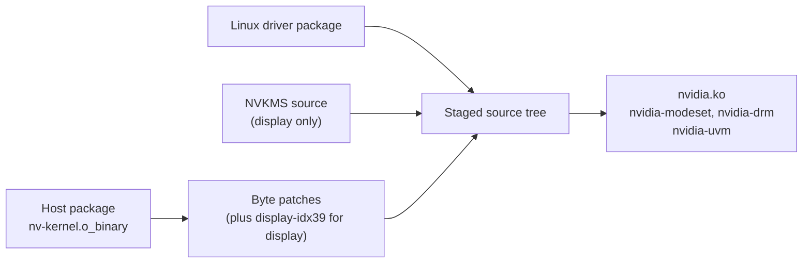

# What install does to NVIDIA's files

NVIDIA's vGPU host driver needs a few changes before it works on these cards.
`geforce-sriov install` makes them on copies of your own files:

- It makes the revisions in [Revisions](#revisions).
- It rebuilds `nvidia.ko` and checks the build.
- It backs up the stock module and installs the patched one.
- It places the patched plugin copy.
- It writes the module option that turns GSP off (GSP is the GPU System Processor, see the
  [Glossary](glossary.md)).

If you prefer to do it by hand, `install --driver=skip` turns all of that off
([The manual path](#the-manual-path)).

> [!NOTE]
> geforce-sriov is **NOT** a vBIOS flasher or a licensing tool. It does not distribute any NVIDIA
> software.

The revisions are made on a copy of your own `nv-kernel.o_binary` and of the vGPU plugin.
NVIDIA's kernel module is rebuilt from NVIDIA's source tree on your host.
The driver versions must match the [supported stack](installation.md#supported-software-stack) ([Supported inputs](#supported-inputs)).

## What install does

`install` works on one of these NVIDIA kernel source trees:

- the one installed with DKMS, which rebuilds kernel modules for each new kernel (for example
  `/usr/src/nvidia-580.159.01`);
- the `kernel/` directory extracted from the `--driver-file` package;
- the tree named by `--nvidia-source`.

It then runs these steps in order:

1. Copies NVIDIA's source tree and leaves the stock tree untouched.
2. Makes the host-object revisions on the copy's `nvidia/nv-kernel.o_binary`: scheduler, probe gate, VF count ([Which revisions to make](#which-revisions-to-make)).
   When an Ada card is selected (`--ada-selected`) it makes the Ada placement change as well, the change named `ada-placement` (`geforce-sriov-patch ada list` prints every change by name; see [Revisions](#revisions)).
   An object whose SHA-256 is the one recorded for 580.159.01 is a confirmed input, and the result must match the recorded digest.
   An object of another digest is admitted when the bytes around each change (its code window) are found exactly once; such a build is best effort and recorded as `confirmation=unconfirmed`.
   A file whose windows are not found is refused with the reason ([Supported inputs](#supported-inputs)).
3. Rebuilds `nvidia.ko` for the running kernel.
   The build also prints `objtool` warnings about functions in NVIDIA's closed object (for example `_nv000847rm+0x9: call without frame pointer save/setup`).
   They are expected.
4. For a build without the display modules, compares the code (`.text`) of the build with that of the installed stock module and requires them to differ at the eight recorded offsets, plus the one placement offset when an Ada card is selected ([Compare with a stock build](#compare-with-a-stock-build)).
   For another host driver version the offsets are the ones the patch tool reported for that build.
   A build with the display modules is checked another way.
   The display revision is one more change to the closed object, made after the last host revision and only in a build with the display modules: it changes one call inside NVIDIA's closed object.
   The check that the finished module carries the display revision always runs.
   Only a confirmed-inputs build must also end at the recorded object chain digest; a display revision admitted by its anchors is accepted and recorded as unconfirmed.
   Any other difference refuses before anything is installed.
5. Backs up the stock `nvidia.ko` and installs the patched one in its place.
6. Makes the patched plugin copy from the stock `libnvidia-vgpu.so.<version>`: the plugin placement change and then the Ada framebuffer change, each result checked against its recorded digest.
   It points `libnvidia-vgpu.so` at the copy.
   One plugin copy serves the Ampere and Ada cards on the host.
   A copy from an earlier install that has only the plugin placement change is replaced when `install` runs again.
7. Writes `options nvidia NVreg_EnableGpuFirmware=0` in `/etc/modprobe.d/geforce-sriov-nvidia.conf` (GSP off).
   Another file in `/etc/modprobe.d/` that already sets the option to `0` is accepted and kept, and the step then writes no file of its own.
   A file it wrote in an earlier install stays until `uninstall`.
   A file that sets any other value causes the step to refuse, naming the file and the value.
   On 580.159.01 `activate` refuses without the option; on any other host driver version it only warns.

The stock module and plugin are never overwritten without a backup, and `uninstall` puts them back when they still match what `install` wrote ([Reverting](#reverting)).
Running `install` again leaves files that are already correct unchanged.
The initramfs needs no rebuild, because `nvidia` is not in it (`status` reports a boot module configuration that loads `nvidia` at boot; it does not inspect built initramfs images).

`dkms status` reports `Differences between built and installed modules` for `nvidia` afterwards.
That is expected, because the installed file is no longer the one DKMS built.

With Secure Boot on, the rebuilt module must be signed with an enrolled key.
This guide does not cover that.

## Supported inputs

The `install` step admits each input in one of three tiers.

### Admission tiers

1. **Recorded digests.**
   The host object `nvidia/nv-kernel.o_binary` and the vGPU plugin `libnvidia-vgpu.so.580.159.01` are pinned by whole-file SHA-256 digests, recorded in [Revisions](#revisions).
   An input that matches, with every result matching its recorded digest, is a confirmed input.
   The build record says `confirmation=confirmed-inputs`.
2. **Search by code window, best effort.**
   An object or plugin of another digest, for example from another host driver version, is admitted when the code window of each revision is found exactly once.
   The search does not depend on the names of the build's functions.
   NVIDIA's driver is then **not guaranteed to work**: the build is made and the record says `confirmation=unconfirmed`.
   The build record keeps `ada_placement=1` when the Ada placement change was made and `ada_placement=0` when not.
   `install` prints a notice, `setup` asks first, and the input and safety checks still apply.
3. **Refusal.**
   A file whose windows are not found, such as a guest driver's object, is refused before the first write, and the reason names the missing window.
   When an Ada card is selected the step also stops when the code window of the Ada placement change is not found, or is found more than once.
   No option skips the check, and `install` does not build a module without the change.
   It prints `refused: the VMs of an Ada card cannot be placed from free video memory with driver <version>: <reason>. Install NVIDIA's vGPU host driver 580.159.01, the recommended confirmed version, and run this again; nothing was installed` (exit 3).
   The reason is `the code window of the placement change was not found in the driver` or `the code window of the placement change was found more than once in the driver` for an unrecorded driver, and `the placement change did not apply to the driver` for a recorded one.
   The change is made for 580.159.01: the window holds a structure size, a field offset and a jump distance of that version.
   With only Ampere cards selected the change is not made and the step does not stop.

### What happens to each file

| File | What happens |
|---|---|
| Host object that matches the recorded stock digest | The three revisions are made, and the result must match the recorded VF-count digest. When an Ada card is selected the placement revision follows, and the result must match the recorded placement digest (a display build has its own recorded endpoint) |
| Plugin that matches the recorded stock digest | The two plugin revisions are made on a copy in order, and each result must match its recorded digest |
| Plugin that already matches the plugin-placement-change digest | The framebuffer change is made on a copy, and the copy must match the recorded patched plugin digest |
| Plugin that already matches the patched plugin digest | Used as it is |
| Another host driver version's object or plugin whose windows are all found | Admitted by anchors (best effort); the record says `confirmation=unconfirmed` |
| Any other file, including a guest driver's object | Refused before the first write. The reason names the window that was not found |

The host and guest drivers must match the [supported software stack](installation.md#supported-software-stack).
580.159.01 is the only confirmed host version; other versions are **not guaranteed to work**.
`install` and `setup` carry on with another host version as best effort (`setup` asks, default no; `--allow-unsupported-driver` answers yes), and other guest driver versions are **not guaranteed to work** either.
On the manual path (`--driver=skip`), `status`, `check` and `activate` print `NVIDIA's driver X is not guaranteed to work; confirmed versions: 580.159.01.` and continue.

The standalone `geforce-sriov-patch` commands below read your own copy of a file and write only `NEWOUTPUT`.
`apply` changes exactly the two scheduler bytes of a stock object and `revert` restores the stock file.
Those commands accept a file only when its structure and SHA-256 match (with the two patch bytes taken as stock), and refuse anything else with a reason.

## Usage

`install` calls the patcher for you. You call it yourself only on the manual path, or to check a file.

```
geforce-sriov-patch inspect INPUT
geforce-sriov-patch apply INPUT NEWOUTPUT
geforce-sriov-patch revert PATCHED STOCK NEWOUTPUT
geforce-sriov-patch --help | --version
```

After `make`, the tool is `driver/geforce-sriov-patch` in this repository. It is on your `PATH` once
`geforce-sriov install` has copied it to `/usr/local/bin`.

- `inspect` prints the driver version, whether the file is `stock` or `already-patched`, and the
  function name and file offset of the two bytes. Nothing is written.
- `apply` writes a new file that differs from `INPUT` in exactly those two bytes. An already-patched
  input is refused.
- `revert` checks that `PATCHED` and `STOCK` are accepted inputs of the same version, that only
  `PATCHED` is patched, and that they differ in nothing but the two bytes. It then writes `STOCK` to
  `NEWOUTPUT`.
- `NEWOUTPUT` must not exist. Inputs are never modified.
- If writing `NEWOUTPUT` fails, the tool tries to remove the partial file and reports what happened
  to it. If that removal fails too, the error says so and the file may remain. If the directory cannot
  be synced, the output is complete, but the new name may not survive a power loss.
- If `apply` or `revert` cannot print its own messages, it exits 1 and says that the output file was
  already created. That file is complete.
- Exit status: 0 success, 1 refused or failed (the reason is on standard error), 2 usage.

## Revisions

With NVIDIA's vGPU-KVM host driver 580.159.01, guest CUDA work can stall.
A PMU-service callback in the closed `nv-kernel.o_binary` calls a routine that sets the GPU's runlist scheduler-disable register.
Replacing the two-byte conditional jump in front of that call (`jne`, bytes `75 76`) with two `NOP`s (`90 90`) makes the callback skip it.
This scheduler revision is made on every host, for both generations ([Ampere](ampere.md), [Ada](ada.md)).

This is a workaround and not a root-cause fix: the stall is **not** guaranteed to stay away.
It does not apply to GSP-based drivers, NVIDIA's open kernel modules or guest drivers, and no GSP firmware is changed.

An Ada card needs two more changes to the host object, the probe gate and the VF count, and two changes to the vGPU plugin ([Ada](ada.md)).
The `ada` commands make them.
The stock module refuses Ada on a vGPU host: its check `rm_is_supported_device` returns `NV_ERR_NOT_SUPPORTED` (`0x56`) for an architecture above `0x17`, and Ada is `0x19`.
The probe gate replaces a two-byte conditional jump in that check with two `NOP`s.

| Revision | File (driver 580.159.01) | File offset | Bytes | SHA-256 of the result |
|---|---|---|---|---|
| Stock host object | `nvidia/nv-kernel.o_binary` | | | `4e3abe645b6873ed478adea6a06c6955352ff06186849edeea536c9630596449` |
| Scheduler (stall workaround) | `nvidia/nv-kernel.o_binary` | `0x9f2588` | `75 76` → `90 90` | `ce8a485bfaeebca3a9609f9415a6df81c160a0a53509aec093bc3361a6d12701` |
| Ada probe gate | `nvidia/nv-kernel.o_binary` | `0xd654ef` | `75 7f` → `90 90` | `f5b788cdb3e06aed18860cc6cf950dcc13143bd831d90d8e9c4bf9e744426f12` |
| VF count | `nvidia/nv-kernel.o_binary` | `0x126644` | `0f b7 45 06` → `31 c0 b0 04` | `946b27b8bcf0f08285335f47904516860c65b726619e5a36d89785981c70ba29` |
| Ada placement change (an Ada card selected), on the VF count row | `nvidia/nv-kernel.o_binary` | `0xd3a86` in `_nv042355rm` (`+0x7f6`) | 1 byte: `01` → `00` | `20eaebcac4f5220d21f64bcd5145143abe8f806a25cb9e249088a1b98df7d157` |
| Stock plugin | `libnvidia-vgpu.so.580.159.01` | | | `7e52b76dc7ca8490e7ffbc1fd724f5db07f3791a3a2ec07f2d595bf05abdcaa7` |
| Plugin placement change | `libnvidia-vgpu.so.580.159.01` | `0x8fc17` | 15 bytes: `4c 39 c1 0f 84 08 03 00 00 48 8d 05 91 78 2d` → `48 8b 93 60 2b 00 00 48 89 4a 08 e9 01 03 00` | `7ddfad458bbfdb0c4d6902a9e045bd15c84f63aea19314f3d3a60967224b73c6` |
| Plugin Ada framebuffer change, on the placement change: the patched plugin copy (serves Ada and Ampere) | `libnvidia-vgpu.so.580.159.01` | `0xa5f28` | 6 bytes: `8b bb d0 29 00 00` → `bf 04 00 00 00 90` | `aa4fdeb5288b5e56e7d4972466813d78e10cfb428fcf62fb53b84fec718cf07c` |

Each result digest covers the whole file after the revision, applied in the order of the table (host object: scheduler, probe gate, VF count, then the Ada placement change when an Ada card is selected; plugin: plugin placement change, then framebuffer change).
With the display revision on top, the endpoint of the host object chain is `48fd6ddd2df13a1131a98facd4a80be1d6d17877eb900f3c945dfa483347627b`.
Check each step with `sha256sum FILE`.
These are the digests recorded for the confirmed version 580.159.01 and printed by `ada list`.
The patched plugin copy is the stock plugin with both plugin changes, SHA-256 `aa4fdeb5…`; it is the only copy `activate` accepts.

The VF-count revision lets an Ada card present 4 VFs.
NVIDIA's driver accepts vGPUs only up to the VF total it reads from the card, and every Ada row with a public dump reports 1, except `28b0`, which reports 16.
The revision replaces a 16-bit load inside `kbifCacheVFInfo` with the constant 4, so the driver reports 4 total VFs instead of 1, for every TU/GA/AD card bound to the module.

The Ada placement change is the store of 1 to `homogeneousPlacementSupported`; the byte at `0xd3a86` is its immediate.
With it the card reports `Homogeneous Placements: Not Supported`, an Ada VF has no `placement_id`, and a VM takes one contiguous free piece of video memory when it starts, as on Ampere ([VM video memory](ada.md#vm-video-memory)).

The plugin placement change lets the plugin accept the framebuffer placement NVIDIA's driver reports for an Ada VF.
Ampere takes another path before this code, so on Ampere the plugin behaves as the stock one.

The framebuffer change is in the Ada branch of the plugin.
There the plugin sets each VF's host framebuffer to the smaller of the type's framebuffer and the card's framebuffer divided by the type's `maxVgpus`, less the reserved memory.
For the RTX 6000 Ada 2Q type `maxVgpus` is 24, which leaves a guest too little memory.
The change makes the divisor 4, the VF count, so an Ada guest keeps more of its profile.
The Ampere path never reaches this code.

### The ada commands

A second command family makes the Ada revisions.
Like the commands above, it reads a copy of your own file and writes only `NEWOUTPUT`.

```
geforce-sriov-patch ada list
geforce-sriov-patch ada inspect INPUT
geforce-sriov-patch ada apply INPUT NEWOUTPUT
geforce-sriov-patch ada revert PATCHED NEWOUTPUT
```

The tool's table has six rows:

1. `module-gate`: stock object to a gate-only object, which is not the full set of revisions.
2. `module-gate`: object with the scheduler revision to object with the gate.
3. `vf-count`.
4. `plugin-mixed`: stock plugin to the placement change, which is not the installed copy.
5. `plugin-div4`: placement change to the patched plugin copy.
6. `ada-placement`: the object after `vf-count` to the object with the Ada placement change. The driver step runs this row only with `--ada-selected`; without it the row is left out, and a module that carries its one changed `.text` offset (`0xf7c06`) is refused.
   The row is admitted by digest first. An object of another digest is admitted when its 24-byte code window (19 bytes before the changed byte, the byte, and 4 bytes after it) occurs exactly once in `.text`, counting its original and its rewritten form together. The search does not depend on the names of the build's functions; the containing function and its offset are reported when a symbol holds the match. A window that is not found, or found more than once, refuses the forward step at that row but not the rows before it. The driver step stops when an Ada card is selected and the row is refused.

- `list` prints each row: name, driver version, file offset, width, old and new bytes, and the input
  and output SHA-256. No file is read.
- `inspect` prints one line, `row N: NAME: VERSION; ARTIFACT; file offset SITE; STATE`, for the row
  whose input or output digest the file has. `STATE` is `file at input state` or
  `file at output state`. A digest that is the output of one row and the input of the next is reported
  as the next row's `file at input state`.
- `apply` prints the same line, then writes the output state. A file already at the output state is
  refused unless another row takes it as input.
- `revert` prints the line for the row whose output digest the file has and writes the input state.
  No stock copy is needed.
- These standalone commands admit a file by the whole-file SHA-256 digests `ada list` prints, or by the code windows of the row when the digest is unknown, as the `install` step does ([Supported inputs](#supported-inputs)).
  `ada revert` of a file admitted by its windows is refused; it needs the recorded digest.
- `NEWOUTPUT` and the exit status follow [Usage](#usage).

### The display and abi-check commands

- `display list|inspect|apply|revert` handles the fourth object byte patch of a display build, `display-idx39` ([Display and host CUDA builds](#display-and-host-cuda-builds)).
  `list` prints the recorded input and output digests of each recipe: `idx39-580.159.01` (input: the VF count result `946b27b8…`, output `83ce12ab…`) and `idx39-ada-placement-580.159.01` (input: the Ada placement result `20eaebca…`, output `48fd6ddd…`).
- `abi-check` is the check `install` runs on every build.
  It compares the `vermagic` of each `--module` with `--vermagic`, and, unless `--vermagic-only` is given, the stored symbol CRCs of each module against the core module (`--core`) and the kernel's `Module.symvers` (`--kernel-symvers`, the kernel's list of exported symbols with their CRCs).
  `install` passes `--vermagic-only` for a plain build on a kernel without module versioning, because such a kernel stores no CRCs.

## Byte patches

The byte patches are the revisions of NVIDIA's host object and of the vGPU plugin copy that this page describes under [Revisions](#revisions).
See [Which revisions to make](#which-revisions-to-make) for which of them each host needs, and [Supported inputs](#supported-inputs) for which files `install` admits.

## Which revisions to make

Every host uses the scheduler, probe gate and VF count object revisions and the patched plugin copy, regardless of its cards' generation.
A host with a selected Ada card (`--ada-selected`) also uses the Ada placement revision.
One host module and one plugin serve every card on the host, and the same stack serves an Ampere card with no Ada card beside it.
The VF count revision makes every TU/GA/AD card bound to the module present 4 VFs ([Combining generations](devices.md#combining-generations)).

| Revision | On an Ada card | On an Ampere card |
|---|---|---|
| Scheduler | needed | needed |
| Probe gate | needed, because the stock check rejects an architecture above `0x17` and Ada is `0x19` | inert: an Ampere card is architecture `0x17`, so the check never rejected it |
| VF count | forces 4 total VFs | forces 4 total VFs, which is what an Ampere card uses |
| Plugin placement change | needed | not reached: Ampere takes another path |
| Plugin framebuffer change | gives each VF the host framebuffer of 4 VFs, not of the type's `maxVgpus` | not reached: Ampere takes another path |
| Ada placement change (only when an Ada card is selected) | needed, so that a VM takes free video memory and no fixed slot | applied to the module as a whole |

The order, which `install` follows:

1. `geforce-sriov-patch apply` on the stock object (the scheduler workaround).
2. `geforce-sriov-patch ada apply` on that output (the probe gate).
3. `geforce-sriov-patch ada apply` on the output of step 2 (the VF count).
4. `geforce-sriov-patch ada apply` on a copy of the stock plugin (the placement change).
5. `geforce-sriov-patch ada apply` on that output (the framebuffer change). The result is the patched
   plugin copy, which serves every card on the host.
6. Only when an Ada card is selected: `geforce-sriov-patch ada apply` on the object from step 3 (the Ada placement change).
   The result is the final host object.

Revert the host object in the opposite order: `ada revert` once for each `ada apply` of the host object (two, or three with the placement row), each time on the previous output,
then `geforce-sriov-patch revert PATCHED STOCK NEWOUTPUT`.

Each step accepts only the output of the step before, so the scheduler commands refuse an object that carries the probe gate or the VF count.
`ada apply` on the stock object also works, but it writes a gate-only object (SHA-256 `ed3efee68582f4fa9f120cf6c28138d8642db93ff0e6ba07ab0d6d7bf1b9823b`) that the scheduler commands refuse.
Undo it with `ada revert` and start again in the order above.
Restoring the stock module from your own backup also works ([Reverting](#reverting)).

## Compare with a stock build

The comparison shows that the rebuilt module differs from the stock one only at the revision sites.
`install` takes the installed stock module, extracts the code (`.text`) of that module and of the module it built, and compares the two.
You can repeat the comparison by hand, with the patched tree in `/var/tmp/nvidia-$VER-patched` as in [The manual path](#the-manual-path):

```sh
STOCK=$(modinfo -n nvidia)        # the installed stock module, before you replace it
objcopy -O binary -j .text "$STOCK" /var/tmp/stock.text
objcopy -O binary -j .text /var/tmp/nvidia-$VER-patched/nvidia.ko /var/tmp/patched.text
cmp -l /var/tmp/stock.text /var/tmp/patched.text
```

`cmp -l` prints one line per differing byte: the one-based position in decimal, then the two bytes in octal.
For a build without display modules, `install` turns each position into a zero-based offset inside `.text` and requires the differing offsets to be exactly these, recorded for a build of the 580.159.01 tree.
A build with the display modules is not compared at these offsets: the check of the display revision always runs, and only a confirmed-inputs build must also end at the recorded object chain digest.
For another host driver version the offsets are the ones the patch tool reported.
A plain build has the first eight; a build with an Ada card selected has all nine:

| `.text` offsets | Stock → built | Revision |
|---|---|---|
| `0x14a7c4`-`0x14a7c7` | `0f b7 45 06` → `31 c0 b0 04` | VF count |
| `0xa16708`, `0xa16709` | `75 76` → `90 90` | scheduler |
| `0xd8966f`, `0xd89670` | `75 7f` → `90 90` | probe gate |
| `0xf7c06` | `01` → `00` | Ada placement change (an Ada card selected only) |

Any other difference, or `.text` sections of different sizes, means the build is not the expected one: the step refuses before it installs anything and names the first unexpected offset.
For another host driver version admitted by its anchors, the step compares at the offsets the patch tool reported for that build.

When there is no difference at all, the installed module already is this build.
If the modprobe file (or another file that sets the option to `0`), the patched plugin copy and this kernel's backup of the stock module are in place (the backup differs from the build at exactly the offsets above), the step writes the record for this kernel and ends without a change to NVIDIA's files.
A copy from an earlier install with the placement change only is replaced with the patched plugin copy.
Otherwise it refuses, tells you to reinstall the stock module first, and names `--driver=skip`, which keeps the installed module as it is and installs the rest.

## Display and host CUDA builds

By default `install` builds only `nvidia.ko`.
Two optional builds add modules and need NVIDIA files beyond the host driver ([What to download](installation.md#what-to-download)):

| Build | Switch | Modules added | Needs |
|---|---|---|---|
| Display | `display=auto` or `display=on` with a boot display GPU selected (the card that shows the BIOS/UEFI screen at power-on), or `--display` with one | `nvidia-modeset`, `nvidia-drm` | the Linux driver package and NVIDIA's public kernel module source |
| Host CUDA | `--host-cuda` (off by default) | `nvidia-uvm` | the Linux driver package |

Both builds need the Linux driver package; the display build also needs NVIDIA's public kernel module source:

- `--companion-file PATH` or `--companion-source DIR`: the Linux driver package, either the `.run` file or an extracted directory.
  It is NVIDIA's Linux driver 580.159.03: the vGPU guest driver from the vGPU software 19.5 download (`NVIDIA-Linux-x86_64-580.159.03-grid.run`), or NVIDIA's GeForce Linux driver (`NVIDIA-Linux-x86_64-580.159.03.run` from `https://download.nvidia.com/XFree86/Linux-x86_64/580.159.03/`).
- `--nvkms-source PATH`: NVIDIA's public kernel module source at tag 580.159.03 ([open-gpu-kernel-modules](https://github.com/NVIDIA/open-gpu-kernel-modules)), as a directory or a tarball. NVKMS is its display mode-setting part.

Each of these declares its version, and `install` records it.



A display build differs from the plain build in these ways:

- It makes a fourth object byte patch, `display-idx39`, on the output of the VF-count patch (or of the Ada placement change when an Ada card is selected).
  `geforce-sriov-patch display list|inspect INPUT|apply INPUT NEWOUTPUT|revert PATCHED NEWOUTPUT` runs it; `display list` prints the recorded digests.
- It stages the source files of the Linux driver package and of the public source into a copy of the tree, and applies the source patches that ship in `driver-patches/`: `gpu-allow` (a GPU-ID allowlist for the DRM driver, DRM being the Linux graphics subsystem) and `allocation-threshold` (an allocation threshold).
  When the version of the Linux driver package differs from the host driver's, the build also applies the third patch, `client-accept`, which lets the driver accept the programs of exactly that version; `modinfo` shows `gs_client_accept` for a build that has it ([What install adds](installation.md#what-install-adds)).
  If that patch does not fit the source, the build goes ahead without it and NVIDIA's graphics libraries are not installed.
- It does **not** use the eight-offset comparison, because the source patches change `.text` on purpose.
  A build of confirmed inputs must end at the recorded object chain digest, and the finished `nvidia.ko` must carry the display change; a display change admitted by its anchors is accepted and recorded as unconfirmed.
- Its ABI check is the full one, with the sibling modules' own `Module.symvers` as a second symbol provider, and it requires `nvidia-modeset` to carry the NVKMS version of the public source.

`install` records the result in `/var/lib/geforce-sriov/driver-build`, with the versions of the host package, the Linux driver package and the public kernel module source, and a confirmation value: `confirmed-inputs` when the host package, the Linux driver package, the source and every byte patch match the recorded digests and versions, and `unconfirmed` otherwise.
A host version other than 580.159.01 is recorded as unconfirmed, and `install` prints the best-effort notice for it.
`status` shows the record.
The manual path below covers the plain build only.

## After a kernel or NVIDIA driver update

The patch is not applied automatically, and DKMS does not know about it.
After an update:

1. **New kernel, same driver.** DKMS builds a stock `nvidia.ko` for the new kernel.
   The kernel hook rebuilds the patched module for that kernel by itself; if its report is in `status`, run `sudo geforce-sriov rebuild --kernel RELEASE`, then power the machine off and on.
   On the manual path, repeat the rebuild with `KERNEL_UNAME` set to the new kernel and install the result before booting it.
2. **New NVIDIA driver version.** A reinstalled or upgraded host package installs a stock module.
   A version without a recorded digest is built best effort when the code it patches is found ([Supported inputs](#supported-inputs)); 580.159.01 is the only confirmed version.
   When an Ada card is selected, `install` stops when the code window of the Ada placement change is not found, and installs nothing; it names the confirmed version, 580.159.01.
   Keep the stock module (the stall can return) or stay on 580.159.01.
   Do not patch it by hand.

   `geforce-sriov status` prints `driver: NVIDIA's driver X is not guaranteed to work; confirmed versions: 580.159.01.` for another host driver version; this is not a failure.
   It also reports whether the identity hook acts on the loaded build.
   On any other build the hook passes every call through.
3. **Replace the module only while no VF exists.** The simplest safe order is to install the patched file and power the machine off and on.
   The boot loads the livepatch module and then `nvidia`, and the activate unit then creates the VFs on the patched module.

`install` records the build it installed in `/var/lib/geforce-sriov/driver-build`.
`status` compares the build ID of the installed `nvidia.ko` with that record and reports it.
`activate` refuses when the record does not name the installed `nvidia.ko` for the running kernel, including a record written for another kernel; `install` on the running kernel rewrites the record.
With no record at all (`--driver=skip`), `activate` only warns.

## Reverting

`geforce-sriov uninstall` restores the stock `nvidia.ko` when the installed module is still the one `install` wrote, and leaves a module that has changed since.
It also points `libnvidia-vgpu.so` back at `libnvidia-vgpu.so.580.159.01`, removes the patched plugin copy and removes `/etc/modprobe.d/geforce-sriov-nvidia.conf`; another file of yours that sets the option stays.
After a successful restore it removes the running kernel's backup from `/var/lib/geforce-sriov/stock/` and then `/var/lib/geforce-sriov/build/` and `/var/lib/geforce-sriov/stock/` when they are empty.
For each other kernel whose backup stays, it prints a `restore <kernel release>: cp … && depmod -a <kernel release>` line that puts NVIDIA's module back for that kernel.
Power the machine fully off, then on afterwards.

When restoring fails, `uninstall` exits 1, keeps the driver-step script `geforce-sriov-driver` and the backup in `/var/lib/geforce-sriov/stock/`, and prints the reason and the two ways to finish by hand:

- Run `geforce-sriov-driver --restore` after fixing the failure.
- Copy the kernel's backup over `nvidia.ko`, run `depmod -a <kernel release>`, and do the rest of the steps below.
- If `geforce-sriov-driver` changed since install, `uninstall` does not run it.
  Check the file, or restore the installed copy with `geforce-sriov install` and run `uninstall` again.
  Alternatively, copy the backup as described above.

To revert by hand:

1. Copy the stock `nvidia.ko` (your backup, or `/var/lib/geforce-sriov/stock/<kernel release>/nvidia.ko`)
   back to the path `modinfo -k <kernel release> -n nvidia` prints, and run
   `depmod -a <kernel release>`.
2. Point `libnvidia-vgpu.so` back at `libnvidia-vgpu.so.580.159.01` (for example
   `ln -sfn libnvidia-vgpu.so.580.159.01 /usr/lib/x86_64-linux-gnu/libnvidia-vgpu.so`).
3. Remove `/etc/modprobe.d/geforce-sriov-nvidia.conf`.
4. Power the machine fully off, then on.

Rebuilding from the untouched `/usr/src/nvidia-<version>` tree also works.

To restore a stock object from a patched one, `geforce-sriov-patch revert PATCHED STOCK NEWOUTPUT`
checks the pair first. For a host object with several revisions, run
`geforce-sriov-patch ada revert PATCHED NEWOUTPUT` once for each `ada apply` of the host object (twice, or three times with the Ada placement change), each time on the previous output, then
`revert` on the last output ([Which revisions to make](#which-revisions-to-make)).

## The manual path

Choose the manual path if you prefer to change NVIDIA's files yourself.
`geforce-sriov install --driver=skip` installs everything else and leaves NVIDIA's module, the plugin and the modprobe option to you.
Do the steps below once, before the power cycle in the [installation guide](installation.md#cold-boot).
On 580.159.01, `activate` refuses until the module, the plugin copy and the GSP-off option are in place.
On another host driver version, which is **not guaranteed to work**, it warns and continues.
Adapt the paths.

### Rebuild NVIDIA's module

The vGPU-KVM host package installed with DKMS places its kernel source in `/usr/src/nvidia-<version>`, with the closed object at `nvidia/nv-kernel.o_binary`.
Build the patched module from a copy of that tree and keep the stock tree untouched.

```sh
GS=$HOME/geforce-sriov       # this repository, after `make`; adapt
VER=580.159.01
cp -a /usr/src/nvidia-$VER /var/tmp/nvidia-$VER-patched
cd /var/tmp/nvidia-$VER-patched

"$GS"/driver/geforce-sriov-patch inspect nvidia/nv-kernel.o_binary
"$GS"/driver/geforce-sriov-patch apply nvidia/nv-kernel.o_binary /var/tmp/nv-kernel.o_binary.patched
"$GS"/driver/geforce-sriov-patch ada apply /var/tmp/nv-kernel.o_binary.patched /var/tmp/nv-kernel.o_binary.gate
"$GS"/driver/geforce-sriov-patch ada apply /var/tmp/nv-kernel.o_binary.gate /var/tmp/nv-kernel.o_binary.ada
# Only when an Ada card is selected: the Ada placement change (row 6)
"$GS"/driver/geforce-sriov-patch ada apply /var/tmp/nv-kernel.o_binary.ada /var/tmp/nv-kernel.o_binary.place
# Without the placement step (no Ada card), install the .ada file; with it, use the .place file in its place
cp /var/tmp/nv-kernel.o_binary.ada nvidia/nv-kernel.o_binary   # with an Ada card: cp /var/tmp/nv-kernel.o_binary.place nvidia/nv-kernel.o_binary
"$GS"/driver/geforce-sriov-patch ada inspect nvidia/nv-kernel.o_binary   # after rows 1-3 only: row 6: ada-placement: …; file at input state; after the full chain: row 6: ada-placement: …; file at output state

make -j"$(nproc)" NV_EXCLUDE_BUILD_MODULES= KERNEL_UNAME="$(uname -r)" modules
```

For 580.159.01, the first `inspect` prints:

```text
580.159.01: stock; stall workaround; function _nv052453rm; file offset 0x9f2588
```

The first `ada apply` prints `row 2: module-gate: …; file at input state`, and the second prints `row 3: vf-count: …; file at input state`.
With the placement step the next one prints `row 6: ada-placement: …; file at input state`.
The plain `inspect` refuses the final file, because it carries more than the scheduler change.

Skip the placement step on a host with no Ada card.
With an Ada card, leaving it out gives NVIDIA's fixed slots: a host program in the slot of a stopped VM keeps that VM from starting.

The build writes `nvidia.ko` and `nvidia-vgpu-vfio.ko` to the top of the copied tree.
Only `nvidia.ko` contains the patched object, so the installed `nvidia-vgpu-vfio.ko` stays as it is.
Compare the result with a stock build before installing it ([Compare with a stock build](#compare-with-a-stock-build)).

### Install the patched module

Do this while `nvidia` is not in use. Back up the installed stock module first:

```sh
M=$(modinfo -n nvidia)        # usually /lib/modules/<kernel>/updates/dkms/nvidia.ko
cp -a "$M" /root/nvidia.ko.stock-"$(uname -r)"
cp /var/tmp/nvidia-$VER-patched/nvidia.ko "$M"
sha256sum "$M" /var/tmp/nvidia-$VER-patched/nvidia.ko   # both sums must be equal
```

- Keep the backup outside `/lib/modules`, so `depmod` and `modprobe` never pick it up.
- Replacing the file under the same name needs no `depmod`. If `modinfo -n` names a compressed file
  (`nvidia.ko.xz`, `nvidia.ko.zst`), skip the two `cp` lines. Move that file to your backup location,
  copy the patched module into the same directory as `nvidia.ko`, and run `depmod <kernel>`.
- One driver serves every GPU in the host, so the patched module applies to all of them.
- The patched module is built for one kernel, so rebuild it for each kernel you boot.

### Make and place the plugin copy

Make the two plugin revisions in order on a copy of the stock plugin (`libnvidia-vgpu.so.580.159.01`, SHA-256 `7e52b76d…`): the placement change, then the framebuffer change on its output.
Check each result against its plugin row of [Revisions](#revisions), put the final copy next to the stock plugin under a name of your choice, and point the symlink `libnvidia-vgpu.so` at it:

```sh
"$GS"/driver/geforce-sriov-patch ada apply libnvidia-vgpu.so.580.159.01 /var/tmp/libnvidia-vgpu.so.placement
sha256sum /var/tmp/libnvidia-vgpu.so.placement    # 7ddfad45…
"$GS"/driver/geforce-sriov-patch ada apply /var/tmp/libnvidia-vgpu.so.placement /var/tmp/libnvidia-vgpu.so.patched
sha256sum /var/tmp/libnvidia-vgpu.so.patched      # aa4fdeb5…, the patched plugin copy
```

The first `ada apply` prints `row 4: plugin-mixed: …; file at input state`, and the second prints `row 5: plugin-div4: …; file at input state`.
Only the second file is the copy to install; `activate` refuses the first one.

### Turn GSP off

The driver must run with GSP off, so that it runs on the CPU.
Load the module with `NVreg_EnableGpuFirmware=0`, for example with `options nvidia NVreg_EnableGpuFirmware=0` in a file in `/etc/modprobe.d/`.
On 580.159.01 `activate` refuses otherwise; on another host driver version, which is **not guaranteed to work**, it warns.
A later `install` without `--driver=skip` accepts and keeps an existing file that sets the option to `0`, and refuses one that sets any other value.
