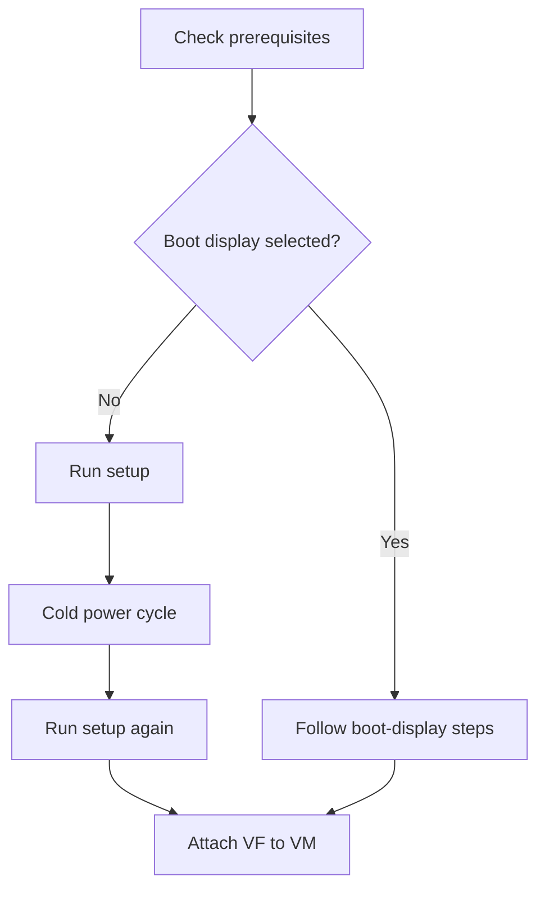
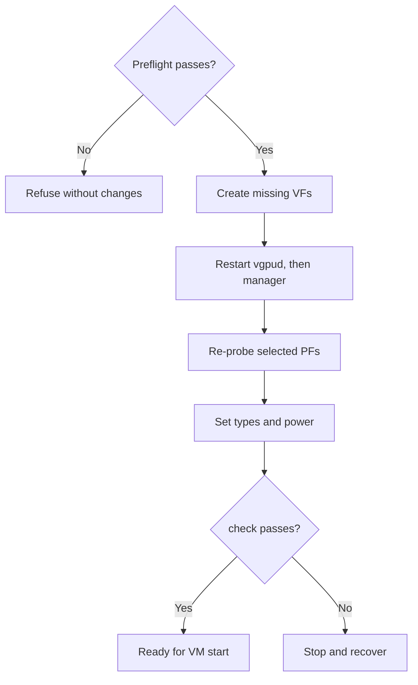
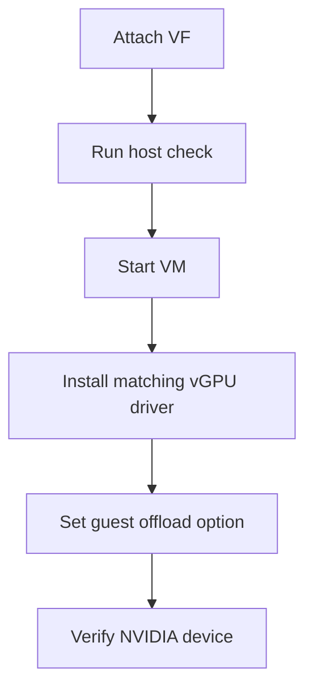
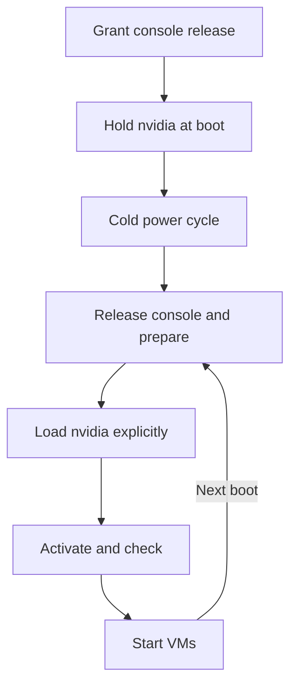

# Installation

Use `setup` for the guided path from a clean Linux KVM host to ready virtual functions (VFs).
Each VF backs one vGPU; you attach it to a VM yourself.
For the short version, see the [README quick start](../README.md#quick-start).

Ampere and Ada are supported.
Blackwell GPUs are not expected to work with the current implementation.
See [Ampere](ampere.md) and [Ada](ada.md) for generation-specific details.

> [!IMPORTANT]
> geforce-sriov is **NOT** a vBIOS flasher or a licensing tool.
> It does not distribute NVIDIA software.

Run `setup` once to install, cold power-cycle the host, then run it again to check readiness.
A cold power cycle means switching the machine fully off and on, not rebooting.
After this one-time setup, the boot units recreate the VFs and their types each boot.
The [boot-display path](#boot-display-card) instead needs a console release after every boot.

Unless you pass `--driver=skip`, installation rebuilds your `nvidia.ko`, installs a patched plugin copy and writes the modprobe option.
It backs up the stock module for `uninstall`.
The individual commands below are for manual operation and troubleshooting.

## Before you start

- NVIDIA's vGPU host package for Linux KVM, proprietary flavour, host driver 580.159.01 (vGPU software 19.5), the supported version.
  Obtain it from NVIDIA with your own entitlement.
  Either install it with DKMS, which rebuilds kernel modules for each new kernel, or have its `.run` file ready for `--driver-file` ([One command from a clean host](#one-command-from-a-clean-host)).
- A card from the [device table](devices.md#generations) that is not the
  [boot display](#boot-display-card), or a console release for it if it is.
- On a laptop, read [Laptop support](laptops.md) first: system sleep must be blocked and NVIDIA's runtime power management turned off.
- The IOMMU turned on in firmware (VT-d or AMD-Vi, plus *Above 4G decoding*) and in the kernel.
- A vGPU licence setup of your own for the guests. Licensing is outside this project.
- A way to cold power-cycle the machine (IPMI, a smart plug or the power button), and SSH or a console
  to get back in.

The host runs Linux with KVM and libvirt or QEMU. Install these prerequisites with your
distribution's package manager:

- kernel headers for the running kernel release
- `dkms`
- `pciutils`
- a C compiler
- `make`

[What doctor checks](#what-doctor-checks) lists everything the tools need.

### Supported software stack

| Part | Ampere | Ada |
|---|---|---|
| Host driver | NVIDIA vGPU software 19.5, host driver 580.159.01, vGPU-KVM proprietary build, CPU-side mode with `NVreg_EnableGpuFirmware=0`, GSP not used | Same |
| vGPU plugin | The patched plugin copy this package makes from the 580.159.01 stock plugin (two changes, SHA-256 `aa4fdeb5…`) | Same |
| Host module | `nvidia.ko` built from the 580.159.01 object with the three revisions | Same |
| Linux guest | 580.159.03 | 535.230.02 (vGPU 16.9) |
| Windows guest | 582.53 | 539.19 (vGPU 16.9) |
| Guest setting | `RMSetVgpuGspPluginOffloadMode=0` | Same |
| Default vGPU type | 525, RTXA6000-2Q, 2048 MiB | 942, RTX6000-Ada-2Q, 2048 MiB |

The host and guest drivers must match this table.
`install` accepts only host driver 580.159.01 and refuses any other version ([Supported inputs](driver-patch.md#supported-inputs)).
Other guest driver versions are not supported ([Guests](#guests)).
On the manual path (`--driver=skip`), other host driver versions are not supported either: `doctor`, `check` and `activate` warn and continue.

## One command from a clean host



With the source of this repository and NVIDIA's `.run` package on the host:

```sh
make
sudo ./geforce-sriov setup --driver-file NVIDIA-Linux-x86_64-580.159.01-vgpu-kvm.run \
    --accept-nvidia-license
# several GPUs, or more than one candidate card: add one --device BDF per GPU (see below)
```

With exactly one eligible card that is not the boot display, `setup` selects it automatically.
Otherwise, pass one `--device BDF` per card, at most 8.
For the boot display, read [Boot display card](#boot-display-card) before installing:

- If the host's only NVIDIA card is the boot display, `setup` asks the console-release question for it. Without a terminal, or with `--no-prompt`, it refuses before installing and names `--device` and `--boot-display-release`.
- Selecting a boot-display card at the prompt requires a console-release grant, default no.
  The grant releases nothing now; after the power cycle, `setup` asks again before releasing it.
- After granting console release, `setup` displays an IMPORTANT notice and asks whether to create the hold file.
  Accepting passes `--hold-nvidia` to `install`.
  If declined, or with `--no-prompt` or without a terminal, `setup` shows the notice after installation, with the file's path and its two lines.
- If any selected GPU is a laptop GPU, `setup` then shows a D3cold notice and asks for consent to keep it powered; the default is no ([Consent](laptops.md#consent)).
  Answering yes passes `--disable-d3cold` to `doctor` and `install`.
  `setup` exits 3 before installing anything if you decline, or if it cannot prompt (`--no-prompt` or no terminal) and `--disable-d3cold` was not given.
- Missing prerequisites cause refusal; install the listed packages and rerun.

If NVIDIA's driver already owns a card, preparation waits until the next boot.
After installation, run `doctor`, then cold power-cycle.
The normal boot path prepares the cards and activates their VFs.
Run `sudo ./geforce-sriov setup` again after boot to check every VF and see the required guest drivers.
On the boot-display path, the boot units defer and `setup` asks before releasing the console.

Repeating the first command is safe: once installed, `setup` ignores `--driver-file`, `--vfs`, `--boot-display-release`, `--hold-nvidia`, `--nvidia-source` and `--driver=skip`.
A `--device` selection that differs from the config is refused.
On an installed host, `setup` asks for D3cold consent before `doctor` if the config lacks it and a laptop GPU is selected.
Accepting or passing `--disable-d3cold` runs `install --driver=skip --disable-d3cold` to record consent, then ends the `setup` run.
If VFs are not ready and the loaded `nvidia` module differs from the installed build, `setup` stops after `check` with exit 3 and changes nothing.
Cold power-cycle, then run `setup` again.
In this state, `status` also requests a power cycle and exits 1.

The flags below work on `install` directly as well.

| Flag | What it does |
|---|---|
| `--driver-file PATH` | Uses NVIDIA's `.run` package and its `kernel/` tree; supplies missing vGPU units and `sriov-manage`. Reuses the same extraction but refuses a directory containing another package's extraction. Before writing, refuses a non-vGPU driver or distribution-owned driver and names its removal command. Cannot combine with `--nvidia-source` or `--driver=skip`. |
| `--accept-nvidia-license` | Accepts NVIDIA's licence and runs `sh PATH --silent --dkms --skip-module-load --kernel-module-type=proprietary` when the package's userspace is not already installed. The licence is `LICENSE` in the extraction. Without this flag, installation extracts the package, then refuses before other writes if userspace is missing and gives the manual installer command (`sh PATH --dkms --skip-module-load --kernel-module-type=proprietary`). |
| `--nvidia-source DIR` | Uses a kernel source tree outside `/usr/src/nvidia-<version>`, such as an extracted `kernel/` directory. Cannot combine with `--driver-file`. |
| `--driver=skip` | Leaves NVIDIA's module, plugin and modprobe option untouched. Use only after completing [the manual driver path](driver-patch.md#the-manual-path). |
| `--hold-nvidia` | Creates `/etc/modprobe.d/nvidia-manual-load.conf` with the two required lines and mode 0644, after the driver step and alongside the config. Records the file so `uninstall` can remove it if unchanged. Requires `--boot-display-release`, or a console-release grant in the config with no `--device` option (exit 2 otherwise). |
| `--disable-d3cold` | Records D3cold consent as `d3cold=off` in the config so `prepare` keeps the selected laptop GPUs powered ([Consent](laptops.md#consent)).<br><br>Requires at least one selected laptop GPU (exit 2 otherwise); a staged install (`--destdir`) records consent without this check. Passing `--device` without this flag removes consent from the config. |

Passing `--device` without `--boot-display-release` drops the console-release grant, so combining it with `--hold-nvidia` exits 2 even if the config already has a grant.

If any file in `/etc/modprobe.d/` already holds `nvidia` back with both required lines, `install` names it and creates no hold file.
If `/etc/modprobe.d/nvidia-manual-load.conf` exists but `install` did not write it, installation refuses before writing anything (exit 3).

If you edited a hold file that `install` wrote, it leaves the file unchanged and names it as long as both required lines remain.
If your edit removed either line, installation refuses (exit 3) and names the file.

The package is extracted with `sh PATH --extract-only` into `/var/lib/geforce-sriov/nvidia/<version>/`.
If its filename has no version, the directory uses the first 16 hex digits of its SHA-256 instead.
`--skip-module-load` keeps `nvidia` unloaded until the cards can be prepared.
If `nouveau` is loaded, installation refuses: blacklist it in `/etc/modprobe.d/`, rebuild the initramfs, cold power-cycle and rerun.
`--driver-file` and `--accept-nvidia-license` cannot be used with `DESTDIR` staging.
For extraction and driver internals, see [Install details](technical-reference.md#install-details) and [What install does](driver-patch.md#what-install-does).

You remain responsible for:

- Obtaining NVIDIA's package through your own NVIDIA entitlement.
- Accepting NVIDIA's licence, which `--accept-nvidia-license` records on the command line.
- The cold power cycle after the install.
- Attaching a VF to a VM ([Create a VM](#create-a-vm)) and the guests' vGPU licensing.

`uninstall` removes the unit files and `sriov-manage` that `install` copied, along with every other file it recorded.
The extraction stays in `/var/lib/geforce-sriov/nvidia/` until you delete it.
The driver installed by NVIDIA's installer stays until you remove it with NVIDIA's `nvidia-uninstall`.

If `setup` completes successfully, continue with [Create a VM](#create-a-vm).
The individual commands below are for manual setup and troubleshooting.

<details>
<summary>Manual commands and troubleshooting</summary>


## Run doctor

`doctor` checks the host and cards without changing anything.
Run it first to see what must change before `install`.
With the source of this repository on the host:

```sh
make                              # builds geforce-sriov, hook/libgeforce_sriov.so, driver/geforce-sriov-patch
sudo ./geforce-sriov doctor       # checks only; changes nothing
sudo ./geforce-sriov doctor --driver-file PATH   # the same, for the host install will leave
```

With `--driver-file PATH`, `doctor` accounts for the components that installation will add.
It reports each check as OK, information, warning or failure.
Resolve failures before installing; see [Symptoms](recovery.md#symptoms).
With no failures, run `install` or let `setup` run it for you.

When the host has exactly one eligible card and it is not the boot display, `doctor`, `install` and `setup` select it automatically.
Otherwise, name each card with `--device BDF`, one per card and at most 8.
Find the BDF with `lspci -D -nn -d 10de:`.
The first column, for example `0000:01:00.0`, is the address every command here expects.

Before installation, warnings about the unbuilt module or a card already owned by NVIDIA are expected.
An absent config is informational; a boot-display failure needs the explicit opt-in below, and `doctor --device BDF --boot-display-release BDF` checks the card with that opt-in.
Add `--hold-nvidia` if you plan to have `install` create the hold file.
`setup` adds the option when you choose the hold.
For a laptop GPU, pass `--disable-d3cold` to `doctor` when you plan to record D3cold consent with `install`.
`setup` adds this option when you answer yes to its D3cold question.

`make check` runs the offline tests and touches no hardware.

## Install

`install` sets the host up for the first cold power cycle.
Use it instead of `setup` to run the steps individually:

```sh
sudo ./geforce-sriov install
# several GPUs, or no single eligible card: one --device BDF per GPU (at most 8)
# a lower VF count: add --vfs N, for example --vfs 2 (default 4)
# NVIDIA's package: add --driver-file PATH --accept-nvidia-license
# NVIDIA's files by hand: add --driver=skip (see "The manual path" in driver-patch.md)
# same thing via make: sudo make install DEVICES="0000:01:00.0"
```

Loading `nvidia` binds every NVIDIA card on the host; the package cannot restrict that.
A mixed host (Ada and Ampere, see [Combining generations](devices.md#combining-generations)) must therefore list every card it will use, with one `--device` each.
A card left out is bound by the driver but not prepared or activated, and the rebuilt `nvidia.ko` applies to it as well.

`install` installs the CLI, hook, DKMS module, config and systemd units.
It patches copies of your NVIDIA module and plugin, backs up the stock module and records installed files for removal.
The boot units are enabled, not started; the cards wait until the cold power cycle.
See [Install details](technical-reference.md#install-details) for paths and [What install does](driver-patch.md#what-install-does) for the driver work.

It refuses a card in any of these cases:

- The card is not in the device table.
- It is the boot display (without `--boot-display-release`).
- It shares its bus with another device.
- It has no PCI bridge above it.

It also refuses an object or plugin whose SHA-256 does not match the recorded 580.159.01 digest.
The rebuilt module's `.text` must differ from the installed stock module at exactly the eight recorded offsets; any other difference is refused.
See [Supported inputs](driver-patch.md#supported-inputs) and [Compare with a stock build](driver-patch.md#compare-with-a-stock-build).

Rerunning leaves identical files alone and updates older plugin copies.
It can repair a missing or wrong-kernel build record only when the installed module, plugin, modprobe option and stock backup match the expected build.
Otherwise it refuses; see [driver build records](driver-patch.md#after-a-kernel-or-nvidia-driver-update).

The vGPU drop-in and config are written only after the driver step succeeds.
Exit 3 means refusal without changes; after any write, a later failure exits 1.
Full driver output goes to `/var/lib/geforce-sriov/driver-step.log` (mode 0600, replaced each run).
On failure, the command also shows the last 40 lines and the log path.

`install` also accepts `--ari=off` and `--msix=off`, which `setup` does not.
See [Configuration and commands](configuration.md) for all options.
Success exits 0 and directs you to `doctor`, the cold power cycle and the second `setup` run.

> [!NOTE]
> This guide assumes Secure Boot is off.
> With Secure Boot on, DKMS's signing key must be enrolled and the rebuilt `nvidia.ko` must also be signed.
> This guide does not cover those steps.

Run `doctor` again after installation and resolve any failures.
Then cold power-cycle the machine.

## Cold boot

Power the machine fully off and on, so the card gets a clean start.

> [!TIP]
> To skip preparation for one boot, add `geforce_sriov.skip` to the kernel command line (in GRUB,
> press `e` on the entry and append it to the `linux` line). Nothing else changes.

At boot, `geforce-sriov-prepare.service` prepares the cards before NVIDIA's driver touches them.
The prepare unit runs before udev and needs `/var/lib/geforce-sriov` and the install directory on the root filesystem.
Then `geforce-sriov-activate.service` runs `activate --boot`, after the prepare unit and before VM autostart, so the VFs exist and carry their vGPU types before any guest starts.
The activate unit has a start timeout of 600 seconds.
It does not run on the boot-display path, where the config grants a console release.

After boot:

```sh
geforce-sriov status
systemctl status geforce-sriov-prepare.service geforce-sriov-activate.service   # expect: active (exited)
journalctl -b -u geforce-sriov-prepare.service -u geforce-sriov-activate.service
```

`status` exits 0 when every selected card was prepared this boot and presents SR-IOV, and otherwise names the next step.
`check` tells whether the VFs are ready for a VM.
Use the journal and [Symptoms](recovery.md#symptoms) to investigate failures.
On the boot-display path, preparation is deferred; follow [Boot display card](#boot-display-card).

### activate

Run `activate` as root after boot if the unit did not run it.
It acts on every card selected by `bdfs` in the config.



The PF is the physical card.
Re-probing unbinds and rebinds it under NVIDIA's lock; it removes no device and rescans no bus.
`activate` sets each VF's type from `--type N`, then the generation's config key, then its default (942 on Ada, 525 on Ampere).
It powers each VF on and reads the type and power state back before running `check`.

```sh
sudo geforce-sriov activate --dry-run     # preflight checks only, then prints the steps
sudo geforce-sriov activate               # or: activate --type N, for one run on one generation
```

Safety conditions:

- Preflight refusal exits 3 and changes nothing; `--dry-run` stops after preflight.
- The patched plugin is required on 580.159.01.
  Other host driver versions are not supported, and activation warns and continues.
- No vGPU may exist when activation restarts the manager.
  Hold VM starts back; stop existing VMs, then use the printed command to clear their VF types to `0`.
- A mismatched driver-build record is refused.
  Run `install` for the running kernel to rewrite it; no record at all causes only a warning.
- `--type N` on a mixed-generation selection is refused.
  Set `type_ada` and `type_ampere` in the config instead.
- If a PF fails to return to `nvidia`, or the guard is set, exit 5 requires [the one rule](recovery.md#the-one-rule): cold power-cycle, never blindly rescan the bus.
- Exit 1 means a step failed after preflight.
  Start no VM until a later `activate` and `check` succeed.

Restart NVIDIA's daemons through `activate`, which runs `nvidia-vgpud` before `nvidia-vgpu-mgr`.
`nvidia-vgpud` normally exits successfully after registering types; duplicate hook lines are normal.
After any daemon restart or PF re-probe outside `activate`, stop vGPU VMs, clear their VF types to `0` and run `activate` again to restore VF power.
For harmless NVIDIA messages, see [Expected messages](recovery.md#expected-messages).

On success, `activate` exits 0, all VFs are on and active, and each VF offers vGPU types.
With the default count, `lspci -nn -d 10de:` shows four extra functions (`01:00.4` to `01:00.7` for a card at `01:00.0`).

To see the hook lines and the types of a VF:

```sh
journalctl -b -u nvidia-vgpud.service | grep geforce-sriov-hook
cat /sys/bus/pci/devices/0000:01:00.4/nvidia/creatable_vgpu_types   # 0000:01:00.4 = a VF
```

In the type list, the first column is the type ID. Some hypervisors name the type `nvidia-<ID>`.

For all stages, preconditions and exit codes, see [activate and the VF power gate](technical-reference.md#activate-and-the-vf-power-gate) and [Commands](configuration.md#commands).

### check

```sh
geforce-sriov check [--device BDF]... [--type N]
```

Run `check` before every VM start.
It changes nothing, needs no root and prints one line for each VF of the selected cards.
On a laptop GPU, a read of its config space resumes the GPU or VF if it is suspended.
It exits 0 only when every VF:

- is bound to `nvidia`,
- has `power/control=on` and `runtime_status=active`,
- on a laptop GPU, answers a config read at offset `0x08`, and
- carries the expected type (`N` with `--type`, else the type `activate` takes from the config, else
  the generation's default).

It reports `NOT READY` and exits 1 while `activate` is running or did not finish, or while the guard is set.
It takes no lock, so run it immediately before the VM start.
Do not re-probe a PF or restart NVIDIA's daemons between the check and the start.
`activate` prints the same result when it finishes.

</details>

## Create a VM

Attach one VF per vGPU as a plain VFIO PCI device with `enable-migration=off`.
`activate` has already set its type.
In QEMU terms:

```text
-device vfio-pci,host=0000:01:00.4,enable-migration=off
```

Without `enable-migration=off`, a plain VM stop makes `nvidia-vgpu-vfio` return an error to QEMU's
migration handshake, and QEMU resets the device. The stop still completes.

Leave the VF on `nvidia`, not `vfio-pci`: `check` requires it and `nvidia-vgpu-vfio` exposes it to QEMU.
Choose the attachment syntax for your hypervisor:

- With libvirt 8.2 or later, use `<hostdev managed='no'>` to prevent rebinding and `<qemu:override>` for the property.
  Add the `xmlns:qemu` namespace to `<domain>`.
  libvirt handles memlock and device-node access:

  ```xml
  <hostdev mode='subsystem' type='pci' managed='no'>
    <source><address domain='0x0000' bus='0x01' slot='0x00' function='0x4'/></source>
  </hostdev>
  <qemu:override>
    <qemu:device alias='hostdev0'>
      <qemu:frontend>
        <qemu:property name='enable-migration' type='string' value='off'/>
      </qemu:frontend>
    </qemu:device>
  </qemu:override>
  ```

- Proxmox VE takes it as a raw line in the VM config:

  ```text
  args: -device vfio-pci,host=0000:01:00.4,enable-migration=off
  ```

Proxmox VE also accepts the `hostpci` form, `qm set <vmid> -hostpci0 0000:01:00.4,mdev=nvidia-<N>`,
where `<N>` is the type the VF carries, by default 525 on Ampere and 942 on Ada ([Choosing a vGPU type](#choosing-a-vgpu-type)).

Run `geforce-sriov check` immediately before starting the VM with your hypervisor's usual command (`virsh start <name>`, or `qm start <vmid>` on Proxmox).
Afterwards, check that the VF carries the type:

```sh
cat /sys/bus/pci/devices/0000:01:00.4/nvidia/current_vgpu_type   # the type ID, e.g. 527; 0 = none
```

Some VM-start warnings are harmless; see [Expected messages](recovery.md#expected-messages).
Then configure the [guest driver and setting](#guests).

### Choosing a vGPU type

A vGPU type, also called a profile, sets the size of the vGPU a VM gets, for example RTXA6000-4Q with 4096 MiB.
Every VF of a card carries the same type, so a card runs one vGPU size at a time.
The default is 942 on Ada and 525 on Ampere.
To choose another:

1. See what the card offers: run `nvidia-smi vgpu -s` before a type is set, or use the lists in
   [Ada](ada.md#choosing-a-profile) and [Ampere](ampere.md#choosing-a-profile).
2. Set it in `/etc/geforce-sriov/config`: `type_ada=N` for the Ada cards, `type_ampere=N` for the Ampere cards.
   The boot unit, `setup`, `activate` and `check` use it from then on.
   `activate --type N` and `check --type N` are for one run on a selection of one generation.
3. If the VFs already carry a type, stop their VMs.
   Then, with `nvidia-vgpu-mgr` running, write `0` to `nvidia/current_vgpu_type` of every VF of the card.
   Never write a type while `nvidia-vgpu-mgr` is stopped.
4. Run `sudo geforce-sriov activate`.

> [!IMPORTANT]
> Choose vGPU types that fit your card's physical VRAM.
> The type list comes from the professional card, so it includes types bigger than your card, and it is not filtered by your card's memory.
> All the vGPUs you run at once must fit in the VRAM together, with some room left over because the host driver uses part of the memory too.
> For example, four `4Q` vGPUs (16 GB in total) fit a 20 GB card, and four `8Q` vGPUs (32 GB) do not ([memory limit](devices.md#status-of-every-row)).

On Ada, later VFs have higher fixed framebuffer slots.
Use lower VFs for large types; `activate` warns about slots near the memory ceiling, but that hint is not a limit.
See [Choosing a vGPU type](configuration.md#choosing-a-vgpu-type).

## Guests



The toolkit does not install anything in a guest.
You handle installation of the NVIDIA vGPU drivers inside each guest. Make sure to use vGPU guest drivers, not regular GeForce or Data Center drivers. The versions listed in the [supported stack](#supported-software-stack) are confirmed to work.

Guest licensing is your responsibility.

Every guest driver needs `RMSetVgpuGspPluginOffloadMode=0`:

| Guest | Where to set it | Without it |
|---|---|---|
| Linux | `options nvidia NVreg_RegistryDwords="RMSetVgpuGspPluginOffloadMode=0"` in a file in `/etc/modprobe.d/` | The guest driver loops `RmInitAdapter failed` |
| Windows | DWORD `RMSetVgpuGspPluginOffloadMode` = `0` in the adapter's display-class key and in `HKLM\SYSTEM\CurrentControlSet\Services\nvlddmkm` | The device shows Code 43 |

Each new Windows GPU identity is a new device and needs the DWORD again in its display-class key.
Use the `NNNN` suffix from `DEVPKEY_Device_Driver`, then restart the device:

```powershell
Get-PnpDevice -Class Display | Format-List FriendlyName, InstanceId
Get-PnpDeviceProperty -InstanceId '<instance id>' -KeyName DEVPKEY_Device_Driver   # {4d36e968-…}\NNNN
reg add "HKLM\SYSTEM\CurrentControlSet\Control\Class\{4d36e968-e325-11ce-bfc1-08002be10318}\NNNN" /v RMSetVgpuGspPluginOffloadMode /t REG_DWORD /d 0 /f
pnputil /restart-device "<instance id>"
```

To check the vGPU in a Windows guest, read the device status in Device Manager or with `Get-PnpDevice`: it should read OK, not Code 43.
A D3D11 test that does not name the NVIDIA adapter can pass on the Microsoft Basic Render Driver and does not verify the vGPU.

## After a kernel update

DKMS builds a stock `nvidia.ko` for each new kernel; only `install` applies the patch.

1. Install the new kernel and its headers, then boot it.
2. Run `sudo geforce-sriov install` to back up the stock module, rebuild the patched module and record it for this kernel.
3. Cold power-cycle so preparation runs before `nvidia` loads.

A new NVIDIA driver version is refused without changes: only the recorded 580.159.01 inputs are accepted.
Keep the stock module (CUDA stalls may return); do not patch it by hand.
Run `geforce-sriov doctor` to see whether the identity hook acts on the loaded build; on any other build it passes calls through unchanged.
See [After a kernel or NVIDIA driver update](driver-patch.md#after-a-kernel-or-nvidia-driver-update).

## Boot display card

The boot display shows the firmware startup screen and Linux text console.
It is often the only NVIDIA card; a server with BMC graphics usually uses that instead.
Check the card with `cat /sys/bus/pci/devices/0000:01:00.0/boot_vga` (`lspci | grep -i nvidia` lists addresses).
A value of `1` means boot display.
This path must release that console before preparation; all other VM and guest steps stay the same.

### Why it is refused by default

Removing and rescanning the card can move the memory used by the firmware console.
Every command therefore refuses the boot display without an explicit grant.
NVIDIA's primary-display restrictions and display-disabled modes for professional cards do not cover GeForce.

### What the opt-in changes

With the opt-in, the Linux text console on that card is detached after each boot, before the card is prepared.
The console stays detached until the next boot: the kernel switches to a dummy console, and the monitor may keep the last frame or lose signal.
Logs continue in the journal and over SSH, and starting and stopping guests does not touch the display.
SSH, your hypervisor's management interface and your VMs are unaffected.

A host desktop using the same GPU is not supported.
The card must stay free of display drivers for preparation, and the vGPU host package has no desktop graphics stack for it afterwards.
For a local console, use an integrated GPU or a cheap second card.

### Setting it up



1. Grant the release at install time, together with any other cards:

   ```sh
   sudo ./geforce-sriov install --device 0000:01:00.0 --boot-display-release 0000:01:00.0 --hold-nvidia
   # with a second card: --device 0000:02:00.0 --device 0000:01:00.0 --boot-display-release 0000:01:00.0
   ```

   This records the grant and clears the boot-display failure in `doctor`. It releases nothing by itself.

2. Keep `nvidia` from loading at boot.
   With a grant, the prepare unit defers all selected cards and holds `nvidia-vgpud` back; the activate unit does not run.
   Nothing may bind any selected card before `prepare`.
   Leave `nvidia-persistenced`, `nvidia-vgpu-mgr` and similar services disabled.
   The package changes no services for you.
   `setup` asks whether to create `/etc/modprobe.d/nvidia-manual-load.conf`.
   You can also create it directly with `install --hold-nvidia`.

   If neither creates the file and no existing file contains both required lines, create it manually:

   ```text
   blacklist nvidia
   install nvidia /bin/false
   ```

   The first line blocks udev autoload; the second makes plain `modprobe nvidia` fail.
   `doctor` warns if either is missing.
   Cold power-cycle after installation.

3. After every boot, as root, run these commands in order:

   ```sh
   geforce-sriov prepare --release-console=0000:01:00.0
   modprobe --ignore-install nvidia    # plain `modprobe nvidia` without the rule above
   geforce-sriov activate              # creates the VFs, sets the types and prints the check result
   geforce-sriov check
   ```

   Or run `sudo geforce-sriov setup` and accept its console-release prompt (default no).
   Yes runs the four commands in order and stops on the first failure.
   No prints them and exits 0.
   With `--no-prompt`, no terminal or end of input, it refuses without changes (exit 3).
   If `nvidia` is already loaded, release is impossible this boot: create the hold file at `/etc/modprobe.d/nvidia-manual-load.conf`, cold power-cycle and retry.

   `--release-console` must name exactly the cards granted in the config.
   `prepare` checks every card first and refuses, changing nothing, if the console is not the card's own simple framebuffer or anything else still uses the card.
   `modprobe --ignore-install` skips the `install` rule for that one command.

Then create your VMs as in [Create a VM](#create-a-vm), which is the same on this path.

### What to expect

The prepare unit can show `active (exited)` while doing no preparation.
Its journal records deferral and the manual commands.
`status` exits 1 while preparation is deferred. After `prepare`, it exits 0 and asks you to load NVIDIA's driver for the PF, then run `activate`; use `check` to see whether the VFs are ready.

### Returning to automatic preparation

1. Run `install --device …` again, selecting only the non-display GPUs and omitting `--boot-display-release`.
2. If `setup` or `install --hold-nvidia` created `/etc/modprobe.d/nvidia-manual-load.conf` and it is unchanged, `install` removes it and prints a removal message.
   If you created or modified the file yourself, it is left in place and reported so you can remove it manually.
   If the hold remains, `nvidia` does not load at boot, `activate` refuses, and `doctor` warns that the hold is there with no console release granted.

The next boot prepares the cards automatically and leaves the boot display and its console alone.

### If something goes wrong

- `prepare` refuses or fails: [recovery.md](recovery.md#the-released-console-of-the-boot-display-gpu)
  describes what it gives back and what stays released. Do not rebind the console or rescan the card
  by hand.
- A card does not come back, or the host cannot be reached: follow
  [the one rule](recovery.md#the-one-rule) (cold power cycle).
- `nvidia-vgpud` refuses to start, or `modprobe nvidia` loads nothing: see
  [Symptoms](recovery.md#symptoms).

Full details of the console release (framebuffer checks, the deferral record) are in
[technical-reference.md](technical-reference.md#the-boot-display-gpu).

## Uninstall

```sh
sudo geforce-sriov uninstall
```

`uninstall` disables the boot units, removes the DKMS module and deletes unchanged installed files.
It restores the stock `nvidia.ko`, restores the plugin link and removes its patched plugin and modprobe file only while those files still match what installation wrote.
Changed modules, links and files, including an edited config, are left alone.

The usual procedure is to uninstall, then cold power-cycle.
The livepatch stays loaded until that boot.
`--unload` works only when no card has VFs and none was prepared this boot; otherwise it refuses.

Backups live in `/var/lib/geforce-sriov/stock/`.
The running kernel's backup is removed after restoration; backups for other kernels remain with printed restore commands:

```text
restore <kernel release>: cp /var/lib/geforce-sriov/stock/<kernel release>/nvidia.ko <path to nvidia.ko> && depmod -a <kernel release>
```

The target is the path from `modinfo -k <kernel release> -n nvidia`, or `/lib/modules/<kernel release>/updates/dkms/nvidia.ko` if none is found.
A later install takes a fresh backup.
The driver log and empty build, stock and state directories are removed.

Uninstall removes `/etc/modprobe.d/nvidia-manual-load.conf` if it was created by `setup` or `install --hold-nvidia` and has not been modified.
Changed files and files you created yourself are left alone.
Uninstall reports any remaining hold so you can remove it if nothing else needs it.

If restoration fails, uninstall exits 1 but removes its other files.
It keeps `geforce-sriov-driver` and all stock backups.
Fix the reported cause, then run the printed `geforce-sriov-driver --restore` command or the backup-copy command above as root.

If `geforce-sriov-driver` changed since install, uninstall refuses to run it and exits 1.
The message tells you to check the file, or restore the installed copy with `geforce-sriov install` and run uninstall again.
It also lists the backup-copy commands.
See [Reverting](driver-patch.md#reverting) for the plugin link and modprobe file.

If you installed with `--driver=skip`, restore your own backup of NVIDIA's files ([Reverting](driver-patch.md#reverting)).
See [recovery.md](recovery.md) for details, the guard and every switch.

## What doctor checks

These are the checks and their manual equivalents.
For implementation details, see [doctor and status](technical-reference.md#doctor-and-status).

| Check | Passes when | By hand |
|---|---|---|
| Kernel | Built with `CONFIG_LIVEPATCH`. The module build also needs x86_64 Linux 6.8 or later with `CONFIG_PCI_IOV`, not built with Clang LTO ([Requirements in detail](technical-reference.md#requirements-in-detail)) | `uname -r`; `/sys/kernel/livepatch` exists |
| Build tools | Kernel headers for the running kernel, `dkms`, a C compiler, `make` | `dkms status`; `cc --version`. `doctor` names what is missing; install it with your package manager |
| System tools | `systemd` and `pciutils` (`lspci` and `setpci`, which NVIDIA's `sriov-manage` needs) | `lspci --version`. `doctor` names `pciutils` when it is missing |
| IOMMU | On in firmware (VT-d or AMD-Vi) and in the kernel. In firmware also enable *Above 4G decoding*, and SR-IOV and ARI if offered | `dmesg \| grep -i -e DMAR -e IOMMU`; `ls /sys/kernel/iommu_groups` is not empty |
| NVIDIA's host package | Proprietary flavour, installed with DKMS: vGPU software 19.5, host driver 580.159.01. While `nvidia` is loaded, another host driver version is reported as not supported and does not fail the check | `modinfo -F version nvidia` (works without loading the module; `/proc/driver/nvidia/version` exists only while `nvidia` is loaded) |
| NVIDIA's units | `nvidia-vgpud.service` and `nvidia-vgpu-mgr.service` exist | `systemctl list-unit-files 'nvidia-vgpu*'` lists both. If not, see [below](#nvidias-vgpu-daemon-units) |
| The card | In the device table, function `.0`, a PCI bridge directly above it, and no other device on its PCI bus | `./geforce-sriov devices`; `./geforce-sriov doctor --device BDF` checks the rest |
| Laptop power | On a laptop GPU:<br>D3cold consent is recorded as `d3cold=off` or planned with `--disable-d3cold`.<br>The GPU answers a config read.<br>A file in `/etc/modprobe.d/` sets `options nvidia NVreg_DynamicPowerManagement=0`.<br>`sleep.target` is masked ([D3cold](laptops.md#d3cold)). | `grep d3cold /etc/geforce-sriov/config`; `grep -h NVreg_DynamicPowerManagement /etc/modprobe.d/*.conf`; `systemctl is-enabled sleep.target` prints `masked` |
| Boot display | The card is not the boot display, or its console release is granted | `cat /sys/bus/pci/devices/<BDF>/boot_vga` |
| Early loading | Nothing loads `nvidia` before the boot unit: not `/etc/modules`, `/etc/modules-load.d/` or the initramfs | `doctor` warns when it finds it |
| Console card hold | With `boot_display_release` set, `/etc/modprobe.d/` holds `blacklist nvidia` and `install nvidia /bin/false` ([Setting it up](#setting-it-up)). With `doctor --hold-nvidia`, a missing hold is reported as information rather than a warning, because `install` writes it | `grep -h nvidia /etc/modprobe.d/*.conf` |
| GSP option | No file in `/etc/modprobe.d/` sets `NVreg_EnableGpuFirmware` to a value other than `0`; a file that sets `0` is noted, and the driver step keeps it | `grep -h NVreg_EnableGpuFirmware /etc/modprobe.d/*.conf` |
| Hook support | The loaded driver build is one the identity hook acts on | `doctor` reports it once the driver is loaded |
| Daemon drop-ins | No drop-in of `nvidia-vgpud` or `nvidia-vgpu-mgr` other than the package's own `geforce-sriov.conf` sets `LD_PRELOAD`; in `nvidia-vgpud.service.d` only a file read after `geforce-sriov.conf` counts. Each one found is a warning naming the file, the unit and the hook to point it at | `grep -l LD_PRELOAD /etc/systemd/system/nvidia-vgpu*.service.d/*.conf` |
| vGPU plugin | `libnvidia-vgpu.so` resolves to the patched plugin copy, SHA-256 `aa4fdeb5…`. Any other file is a warning with the reason, and an earlier copy with only the placement change names `install`. Before the driver step has run, the stock plugin is expected there and is only noted | `sha256sum "$(readlink -f /usr/lib/x86_64-linux-gnu/libnvidia-vgpu.so)"` |

For laptop power, `doctor` warns about missing power-management or sleep settings, but fails a laptop GPU that lacks consent or does not answer.
It reports recorded or planned consent as information.
`doctor` also reports the GPU's `runtime_status`, `power/control` and `d3cold_allowed`, and the bridge's `power/control`, as information.
It does not write any of these settings.

`install` separately checks the object and plugin SHA-256 digests against [Supported inputs](driver-patch.md#supported-inputs).

`doctor` does not check these, so check them yourself:

- A KVM hypervisor, libvirt or QEMU, that can attach a VF to a VM ([Create a VM](#create-a-vm)).
- The guest driver listed for your card, with its setting ([Guests](#guests)).
- A vGPU licence setup for the guests.
- Netconsole or a serial console, if you have one, for the case where the host stops responding.

### NVIDIA's vGPU daemon units

Both daemon unit files must exist for the hook drop-in and activation:

```sh
systemctl list-unit-files 'nvidia-vgpu*'   # expect nvidia-vgpud.service and nvidia-vgpu-mgr.service
```

Missing units are supplied in NVIDIA's extracted `init-scripts/systemd/`; some installs keep them in `/usr/lib/nvidia/systemd/`.
Copy both unchanged and reload systemd:

```sh
sudo install -m 0644 /usr/lib/nvidia/systemd/nvidia-vgpud.service \
    /usr/lib/nvidia/systemd/nvidia-vgpu-mgr.service /etc/systemd/system/
sudo systemctl daemon-reload
```

After changing the `nvidia-vgpud` drop-in or `libnvidia-vgpu.so` link, run `sudo systemctl daemon-reload`, stop the vGPU VMs, clear their VF types to `0` and run `sudo geforce-sriov activate`, which restarts both daemons in order.
The units need no enabling: `activate` starts them after VFs exist.
Leave them disabled on the boot-display path.
