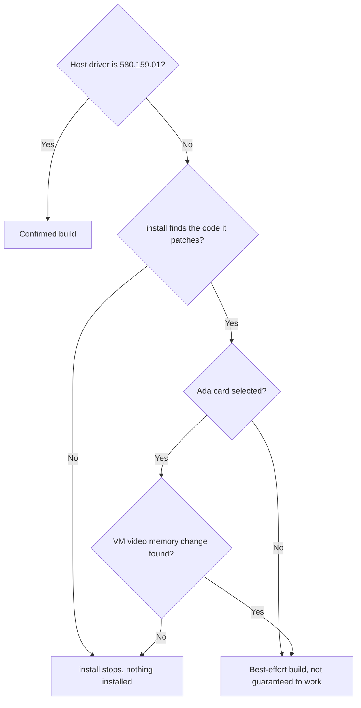
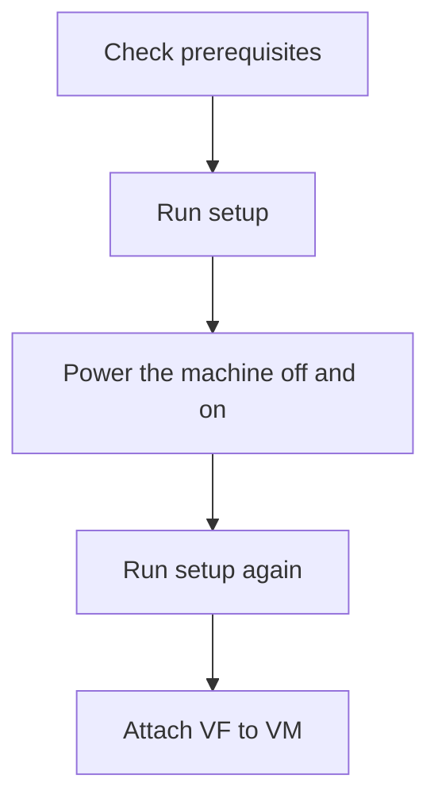
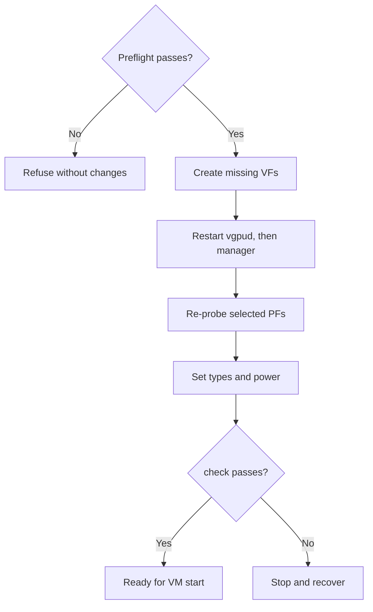
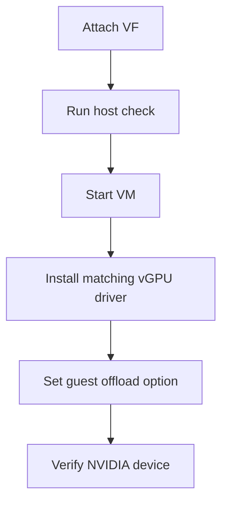
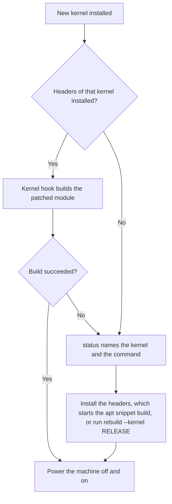
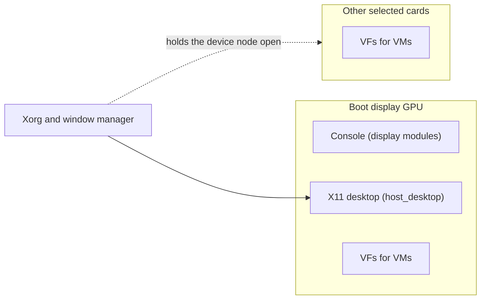
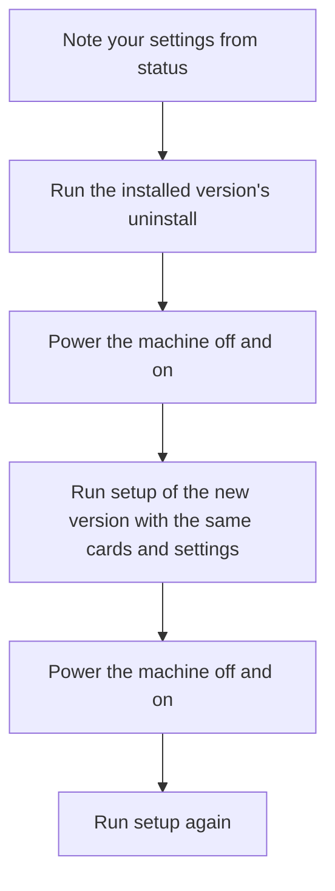

# Installation

Use `setup` for the guided path from a clean Linux KVM host to ready virtual functions (VFs).
Each VF backs one vGPU; you attach it to a VM yourself.
For the short version, see the [README quick start](../README.md#quick-start).

Ampere and Ada are supported.
See [Ampere](ampere.md) and [Ada](ada.md) for generation-specific details.

**Upgrading from an earlier version.** New to geforce-sriov? Skip to [Install](#install).

If an earlier version of geforce-sriov is installed, remove it completely before you install this one:

1. Stop the VMs that use the GPUs.
2. Run `sudo geforce-sriov uninstall`, then run any command it prints.
3. Power the machine off and on.
4. Install this version as described in [Install](#install).

To remove geforce-sriov without installing a new version, do steps 1 to 3. Details: [Uninstall](#uninstall).

> [!IMPORTANT]
> geforce-sriov is **NOT** a vBIOS flasher or a licensing tool.
> It does not distribute NVIDIA software.

> [!NOTE]
> geforce-sriov changes software only.
> It writes no firmware (vBIOS) and makes no permanent hardware change.
> Installed files stay on disk until you run `uninstall`; the runtime setup (the loaded module, the VFs and the vGPU types) ends at every power-off, and the boot units make it again at the next boot ([Safety and reversibility](../README.md#safety-and-reversibility)).

Run `setup` once to install, power the machine off and on, then run it again to check readiness.
A cold power cycle means switching the machine fully off and on, not rebooting.
After this one-time setup, the boot units recreate the VFs and their types each boot.

Unless you pass `--driver=skip`, installation rebuilds your `nvidia.ko`, installs a patched plugin copy and writes the modprobe option.
It backs up the stock module for `uninstall`.
The individual commands below are for manual operation and troubleshooting.

## Before you start

- NVIDIA's vGPU host driver for Linux KVM, proprietary flavour, host driver 580.159.01 (vGPU software 19.5), the confirmed version. Other versions are **not guaranteed to work**.
  Obtain it from NVIDIA with your own entitlement: the `.run` file `NVIDIA-Linux-x86_64-580.159.01-vgpu-kvm.run` from the vGPU software 19.5 download.
  Either install it with DKMS, which rebuilds kernel modules for each new kernel, or have its `.run` file ready for `--driver-file` ([One command from a clean host](#one-command-from-a-clean-host)).
- For host CUDA, NVIDIA's Linux driver package; for the display build on the boot display GPU, the Linux driver package and NVIDIA's public kernel module source ([What to download](#what-to-download)).
- A card from the [device table](devices.md#generations). A [boot display GPU](#boot-display-gpu) is allowed; it needs the display modules.
- On a laptop, read [Laptop support](laptops.md) first: system sleep must be blocked and NVIDIA's runtime power management turned off.
- The IOMMU turned on in firmware (VT-d or AMD-Vi, plus *Above 4G decoding*) and in the kernel.
- A vGPU licence setup of your own for the guests. Licensing is outside this project.
- A way to power the machine off and on (IPMI, a smart plug or the power button), and SSH or a console
  to get back in.

### What to download

| Feature | What to download | Exact version | Needed when |
|---|---|---|---|
| vGPU host driver | NVIDIA vGPU host driver for Linux KVM, the `.run` file `NVIDIA-Linux-x86_64-580.159.01-vgpu-kvm.run`, from the NVIDIA vGPU software 19.5 download (NVIDIA Licensing Portal) | 580.159.01 | Always |
| Host CUDA | NVIDIA's Linux driver package: NVIDIA's Linux driver 580.159.03 as a `.run` file. Either the vGPU guest driver from the same vGPU software 19.5 download (`NVIDIA-Linux-x86_64-580.159.03-grid.run`) or NVIDIA's GeForce Linux driver 580.159.03 | 580.159.03 | You turn host CUDA on (`--host-cuda`) |
| Host display and desktop on the boot display GPU | The Linux driver package (above) and NVIDIA's public kernel module source: [open-gpu-kernel-modules](https://github.com/NVIDIA/open-gpu-kernel-modules), tag [580.159.03](https://github.com/NVIDIA/open-gpu-kernel-modules/archive/refs/tags/580.159.03.tar.gz) | 580.159.03 for both | A GPU you select is the boot display GPU. The desktop libraries come from the Linux driver package; the public kernel module source is used only for the display modules |

What each input is used for:

- The Linux driver package supplies NVIDIA's CUDA libraries (host CUDA), NVIDIA's graphics libraries (host desktop) and the source files that the display build adds to NVIDIA's kernel source.
  Give it as a `.run` file (`--companion-file PATH`) or as an extracted directory (`--companion-source DIR`).
  The version is read from the package, not from the file name, and a `.run` file is run to extract it, so use only a package you trust.
  A file whose name states 580.159.03 but whose SHA-256 is not a recorded one is refused.
- NVIDIA's public kernel module source supplies `nvidia-modeset` and `nvidia-drm` for the display build.
  Give it as a tarball or a directory (`--nvkms-source PATH`).

The host runs Linux with KVM and libvirt or QEMU. Install these prerequisites with your
distribution's package manager:

- kernel headers for the running kernel release
- `dkms`
- `pciutils`
- a C compiler
- `make`

Check these on the host before you run `setup`:

- The packages: for example `apt install build-essential dkms pciutils proxmox-headers-$(uname -r)` (`linux-headers-$(uname -r)` on Debian).
- The `nouveau` driver is not loaded: `lsmod | grep nouveau` prints nothing. Otherwise put `blacklist nouveau` and `options nouveau modeset=0` in `/etc/modprobe.d/blacklist-nouveau.conf`, run `update-initramfs -u` and power-cycle.
- The IOMMU is on: `ls /sys/kernel/iommu_groups` lists numbered folders. Otherwise turn on VT-d or AMD-Vi and *Above 4G decoding* in the BIOS/UEFI setup. `setup` only warns about it, and the VM start fails later.
- Secure Boot is off: `mokutil --sb-state`.
- If the card is the boot display (it is when it is the host's only GPU): `cat /sys/bus/pci/devices/<address>/boot_vga` prints `1`. Then the Linux driver package (580.159.03) and NVIDIA's public kernel module source (`open-gpu-kernel-modules`, tag 580.159.03) are needed ([What to download](#what-to-download)).

### Prepare a way back

Normal recovery needs only a power cycle, never a reinstall of the operating system ([Recovery](recovery.md#the-one-rule)).
Have these ready before the first `setup`:

- a backup of your VM configs and of any data you cannot recreate;
- a bootable recovery medium, such as a USB installer for the host;
- SSH access to the host from another machine, which you have tried once and which keeps the host reachable while the screen is blank;
- a way to power-cycle the host (the power button, a smart plug or a remote management port).

See [What install --dry-run and status check](#what-install---dry-run-and-status-check) for everything the tools need.

### Supported software stack

| Part | Ampere | Ada |
|---|---|---|
| Host driver | NVIDIA vGPU software 19.5, host driver 580.159.01, vGPU-KVM proprietary build, CPU-side mode with `NVreg_EnableGpuFirmware=0`, GSP not used | Same |
| vGPU plugin | The patched plugin copy geforce-sriov makes from the 580.159.01 stock plugin (two changes, SHA-256 `aa4fdeb5…`) | Same |
| Host module | `nvidia.ko` built from the 580.159.01 object with the three revisions | The same, plus the VM video memory change when an Ada card is selected ([VM video memory](ada.md#vm-video-memory)) |
| Linux guest | 580.159.03 | 535.230.02 (vGPU 16.9) |
| Windows guest | 582.53 | 539.19 (vGPU 16.9) |
| Guest setting | `RMSetVgpuGspPluginOffloadMode=0` | Same |
| Default vGPU type | 525, RTXA6000-2Q, 2048 MiB | 942, RTX6000-Ada-2Q, 2048 MiB |

Use the host and guest driver versions in this table.
Other versions are **not guaranteed to work**.



- With another host driver version, `install` prints that the version is not guaranteed to work and carries on with a best-effort build. Its input and safety checks still apply ([Supported inputs](driver-patch.md#supported-inputs)).
  `setup` asks first. The default answer is no, and `--allow-unsupported-driver` answers yes. 580.159.01 is the only confirmed version.
- With an Ada card selected, `install` stops on a host driver version in which it cannot make the VM video memory change ([VM video memory](ada.md#vm-video-memory)). It does not stop when only Ampere cards are selected.
- With another host driver version loaded, `status`, `check` and `activate` print `NVIDIA's driver X is not guaranteed to work; confirmed versions: 580.159.01.` and carry on. In `status` this is an ordinary line and does not change the exit status.
  This holds on the manual path (`--driver=skip`) too.
- Other guest driver versions are **not guaranteed to work** ([Guests](#guests)).

## One command from a clean host



Get `geforce-sriov-<version>.tar.gz` from the [latest release](https://github.com/noon-at-cgn/geforce-sriov/releases/latest), then run this in the folder that holds it, with `<version>` replaced by the release number and no angle brackets:

```sh
sha256sum geforce-sriov-<version>.tar.gz
tar xzf geforce-sriov-<version>.tar.gz
cd geforce-sriov-<version>
```

The first command prints the file's SHA-256; compare it with the `SHA-256 of geforce-sriov-<version>.tar.gz` line in the release notes.
`make` (below) builds the tools in that folder and installs nothing.

With the source of this repository and NVIDIA's `.run` package on the host:

```sh
make
sudo ./geforce-sriov setup --driver-file NVIDIA-Linux-x86_64-580.159.01-vgpu-kvm.run \
    --accept-nvidia-license
# several GPUs, or more than one candidate card: add one --device BDF per GPU (see below)
```

With exactly one eligible card, `setup` selects it automatically.
Otherwise, pass one `--device BDF` per card, at most 32.
You can select the boot display GPU like any other ([Boot display GPU](#boot-display-gpu)):

- `setup` runs `install --dry-run` first, printed as `== install --dry-run`. A failure stops it with `Stopped: fix what the checks above name, then run setup again. Nothing changed.`
- When a selected GPU is the boot display, the host console needs NVIDIA's display modules. `setup` asks for the path of the Linux driver package (580.159.03) and of NVIDIA's public kernel module source (`open-gpu-kernel-modules`, tag 580.159.03). Without a terminal, or with `--no-prompt`, pass `--companion-file PATH` (or `--companion-source DIR`) and `--nvkms-source PATH`, or pass `--no-display`.
- If any selected GPU is a laptop GPU, `setup` then shows a D3cold notice and asks for consent to keep it powered; the default is no ([Consent](laptops.md#consent)).
  Answering yes passes `--disable-d3cold` to `install --dry-run` and `install`.
  `setup` exits 3 before installing anything if you decline, or if it cannot prompt (`--no-prompt` or no terminal) and `--disable-d3cold` was not given.
- Missing prerequisites cause refusal; install the listed packages and rerun.

If NVIDIA's driver already owns a card, activation waits until the next boot.
After installation, run `geforce-sriov status`, then power the machine off and on.
The boot units load the livepatch and activate the VFs.
Run `sudo ./geforce-sriov setup` again after boot to check every VF and see the required guest drivers.

`setup` prints `Setup runs with:`, a summary and one `geforce-sriov setup --no-prompt …` command that repeats the run without questions; copy it, so that a run that stops can be repeated without answering every question.
Then `== install --dry-run`, `== install` (the NVIDIA module build takes a few minutes), `== activate` and `== check` run in turn.
If `setup` prints `The install is complete.` and `Next: power the machine off and on.`, switch the machine fully off and on, then run `geforce-sriov setup` again; the installed command works from any folder without `./`.
`check` prints one line per VF:

```text
OK 0000:01:00.4 (VF of 0000:01:00.0): driver=nvidia type=942 expected=942 power/control=on runtime_status=active
```

`OK` means the VF is bound to NVIDIA's driver, powered on and carries its vGPU type (942 on an Ada card, 525 on an Ampere card).
A first run prints `activation finished` above these lines.
The run after a power cycle prints `Every selected VF is ready. Nothing to bring up.` below them, then `Guest drivers:` with the versions for your card.
A line that begins with `NOT READY` means start no VM yet ([If something goes wrong](recovery.md#if-something-goes-wrong)).

Repeating the first command is safe: once installed, `setup` ignores `--driver-file`, `--vfs`, `--nvidia-source` and `--driver=skip`.
A `--device` selection that differs from the config is refused.
On an installed host, `setup` asks for D3cold consent before its checks if the config lacks it and a laptop GPU is selected.
Accepting or passing `--disable-d3cold` runs `install --driver=skip --disable-d3cold` to record consent, then ends the `setup` run.
If VFs are not ready and the loaded `nvidia` module differs from the installed build, `setup` stops after `check` with exit 3 and changes nothing.
Power the machine off and on, then run `setup` again.
In this state, `status` also requests a power cycle and exits 1.

The flags below work on `install` directly as well.

| Flag | What it does |
|---|---|
| `--driver-file PATH` | Uses NVIDIA's `.run` package and its `kernel/` tree; supplies missing vGPU units and `sriov-manage`. Reuses the same extraction but refuses a directory containing another package's extraction. Before writing, refuses a non-vGPU driver or distribution-owned driver and names its removal command. Cannot combine with `--nvidia-source` or `--driver=skip`. |
| `--accept-nvidia-license` | Accepts NVIDIA's licence and runs `sh PATH --silent --dkms --skip-module-load --kernel-module-type=proprietary` when the package's userspace is not already installed. The licence is `LICENSE` in the extraction. Without this flag, installation extracts the package, then refuses before other writes if userspace is missing and gives the manual installer command (`sh PATH --dkms --skip-module-load --kernel-module-type=proprietary`). |
| `--nvidia-source DIR` | Uses a kernel source tree outside `/usr/src/nvidia-<version>`, such as an extracted `kernel/` directory. Cannot combine with `--driver-file`. |
| `--driver=skip` | Leaves NVIDIA's module, plugin and modprobe option untouched. Use only after completing [the manual driver path](driver-patch.md#the-manual-path). |
| `--display`, `--no-display` | Builds NVIDIA's display modules (`nvidia-modeset`, `nvidia-drm`) or leaves them out. By default they are built when a selected GPU is the boot display ([Boot display GPU](#boot-display-gpu)). `--companion-file PATH` or `--companion-source DIR` names the Linux driver package, and `--nvkms-source PATH` NVIDIA's public kernel module source; both are inputs of the display build ([What to download](#what-to-download)). |
| `--disable-d3cold` | Records D3cold consent as `d3cold=off` in the config so `activate` keeps the selected laptop GPUs powered ([Consent](laptops.md#consent)).<br><br>Requires at least one selected laptop GPU (exit 2 otherwise); a staged install (`--destdir`) records consent without this check. Passing `--device` without this flag removes consent from the config. |
| `--host-cuda`, `--no-host-cuda` | Builds `nvidia-uvm` and installs NVIDIA's CUDA library, so CUDA programs can run on the host, or leaves them out. Off by default. Needs the Linux driver package (`--companion-file PATH` or `--companion-source DIR`). See [Host CUDA](#host-cuda). |
| `--host-desktop`, `--no-host-desktop` | Installs NVIDIA's graphics libraries, so the host desktop is drawn by the GPU, or leaves them out. By default (`auto`) they are installed when the display build is in effect and the Linux driver package is given. See [Host desktop](#host-desktop). |

The package is extracted with `sh PATH --extract-only` into `/var/lib/geforce-sriov/nvidia/<version>/`.
If its filename has no version, the directory uses the first 16 hex digits of its SHA-256 instead.
`--skip-module-load` keeps `nvidia` unloaded until the cards can be activated.
If `nouveau` is loaded, installation refuses: blacklist it in `/etc/modprobe.d/`, rebuild the initramfs, power the machine off and on, and rerun.
`--driver-file` and `--accept-nvidia-license` cannot be used with `DESTDIR` staging.
For extraction and driver internals, see [Install details](technical-reference.md#install-details) and [What install does](driver-patch.md#what-install-does).

You remain responsible for:

- Obtaining NVIDIA's package through your own NVIDIA entitlement.
- Accepting NVIDIA's licence, which `--accept-nvidia-license` records on the command line.
- The cold power cycle after the install.
- Attaching a VF to a VM ([Create a VM](#create-a-vm)) and the guests' vGPU licensing.

`uninstall` removes the unit files and `sriov-manage` that `install` copied, along with every other file it recorded.
The extraction stays in `/var/lib/geforce-sriov/nvidia/` until you delete it.
The driver installed by NVIDIA's installer stays until you remove it with NVIDIA's `nvidia-uninstall`.

If `setup` completes successfully, continue with [Create a VM](#create-a-vm).
The individual commands below are for manual setup and troubleshooting.

<details>
<summary>Manual commands and troubleshooting</summary>


## Check before installing

`install --dry-run` checks the host and cards without changing anything.
It writes nothing and takes no lock.
Run it first to see what must change before `install`.
With the source of this repository on the host:

```sh
make                                  # builds geforce-sriov, hook/libgeforce_sriov.so, driver/geforce-sriov-patch
sudo ./geforce-sriov install --dry-run                      # checks only; changes nothing
sudo ./geforce-sriov install --dry-run --driver-file PATH   # the same, for the host install will leave
```

It takes the selection, feature and package options of `install`: `--device`, `--display` and `--no-display`, `--host-cuda` and `--no-host-cuda`, `--host-desktop` and `--no-host-desktop`, `--companion-file`, `--companion-source`, `--nvkms-source`, `--driver-file`, `--nvidia-source`, `--driver=skip`, `--disable-d3cold` and `--accept-nvidia-license`.
With them it accounts for the components that installation will add.
It refuses `--prefix`, `--destdir`, `--source`, `--vfs`, `--ari` and `--msix` (exit 2), and `--disable-d3cold` without a laptop GPU (exit 2).

It reports each check as OK, information, warning or failure and ends with the number of failures and warnings.
It exits 0, or 3 when a line is a failure.
Resolve failures before installing; see [Symptoms](recovery.md#symptoms).
With no failures, run `install` or let `setup` run it for you: `setup` runs `install --dry-run` as its first step and stops on a failure.

When the host has exactly one eligible card, `install` and `setup` select it automatically.
Otherwise, name each card with `--device BDF`, one per card and at most 32.
Find the BDF with `lspci -D -nn -d 10de:`.
The first column, for example `0000:01:00.0`, is the address every command here expects.

Before installation, warnings about the unbuilt module or a card already owned by NVIDIA are expected.
An absent config is informational.
For a laptop GPU, pass `--disable-d3cold` when you plan to record D3cold consent with `install`; the check then treats consent as recorded.
`setup` adds this option when you answer yes to its D3cold question.

After installation, `status` shows the checks that still apply, after each card's report.
It prints only information, warning and failure lines, and exits 1 on a failure.

`make check` runs the offline tests and touches no hardware.

## Install

`install` sets the host up for the first cold power cycle.
Use it instead of `setup` to run the steps individually:

```sh
sudo ./geforce-sriov install
# several GPUs, or no single eligible card: one --device BDF per GPU (at most 32)
# a lower VF count: add --vfs N, for example --vfs 2 (default 4)
# NVIDIA's package: add --driver-file PATH --accept-nvidia-license
# NVIDIA's files by hand: add --driver=skip (see "The manual path" in driver-patch.md)
# same thing via make: sudo make install DEVICES="0000:01:00.0"
```

Loading `nvidia` binds every NVIDIA card on the host; geforce-sriov cannot restrict that.
A mixed host (Ada and Ampere, see [Combining generations](devices.md#combining-generations)) must therefore list every card it will use, with one `--device` each.
A card left out is bound by the driver but not activated, and the rebuilt `nvidia.ko` applies to it as well.

`install` puts these on the host. See [Install details](technical-reference.md#install-details) for the paths. `uninstall` removes what `install` recorded.

- The CLI, the hook, the driver tools, the DKMS module source, the config and the systemd units, including the drop-ins for `nvidia-vgpud` and for VM autostart.
- Patched copies of NVIDIA's module and plugin, and a backup of the stock module (not with `--driver=skip`).
- The kernel hook, `/etc/kernel/postinst.d/geforce-sriov` and `/etc/kernel/header_postinst.d/geforce-sriov`, for each of those directories that exists, and the apt snippet `/etc/apt/apt.conf.d/99geforce-sriov`; on a host with `kernel-install` and no `/etc/kernel/postinst.d`, the plugin `/etc/kernel/install.d/90-geforce-sriov.install`; on a host with pacman, `/etc/pacman.d/hooks/90-geforce-sriov.hook`; and, for the last two, the hook script `geforce-sriov-kernel-hook` beside the program ([After a kernel update](#after-a-kernel-update)).
- State files in `/var/lib/geforce-sriov/`: `installed-files` (every file `install` recorded), `format` (the version stamp), `selection` (the identity of each selected card), `driver-build` (the build record), `inputs/` (the packages and source `install` kept for later builds), `kernel-hook-logs/` and `kernel-hook-failed/` (the output and the failures of the kernel hook), and `driver-step.log`.
- The files named in [Modprobe files](#modprobe-files).
- With host CUDA or the host desktop, NVIDIA's libraries ([Host CUDA](#host-cuda), [Host desktop](#host-desktop)).

The boot units are enabled, not started; the cards wait until the cold power cycle.
See [Install details](technical-reference.md#install-details) for paths and [What install does](driver-patch.md#what-install-does) for the driver work.

It refuses a card in any of these cases:

- The card is not in the device table.
- It shares its bus with another device.
- It has no PCI bridge above it.

`install` checks NVIDIA's files before it changes them and checks the rebuilt module before it installs it.
A file it cannot patch is refused before the first write.
With a host driver version other than 580.159.01 the build is best effort ([Supported inputs](driver-patch.md#supported-inputs), [Compare with a stock build](driver-patch.md#compare-with-a-stock-build)).

Rerunning leaves identical files alone and updates older plugin copies.
It can repair a missing or wrong-kernel build record only when the installed module, plugin, modprobe option and stock backup match the expected build.
Otherwise it refuses; see [driver build records](driver-patch.md#after-a-kernel-or-nvidia-driver-update).

The vGPU drop-in and config are written only after the driver step succeeds.
Exit 3 means refusal without changes; after any write, a later failure exits 1.
Full driver output goes to `/var/lib/geforce-sriov/driver-step.log` (mode 0600, replaced each run).
On failure, the command also shows the last 40 lines and the log path.

`install` also accepts `--ari=off` and `--msix=off`, which `setup` does not.
See [Configuration and commands](configuration.md) for all options.
Success exits 0 and ends with `Next: power the machine off and on. ...`: the cold power cycle, then the second `setup` run.

> [!NOTE]
> This guide assumes Secure Boot is off.
> With Secure Boot on, DKMS's signing key must be enrolled and the rebuilt `nvidia.ko` must also be signed.
> This guide does not cover those steps.

Run `geforce-sriov status` after installation and resolve any failures it prints.
Then power the machine off and on.

## Cold boot

Power the machine fully off and on, so the card gets a clean start.

> [!TIP]
> To skip both boot units for one boot, add `geforce_sriov.skip` to the kernel command line (in GRUB,
> press `e` on the entry and append it to the `linux` line). Neither unit runs, and that boot has no NVIDIA driver at all, because the package keeps udev from loading it: run `modprobe nvidia` if you need it.

At boot, `geforce-sriov-livepatch.service` loads the livepatch and NVIDIA's `nvidia` module before udev starts, so nothing else can bind the cards first.
The unit runs before udev and needs `/var/lib/geforce-sriov` and the install directory on the root filesystem.
Then `geforce-sriov-activate.service` runs `activate --boot`, after the livepatch unit and before VM autostart, so the VFs exist and carry their vGPU types before guests start, unless activation fails (below).
Boot activation never prompts, and it does not stop a running display manager.
Guest autostart (`pve-guests.service`, `libvirt-guests.service`) starts after the activate unit has finished, whatever its result, and runs `geforce-sriov check` first, which only logs which VFs are not ready. A failed activation never keeps guests from starting; a guest that uses a vGPU can then fail to start, so run `geforce-sriov check` before starting it.
`install` sets the activate unit's start timeout from the number of selected cards and VFs, at least 900 seconds. Normal activation takes seconds per card, so the timeout matters only in a real hang; activation also extends the timeout before each step that can wait.

After boot:

```sh
geforce-sriov status
systemctl status geforce-sriov-livepatch.service geforce-sriov-activate.service   # expect: active (exited)
journalctl -b -u geforce-sriov-livepatch.service -u geforce-sriov-activate.service
```

`status` shows each selected card's state and exits 0 when every selected VF is ready and no host check fails; otherwise it names the next step.
`check` tells whether the VFs are ready for a VM.
Use the journal and [Symptoms](recovery.md#symptoms) to investigate failures.

### activate

Run `activate` as root after boot if the unit did not run it.
It acts on every card selected by `bdfs` in the config.



The PF is the physical card.
Re-probing unbinds and rebinds it under NVIDIA's lock; it removes no device and rescans no bus.
`activate` sets each VF's type from `--type N`, then the generation's config key, then its default (942 on Ada, 525 on Ampere).
It powers each VF on and reads the type and power state back before running `check`.

```sh
sudo geforce-sriov activate --dry-run     # preflight checks only, then prints the steps
sudo geforce-sriov activate               # or: activate --type N, for one run on one generation
```

Safety conditions:

- Preflight refusal exits 3 and changes nothing; `--dry-run` stops after preflight.
- The patched plugin is required on 580.159.01.
  Another host driver version is **not guaranteed to work**; activation prints that and continues.
- No vGPU may exist when activation restarts the manager.
  Hold VM starts back; stop existing VMs, then use the printed command to clear their VF types to `0`.
- A mismatched driver-build record is refused.
  Run `install` for the running kernel to rewrite it; no record at all causes only a warning.
- `--type N` on a mixed-generation selection is refused.
  Set `type_ada` and `type_ampere` in the config instead.
- If a PF fails to return to `nvidia`, or the activation lock is set, exit 5 requires [the one rule](recovery.md#the-one-rule): power the machine off and on, never blindly rescan the bus.
- Exit 1 means a step failed after preflight.
  Start no VM until a later `activate` and `check` succeed.

Restart NVIDIA's daemons through `activate`, which runs `nvidia-vgpud` before `nvidia-vgpu-mgr`.
`nvidia-vgpud` normally exits successfully after registering types; duplicate hook lines are normal.
After any daemon restart or PF re-probe outside `activate`, stop vGPU VMs, clear their VF types to `0` and run `activate` again to restore VF power.
For harmless NVIDIA messages, see [Expected messages](recovery.md#expected-messages).

On success, `activate` exits 0, all VFs are on and active, and each VF offers vGPU types.
With the default count, `lspci -nn -d 10de:` shows four extra functions (`01:00.4` to `01:00.7` for a card at `01:00.0`).

To see the hook lines and the types of a VF:

```sh
journalctl -b -u nvidia-vgpud.service | grep geforce-sriov-hook
cat /sys/bus/pci/devices/0000:01:00.4/nvidia/creatable_vgpu_types   # 0000:01:00.4 = a VF
```

In the type list, the first column is the type ID. Some hypervisors name the type `nvidia-<ID>`.

For all stages, preconditions and exit codes, see [activate and the VF power gate](technical-reference.md#activate-and-the-vf-power-gate) and [Commands](configuration.md#commands).

### check

```sh
geforce-sriov check [--device BDF]... [--type N]
```

Run `check` before every VM start.
It changes nothing, needs no root and prints one line for each VF of the selected cards.
On a laptop GPU, a read of its config space resumes the GPU or VF if it is suspended.
It exits 0 only when every VF:

- is bound to `nvidia`,
- has `power/control=on` and `runtime_status=active`,
- on a laptop GPU, answers a config read at offset `0x08`, and
- carries the expected type (`N` with `--type`, else the type `activate` takes from the config, else
  the generation's default).

It reports `NOT READY` and exits 1 while `activate` is running or did not finish, or while the activation lock is set.
It takes no lock, so run it immediately before the VM start.
Do not re-probe a PF or restart NVIDIA's daemons between the check and the start.
`activate` prints the same result when it finishes.

</details>

## Create a VM

Attach one VF per vGPU as a plain VFIO PCI device with `enable-migration=off`.
`activate` has already set its type.
In QEMU terms:

```text
-device vfio-pci,host=0000:01:00.4,enable-migration=off
```

Without `enable-migration=off`, a plain VM stop makes `nvidia-vgpu-vfio` return an error to QEMU's
migration handshake, and QEMU resets the device. The stop still completes.

Leave the VF on `nvidia`, not `vfio-pci`: `check` requires it and `nvidia-vgpu-vfio` exposes it to QEMU.
Choose the attachment syntax for your hypervisor:

- With libvirt 8.2 or later, use `<hostdev managed='no'>` to prevent rebinding and `<qemu:override>` for the property.
  Add the `xmlns:qemu` namespace to `<domain>`.
  libvirt handles memlock and device-node access:

  ```xml
  <hostdev mode='subsystem' type='pci' managed='no'>
    <source><address domain='0x0000' bus='0x01' slot='0x00' function='0x4'/></source>
  </hostdev>
  <qemu:override>
    <qemu:device alias='hostdev0'>
      <qemu:frontend>
        <qemu:property name='enable-migration' type='string' value='off'/>
      </qemu:frontend>
    </qemu:device>
  </qemu:override>
  ```

- Proxmox VE takes it as a raw line in the VM config:

  ```text
  args: -device vfio-pci,host=0000:01:00.4,enable-migration=off
  ```

Proxmox VE also accepts the `hostpci` form, `qm set <vmid> -hostpci0 0000:01:00.4,mdev=nvidia-<N>`,
where `<N>` is the type the VF carries, by default 525 on Ampere and 942 on Ada ([Choosing a vGPU type](#choosing-a-vgpu-type)).

Run `geforce-sriov check` immediately before starting the VM with your hypervisor's usual command (`virsh start <name>`, or `qm start <vmid>` on Proxmox).
Afterwards, check that the VF carries the type:

```sh
cat /sys/bus/pci/devices/0000:01:00.4/nvidia/current_vgpu_type   # the type ID, e.g. 527; 0 = none
```

Some VM-start warnings are harmless; see [Expected messages](recovery.md#expected-messages).
Then configure the [guest driver and setting](#guests).

### Choosing a vGPU type

A vGPU type, also called a profile, sets the size of the vGPU a VM gets, for example RTXA6000-4Q with 4096 MiB.
Every VF of a card carries the same type, so a card runs one vGPU size at a time.
The default is 942 on Ada and 525 on Ampere.
To choose another:

1. See what the card offers: run `nvidia-smi vgpu -s` before a type is set, or use the lists in
   [Ada](ada.md#choosing-a-vgpu-type) and [Ampere](ampere.md#choosing-a-vgpu-type).
2. Set it in `/etc/geforce-sriov/config`: `type_ada=N` for the Ada cards, `type_ampere=N` for the Ampere cards.
   The boot unit, `setup`, `activate` and `check` use it from then on.
   `activate --type N` and `check --type N` are for one run on a selection of one generation.
3. If the VFs already carry a type, stop their VMs.
   Then, with `nvidia-vgpu-mgr` running, write `0` to `nvidia/current_vgpu_type` of every VF of the card.
   Never write a type while `nvidia-vgpu-mgr` is stopped.
4. Run `sudo geforce-sriov activate`.

> [!IMPORTANT]
> Choose vGPU types that fit your card's physical VRAM.
> The type list comes from the professional card, so it includes types bigger than your card, and it is not filtered by your card's memory.
> All the vGPUs you run at once must fit in the VRAM together, with some room left over because the host driver uses part of the memory too.
> For example, four `4Q` vGPUs need 16 GB plus the host driver's share: they fit a 24 GB card and do not fit a 16 GB card ([memory limit](devices.md#status-of-every-row)).

On an Ada card whose loaded module does not carry the VM video memory change, each VF has a fixed slot in the card's memory, and the last VFs cannot start a VM of a large type.
`activate` names those VFs; the line is advice and does not stop activation. With the VM video memory change a VM takes free video memory when it starts and there are no slots, so `activate` prints no hint ([VM video memory](ada.md#vm-video-memory)).
See [Choosing a vGPU type](configuration.md#choosing-a-vgpu-type).

## Guests



geforce-sriov does not install anything in a guest.
Install NVIDIA's vGPU guest driver in each guest yourself. A regular GeForce or Data Center driver does not work. The versions listed in the [supported stack](#supported-software-stack) are confirmed to work.

For an Ada card, use Windows guest driver 582.53 or 539.19. For a Linux guest on an Ada card use 535.230.02 (vGPU 16.9): the 580.159.03 Linux driver does not run CUDA in an Ada guest.

In a Linux guest (for example Debian 12):

```sh
sudo apt install build-essential dkms linux-headers-$(uname -r)
sudo sh NVIDIA-Linux-x86_64-<version>-grid.run --dkms
echo 'options nvidia NVreg_RegistryDwords="RMSetVgpuGspPluginOffloadMode=0"' | sudo tee /etc/modprobe.d/nvidia-vgpu-guest.conf
sudo update-initramfs -u
sudo reboot
```

If the installer says the `nouveau` driver (the open-source NVIDIA driver Linux loads by default) is in use, let it disable `nouveau`, reboot the VM and run the installer again.
After the reboot, `nvidia-smi` lists the vGPU, for example `NVIDIA RTX6000-Ada-2Q` on an Ada card and `NVIDIA RTXA6000-2Q` on an Ampere card.

In a Windows guest, run NVIDIA's installer, then open PowerShell as Administrator and run:

```powershell
Get-PnpDevice -PresentOnly -Class Display -FriendlyName '*NVIDIA*' | ForEach-Object {
    $key = (Get-PnpDeviceProperty -InstanceId $_.InstanceId -KeyName DEVPKEY_Device_Driver).Data
    reg add "HKLM\SYSTEM\CurrentControlSet\Control\Class\$key" /v RMSetVgpuGspPluginOffloadMode /t REG_DWORD /d 0 /f
    pnputil /restart-device "$($_.InstanceId)"
}
Get-PnpDevice -PresentOnly -Class Display -FriendlyName '*NVIDIA*' | Format-Table FriendlyName, Status
```

The last command shows the vGPU with the status `OK`.

Guest licensing is your responsibility.

Every guest driver needs `RMSetVgpuGspPluginOffloadMode=0`:

| Guest | Where to set it | Without it |
|---|---|---|
| Linux | `options nvidia NVreg_RegistryDwords="RMSetVgpuGspPluginOffloadMode=0"` in a file in `/etc/modprobe.d/` | The guest driver loops `RmInitAdapter failed` |
| Windows | DWORD `RMSetVgpuGspPluginOffloadMode` = `0` in the adapter's display-class key and in `HKLM\SYSTEM\CurrentControlSet\Services\nvlddmkm` | The device shows Code 43 |

Each new Windows GPU identity is a new device and needs the DWORD again in its display-class key.
Use the `NNNN` suffix from `DEVPKEY_Device_Driver`, then restart the device:

```powershell
Get-PnpDevice -Class Display | Format-List FriendlyName, InstanceId
Get-PnpDeviceProperty -InstanceId '<instance id>' -KeyName DEVPKEY_Device_Driver   # {4d36e968-…}\NNNN
reg add "HKLM\SYSTEM\CurrentControlSet\Control\Class\{4d36e968-e325-11ce-bfc1-08002be10318}\NNNN" /v RMSetVgpuGspPluginOffloadMode /t REG_DWORD /d 0 /f
pnputil /restart-device "<instance id>"
```

To check the vGPU in a Windows guest, read the device status in Device Manager or with `Get-PnpDevice`: a working vGPU reads OK. Code 43 means the guest driver or its setting is wrong ([Symptoms](recovery.md#symptoms)).
A D3D11 test that does not name the NVIDIA adapter can pass on the Microsoft Basic Render Driver and does not verify the vGPU.

## After a kernel update

`install` puts a kernel hook in `/etc/kernel/postinst.d` and in `/etc/kernel/header_postinst.d` (Debian runs the first when a kernel image is installed and the second when its headers are; Proxmox runs only the first, from the image package's postinst), and an apt snippet when `/etc/apt/apt.conf.d` exists.
It runs `geforce-sriov rebuild --kernel RELEASE` for the new kernel, which builds the patched `nvidia.ko` and records it for that kernel, so you run nothing by hand.
Its output goes to the journal (`journalctl -t geforce-sriov-kernel-hook`) and to `/var/lib/geforce-sriov/kernel-hook-logs/RELEASE.log`.



1. Install the new kernel and its headers with `apt`, in one transaction or in two, in either order. When the headers come after the image, the snippet below builds for the kernel after apt has finished. Until the build exists, `status` keeps the `kernel hook:` line.
2. Power the machine off and on, so that the boot units start from a clean state; boot the new kernel.

The apt snippet, `/etc/apt/apt.conf.d/99geforce-sriov`, runs `geforce-sriov-kernel-hook --retry` after every apt run that ran dpkg, because the headers package can come after the image and Proxmox's headers package does not run `/etc/kernel/header_postinst.d`.
It builds for each installed kernel (one with an image in `/boot`) that has its headers and no build yet, and returns at once when there is none. The first apt run after `install` therefore builds for every installed kernel that has headers, a few minutes per kernel, so any kernel you pick in the boot menu has its build. When NVIDIA's own module for that kernel is missing, it first asks DKMS to build it (`dkms autoinstall -k RELEASE`).
It never fails apt, and it does not wait for another geforce-sriov process: a build that finds the lock held prints `another geforce-sriov process is running; the next apt run tries again` and is tried at the next apt run.
Without the headers of the new kernel the hook builds nothing and records that (`status` says "the headers of kernel RELEASE are not installed; install them, then run the command below"); the same holds when NVIDIA's own module for the kernel cannot be built (`status` says "NVIDIA's own module for kernel RELEASE is not built yet"). The snippet tries the first again at every apt run, and the second again when NVIDIA's own module exists or the headers changed since, so that no apt run repeats a DKMS build that fails every time. An activation just after boot holding the lock is waited for, six tries ten seconds apart. `status` stops naming a kernel once its module is the recorded build.
A failed build never fails the kernel package or apt. `geforce-sriov status` then names the kernel (`kernel hook: the automatic build for kernel RELEASE failed ...`), and `activate` on that kernel refuses with the build it lacks. The snippet does not try that failed build again, so a failure for another reason stays reported until you fix it.
To fix it, read `/var/lib/geforce-sriov/kernel-hook-logs/RELEASE.log`, then run `sudo geforce-sriov rebuild --kernel RELEASE`, the one command that does what the hook does.
These systems build for a new kernel by themselves; `install` writes the file for each one whose directory exists:

| System | What runs the build | File |
|---|---|---|
| apt-based hosts | the kernel image package, the headers package and an apt snippet after dpkg | `/etc/kernel/postinst.d/geforce-sriov`, `/etc/kernel/header_postinst.d/geforce-sriov`, `/etc/apt/apt.conf.d/99geforce-sriov` |
| hosts with systemd `kernel-install` | `kernel-install add` for the new kernel | `/etc/kernel/install.d/90-geforce-sriov.install` |
| hosts with pacman | a hook after a transaction that installs or upgrades kernel modules or headers | `/etc/pacman.d/hooks/90-geforce-sriov.hook` |

The `kernel-install` plugin and the pacman hook call the hook script `geforce-sriov-kernel-hook`, which `install` puts beside the program. The plugin is written only on a host without `/etc/kernel/postinst.d`.
On an apt-based host and on a pacman host the build is made whichever of the kernel and its headers is installed first. On a `kernel-install` host the build runs when the kernel is added, so install the kernel headers package with or before the kernel; otherwise run `sudo geforce-sriov rebuild --kernel RELEASE` after it.
On any other system, and on a host without these directories, run `sudo geforce-sriov rebuild --kernel RELEASE` after each kernel update. `uninstall` removes the hook files and the snippet.

A new NVIDIA driver version is built best effort when `install` finds the code it patches; 580.159.01 is the only confirmed version.
With an Ada card selected, `install` stops on a host driver version in which it cannot make the VM video memory change.
Run `geforce-sriov status` to see whether the identity hook acts on the loaded build; on any other build it passes calls through unchanged.
See [After a kernel or NVIDIA driver update](driver-patch.md#after-a-kernel-or-nvidia-driver-update).

<a id="boot-display-card"></a>
## Boot display GPU

The boot display shows the firmware startup screen and Linux text console.
It is often the only NVIDIA card; a server with BMC graphics usually uses that instead.
Check the card with `cat /sys/bus/pci/devices/0000:01:00.0/boot_vga` (`lspci | grep -i nvidia` lists addresses).
A value of `1` means boot display.

You select a boot display GPU like any other card.
It needs no manual step after boot: `activate` handles its console as part of the activation transaction.
All other VM and guest steps stay the same.

What to expect while `activate` runs on the boot display GPU:

- The monitor can go blank briefly, and can stay blank until the next boot after a failure; SSH and the journal keep working. Run `setup` over SSH.
- Stopping the display manager ends the running desktop session, so save your work first.
- After a failure, do not rebind the console or rescan the card by hand ([Recovery](recovery.md#the-console-of-the-boot-display-gpu)).

### What activation does

The firmware console scans out of one of the card's BARs, and the card is removed and rescanned during activation.
`activate` therefore hands the firmware framebuffer to NVIDIA's display modules (`nvidia-modeset` and `nvidia-drm`) before it removes the card, and the display modules then drive the console.
Display output goes only to the boot display GPU, even with `display=on`.
KMS (kernel mode setting, which lets the display driver set the screen mode) is limited to the boot display GPU even with `display=on`, because a display driver on any other card that serves VFs breaks that card's first VF.
A host desktop on that GPU is drawn by it when `host_desktop` is on ([Host desktop](#host-desktop)).

Activation needs a build of NVIDIA's module with the display modules:

- `install` builds them when a selected GPU is the boot display (`display=auto`).
- The build needs the Linux driver package (`--companion-file PATH` or `--companion-source DIR`) and NVIDIA's public kernel module source (`--nvkms-source PATH`).
  The Linux driver package is NVIDIA's Linux driver 580.159.03: the vGPU guest driver from the vGPU software 19.5 download (`NVIDIA-Linux-x86_64-580.159.03-grid.run`), or NVIDIA's GeForce Linux driver of that version.
  The kernel module source is NVIDIA's `open-gpu-kernel-modules` tag 580.159.03, `https://github.com/NVIDIA/open-gpu-kernel-modules/archive/refs/tags/580.159.03.tar.gz`.
  `setup` asks for both. `install --dry-run` names a missing input.
- With `--no-display`, or with a build that has no display modules, `activate` refuses the boot display GPU before it releases anything.
  The message names the commands that fix it: the build again with the display modules, or `sudo geforce-sriov rebuild`.

### Display clients

A running display manager and other display clients hold the card, and activation needs them gone.
`status` lists them.
The boot unit never stops a display manager.
Stop it by hand, or run `sudo geforce-sriov activate --stop-display-manager` after boot; activation then starts the display manager again afterwards.
`setup` asks before it does so.

### If something goes wrong

- `activate` refuses or fails: read the message and [Symptoms](recovery.md#symptoms).
  Once the card's removal has been attempted, the console is not given back during that boot. Do not rebind the console or rescan the card by hand.
- A card does not come back, or the host cannot be reached: follow
  [the one rule](recovery.md#the-one-rule) (cold power cycle).
- `nvidia-vgpud` refuses to start, or `modprobe nvidia` loads nothing: see
  [Symptoms](recovery.md#symptoms).

## NVIDIA's Linux driver package and its licence

NVIDIA's Linux driver package has its own licence, the one that came with your copy of the package.

- geforce-sriov ships, downloads and redistributes **no** file from this package.
- When you pass `--companion-file` or `--companion-source`, `install` copies the files it needs, unmodified, from your copy into geforce-sriov's folders on your own host, for your own use.
- `install` does **not** accept that licence for you. Following it is your responsibility.
- NVIDIA's licences limit where and how the software may be used. Check that your use is within the licence of your package.

This applies to the display build, [Host desktop](#host-desktop) and [Host CUDA](#host-cuda).
It is not legal advice.

## Host desktop

With the display build, the console of the boot display GPU is shown through NVIDIA's display modules ([Boot display GPU](#boot-display-gpu)).
Without NVIDIA's graphics libraries, the CPU draws the desktop of the host.
The host desktop feature installs those libraries, so the GPU draws it.
It supports X11 desktops.



You need:

- the display build in effect: a selected GPU is the boot display and `display` is not `off`;
- the Linux driver package (`--companion-file PATH` or `--companion-source DIR`);
- no other NVIDIA graphics driver on the host.

The setting is `host_desktop=auto|on|off`, default `auto`. The options are `--host-desktop` and `--no-host-desktop`.
`auto` is on when the display build is in effect, the Linux driver package is given and no other NVIDIA graphics driver is on the host.
Changing it needs `sudo ./geforce-sriov install` from the source folder, no rebuild and no reboot.

### What install adds

- NVIDIA's libraries for X (the X driver and GLX), EGL, GBM and Vulkan in `<prefix>/lib/geforce-sriov/gl`, and the X modules in `<prefix>/lib/geforce-sriov/xorg`. `/etc/ld.so.conf.d/geforce-sriov-gl.conf` names the library directory to the loader.
- Small files that say where the libraries are: EGL vendor and platform files, the Vulkan ICD file, NVIDIA's application profiles in `/usr/share/nvidia`, and one link, `nvidia-drm_gbm.so`, in the `gbm` directory of `libgbm`.
- `/etc/X11/xorg.conf.d/geforce-sriov-nvidia-drm-outputclass.conf`, which is NVIDIA's output-class file with the path of the X modules added.

No file that a distribution package owns is replaced, and NVIDIA's copies of libglvnd are not installed.
The link in the `gbm` directory is the one new entry inside a directory that a package owns.

NVIDIA's host driver 580.159.01 refuses libraries of another version, and the Linux driver package carries 580.159.03.
The module build therefore carries a small source patch (`client_accept`) that lets the driver accept programs of exactly the version of the Linux driver package.
NVIDIA's own version check still runs and still requires the same major version.
`modinfo` shows `gs_client_accept` for a build that has the patch.
See [The host desktop](technical-reference.md#the-host-desktop) for the mechanism.

### Which GPUs X opens

The output-class file sets `ProbeAllGpus` to false, so X probes only the boot display GPU.
Xorg and the window manager still hold the device node of the other NVIDIA GPUs open, and such a card shows about 1 MiB in use.
`ProbeAllGpus` is an X11 option.
To change it, edit or remove the file, or run `install --no-host-desktop`. `install` writes the file again.

### After install

1. Restart the display manager, for example `sudo systemctl restart display-manager`, or reboot. X must be restarted before it uses NVIDIA's driver; this ends the running desktop session.
2. Run `geforce-sriov status`. Its `host desktop:` lines show the requested and effective setting, the libraries, whether the driver accepts them, and whether the display server draws with NVIDIA's driver, draws in software, or is not running.

When only these libraries changed, the `install` run needs no power cycle.
A cold power cycle that an earlier run asked for still applies.

The desktop uses video memory on the boot display GPU: some hundred MiB, more with many windows. VMs on that GPU cannot have it.

### If something goes wrong

- Another NVIDIA graphics driver is on the host: `install` warns, names the file it found, and installs no graphics libraries. Remove that driver, or use `--no-host-desktop`.
- The login screen does not appear: log in on a text console or over SSH, run `sudo ./geforce-sriov install --no-host-desktop` in the source folder, then restart the display manager.
- The libraries are of another version than the build accepts: `install` and `status` say so. Run `install` again with `--companion-file PATH` for the matching Linux driver package (580.159.03).
- `activate` stops the display manager only with `--stop-display-manager`, and only when activation must unload or reload the display stack. Without that option it refuses while the display manager holds a selected GPU. A desktop on a GPU that is not selected does not cause this refusal. A process you started yourself that holds a selected GPU's device node does.

### Turn it off

`sudo ./geforce-sriov install --no-host-desktop` (or `host_desktop=off`, then `install`) removes every file `install` added for the desktop. It needs no rebuild and no reboot. Restart the display manager afterwards.
`uninstall` removes the files too.

## Host CUDA

Host CUDA lets CUDA programs run on the host itself.
It is off by default.

You need the Linux driver package (`--companion-file PATH` or `--companion-source DIR`).
`setup` asks `Build NVIDIA's CUDA module for the host too, so CUDA programs can run on the host? [y/N]`; the default is no.

The setting is `host_cuda=on|off`, default `off`. The options are `--host-cuda` and `--no-host-cuda`.
With it on, `install`:

- builds `nvidia-uvm` together with NVIDIA's module;
- installs NVIDIA's CUDA library from the Linux driver package into `<prefix>/lib/geforce-sriov/cuda/`, and `/etc/ld.so.conf.d/geforce-sriov-cuda.conf` names that directory to the loader;
- writes `/etc/modprobe.d/geforce-sriov-uvm.conf` ([Modprobe files](#modprobe-files)).

A CUDA library that belongs to another package is left alone.
If programs on the host load it first, `install` warns and names it. It works only if it has the version of the loaded NVIDIA driver; otherwise remove it or move it away, then run `ldconfig`.
The module build is a driver step like any other, so the boot after it needs the cold power cycle.
When the desktop is on as well, a second copy of `libnvidia-gpucomp` is installed.

On an Ada card, a host CUDA program does not block a VM, because a VM takes free video memory when it starts ([VM video memory](ada.md#vm-video-memory)).
A full or fragmented card refuses a VM.
On the vGPU host driver, `nvidia-smi` lists no host CUDA process, only the vGPU processes, although the memory counts in `memory.used`.
`activate` loads `nvidia_uvm` last, after every VF is configured, and not while a CUDA client uses the host GPU: it then prints `nvidia_uvm is not loaded while a CUDA client exists; stop it, then run activate again` and exits 1.
Stop host CUDA programs before you run `activate` again.

To turn it off, run `sudo ./geforce-sriov install --no-host-cuda` (or `host_cuda=off`, then `install`). It builds the module without `nvidia-uvm` and removes the CUDA library and `geforce-sriov-uvm.conf`, each while it is unchanged. `uninstall` removes them too.

## Modprobe files

`install` writes these files in `/etc/modprobe.d/`.
`uninstall` removes each one while it is unchanged.

| File | Content | When |
|---|---|---|
| `geforce-sriov-nvidia.conf` | `options nvidia NVreg_EnableGpuFirmware=0` | The driver step writes it, unless another file there already sets the option to `0`. Not with `--driver=skip` |
| `geforce-sriov-autoload.conf` | Three `alias pci:v000010DE... off` lines for NVIDIA's PCI class aliases | While a GPU is selected. The aliases match by PCI class, so they cover every NVIDIA GPU on the host, not only the selected ones. They keep udev from loading NVIDIA's modules. The early boot unit loads `nvidia`, and `activate` loads the other modules |
| `geforce-sriov-uvm.conf` | `options nvidia_uvm uvm_disable_hmm=1` | Only with `host_cuda=on` ([Host CUDA](#host-cuda)) |

0.4.0 writes no `geforce-sriov-display.conf`. A copy that an earlier run of this version recorded is removed while it is unchanged.

## Upgrading

A host is changed only by the version that installed it. To move to another version, uninstall the installed one,
power the machine off and on, then install the new one:

```
sudo geforce-sriov uninstall      # the installed copy, the version that is on the host now
# power the machine off and on
sudo ./geforce-sriov setup        # in the source folder of the new version
```

`install` and `setup` of another version stop before they write anything and say so. The same version can be
installed again over itself, and `rebuild` after a kernel update needs no uninstall.



The installed version's uninstall removes `/etc/geforce-sriov`, which holds your card selection and settings (a config you
edited by hand is kept, as for every changed file). Once it is gone the new install has no selection to start from, so note the settings
you want to keep before you uninstall: `bdfs`, `display`, `host_cuda`, `host_desktop`, `vfs`, `type_ada` and
`type_ampere`. The refusal prints them from the installed config, and `sudo geforce-sriov status` shows what is in effect.
Then give the new install the same choices (`--device` for each card, `--vfs`, and so on), or put them back into the config
it writes. A `fb_slots=` line in a kept config (a setting of 0.3.0, removed in 0.4.0) is ignored.

## Uninstall

```sh
sudo geforce-sriov uninstall
```

`uninstall` disables the boot units, removes the DKMS module and deletes unchanged installed files.
It restores the stock `nvidia.ko`, restores the plugin link and removes its patched plugin and modprobe file only while those files still match what installation wrote.
Changed modules, links and files, including an edited config, are left alone.
When `install` ran with `--driver-file`, the extraction in `/var/lib/geforce-sriov/nvidia/` stays; `uninstall` names it and prints the `rm -r` command that deletes it.

What `install` adds and what `uninstall` does with it:

| `install` adds or changes | `uninstall` |
|---|---|
| CLI, hook, units, drop-ins, DKMS module | Removes them while they are unchanged |
| Patched `nvidia.ko`, stock module backed up | Restores the stock module while the installed one is unchanged |
| Patched plugin copy and the `libnvidia-vgpu.so` link | Removes the copy and points the link back, while they are unchanged |
| Modprobe files | Removes each one while it is unchanged |
| Kernel hook, state files, kept inputs | Removes them; keeps the build inputs while a restore of NVIDIA's module is owed, and keeps a set activation lock |
| `/etc/geforce-sriov/config` | Removes it; keeps a config you edited |
| NVIDIA's own driver install and the extracted package | Leaves them; remove the driver with `nvidia-uninstall` |

The usual procedure is to uninstall, then power the machine off and on.
The livepatch stays loaded until that boot.
`--unload` works only when no card has VFs and no activation was interrupted; otherwise it refuses.

Backups live in `/var/lib/geforce-sriov/stock/`.
The running kernel's backup is removed after restoration; backups for other kernels remain with printed restore commands:

```text
restore <kernel release>: cp /var/lib/geforce-sriov/stock/<kernel release>/nvidia.ko <path to nvidia.ko> && depmod -a <kernel release>
```

The target is the path from `modinfo -k <kernel release> -n nvidia`, or `/lib/modules/<kernel release>/updates/dkms/nvidia.ko` if none is found.
A later install takes a fresh backup.
The driver log and empty build, stock and state directories are removed.

If restoration fails, uninstall exits 1 but removes its other files.
It keeps `geforce-sriov-driver` and all stock backups.
Fix the reported cause, then run the printed `geforce-sriov-driver --restore` command or the backup-copy command above as root.

If `geforce-sriov-driver` changed since install, uninstall refuses to run it and exits 1.
The message tells you to check the file, or restore the installed copy with `geforce-sriov install` and run uninstall again.
It also lists the backup-copy commands.
See [Reverting](driver-patch.md#reverting) for the plugin link and modprobe file.

If you installed with `--driver=skip`, restore your own backup of NVIDIA's files ([Reverting](driver-patch.md#reverting)).
See [recovery.md](recovery.md) for details, the activation lock and every switch.

## What install --dry-run and status check

These are the checks and their manual equivalents.
`install --dry-run` judges the host before installing.
`status` repeats the ones that still apply after installing and prints only their INFO, WARN and FAIL lines.
For implementation details, see the [Technical reference](technical-reference.md).

| Check | Passes when | By hand |
|---|---|---|
| Kernel | Built with `CONFIG_LIVEPATCH`. The module build also needs x86_64 Linux 6.8 or later with `CONFIG_PCI_IOV`, not built with Clang LTO ([Requirements in detail](technical-reference.md#requirements-in-detail)) | `uname -r`; `/sys/kernel/livepatch` exists |
| Build tools | Kernel headers for the running kernel, `dkms`, a C compiler, `make` | `dkms status`; `cc --version`. `install --dry-run` names what is missing; install it with your package manager |
| System tools | `systemd` and `pciutils` (`lspci` and `setpci`, which NVIDIA's `sriov-manage` needs) | `lspci --version`. `install --dry-run` names `pciutils` when it is missing |
| IOMMU | On in firmware (VT-d or AMD-Vi) and in the kernel. In firmware also enable *Above 4G decoding*, and SR-IOV and ARI if offered | `dmesg \| grep -i -e DMAR -e IOMMU`; `ls /sys/kernel/iommu_groups` is not empty |
| NVIDIA's host package | Proprietary flavour, installed with DKMS: vGPU software 19.5, host driver 580.159.01. While `nvidia` is loaded, `status` prints `driver: NVIDIA's driver X is not guaranteed to work; confirmed versions: 580.159.01.` for another host driver version; it is an ordinary line, and the check neither warns nor fails. `install --dry-run` reports nothing about the version | `modinfo -F version nvidia` (works without loading the module; `/proc/driver/nvidia/version` exists only while `nvidia` is loaded) |
| NVIDIA's units | `nvidia-vgpud.service` and `nvidia-vgpu-mgr.service` exist | `systemctl list-unit-files 'nvidia-vgpu*'` lists both. If not, see [below](#nvidias-vgpu-daemon-units) |
| The card | In the device table, function `.0`, a PCI bridge directly above it, and no other device on its PCI bus | `./geforce-sriov devices`; `./geforce-sriov install --dry-run --device BDF` checks the rest |
| Laptop power | On a laptop GPU:<br>D3cold consent is recorded as `d3cold=off`, or assessed as recorded when `--disable-d3cold` is given to `install --dry-run`.<br>The GPU answers a config read.<br>A file in `/etc/modprobe.d/` sets `options nvidia NVreg_DynamicPowerManagement=0`.<br>`sleep.target` is masked ([D3cold](laptops.md#d3cold)). | `grep d3cold /etc/geforce-sriov/config`; `grep -h NVreg_DynamicPowerManagement /etc/modprobe.d/*.conf`; `systemctl is-enabled sleep.target` prints `masked` |
| Display build | A selected GPU that is the boot display needs the display modules. Installing them takes the Linux driver package and NVIDIA's public kernel module source (`--companion-file` or `--companion-source`, and `--nvkms-source`), or `--no-display` | `cat /sys/bus/pci/devices/<BDF>/boot_vga` prints `1` for the boot display |
| Early loading | Nothing loads `nvidia` before the boot unit: not `/etc/modules`, `/etc/modules-load.d/` or the initramfs | `status` warns when it finds it |
| Boot hold | No file in `/etc/modprobe.d/` holds `nvidia` back with `blacklist nvidia` and `install nvidia /bin/false`, because `activate` loads the driver itself | `grep -h nvidia /etc/modprobe.d/*.conf` |
| GSP option | No file in `/etc/modprobe.d/` sets `NVreg_EnableGpuFirmware` to a value other than `0`; a file that sets `0` is noted, and the driver step keeps it | `grep -h NVreg_EnableGpuFirmware /etc/modprobe.d/*.conf` |
| Hook support | The loaded driver build is one the identity hook acts on | `status` reports it once the driver is loaded |
| Daemon drop-ins | No drop-in of `nvidia-vgpud` or `nvidia-vgpu-mgr` other than the package's own `geforce-sriov.conf` sets `LD_PRELOAD`; in `nvidia-vgpud.service.d` only a file read after `geforce-sriov.conf` counts. Each one found is a warning naming the file, the unit and the hook to point it at | `grep -l LD_PRELOAD /etc/systemd/system/nvidia-vgpu*.service.d/*.conf` |
| vGPU plugin | `libnvidia-vgpu.so` resolves to the patched plugin copy, SHA-256 `aa4fdeb5…`. Any other file is a warning with the reason, and an earlier copy with only the plugin placement change names `install`. Before the driver step has run, the stock plugin is expected there and is only noted | `sha256sum "$(readlink -f /usr/lib/x86_64-linux-gnu/libnvidia-vgpu.so)"` |
| Activation lock | `/var/lib/geforce-sriov/prepare-attempt` is absent. `status` names the recovery when it is set ([the one rule](recovery.md#the-one-rule)) | `ls /var/lib/geforce-sriov/prepare-attempt` |

For laptop power, the checks warn about missing power-management or sleep settings, but fail a laptop GPU that lacks consent or does not answer.
They report recorded or assessed consent as information.
They also report the GPU's `runtime_status`, `power/control` and `d3cold_allowed`, and the bridge's `power/control`, as information.
They do not write any of these settings.

`install` separately checks the object and plugin SHA-256 digests against [Supported inputs](driver-patch.md#supported-inputs).

These checks do not cover the following, so check them yourself:

- A KVM hypervisor, libvirt or QEMU, that can attach a VF to a VM ([Create a VM](#create-a-vm)).
- The guest driver listed for your card, with its setting ([Guests](#guests)).
- A vGPU licence setup for the guests.
- Netconsole or a serial console, if you have one, for the case where the host stops responding.

### NVIDIA's vGPU daemon units

Both daemon unit files must exist for the hook drop-in and activation:

```sh
systemctl list-unit-files 'nvidia-vgpu*'   # expect nvidia-vgpud.service and nvidia-vgpu-mgr.service
```

Missing units are supplied in NVIDIA's extracted `init-scripts/systemd/`; some installs keep them in `/usr/lib/nvidia/systemd/`.
Copy both unchanged and reload systemd:

```sh
sudo install -m 0644 /usr/lib/nvidia/systemd/nvidia-vgpud.service \
    /usr/lib/nvidia/systemd/nvidia-vgpu-mgr.service /etc/systemd/system/
sudo systemctl daemon-reload
```

After changing the `nvidia-vgpud` drop-in or `libnvidia-vgpu.so` link, run `sudo systemctl daemon-reload`, stop the vGPU VMs, clear their VF types to `0` and run `sudo geforce-sriov activate`, which restarts both daemons in order.
The units need no enabling: `activate` starts them after VFs exist.
