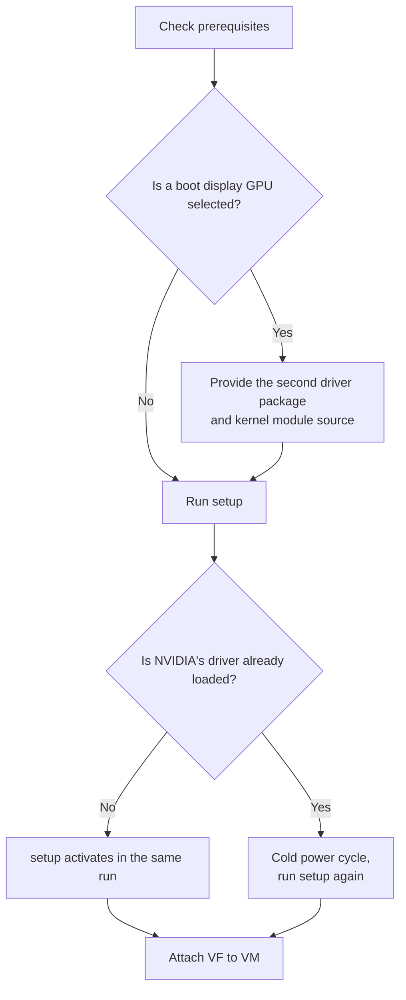
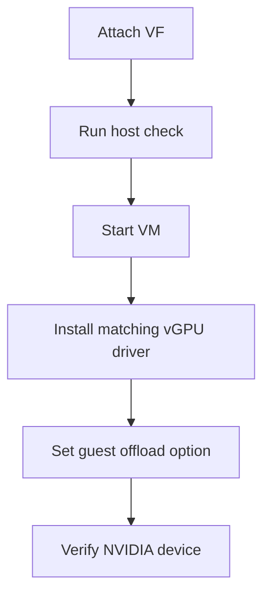
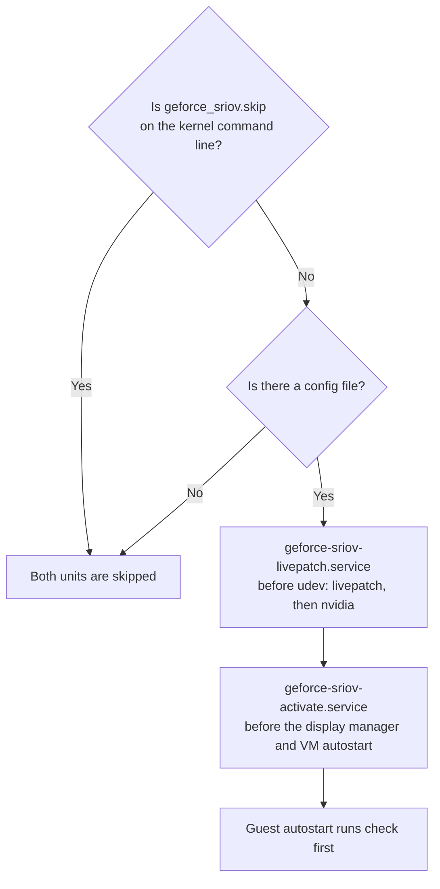
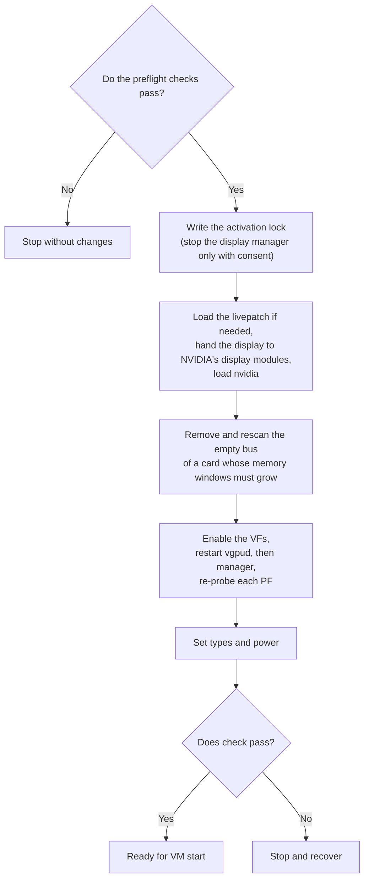

# Installation

This guide takes a Linux KVM host from a plain NVIDIA GeForce card to ready virtual functions (VFs) that you can attach to VMs.
You will work through these stages, and each one says what to do, why, and what you should see:

1. [Prepare a way back and check the prerequisites](#before-you-start).
2. [Download, verify and build the tools, then run `setup`](#automated-setup). This is the whole installation for most people.
3. [Create a VM](#create-a-vm) on a VF and [install the guest driver](#guests).
4. See what happens on [later boots](#later-boots), [after a kernel update](#after-a-kernel-update) and [at uninstall](#uninstall).

For the short path, see [Getting started](getting-started.md); this page is the full guide. [How it works](../README.md#how-it-works) explains how geforce-sriov works.
You need root access on the host, and NVIDIA's vGPU host package from your own NVIDIA entitlement.
Commands that need root are written with `sudo`. On Proxmox VE you are already `root`, so leave `sudo` out; [Getting started](getting-started.md) and the README write the host commands without it.

Two terms matter throughout:

- **VF** (virtual function): one of the lightweight copies of the card that SR-IOV creates. Each VF backs one vGPU.
- **Cold power cycle**: switching the machine fully off and on, **not** rebooting. A card returns to a known state only after it loses power, so this guide asks for one wherever that matters.

Ampere and Ada GPUs are supported ([Ampere](ampere.md), [Ada](ada.md)).
Blackwell GPUs are **not** expected to work with the current implementation.

> [!IMPORTANT]
> geforce-sriov is software only: it makes no permanent hardware change and writes no firmware.
> It does **not** supply NVIDIA software or vGPU licensing.
> What `install` writes stays on disk until you run [`uninstall`](#uninstall).
> The runtime setup (the VFs and their types) is applied again at every boot by two services, and it ends at power-off.

## Before you start

### Prepare a way back

Do these before you run any command, so that a problem never leaves you stuck:

- Have a second machine that can log in to the host over SSH.
  If the GPU you share also drives the host's monitor, the screen can go blank for a while during setup, and SSH keeps the host reachable while only the display is unavailable.
- Back up your VM configs and any data you cannot recreate.
- Keep a bootable USB installer for the host as a last resort.
  Normal recovery needs only a power cycle, not a reinstall of the operating system ([Recovery](recovery.md)).
- Have a way to cold power-cycle the machine (IPMI, a smart plug or the power button).

### What you need

- NVIDIA's vGPU host package for Linux KVM, proprietary flavour, from NVIDIA with your own entitlement.
  The recommended version is host driver 580.159.01 (vGPU software 19.5).
  Either install it with DKMS, which rebuilds kernel modules for each new kernel, or have its `.run` file ready for `--driver-file` ([Automated setup](#automated-setup)).
- A vGPU licence for your guests, which you set up yourself.
  Licensing is outside this project.
- A card from the [device table](devices.md#generations).
  If it is the [boot display](#boot-display-card), you also need a second NVIDIA driver package and NVIDIA's public kernel module source ([Boot display card](#boot-display-card)).
- On a laptop, read [Laptop support](laptops.md) first: system sleep must be blocked and NVIDIA's runtime power management turned off.
- The IOMMU turned on in the BIOS/UEFI (VT-d or AMD-Vi, plus *Above 4G decoding*, which lets the BIOS/UEFI place the card's large memory regions above the 4 GB address mark) and in the kernel.
  The IOMMU is what keeps each VM's device access separate, so VFs cannot be passed to VMs without it.
- A Linux host with KVM and libvirt or QEMU, plus these packages from your distribution:
  kernel headers for the running kernel release, `dkms`, `pciutils`, a C compiler, `make`, and `python3` (only for the display or host CUDA build).

[What doctor checks](#what-doctor-checks) lists everything the tools verify.

> [!NOTE]
> This guide assumes Secure Boot is off.
> With Secure Boot on, you must enroll DKMS's signing key (so that the BIOS/UEFI accepts the modules DKMS builds) and sign the rebuilt `nvidia.ko` as well.
> This guide does not cover those steps.

### Supported software stack

The recommended versions are the ones that were tested:

| Part | Ampere | Ada |
|---|---|---|
| Host driver | NVIDIA vGPU software 19.5, host driver 580.159.01, vGPU-KVM proprietary build | Same |
| Linux guest | 580.159.03 | 535.230.02 (vGPU 16.9) |
| Windows guest | 582.53 | 539.19 (vGPU 16.9) |
| Guest setting | `RMSetVgpuGspPluginOffloadMode=0` | Same |
| Default vGPU type | 525, RTXA6000-2Q, 2048 MiB | 942, RTX6000-Ada-2Q, 2048 MiB |

`install` does these for you, so none of them is a manual prerequisite:

- It builds NVIDIA's patched module (`nvidia.ko`).
- It builds a patched copy of NVIDIA's vGPU plugin, the library that runs the vGPUs (see the [glossary](glossary.md)).
- It turns off the GSP option that the host driver needs. GSP is a small processor on the GPU that runs part of NVIDIA's driver as firmware.

The internals are in [Recommended stack in detail](technical-reference.md#recommended-stack-in-detail).

Host driver 580.159.01 is the version confirmed to work.
Other versions are **not** guaranteed to work ([Supported inputs](driver-patch.md#supported-inputs)), but you can try another host version on a best-effort basis.
`install` names the version and continues only when it still finds every place it patches.
`setup` asks before it continues and defaults to no, and `--allow-unsupported-driver` answers yes without a question.
Other guest driver versions are not guaranteed to work either ([Guests](#guests)).
On the manual path (`--driver=skip`), `doctor`, `check` and `activate` warn about another host version and continue.

## Automated setup

`setup` is the guided path and the one most people need.
It inspects the host, asks you for the information it needs (such as where NVIDIA's package is and which GPUs to use), installs and configures everything, brings the GPUs up and checks the result.
What it installs:

- The livepatch module (`geforce_sriov`), a kernel module that changes the running kernel so that it sees the SR-IOV feature the card hides.
- The identity hook, a small library that makes NVIDIA's vGPU software accept your card.
- Patched copies of NVIDIA's driver files.
- The boot units, two systemd services that repeat the setup at every boot.
- The config.

You do not run the individual install commands yourself.



Once you have [prepared a way back](#prepare-a-way-back):

1. Download, verify and build the tools.
   The [latest release](https://github.com/noon-at-cgn/geforce-sriov/releases/latest) has `geforce-sriov-<version>.tar.gz`, which holds the source, and `SHA256SUMS`.
   In the folder with both files, check the download, extract it and build, with the four commands in [Getting started](getting-started.md#steps).
   Replace `<version>` with the release number of the file you downloaded, and leave out the angle brackets.
   The first command prints `geforce-sriov-<version>.tar.gz: OK` when the file is intact.
   `make` builds the `geforce-sriov` command, `hook/libgeforce_sriov.so` and `driver/geforce-sriov-patch` in the extracted folder.
   Nothing is installed yet, and the build touches nothing outside that folder.

2. Run `setup` as root from that folder, with NVIDIA's `.run` package at hand:

   ```sh
   sudo ./geforce-sriov setup --driver-file NVIDIA-Linux-x86_64-580.159.01-vgpu-kvm.run \
       --accept-nvidia-license
   # several GPUs, or more than one candidate card: add one --device BDF (the card's PCI address) per GPU (see below)
   ```

   `--driver-file` names the NVIDIA package, and `--accept-nvidia-license` accepts NVIDIA's licence on your behalf.
   You can leave both out and `setup` asks for them instead.
   If NVIDIA's driver is already installed, `setup` does not need the package at all.

3. Read what `setup` prints.
   After its questions it prints `Setup runs with:`, a summary of the package, the GPUs and whether the display modules and host CUDA are built, and one `geforce-sriov setup --no-prompt …` command that repeats the run without questions.
   Copy that command, so that a rerun after a refusal needs no answers.
   It then runs `doctor` to check the host and `install` to set everything up.
   Building NVIDIA's module can take a few minutes, and its progress is in `/var/lib/geforce-sriov/driver-step.log`.
   When NVIDIA's driver is not loaded yet, `setup` also runs `activate` to create the VFs and `check` to verify them.

   When it worked, the output contains `activation finished` and a line for each VF, for example:

   ```text
   OK 0000:01:00.4 (VF of 0000:01:00.0): driver=nvidia type=525 expected=525 power/control=on runtime_status=active
   ```

   `OK` means the VF is bound to NVIDIA's driver, powered on and carries the vGPU type it should.
   After the VF lines, `setup` prints the guest drivers to install in your VMs.
   If it says instead that the install is complete and asks you to power the machine off and on, follow [the next section](#when-nvidias-driver-is-already-loaded).

If a prerequisite is missing, `setup` stops and tells you what to install, and you rerun it.
For example, when the open-source `nouveau` driver is loaded, put `blacklist nouveau` and `options nouveau modeset=0` in `/etc/modprobe.d/blacklist-nouveau.conf`, rebuild the initramfs (`update-initramfs -u`, or `dracut -f`), cold power-cycle and run `setup` again.

### What setup asks

With exactly one eligible card, `setup` selects it automatically and prints the choice, whether or not the card is the boot display.
With several, pass one `--device BDF` per card (at most 8) or pick from the list at the prompt.
Find the BDF, the card's PCI address in the form `0000:01:00.0` (the first column of the output), with `lspci -D -nn -d 10de:` (`10de` is NVIDIA's PCI vendor ID).

`setup` also handles these cases.
The questions of a first install, in order, are listed under [setup](configuration.md#setup) in the reference.

- Boot display GPU. If you select it, the display build turns on (`display=auto`) so that the display keeps working.
  That needs a second NVIDIA driver package (`--companion-file PATH`, or `--companion-source DIR` for an unpacked copy) and NVIDIA's public kernel module source (`--nvkms-source PATH`) ([Boot display card](#boot-display-card)).
  At a prompt, `setup` asks for them. Answering `none` to the second package builds no display modules, and the card then cannot keep the host's screen working while it serves VFs, so plan on SSH only. Without a terminal, or with `--no-prompt`, it stops before installing and names what is missing.
- Host CUDA. It asks whether to enable CUDA on the host. `--host-cuda` answers yes ([Host CUDA](#host-cuda)).
- Laptop GPU. It shows a D3cold notice (D3cold is the powered-off state a laptop GPU enters when idle, see [D3cold](laptops.md#d3cold)) and asks for your consent to keep the GPU powered; the default is no ([Consent](laptops.md#consent)).
  Answering yes passes `--disable-d3cold` to `doctor` and `install`.
  If you decline, or `setup` cannot prompt (`--no-prompt` or no terminal) and `--disable-d3cold` was not given, it exits 3 before installing anything.
- Display manager (the service that shows your login screen and desktop, such as `gdm` or `sddm`). If one is using a selected GPU, `setup` asks before it stops the manager for activation, and starts it again afterwards.
  Stopping it **ends the running desktop session**, so save your work first and run `setup` over SSH or from a text console.
  With `--no-prompt` it stops and prints the commands for you to run.
- Other host driver version. If the version is not the confirmed one, it asks whether to continue on a best-effort basis; the default is no.

### When NVIDIA's driver is already loaded

The livepatch (the `geforce_sriov` kernel module that reveals the SR-IOV feature the card hides) has to be in place before NVIDIA's driver first sees the card, and it cannot take effect once that driver is already running.
`setup` therefore finishes the install, says that the install is complete and that you should power the machine off and on, and exits 0.

1. Power the machine fully off, then on.
2. Run `sudo ./geforce-sriov setup` again.
   The boot units have already created the VFs, so `setup` only checks every VF and prints the guest drivers to install.

### Later boots

After this one-time setup you do nothing at boot.
Two systemd services recreate the VFs and set their types before the display manager and your VM autostart run ([Cold boot](#cold-boot) explains the order).
To skip both services for one boot, add `geforce_sriov.skip` to the kernel command line ([Turn features off](recovery.md#turn-features-off)).

### Running setup again

Repeating the first command is safe: on an installed host, `setup` reuses the config and runs `install` again only if the request or the host needs it.
It stops if the `--device` selection differs from the config.
Two cases behave differently:

- Laptop GPU without consent in the config.
  `setup` asks for D3cold consent before `doctor`.
  Accepting, or passing `--disable-d3cold`, runs `install --driver=skip --disable-d3cold` to record the consent and then ends the `setup` run.
- The VFs are not ready and the loaded `nvidia` module is not the one `install` built.
  `setup` runs `doctor` and `install`, then stops without running `activate` and asks for a power cycle.
  It exits 0, because the install itself completed.
  Cold power-cycle, then run `setup` again.
  In this state, `status` also requests a power cycle and exits 1.

### Options shared with install

These flags work on `install` directly as well. Terms used in the table:

- `sriov-manage` is NVIDIA's script that creates the VFs.
- The vGPU units are NVIDIA's two systemd service files for its vGPU daemons.
- Userspace means NVIDIA's libraries and tools, as opposed to its kernel module (`nvidia.ko`).
- A modprobe file is a file in `/etc/modprobe.d/` that sets options for a kernel module (a driver loaded into the kernel) when it loads.

| Flag | What it does |
|---|---|
| `--driver-file PATH` | Uses NVIDIA's `.run` package and its `kernel/` tree, and supplies missing vGPU units and `sriov-manage`. Reuses the same extraction but stops if the directory holds another package's extraction. Before writing, stops on a non-vGPU driver or distribution-owned driver and names its removal command. Cannot combine with `--nvidia-source` or `--driver=skip`. |
| `--accept-nvidia-license` | Accepts NVIDIA's licence and runs `sh PATH --silent --dkms --skip-module-load --kernel-module-type=proprietary` when the package's userspace is not already installed. The licence is `LICENSE` in the extraction. Without this flag, installation extracts the package, then stops before other writes if userspace is missing and prints the manual installer command (`sh PATH --dkms --skip-module-load --kernel-module-type=proprietary`). |
| `--nvidia-source DIR` | Uses a kernel source tree outside `/usr/src/nvidia-<version>`, such as an extracted `kernel/` directory. Cannot combine with `--driver-file`. |
| `--driver=skip` | Leaves NVIDIA's module, plugin and modprobe option untouched. Use only after completing [the manual driver path](driver-patch.md#the-manual-path). |
| `--display` / `--no-display` | Builds NVIDIA's display modules, or leaves them out. Without either, `display=auto` builds them when a selected GPU is the boot display. Needs `--companion-file` or `--companion-source`, and `--nvkms-source` ([Boot display card](#boot-display-card)). `--no-display` builds none, so the card cannot keep the host's screen working while it serves VFs. |
| `--host-cuda` / `--no-host-cuda` | Builds `nvidia-uvm` for CUDA on the host. Off by default. Needs `--companion-file` or `--companion-source` ([Host CUDA](#host-cuda)). |
| `--companion-file PATH` / `--companion-source DIR` | NVIDIA's second driver package (a `.run` file) or an extracted copy of it. |
| `--nvkms-source PATH` | NVIDIA's public kernel module source, a directory or a tarball. |
| `--allow-unsupported-driver` | `setup` only: continue without asking when the host driver version is not the confirmed one. |
| `--disable-d3cold` | Records D3cold consent as `d3cold=off` in the config so that `activate` keeps the selected laptop GPUs powered ([Consent](laptops.md#consent)).<br><br>Requires at least one selected laptop GPU (exit 2 otherwise); a staged install (`--destdir`) records consent without this check. Passing `--device` without this flag removes consent from the config. |

The package is extracted with `sh PATH --extract-only` into `/var/lib/geforce-sriov/nvidia/<version>/`.
If its filename has no version, the directory uses the first 16 hex digits of its SHA-256 instead.
`--skip-module-load` keeps NVIDIA's installer from loading `nvidia`, because the early boot unit loads it after the livepatch.
`--driver-file` and `--accept-nvidia-license` cannot be used with `DESTDIR` staging (installing into a separate directory instead of the live system).
For extraction and driver internals, see [Install details](technical-reference.md#install-details) and [Install steps](driver-patch.md#what-install-does).

An unchanged hold file left by 0.2.x (`/etc/modprobe.d/nvidia-manual-load.conf`, a modprobe file that kept `nvidia` from loading at boot) is removed by `install`.
One you edited stays in place, and `doctor` warns that it keeps the driver from loading at boot.

### What stays your job

- Getting NVIDIA's package through your own NVIDIA entitlement.
- Accepting NVIDIA's licence, which `--accept-nvidia-license` records on the command line.
- The cold power cycle, when `setup` asks for one.
- Attaching a VF to a VM ([Create a VM](#create-a-vm)) and the guests' vGPU licensing.

`uninstall` removes the unit files and `sriov-manage` that `install` copied, along with every other file it recorded.
The extraction stays in `/var/lib/geforce-sriov/nvidia/`, and `uninstall` tells you how to delete it (see [Uninstall](#uninstall)).
The driver installed by NVIDIA's installer stays until you remove it with NVIDIA's `nvidia-uninstall`.

## Create a VM

With `setup` finished, each VF is ready to attach to a VM, and `activate` has already set its type.
Attach one VF per vGPU as a plain VFIO PCI device (VFIO is the Linux interface that hands a PCI device to a VM) with `enable-migration=off`.
In QEMU terms:

```text
-device vfio-pci,host=0000:01:00.4,enable-migration=off
```

Without `enable-migration=off`, a plain VM stop makes `nvidia-vgpu-vfio` return an error to QEMU's live-migration handshake, and QEMU resets the device.
The stop still completes, but the reset is avoidable.

Leave the VF on `nvidia`, **not** `vfio-pci`: `check` requires it, and `nvidia-vgpu-vfio` exposes the VF to QEMU.
How you express the attachment depends on your hypervisor:

- With libvirt 8.2 or later, use `<hostdev managed='no'>` to prevent rebinding and `<qemu:override>` for the property.
  Add the `xmlns:qemu` namespace to `<domain>`.
  libvirt handles the memory locking and device-node access that the VM needs:

  ```xml
  <hostdev mode='subsystem' type='pci' managed='no'>
    <source><address domain='0x0000' bus='0x01' slot='0x00' function='0x4'/></source>
  </hostdev>
  <qemu:override>
    <qemu:device alias='hostdev0'>
      <qemu:frontend>
        <qemu:property name='enable-migration' type='string' value='off'/>
      </qemu:frontend>
    </qemu:device>
  </qemu:override>
  ```

- Proxmox VE takes it as a raw line in the VM config:

  ```text
  args: -device vfio-pci,host=0000:01:00.4,enable-migration=off
  ```

Proxmox VE also accepts the `hostpci` form, `qm set <vmid> -hostpci0 0000:01:00.4,mdev=nvidia-<N>`, where `<N>` is the type the VF carries, by default 525 on Ampere and 942 on Ada ([Choosing a vGPU type](#choosing-a-vgpu-type)).

Start the VM in two steps:

1. Run `geforce-sriov check` immediately before the start.
   It prints one line for each VF, and every line should begin with `OK`:

   ```text
   OK 0000:01:00.4 (VF of 0000:01:00.0): driver=nvidia type=525 expected=525 power/control=on runtime_status=active
   ```

2. Start the VM with your hypervisor's usual command (`virsh start <name>`, or `qm start <vmid>` on Proxmox).
   Afterwards, check that the VF carries the type:

   ```sh
   cat /sys/bus/pci/devices/0000:01:00.4/nvidia/current_vgpu_type   # the type ID, e.g. 527; 0 = none
   ```

Some VM-start warnings are harmless; see [Expected messages](recovery.md#expected-messages).
Then configure the [guest driver and setting](#guests).

### Choosing a vGPU type

A vGPU type (NVIDIA also calls it a profile) sets the size of the vGPU a VM gets, for example RTXA6000-4Q with 4096 MiB. The number before the letter in the name is the memory size in GB.
Every VF of a card carries the same type, so a card runs one vGPU size at a time.
The default is 942 on Ada and 525 on Ampere.
To choose another:

1. See what the card offers: run `nvidia-smi vgpu -s` before a type is set, or use the lists in [Ada](ada.md#choosing-a-vgpu-type) and [Ampere](ampere.md#choosing-a-vgpu-type).
2. Set it in `/etc/geforce-sriov/config`: `type_ada=N` for the Ada cards, `type_ampere=N` for the Ampere cards.
   The boot unit, `setup`, `activate` and `check` use it from then on.
   `activate --type N` and `check --type N` are for one run on a selection of one generation.
3. If the VFs already carry a type, stop their VMs.
   Then, with `nvidia-vgpu-mgr` running, write `0` to `nvidia/current_vgpu_type` of every VF of the card.
   **Never** write a type while `nvidia-vgpu-mgr` is stopped.
4. Run `sudo geforce-sriov activate`.

> [!IMPORTANT]
> Choose vGPU types that fit your card's VRAM.
> The number in a type's name is its VRAM allocation: a `4Q` type gives each vGPU 4 GB.
> The type list comes from the professional card, so it includes types bigger than your card, and it is **not** filtered by your card's memory.
> All the vGPUs you run at once must fit in the VRAM together, and the host driver needs some too, so not all of it can be assigned.
> As an illustration of the arithmetic, one `8Q` vGPU asks for 8 GB of a 12 GB card and leaves nominal room for the host, while three `4Q` vGPUs ask for all 12 GB before the host takes any.
> Whether a type starts also depends on the driver's per-VF allocation limits ([memory limit](devices.md#status-of-every-row)).

On Ada, each VF has a fixed slot in the card's VRAM (its framebuffer), and later VFs have higher slots.
Use lower VFs for large types; `activate` warns about slots near the memory ceiling, but that hint is not a limit.
The [configuration reference](configuration.md#choosing-a-vgpu-type) covers the order in which the type is resolved.

## Guests



The toolkit does not install anything in a guest.
You install the NVIDIA vGPU drivers inside each guest yourself, and they must be vGPU guest drivers, **not** regular GeForce or Data Center drivers.
The versions in the [recommended stack](#supported-software-stack) are the ones tested, and other guest versions are not guaranteed to work.
Licensing the guests is up to you.

Every guest driver needs `RMSetVgpuGspPluginOffloadMode=0`, a setting that turns off GSP plugin offload (GSP is the GPU's firmware processor). Without it the guest driver does not work, and the symptom depends on the guest:

| Guest | Where to set it | Without it |
|---|---|---|
| Linux | `options nvidia NVreg_RegistryDwords="RMSetVgpuGspPluginOffloadMode=0"` in a file in `/etc/modprobe.d/` | The guest driver loops `RmInitAdapter failed` |
| Windows | DWORD `RMSetVgpuGspPluginOffloadMode` = `0` in the display adapter's class key | The device shows Code 43 |

Each new Windows GPU identity is a new device and needs the DWORD again in its display-class key.
Use the `NNNN` suffix from `DEVPKEY_Device_Driver`, then restart the device:

```powershell
Get-PnpDevice -Class Display | Format-List FriendlyName, InstanceId
Get-PnpDeviceProperty -InstanceId '<instance id>' -KeyName DEVPKEY_Device_Driver   # {4d36e968-…}\NNNN
reg add "HKLM\SYSTEM\CurrentControlSet\Control\Class\{4d36e968-e325-11ce-bfc1-08002be10318}\NNNN" /v RMSetVgpuGspPluginOffloadMode /t REG_DWORD /d 0 /f
pnputil /restart-device "<instance id>"
```

To check the vGPU in a Windows guest, read the device status in Device Manager or with `Get-PnpDevice`: it should read OK, not Code 43.
A D3D11 test that does not name the NVIDIA adapter can pass on the Microsoft Basic Render Driver and does **not** verify the vGPU.

## After a kernel update

DKMS builds a stock `nvidia.ko` for each new kernel, but only geforce-sriov applies its patch, so a new kernel needs one more command:

1. Install the new kernel and its headers. DKMS builds NVIDIA's stock module for it.
2. Before you boot the new kernel, run `sudo geforce-sriov rebuild --kernel <new release>`, where `<new release>` is the new kernel's folder name under `/lib/modules`.
   It builds NVIDIA's patched module and plugin for that kernel, with the features your config selects, and keeps the stock `nvidia.ko` as a backup.
   It also makes sure the livepatch module `geforce_sriov` is installed for that kernel, and builds it with DKMS when it is not.
   You need no other options: `install` kept the second NVIDIA driver package and NVIDIA's public kernel module source for exactly this purpose.
3. Cold power-cycle into the new kernel.

If you already booted the new kernel, run `sudo geforce-sriov rebuild` without `--kernel`, then power-cycle once more.
Until then the new kernel runs NVIDIA's unpatched module, so the vGPUs do **not** come up.

The same command prepares a kernel that was already installed before geforce-sriov, for example an older kernel you want to boot again: `sudo geforce-sriov rebuild --kernel <that release>`.
DKMS builds modules only when a kernel package is installed, so such a kernel has neither module until you run it.

If `rebuild` stops because `dkms install` failed for `geforce-sriov`, the kernel's headers are usually missing. Install them and run `rebuild` again.

If `rebuild` says that NVIDIA's own module for that kernel is not built yet, DKMS could not build it, for example because the kernel's headers are missing.
Install the headers, run `sudo dkms install nvidia/<version> -k <kernel>`, then run `sudo geforce-sriov rebuild --kernel <kernel>` again.

`install` itself runs only from the source folder you built in. Run from the installed copy, it stops and names `rebuild`.
After an NVIDIA driver update, run `install` from the source folder with the new packages.

A new NVIDIA driver version is not guaranteed to work.
`install` reports it and continues only when it finds every place it patches, as a best-effort build.
Keep the stock `nvidia.ko` (CUDA stalls may return) and do **not** patch it by hand.
Run `geforce-sriov doctor` to see whether the identity hook acts on the loaded build; on any other build it passes calls through unchanged.
See [After a kernel or NVIDIA driver update](driver-patch.md#after-a-kernel-or-nvidia-driver-update).

## Boot display card

The boot display GPU shows the BIOS/UEFI screen at power-on and then drives the host's display, which is the Linux text console or a graphical desktop.
On a consumer system without integrated graphics, a single NVIDIA card is usually the boot display GPU.
Check the card with `cat /sys/bus/pci/devices/0000:01:00.0/boot_vga` (`lspci | grep -i nvidia` lists addresses).
A value of `1` means boot display.

A boot display GPU can serve VFs like any other card.

### What it needs

The display modules (`nvidia-modeset` and `nvidia-drm`, the parts of NVIDIA's driver that put the screen on the card) come from a second NVIDIA driver package and from NVIDIA's public kernel module source:

| Needed | Option | What to give |
|---|---|---|
| Second NVIDIA package | `--companion-file PATH` (a `.run` file) or `--companion-source DIR` (an extracted copy) | The Linux vGPU guest driver 580.159.03, or NVIDIA's GeForce driver 580.159.03 |
| NVIDIA's public kernel module source | `--nvkms-source PATH` (a directory or a tarball) | The `open-gpu-kernel-modules` repository at tag 580.159.03, from [github.com/NVIDIA/open-gpu-kernel-modules](https://github.com/NVIDIA/open-gpu-kernel-modules) |

`display=auto`, the default, builds the display modules when a selected GPU is the boot display.
`--display` and `display=on` ask for them explicitly, and `--no-display` builds none.
The display modules are built **only** when a selected GPU is the boot display, because the display is only ever put on that card: with `display=on` and no such GPU, `install` builds no display modules and says why.
`setup` asks for both when you select a boot display GPU. With `install` and `doctor`, pass them as options.

### What to expect

- At boot you do not need to do anything: activation runs before the display manager starts, so your desktop or login screen comes up afterwards on the shared card.
- The monitor may go blank briefly during activation.
- Running `activate` by hand while a desktop session is open on the card needs your consent to stop the display manager. `setup` asks, and `activate --stop-display-manager` is the manual form. Stopping the display manager **ends the running desktop session**, and `activate` starts the display manager again when it finishes. Without that consent, `activate` stops and changes nothing. The boot unit **never** stops a display manager.
- Display output goes **only** to the boot display GPU.
  KMS, the kernel's mode-setting driver that drives the screen, is limited to that card even with `display=on`, because a display driver on any other card that serves VFs breaks that card's first VF.

### If something goes wrong

- A failure while the display modules are handled leaves the activation lock set.
  Follow [the power-cycle rule](recovery.md#the-one-rule) and [The activation lock](recovery.md#the-activation-lock).
- Do **not** unbind the framebuffer (the console's screen buffer) or rescan the card yourself. `activate` does it with its own checks.

Implementation details are in [technical-reference.md](technical-reference.md#the-boot-display-gpu).

## Host CUDA

By default the host runs only the vGPU stack, so a CUDA program on the host cannot use the card.
`--host-cuda` (or `host_cuda=on` in the config) sets up the two things CUDA programs on the host need to use a selected GPU:

- NVIDIA's `nvidia-uvm` kernel module, built for your kernel.
- NVIDIA's CUDA library, `libcuda`, with the libraries it loads. NVIDIA's vGPU host driver does **not** include them, so `install` takes them from the second driver package.

It needs the same second driver package as the display modules (`--companion-file` or `--companion-source`), but not the kernel module source.
If you give that package as a folder, give the whole extracted package and not only its `kernel` folder, because the libraries are beside it.
It is off by default.

Host CUDA together with the display build on 580.159.01 is a confirmed combination.

`install` puts the CUDA libraries in a folder of their own, `<prefix>/lib/geforce-sriov/cuda/`, and adds that folder to the system's library search path, so CUDA programs find them without any setting.
A CUDA library that another package or you installed is left as it is. If programs would load that one first, `install` and `doctor` say so and name the file.
`geforce-sriov status` shows the result in the line `host CUDA libraries`.
`install --no-host-cuda` removes the libraries again, and so does `uninstall`.

`install` also writes `/etc/modprobe.d/geforce-sriov-uvm.conf` for it ([Modprobe files](#modprobe-files)).
On an Ada card, the memory of each VF stays reserved for its VM, so host CUDA programs can use only the rest of the card ([Reserved VM memory](ada.md#reserved-vm-memory)).
`activate` loads `nvidia_uvm` after the VFs are ready and unloads it again only when no program uses it, so stop host CUDA programs before you run `activate` again.

## Modprobe files

`install` writes these in `/etc/modprobe.d/`, and `uninstall` removes them while they are unchanged.
Each file sets options for a kernel module when it loads. Terms used here:

- udev is the service that detects hardware at boot and loads the matching driver automatically.
- GSP is the GPU's firmware processor.
- `uvm_disable_hmm=1` turns off HMM, a memory-sharing feature of `nvidia_uvm`.

| File | Written when | What it does |
|---|---|---|
| `geforce-sriov-nvidia.conf` | `install` builds NVIDIA's module and no other file already sets the option to `0` | Turns GSP off for `nvidia` |
| `geforce-sriov-autoload.conf` | A GPU is selected | Maps NVIDIA's PCI class aliases to `off`, so udev does not load `nvidia` or `nvidia_drm` by itself. The livepatch unit loads `nvidia` and `activate` loads `nvidia_drm` |
| `geforce-sriov-uvm.conf` | `host_cuda=on` | Sets `uvm_disable_hmm=1` for `nvidia_uvm` |

The alias file exists so that nothing loads `nvidia` before the livepatch does: NVIDIA's module declares aliases that tell udev to load it for every NVIDIA display device, and this file turns them off.
It is written exactly when a GPU is selected, which is when the boot units are enabled, and it covers every NVIDIA GPU on the host, selected or not.
If the livepatch unit does not run, for example on a `geforce_sriov.skip` boot or after you disable the units, no NVIDIA driver loads until you run `modprobe nvidia`.
While `activate` enables VFs it also writes `/run/modprobe.d/zz-geforce-sriov-enable.conf`, which keeps `nvidia_drm` and `nvidia_uvm` from loading; it is gone after a reboot.

## Uninstall

By the end of this section the package is removed, NVIDIA's original `nvidia.ko` is back in place, and the host starts without geforce-sriov at the next boot.
You do not need to reinstall the operating system.

1. Shut down the VMs that use a VF.
   The power cycle in step 3 ends them anyway.
2. Run `uninstall` as root:

   ```sh
   sudo geforce-sriov uninstall
   ```

   You should see a `removed <path>` line for each file it deletes, and at the end a request to power the machine off and on.
3. Power the machine fully off and on.
   The loaded modules and the GPUs keep their current state until then, and the livepatch stays loaded until that boot.

`uninstall` works in this order:

- It disables the boot units and the 0.2.x prepare unit if one is still present, and it removes the `geforce_sriov` DKMS module.
- It restores NVIDIA's stock `nvidia.ko` from the backup for every kernel that geforce-sriov built for, but only while the installed `nvidia.ko` is still the one geforce-sriov wrote and the backup matches the SHA-256 recorded for it.
  It points the plugin link back at NVIDIA's own plugin, and it removes the patched plugin copy and the GSP modprobe file while they still match what `install` wrote.
- It removes the other installed files, the modprobe files and the drop-ins while they are unchanged.
  Changed files, including an edited config, stay and are reported as `kept`.
- It reports a set activation lock (the marker file that records an unfinished activation, see [The activation lock](recovery.md#the-activation-lock)) as `kept activation lock` and asks for a power cycle.
  After a reinstall the activation lock blocks activation until `geforce-sriov activate --clear-lock` clears it. Without a reinstall, delete the file after the power cycle.
- Once NVIDIA's files are back, it removes the copies of the second driver package and the kernel module source that `install` kept for later kernels.
- It keeps the `--driver-file` extraction in `/var/lib/geforce-sriov/nvidia/`, which `geforce-sriov` no longer uses, and prints the command to delete it: `rm -r /var/lib/geforce-sriov/nvidia`, or `rm -r /var/lib/geforce-sriov` when the extraction is the only thing left there.
- It leaves the driver that NVIDIA's installer put on the host in place ([Changes and reversibility](technical-reference.md#changes-and-reversibility)).

`--unload` also unloads the livepatch module (`geforce_sriov`) before anything is removed.
It works only when no selected card has VFs, the loaded `geforce_sriov` module's `bdfs` parameter (the list of selected cards) can be read and no activation was interrupted. Otherwise it refuses and removes nothing.

Backups live in `/var/lib/geforce-sriov/stock/`.
A backup is removed once its `nvidia.ko` is back. A backup that was not put back stays, and `uninstall` prints the command to put it back:

```text
restore <kernel release>: cp /var/lib/geforce-sriov/stock/<kernel release>/nvidia.ko <path to nvidia.ko> && depmod -a <kernel release>
```

The target is the path from `modinfo -k <kernel release> -n nvidia`, or `/lib/modules/<kernel release>/updates/dkms/nvidia.ko` if none is found.
A later install takes a fresh backup.
The driver log and empty build, stock and state directories are removed.

A leftover hold file from 0.2.x that you edited stays in place, and `uninstall` names it so that you can remove it.

If restoration fails, `uninstall` exits 1 but removes its other files.
It keeps `geforce-sriov-driver` and all stock backups.
Fix the reported cause, then run the printed `geforce-sriov-driver --restore` command or the backup-copy command above as root.

If `geforce-sriov-driver` changed since install, `uninstall` refuses to run it and exits 1.
The message tells you to check the file, or restore the installed copy with `geforce-sriov install` and run `uninstall` again.
It also lists the backup-copy commands.
See [Reverting](driver-patch.md#reverting) for the plugin link and modprobe file.

If you installed with `--driver=skip`, restore your own backup of NVIDIA's files ([Reverting](driver-patch.md#reverting)).
[Recovery](recovery.md) has the details, the activation lock and every switch.

## What doctor checks

`doctor` reads the host without changing anything. The table lists each check and the commands that show the same thing by hand.
For implementation details, see [doctor and status](technical-reference.md#doctor-and-status).

Terms used in the table:

- `CONFIG_LIVEPATCH` and `CONFIG_PCI_IOV` are kernel build options for livepatching and for SR-IOV support. Clang LTO is a compiler mode that the build of the livepatch module does not support.
- A drop-in is a small file that adds settings to an existing systemd service without editing the service's own file.
- `/sys/kernel/iommu_groups` lists the IOMMU groups, the sets of devices that the IOMMU isolates together. It is empty when the IOMMU is off.
- The PCI bridge is the port above the card (a root port or a switch port), and the PCI bus is the link between that port and the card. The card must be the only device on it, because `activate` removes and rescans that bus.
- Config space is the register block every PCI device answers with its ID and capabilities, and `setpci` reads and writes it. A laptop GPU that is powered off does not answer a config read.
- `NVreg_DynamicPowerManagement=0` turns off NVIDIA's runtime power management, which powers an idle GPU down on its own. `sleep.target` is the systemd target behind system sleep, and masking it blocks sleep.
- `/etc/modules`, `/etc/modules-load.d/` and the initramfs (the small image the kernel boots from) are places that can load a driver at boot before the livepatch unit runs.
- `NVreg_EnableGpuFirmware=0` turns GSP off.
- `LD_PRELOAD` is the environment variable that makes a program load a library first, which is how the identity hook gets into NVIDIA's daemons.

| Check | Passes when | By hand |
|---|---|---|
| Kernel | Built with `CONFIG_LIVEPATCH`. The build of the livepatch module also needs x86_64 Linux 6.8 or later with `CONFIG_PCI_IOV`, not built with Clang LTO ([Requirements in detail](technical-reference.md#requirements-in-detail)) | `uname -r`; `/sys/kernel/livepatch` exists |
| Build tools | Kernel headers for the running kernel, `dkms`, a C compiler, `make` | `dkms status`; `cc --version`. `doctor` names what is missing; install it with your package manager |
| System tools | `systemd` and `pciutils` (`lspci` and `setpci`, which NVIDIA's `sriov-manage` needs) | `lspci --version`. `doctor` names `pciutils` when it is missing |
| IOMMU | On in the BIOS/UEFI (VT-d or AMD-Vi) and in the kernel. In the BIOS/UEFI also enable *Above 4G decoding*, and SR-IOV and ARI if offered | `dmesg \| grep -i -e DMAR -e IOMMU`; `ls /sys/kernel/iommu_groups` is not empty |
| NVIDIA's host package | Proprietary flavour, installed with DKMS: vGPU software 19.5, host driver 580.159.01. While `nvidia` is loaded, another host driver version is reported as not guaranteed to work and does not fail the check | `modinfo -F version nvidia` (works without loading `nvidia`; `/proc/driver/nvidia/version` exists only while `nvidia` is loaded) |
| NVIDIA's vGPU daemon units | `nvidia-vgpud.service` and `nvidia-vgpu-mgr.service` exist | `systemctl list-unit-files 'nvidia-vgpu*'` lists both. If not, see [below](#nvidias-vgpu-daemon-units) |
| The card | In the device table, function `.0`, a PCI bridge directly above it, and no other device on its PCI bus | `./geforce-sriov devices`; `./geforce-sriov doctor --device BDF` checks the rest |
| Laptop power | On a laptop GPU:<br>D3cold consent is recorded as `d3cold=off` or planned with `--disable-d3cold`.<br>The GPU answers a config read.<br>A file in `/etc/modprobe.d/` sets `options nvidia NVreg_DynamicPowerManagement=0`.<br>`sleep.target` is masked ([D3cold](laptops.md#d3cold)). | `grep d3cold /etc/geforce-sriov/config`; `grep -h NVreg_DynamicPowerManagement /etc/modprobe.d/*.conf`; `systemctl is-enabled sleep.target` prints `masked` |
| Boot display | A selected boot display GPU has the display modules in the installed build when `display` asks for them, and NVIDIA's second driver package and kernel module source are available before `install` | `cat /sys/bus/pci/devices/<BDF>/boot_vga`; `geforce-sriov status` |
| Boot units | `geforce-sriov-livepatch.service` is enabled and `geforce-sriov-activate.service` is installed | `systemctl is-enabled geforce-sriov-livepatch.service`; `systemctl cat geforce-sriov-activate.service` |
| Early loading | Nothing loads `nvidia` before the livepatch unit: not `/etc/modules`, `/etc/modules-load.d/` or the initramfs | `doctor` warns when it finds it |
| Hold file | No file in `/etc/modprobe.d/` holds `nvidia` back (`blacklist nvidia`, `install nvidia /bin/false`), because the livepatch unit loads it itself | `grep -h nvidia /etc/modprobe.d/*.conf` |
| GSP option | No file in `/etc/modprobe.d/` sets `NVreg_EnableGpuFirmware` to a value other than `0`; a file that sets `0` is noted, and `install` keeps it | `grep -h NVreg_EnableGpuFirmware /etc/modprobe.d/*.conf` |
| Hook support | The loaded driver build is one the identity hook acts on | `doctor` reports it once the driver is loaded |
| Daemon drop-ins | No drop-in of `nvidia-vgpud` or `nvidia-vgpu-mgr` other than the package's own `geforce-sriov.conf` sets `LD_PRELOAD`; in `nvidia-vgpud.service.d` only a file read after `geforce-sriov.conf` counts. Each one found is a warning naming the file, the unit and the hook to point it at | `grep -l LD_PRELOAD /etc/systemd/system/nvidia-vgpu*.service.d/*.conf` |
| vGPU plugin | `libnvidia-vgpu.so` resolves to the patched plugin copy, SHA-256 `aa4fdeb5…`. Any other file is a warning with the reason, and an earlier copy with only the placement patch names `install`. Before `install` has built NVIDIA's module, the stock plugin is expected there and is only noted | `sha256sum "$(readlink -f /usr/lib/x86_64-linux-gnu/libnvidia-vgpu.so)"` |

For laptop power, `doctor` warns about missing power-management or sleep settings, but fails a laptop GPU that lacks consent or does not answer.
It reports recorded or planned consent as information.
It also reports the GPU's `runtime_status` (whether it is active or suspended), `power/control` and `d3cold_allowed` (the sysfs switches for runtime power management and for D3cold), and the bridge's `power/control`, as information, and it does not write any of these settings.

`install` separately checks the SHA-256 digests (checksums) of NVIDIA's host driver object file and plugin against [Supported inputs](driver-patch.md#supported-inputs).

`doctor` does **not** check these, so check them yourself:

- A KVM hypervisor, libvirt or QEMU, that can attach a VF to a VM ([Create a VM](#create-a-vm)).
- The guest driver listed for your card, with its setting ([Guests](#guests)).
- A vGPU licence setup for the guests.
- Netconsole or a serial console, if you have one, for the case where the host stops responding.

### NVIDIA's vGPU daemon units

Both daemon unit files need to exist for the hook drop-in and for activation:

```sh
systemctl list-unit-files 'nvidia-vgpu*'   # expect nvidia-vgpud.service and nvidia-vgpu-mgr.service
```

If they are missing, you will find them in NVIDIA's extracted `init-scripts/systemd/`; some installs keep them in `/usr/lib/nvidia/systemd/`.
Copy both unchanged and reload systemd:

```sh
sudo install -m 0644 /usr/lib/nvidia/systemd/nvidia-vgpud.service \
    /usr/lib/nvidia/systemd/nvidia-vgpu-mgr.service /etc/systemd/system/
sudo systemctl daemon-reload
```

After changing the `nvidia-vgpud` drop-in or the `libnvidia-vgpu.so` link, run `sudo systemctl daemon-reload`, stop the vGPU VMs, clear their VF types to `0` and run `sudo geforce-sriov activate`, which restarts both daemons in order.
The units need no enabling: `activate` starts them after VFs exist.

## Manual commands and troubleshooting

`setup` runs the commands below for you.
Use them directly when you want to go one command at a time, or when one of the commands `setup` runs needs a closer look.

### Run doctor

`doctor` checks the host and cards without changing anything, so run it first to see what needs to change before `install`.
With the source of this repository on the host:

```sh
make                              # builds geforce-sriov, hook/libgeforce_sriov.so, driver/geforce-sriov-patch
sudo ./geforce-sriov doctor       # checks only; changes nothing
sudo ./geforce-sriov doctor --driver-file PATH   # the same, for the host install will leave
```

With `--driver-file PATH`, `doctor` counts what `install` will add from that package.
It reports each check as OK, information, warning or failure.
Fix any failures before you install ([Symptoms](recovery.md#symptoms)). With no failures, run `install` or let `setup` run it for you.

When the host has exactly one eligible card and it is not the boot display, `doctor`, `install` and `setup` select it automatically.
Otherwise, name each card with `--device BDF`, one per card and at most 8.
Find the BDF with `lspci -D -nn -d 10de:`.
The first column, for example `0000:01:00.0`, is the address every command here expects.

Before the first installation, `doctor` reports what is not installed yet as `[INFO]` lines, not warnings: the livepatch module (`geforce_sriov`), the two boot units, the `nvidia-vgpud` drop-in and the config. A card that NVIDIA's driver already owns is still expected to produce a warning. On a host that already has an install, a missing livepatch module for the running kernel is a warning, as after a kernel update ([After a kernel update](#after-a-kernel-update)).
For a display or host CUDA build, give `doctor` the same `--display`, `--host-cuda`, `--companion-file` or `--companion-source` and `--nvkms-source` options you plan to give `install`, and it fails when the second driver package or the kernel module source is missing.
For a laptop GPU, pass `--disable-d3cold` to `doctor` when you plan to record D3cold consent with `install`. `setup` adds this option when you answer yes to its D3cold question.

`make check` runs the offline tests and touches no hardware.

### Install

`install` sets the host up for the first cold power cycle.
Use it instead of `setup` to run the commands one at a time, from the source folder you built in:

```sh
sudo ./geforce-sriov install
# several GPUs, or no single eligible card: one --device BDF per GPU (at most 8)
# a lower VF count: add --vfs N, for example --vfs 2 (default 4)
# NVIDIA's package: add --driver-file PATH --accept-nvidia-license
# NVIDIA's files by hand: add --driver=skip (see "The manual path" in driver-patch.md)
# same thing via make: sudo make install DEVICES="0000:01:00.0"
```

Loading `nvidia` binds every NVIDIA card on the host, and the package cannot restrict that.
A mixed host (Ada and Ampere, see [Combining generations](devices.md#combining-generations)) therefore needs to list every card it will use, with one `--device` each.
A card left out is bound by the driver but not activated, and the rebuilt `nvidia.ko` applies to it as well.

`install` installs the CLI, hook, the `geforce_sriov` DKMS module, config and systemd units.
It patches copies of your NVIDIA module and plugin, backs up the stock `nvidia.ko` and records installed files for removal.
The boot units are enabled, not started: `setup` brings the GPUs up in the same boot when NVIDIA's driver is not loaded, and otherwise the cards wait for the power cycle.
See [Install details](technical-reference.md#install-details) for paths and [Install steps](driver-patch.md#what-install-does) for the driver work.

It refuses a card in any of these cases:

- The card is not in the device table.
- It shares its bus with another device.
- It has no PCI bridge above it.

It accepts NVIDIA's host driver object file and vGPU plugin when their SHA-256 matches the one recorded for 580.159.01.
For another host version it continues only when it still finds every place it patches, as a best-effort build, and it always refuses a guest driver's object.
After the build, `install` checks that the rebuilt `nvidia.ko` differs from your stock `nvidia.ko` only where the patch changes it, and refuses any other difference.
A display build is checked differently.
See [Supported inputs](driver-patch.md#supported-inputs) and [Compare with a stock build](driver-patch.md#compare-with-a-stock-build).

Rerunning leaves identical files alone and updates older plugin copies.
It can repair a missing or wrong-kernel build record only when the installed `nvidia.ko`, plugin, modprobe option and stock backup match the expected build. Otherwise it refuses ([driver build records](driver-patch.md#after-a-kernel-or-nvidia-driver-update)).
A rerun that changes nothing says `Nothing changed.` and asks for no power cycle of its own. A power cycle that an earlier install requested still applies.
When the build needs a second NVIDIA driver package or the kernel module source, `install` keeps a copy for later kernels, so `rebuild` needs no paths.
`install` stops when you run it from the installed copy, and names `rebuild`.

`install` writes the vGPU drop-in and config only after the build of NVIDIA's module succeeds (or with `--driver=skip`, when no build runs).
Exit 3 means refusal without changes, and after any write, a later failure exits 1.
Full build output goes to `/var/lib/geforce-sriov/driver-step.log` (mode 0600, replaced each run).
On failure, the command also shows the last 40 lines and the log path.

`install` also accepts `--ari=off` and `--msix=off`, which `setup` does not ([Configuration and commands](configuration.md) has all options).
On success it exits 0 and ends with the next steps: run `doctor`, then power the machine off and on, and after the boot `geforce-sriov status` shows each GPU and its next step.
Run by `setup`, `install` prints no next steps of its own, because `setup` prints one closing block.
Run `doctor` again after installation and resolve any failures, then cold power-cycle the machine.

### Rebuild

`sudo geforce-sriov rebuild [--kernel RELEASE]` is the command for a kernel update ([After a kernel update](#after-a-kernel-update)).
It runs from the installed copy as root and needs no file paths: it builds NVIDIA's patched module and plugin again for the running kernel (or the kernel named by `--kernel`), with the display and host CUDA features the config selects, from the copies of the second NVIDIA driver package and NVIDIA's public kernel module source that `install` kept.
It stops without changes when the config is invalid, and it tells you what to do when one of those kept copies is missing or was changed.
Afterwards it prints one of three results: the build was already in place (`Nothing changed`), only the build record changed, or NVIDIA's patched module and plugin are now rebuilt and you must power the machine off and on.

### Cold boot

By the end of this section the boot units have created the VFs and set their types, without any command from you.
Have `install` (or `setup`) finished first.

A cold boot means the machine loses power completely before it starts again.
It is required here for two reasons: the livepatch module (`geforce_sriov`) has to load before NVIDIA's driver first sees the card, and a card that has been through an unfinished change only returns to a known state after a full power-off.



> [!TIP]
> To skip both boot units for one boot, add `geforce_sriov.skip` to the kernel command line (in GRUB,
> press `e` on the entry and append it to the `linux` line).
> That boot has no NVIDIA driver at all, for every NVIDIA GPU, because the package keeps udev from loading it.
> Run `modprobe nvidia` if you need it.

At boot, `geforce-sriov-livepatch.service` runs before udev.
It loads the livepatch module (`geforce_sriov`), then `nvidia`, and needs `/var/lib/geforce-sriov` and the install directory on the root filesystem.
Then `geforce-sriov-activate.service` runs `activate --boot` before the display manager and VM autostart, so the VFs exist and carry their vGPU types before any guest starts.
It has a start timeout of 600 seconds and never stops a running display manager.
Guest autostart (`libvirt-guests.service`, `pve-guests.service`) requires the activate unit and runs `check` first, so a failed activation keeps guests from starting.

After the machine is back:

1. Run `status`:

   ```sh
   geforce-sriov status
   ```

   You should see `next: every selected VF is ready. Nothing to bring up.`, then a line such as `1 of 1 selected GPU(s) have every VF ready.`, and the command exits 0.

2. Check that both units ran:

   ```sh
   systemctl status geforce-sriov-livepatch.service geforce-sriov-activate.service   # expect: active (exited)
   ```

3. If either command shows a problem, read the journal and [Symptoms](recovery.md#symptoms):

   ```sh
   journalctl -b -u geforce-sriov-livepatch.service -u geforce-sriov-activate.service
   ```

When something is not ready, `status` tells you what to do next.
`check` tells you whether the VFs are ready for a VM.

### activate

Run `activate` as root after boot if the unit did not run it.
It acts on every card selected by `bdfs` in the config.



Terms used above:

- The activation lock is a marker file that means an activation is incomplete or its state is uncertain. `activate` removes it when every card is back in a known state. If it stays, the next step is a cold power cycle ([The activation lock](recovery.md#the-activation-lock)).
- The PF (physical function) is the physical card. Re-probing unbinds and rebinds it under NVIDIA's lock.
- A memory window is a range of host addresses through which the CPU reaches the card's memory. A card whose windows are too small for its VFs needs its bus removed and rescanned, so that the kernel assigns bigger ones.

`activate` refuses when NVIDIA's driver is already loaded and the livepatch is not. Power-cycle the machine in that case.
For every step, see [Activation sequence](technical-reference.md#what-activate-does-to-a-card).
With `--stop-display-manager`, `activate` may stop a running display manager and start it again afterwards. Without it, `activate` stops and prints the commands.
The boot unit never passes it.

`activate` sets each VF's type from `--type N`, then the generation's config key, then its default (942 on Ada, 525 on Ampere).
It powers each VF on and reads the type and power state back before running `check`.

```sh
sudo geforce-sriov activate --dry-run     # preflight checks only, then prints the steps
sudo geforce-sriov activate               # or: activate --type N, for one run on one generation
```

Safety conditions:

- Preflight refusal exits 3 and changes nothing, and `--dry-run` stops after preflight.
- On 580.159.01 you need the patched plugin.
  Other host driver versions are not guaranteed to work, and activation warns and continues.
- There **must not** be a vGPU when activation restarts the manager.
  Hold VM starts back; stop existing VMs, then use the printed command to clear their VF types to `0`.
- `activate` refuses a mismatched driver-build record.
  Run `install` for the running kernel to rewrite it; no record at all causes only a warning.
- `activate` refuses `--type N` on a mixed-generation selection.
  Set `type_ada` and `type_ampere` in the config instead.
- `activate` refuses a selected laptop GPU without D3cold consent in the config, before it writes anything ([Consent](laptops.md#consent)).
- `activate` refuses a GPU that a program still holds, before it removes it, because NVIDIA's driver does not grant the unbind lock while a program uses it.
  Stop the program (`nvidia-smi` in a loop, `nvidia-persistenced`, a CUDA program) and run `activate` again.
- If a PF fails to return to `nvidia`, or the activation lock is set, `activate` exits 5 and you follow [the power-cycle rule](recovery.md#the-one-rule): cold power-cycle, and **never** blindly rescan the bus.
- Exit 1 means a step failed after preflight.
  Start no VM until a later `activate` and `check` succeed.

Restart NVIDIA's daemons through `activate`, which runs `nvidia-vgpud` before `nvidia-vgpu-mgr`.
`nvidia-vgpud` normally exits successfully after registering types, and duplicate hook lines are normal.
After any daemon restart or PF re-probe outside `activate`, stop vGPU VMs, clear their VF types to `0` and run `activate` again to restore VF power.
For harmless NVIDIA messages, see [Expected messages](recovery.md#expected-messages).

On success, `activate` exits 0, all VFs are on and active, and each VF offers vGPU types.
With the default count, `lspci -nn -d 10de:` shows four extra functions (`01:00.4` to `01:00.7` for a card at `01:00.0`).

To see the hook lines and the types of a VF:

```sh
journalctl -b -u nvidia-vgpud.service | grep geforce-sriov-hook
cat /sys/bus/pci/devices/0000:01:00.4/nvidia/creatable_vgpu_types   # 0000:01:00.4 = a VF
```

In the type list, the first column is the type ID.
Some hypervisors name the type `nvidia-<ID>`.

For all stages, preconditions and exit codes, see [activate and the VF power gate](technical-reference.md#activate-and-the-vf-power-gate) and [Commands](configuration.md#commands).

### check

```sh
geforce-sriov check [--device BDF]... [--type N] [--daemon-ready]
```

Run `check` before every VM start.
It changes nothing, needs no root and prints one line for each VF of the selected cards.
On a laptop GPU, a read of its config space (the registers every PCI device answers with its ID and capabilities) resumes the GPU or VF if it is suspended.
It exits 0 **only** when every VF:

- is bound to `nvidia`,
- has `power/control=on` and `runtime_status=active`,
- on a laptop GPU, answers a config read at offset `0x08`, and
- carries the expected type (`N` with `--type`, else the type `activate` takes from the config, else the generation's default).

It reports `NOT READY` and exits 1 while `activate` is running or did not finish, or while the activation lock is set.
It takes no lock, so run it immediately before the VM start, and do not re-probe a PF or restart NVIDIA's daemons between the check and the start.
`activate` prints the same result when it finishes.

`check --daemon-ready` is the stricter test that the `nvidia-vgpud` drop-in runs before the daemon starts. It refuses while the activation lock is set, a selected card is missing, its VFs are not all enabled and bound to `nvidia`, or a memory window is unassigned.
