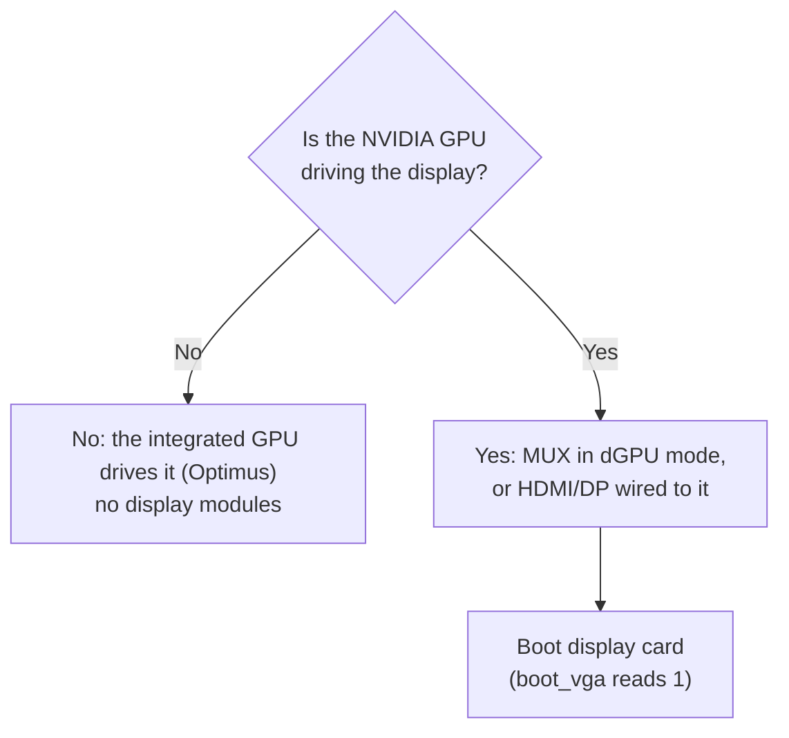

# Laptop support

This page covers laptops with an NVIDIA Ampere or Ada GPU.
They follow the same steps as desktop cards, plus extra power handling: a laptop powers an idle GPU off to save battery, and that would wipe the SR-IOV setup, so the package keeps the GPU awake while VMs use it.

## What you need to know

- A laptop follows the same steps as a desktop card, plus consent to keep the GPU powered: without it, `setup` and `activate` stop ([Consent](#consent)).
- Block system sleep and turn NVIDIA's runtime power management off before you start ([D3cold](#d3cold)).
- Keeping the GPU awake costs battery life while VMs use it.
- With Optimus (the integrated GPU drives the display), the NVIDIA GPU is not the boot display, so no display modules are needed ([Display](#display)).
- No laptop GPU has been tested.

## At a glance

| Item | Value |
|---|---|
| Device IDs | The PCI device ID of every laptop row in [devices.md](devices.md#rows), listed in the two tables under [Supported laptop GPUs](#supported-laptop-gpus) |
| Path | The same as the desktop cards of the generation ([Ampere](ampere.md), [Ada](ada.md)) |
| Presented as | Ampere: RTX A6000, `10de:2230`. Ada: RTX 6000 Ada, `10de:26b1` |
| VFs per card | 4 |
| Host and guest drivers | The recommended versions in the [supported software stack](installation.md#supported-software-stack); other versions are not guaranteed to work |
| Power | `activate` keeps a laptop GPU powered and blocks D3cold (the powered-off idle state) while it works. `setup` and `activate` stop without consent (`d3cold=off`), and `doctor` fails it. System sleep also needs to be blocked ([D3cold](#d3cold)) |
| Status | supported; see [Ampere](ampere.md#at-a-glance) and [Ada](ada.md#at-a-glance) |

A PCI ID has the form `vendor:device`: `10de` is NVIDIA, and the second part identifies the card model.
"Presented as" is the professional card whose identity the GeForce card takes on, so that NVIDIA's vGPU software accepts it.

## Supported laptop GPUs

Ampere and Ada laptop GPUs are supported.
They use the same professional counterpart, NVIDIA host driver setup and guest drivers as desktop cards of the same generation.
Blackwell GPUs are **not** expected to work with the current implementation ([Generations](devices.md#generations)).

### IDs with a config-space dump

Each ID below has public raw [config-space](glossary.md) dumps (the raw contents of a PCI device's configuration registers, which include its list of optional features) from one or more machines, as listed in the table.
Every dump shows hidden SR-IOV, ARI and MSI-X capabilities at the same positions as desktop cards of that generation.

| Device | Die | Product | Generation | Dumps |
|---|---|---|---|---|
| `249c` | GA104 | GeForce RTX 3080 Laptop GPU | Ampere | at least two machines |
| `249d` | GA104 | GeForce RTX 3070 Laptop GPU | Ampere | one machine |
| `24a0` | GA104 | GeForce RTX 3070 Ti Laptop GPU | Ampere | at least two machines |
| `24b6` | GA104 | RTX A5000 Laptop GPU | Ampere | at least two machines |
| `24dc` | GA104 | GeForce RTX 3080 Laptop GPU | Ampere | at least two machines |
| `24dd` | GA104 | GeForce RTX 3070 Laptop GPU | Ampere | one machine |
| `24e0` | GA104 | GeForce RTX 3070 Ti Laptop GPU | Ampere | one machine |
| `2520` | GA106 | GeForce RTX 3060 Laptop GPU | Ampere | at least two machines |
| `2523` | GA106 | GeForce RTX 3050 Ti Laptop GPU | Ampere | one machine |
| `2560` | GA106 | GeForce RTX 3060 Laptop GPU | Ampere | at least two machines |
| `25a0` | GA107 | GeForce RTX 3050 Ti Laptop GPU | Ampere | one machine |
| `25a2` | GA107 | GeForce RTX 3050 Laptop GPU | Ampere | at least two machines |
| `25b9` | GA107 | RTX A1000 Laptop GPU | Ampere | at least two machines |
| `25ba` | GA107 | RTX A2000 8GB Laptop GPU | Ampere | one machine |
| `25ec` | GA107 | GeForce RTX 3050 6GB Laptop GPU | Ampere | at least two machines |
| `2717` | AD103 | GeForce RTX 4090 Laptop GPU | Ada | at least two machines |
| `2757` | AD103 | GeForce RTX 4090 Laptop GPU | Ada | at least two machines |
| `27e0` | AD104 | GeForce RTX 4080 Laptop GPU | Ada | at least two machines |
| `2820` | AD106 | GeForce RTX 4070 Laptop GPU | Ada | at least two machines |
| `2860` | AD106 | GeForce RTX 4070 Laptop GPU | Ada | at least two machines |
| `28a0` | AD107 | GeForce RTX 4060 Laptop GPU | Ada | at least two machines |
| `28a1` | AD107 | GeForce RTX 4050 Laptop GPU | Ada | at least two machines |
| `28b8` | AD107 | RTX 2000 Ada Laptop GPU | Ada | at least two machines |
| `28e0` | AD107 | GeForce RTX 4060 Laptop GPU | Ada | at least two machines |
| `28e1` | AD107 | GeForce RTX 4050 Laptop GPU | Ada | at least two machines |

### IDs without a dump

There are no public config-space dumps for the IDs below.
They are included because every laptop GPU of the same generation that does have a dump uses the desktop layout, so they follow the same path.
The five Embedded parts are not laptop GPUs, but they use the same path and power guards and need D3cold consent too.

The package's livepatch module (`geforce_sriov`, which reveals the hidden SR-IOV feature) checks the hidden SR-IOV block when it loads, before `activate` removes or rescans the card.
If the block is missing, the livepatch module refuses the card and `activate` stops without removing it.

| Device | Die | Product | Generation |
|---|---|---|---|
| `24b7` | GA104 | RTX A4000 Mobile | Ampere |
| `24b8` | GA104 | RTX A3000 Mobile | Ampere |
| `24b9` | GA104 | RTX A3000 12GB Laptop GPU | Ampere |
| `24ba` | GA104 | RTX A4500 Laptop GPU | Ampere |
| `24bb` | GA104 | RTX A3000 Laptop GPU | Ampere |
| `2563` | GA106 | GeForce RTX 3050 Ti Mobile / Max-Q | Ampere |
| `25a5` | GA107 | GeForce RTX 3050 Mobile | Ampere |
| `25a6` | GA107 | GeForce MX570 | Ampere |
| `25a7` | GA107 | GeForce MX570 | Ampere |
| `25a9` | GA107 | GeForce RTX 2050 | Ampere |
| `25ab` | GA107 | GeForce RTX 3050 4GB Laptop GPU | Ampere |
| `25ac` | GA107 | GeForce RTX 3050 6GB Laptop GPU | Ampere |
| `25ad` | GA107 | GeForce RTX 2050 | Ampere |
| `25b8` | GA107 | RTX A2000 Mobile | Ampere |
| `25bb` | GA107 | RTX A500 Laptop GPU | Ampere |
| `25bc` | GA107 | RTX A1000 6GB Laptop GPU | Ampere |
| `25bd` | GA107 | RTX A500 Laptop GPU | Ampere |
| `25e0` | GA107 | GeForce RTX 3050 Ti Mobile | Ampere |
| `25e2` | GA107 | GeForce RTX 3050 Mobile | Ampere |
| `25e5` | GA107 | GeForce RTX 3050 Mobile | Ampere |
| `25ed` | GA107 | GeForce RTX 2050 | Ampere |
| `25f9` | GA107 | RTX A1000 Embedded GPU | Ampere |
| `25fa` | GA107 | RTX A2000 Embedded GPU | Ampere |
| `25fb` | GA107 | RTX A500 Embedded GPU | Ampere |
| `2730` | AD103 | RTX 5000 Ada Generation Laptop GPU | Ada |
| `2770` | AD103 | RTX 5000 Ada Generation Embedded GPU | Ada |
| `27a0` | AD104 | GeForce RTX 4080 Max-Q / Mobile | Ada |
| `27ba` | AD104 | RTX 4000 Ada Generation Laptop GPU | Ada |
| `27bb` | AD104 | RTX 3500 Ada Generation Laptop GPU | Ada |
| `27fb` | AD104 | RTX 3500 Ada Generation Embedded GPU | Ada |
| `2838` | AD106 | RTX 3000 Ada Generation Laptop GPU | Ada |
| `28b9` | AD107 | RTX 1000 Ada Generation Laptop GPU | Ada |
| `28ba` | AD107 | RTX 500 Ada Generation Laptop GPU | Ada |
| `28bb` | AD107 | RTX 500 Ada Generation Laptop GPU | Ada |
| `28e3` | AD107 | GeForce RTX 3050 A Laptop GPU | Ada |

The tools refuse laptop GPUs absent from both tables, like any other unlisted card ([Supported cards](devices.md)).

## Display

The boot display GPU is the one that shows the BIOS/UEFI screen at power-on and then drives the host's display, the Linux text console or a graphical desktop ([Glossary](glossary.md)).
An NVIDIA GPU in that role needs extra handling, because `activate` has to hand its display to NVIDIA's display modules ([Boot display card](installation.md#boot-display-card)).
Whether your NVIDIA GPU is the boot display depends on what the laptop's screen is wired to:

- Optimus, with the integrated GPU driving the display: the laptop's screen is wired to the CPU's built-in graphics, and the NVIDIA GPU only renders on request. This is the common case. The NVIDIA GPU is **not** the boot display, and no display modules are needed.
- MUX in dGPU mode, or HDMI or DisplayPort wired to the NVIDIA GPU: a MUX is a hardware switch (often a BIOS or vendor-app setting) that connects the screen to the NVIDIA GPU instead. In that mode, or with an external display on the GPU's own port, the display is attached to the NVIDIA GPU, so it is the boot display. See [Boot display card](installation.md#boot-display-card).

To check, run `cat /sys/bus/pci/devices/<BDF>/boot_vga`, replacing `<BDF>` with your GPU's PCI address, for example `0000:01:00.0`.
A value of `1` means the GPU is the boot display.



## D3cold

D3cold is the deepest PCI power state: the device is fully powered off and cannot answer.
Laptops use it to cut power to an idle GPU and save battery.
When power returns, the GPU restarts from scratch: its SR-IOV setup is erased, every running vGPU stops and the GPU firmware resets.

Both a hybrid (Optimus) laptop and NVIDIA's driver, through its runtime power management, can power down an idle NVIDIA GPU, so the package keeps the GPU awake while it works.
The power guards below apply to every laptop and embedded GPU in the tables above.
Keeping the GPU awake costs battery life, which is why it needs your consent.

### Consent

The power guards need your consent, which is recorded in the config as `d3cold=off`.
Without it, `setup` and `activate` stop with exit 3 before anything changes if any selected GPU is a laptop GPU, and `doctor` reports a failure.
The message includes the `install` command that records consent.

- `setup` shows a D3cold notice and asks whether to disable it for the selected laptop GPUs; the default is no.
  On a first install, it comes after the GPU selection and before the host CUDA question.
  On an installed host whose config lacks consent, `setup` asks before `doctor` and ends the run after a yes.
- `setup` exits 3 without changes if you decline, or if it cannot prompt (`--no-prompt` or no terminal) and `--disable-d3cold` was not given.
- `setup --disable-d3cold` and `install --disable-d3cold` record consent without asking the D3cold question.
  On a live run, the option needs at least one selected laptop GPU, or the command exits 2.
  A staged install (`--destdir`) skips this check and records consent.
- On an installed host, accepting or passing `--disable-d3cold` runs `install --driver=skip --disable-d3cold` to record consent without changing NVIDIA's files, then ends the `setup` run.
- `install --device` without `--disable-d3cold` removes consent from the config and reports the removal; without `--device`, `install` preserves it.
- `uninstall` removes consent with the config only if the config is unchanged since install.

### Package behavior

- For a laptop GPU, `activate` sets the `power/control` of the parent bridge (the PCIe port above the GPU) and of the GPU to `on` (the sysfs switch that keeps a device powered) and writes `0` to the GPU's `d3cold_allowed` (the sysfs switch that permits D3cold).
  It waits up to 5 seconds for the GPU to answer a config read while powered on.
- If the GPU does not answer, `activate` restores the settings it changed and stops before any removal.
  The message names the GPU and what failed.
- If a card fails or is stopped, `activate` also restores power settings for cards it did not remove.
- `activate` writes `d3cold_allowed` again after the rescan and holds it around the driver re-probe (unbinding and rebinding NVIDIA's driver).
- The parent bridge stays `on` for the session; `activate` reports this.
- `check` needs every VF to answer a config read at offset `0x08`.
  Reading a laptop GPU's or VF's config space resumes it if suspended.
- `doctor` writes nothing, but its config-space reads resume a suspended GPU.
  A GPU that does not answer fails the check, as does a laptop GPU without D3cold consent.
  If consent is recorded in the config or planned with `doctor --disable-d3cold`, `doctor` reports that consent as information.
  It reports the GPU's `runtime_status`, `power/control` and `d3cold_allowed`, and the bridge's `power/control`, as information.
  It warns if NVIDIA's runtime power management is not off, system sleep is not blocked, [MSI-X](#msi-x) has become hidden again, or the GPU has lost its SR-IOV state.

These settings last only for the current boot.
`activate` reapplies them each time it runs.

### Costs

- Shorter battery life and a warmer laptop, because the GPU no longer powers off when idle.
- The bridge above the GPU stays powered too.
- The laptop **must not** suspend, because sleep powers the GPU off.
- With sleep blocked, the laptop keeps running with its lid closed.
- Keep the laptop on mains power.
  With hibernation also masked, a laptop on battery may run out of charge and lose power while VMs are running.

### Settings you make yourself

The package does **not** block system sleep or change NVIDIA's runtime power management setting.
You need to set up both yourself.
`doctor` warns about missing settings and reports OK once they are set.

- Block system sleep, including on lid close and when idle.
  For example, this command masks the sleep targets; geforce-sriov **never** runs it:

  ```sh
  sudo systemctl mask sleep.target suspend.target hibernate.target hybrid-sleep.target
  ```

  `doctor` checks whether `sleep.target` is masked.
- Disable NVIDIA's GPU runtime power management (the driver's idle power saving) with this setting in a `.conf` file in `/etc/modprobe.d/`, the folder of kernel module option files:

  ```text
  options nvidia NVreg_DynamicPowerManagement=0
  ```

For NVIDIA's setting, `doctor` checks only `/etc/modprobe.d/`.
The first file that sets the value to 0 satisfies the check, even if another file sets a different value.
It does not read `/run/modprobe.d/` or `/lib/modprobe.d/`.

## MSI-X

MSI-X is the way a PCIe device sends interrupts to the CPU.
The GPU hides its MSI-X capability, and `msix=on` (the default) exposes it as it does on desktop cards ([Module parameters](configuration.md#module-parameters)).
The livepatch module can only do this when it loads, so a power cut is expected to hide MSI-X again, as a reset of the physical function (the whole card) does, and that stops the GPU's interrupts ([Turn features off](recovery.md#turn-features-off)).
`doctor` and `check` warn if MSI-X becomes hidden again after the livepatch module linked it on a laptop GPU.

## ARI

A PCI slot normally holds 8 functions, numbered 0 to 7.
ARI (Alternative Routing-ID Interpretation) is a PCIe feature that lets a device have more than 8.
It matters only for functions above 7; the default four VFs occupy functions 4 to 7, so ARI is optional.
It stays off when:

- The hidden ARI capability has next function number 0, as on most boards without an audio function.
- The parent root port (the CPU's PCIe port the card hangs off) lacks ARI forwarding, the setting that lets the port pass such a device's traffic.

`activate` then prints a note, and activation continues.
`doctor` warns about a bridge without ARI forwarding.

## VF counts

The VF count a card reports depends on its generation, and the package presents 4 either way:

- Ada laptop GPUs with dumps report 1 VF, as most Ada desktop cards do.
  The livepatch module presents 4 VFs, and the VF-count patch in NVIDIA's module makes its driver accept them.
  If the card does not accept 4, the livepatch module sets up no SR-IOV on it.
- Ampere laptop GPUs with dumps report 16 VFs.
  The package presents 4, as on desktop cards.
- IDs without dumps use the same handling as other cards of their generation.

See [Capability positions per generation](devices.md#capability-positions-per-generation).

## Guests

Use the desktop guest setup for the card's generation ([Guests](installation.md#guests)).
On Windows, `RMSetVgpuGspPluginOffloadMode=0` is a per-device setting.
After changing the GPU identity, set it again as [Guests](installation.md#guests) describes.

## Recovery

- If vGPUs stop or `doctor` reports hidden MSI-X or lost SR-IOV state, stop the VMs, shut the laptop down fully, power it on with the power button, then run `setup` again.
  This needs a cold power cycle, **not** a reboot ([Reboot or power-off](recovery.md#reboot-or-power-off)).
  A smart plug cannot power off a laptop running on its battery.
- If the GPU disappears from `lspci` or the host cannot be reached, follow [the power-cycle rule](recovery.md#the-one-rule).
- If `setup`, `activate` or `doctor` stops because D3cold consent is missing, run `setup` and answer yes, or run the `install` command shown in the message ([Consent](#consent)).
- For other problems, see [Symptoms](recovery.md#symptoms).

## Reports

Submit a [compatibility report](https://github.com/noon-at-cgn/geforce-sriov/issues/new?template=compatibility-report.yml) if your laptop has a GPU from these tables, whether it works or not.
Include the laptop model and whether it uses Optimus or a MUX.
See [Compatibility reports](compatibility.md) for the information to collect.
