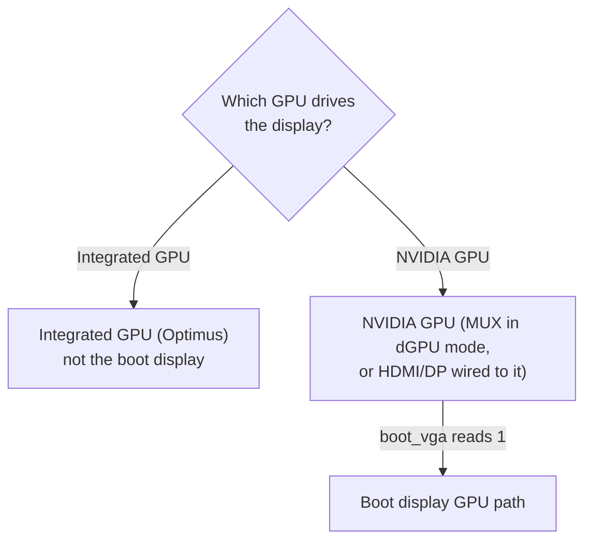

# Laptop support

## At a glance

| Item | Value |
|---|---|
| Device IDs | Every laptop row in [devices.md](devices.md#rows), listed in the two tables under [Supported laptop GPUs](#supported-laptop-gpus) |
| Path | The same as the desktop cards of the generation ([Ampere](ampere.md), [Ada](ada.md)) |
| Presented as | Ampere: RTX A6000, `10de:2230`. Ada: RTX 6000 Ada, `10de:26b1` |
| VFs per card | 4 |
| Host and guest drivers | The [supported software stack](installation.md#supported-software-stack) |
| Power | With consent (`d3cold=off`), `activate` keeps the GPU powered and blocks D3cold. Without consent, it refuses the entire run and activates no GPU. System sleep must also be blocked ([D3cold](#d3cold)) |
| Status | supported; see [Ampere](ampere.md#at-a-glance) and [Ada](ada.md#at-a-glance) |

## Supported laptop GPUs

Ampere and Ada laptop GPUs are supported.
They use the same target, host stack and guest drivers as desktop cards of the same generation.

### IDs with a config-space dump

Each ID below has public raw config-space dumps from one or more machines, as listed in the table.
Every dump shows hidden SR-IOV, ARI and MSI-X capabilities at the same positions as desktop cards of that generation.

| Device | Die | Product | Generation | Dumps |
|---|---|---|---|---|
| `249c` | GA104 | GeForce RTX 3080 Laptop GPU | Ampere | at least two machines |
| `249d` | GA104 | GeForce RTX 3070 Laptop GPU | Ampere | one machine |
| `24a0` | GA104 | GeForce RTX 3070 Ti Laptop GPU | Ampere | at least two machines |
| `24b6` | GA104 | RTX A5000 Laptop GPU | Ampere | at least two machines |
| `24dc` | GA104 | GeForce RTX 3080 Laptop GPU | Ampere | at least two machines |
| `24dd` | GA104 | GeForce RTX 3070 Laptop GPU | Ampere | one machine |
| `24e0` | GA104 | GeForce RTX 3070 Ti Laptop GPU | Ampere | one machine |
| `2520` | GA106 | GeForce RTX 3060 Laptop GPU | Ampere | at least two machines |
| `2523` | GA106 | GeForce RTX 3050 Ti Laptop GPU | Ampere | one machine |
| `2560` | GA106 | GeForce RTX 3060 Laptop GPU | Ampere | at least two machines |
| `25a0` | GA107 | GeForce RTX 3050 Ti Laptop GPU | Ampere | one machine |
| `25a2` | GA107 | GeForce RTX 3050 Laptop GPU | Ampere | at least two machines |
| `25b9` | GA107 | RTX A1000 Laptop GPU | Ampere | at least two machines |
| `25ba` | GA107 | RTX A2000 8GB Laptop GPU | Ampere | one machine |
| `25ec` | GA107 | GeForce RTX 3050 6GB Laptop GPU | Ampere | at least two machines |
| `2717` | AD103 | GeForce RTX 4090 Laptop GPU | Ada | at least two machines |
| `2757` | AD103 | GeForce RTX 4090 Laptop GPU | Ada | at least two machines |
| `27e0` | AD104 | GeForce RTX 4080 Laptop GPU | Ada | at least two machines |
| `2820` | AD106 | GeForce RTX 4070 Laptop GPU | Ada | at least two machines |
| `2860` | AD106 | GeForce RTX 4070 Laptop GPU | Ada | at least two machines |
| `28a0` | AD107 | GeForce RTX 4060 Laptop GPU | Ada | at least two machines |
| `28a1` | AD107 | GeForce RTX 4050 Laptop GPU | Ada | at least two machines |
| `28b8` | AD107 | RTX 2000 Ada Laptop GPU | Ada | at least two machines |
| `28e0` | AD107 | GeForce RTX 4060 Laptop GPU | Ada | at least two machines |
| `28e1` | AD107 | GeForce RTX 4050 Laptop GPU | Ada | at least two machines |

### IDs without a dump

No public config-space dumps are available for the IDs below.
They are included because every laptop GPU with a config-space dump for the same generation has the desktop layout.
They use the same activation path.
The five Embedded parts are not laptop GPUs, but use the same path and power guards and also require D3cold consent.

The kernel module checks the hidden SR-IOV block when it loads, before `activate` removes or rescans the card.
If the block is missing, the module refuses the card and `activate` stops without removing it.

| Device | Die | Product | Generation |
|---|---|---|---|
| `24b7` | GA104 | RTX A4000 Mobile | Ampere |
| `24b8` | GA104 | RTX A3000 Mobile | Ampere |
| `24b9` | GA104 | RTX A3000 12GB Laptop GPU | Ampere |
| `24ba` | GA104 | RTX A4500 Laptop GPU | Ampere |
| `24bb` | GA104 | RTX A3000 Laptop GPU | Ampere |
| `2563` | GA106 | GeForce RTX 3050 Ti Mobile / Max-Q | Ampere |
| `25a5` | GA107 | GeForce RTX 3050 Mobile | Ampere |
| `25a6` | GA107 | GeForce MX570 | Ampere |
| `25a7` | GA107 | GeForce MX570 | Ampere |
| `25a9` | GA107 | GeForce RTX 2050 | Ampere |
| `25ab` | GA107 | GeForce RTX 3050 4GB Laptop GPU | Ampere |
| `25ac` | GA107 | GeForce RTX 3050 6GB Laptop GPU | Ampere |
| `25ad` | GA107 | GeForce RTX 2050 | Ampere |
| `25b8` | GA107 | RTX A2000 Mobile | Ampere |
| `25bb` | GA107 | RTX A500 Laptop GPU | Ampere |
| `25bc` | GA107 | RTX A1000 6GB Laptop GPU | Ampere |
| `25bd` | GA107 | RTX A500 Laptop GPU | Ampere |
| `25e0` | GA107 | GeForce RTX 3050 Ti Mobile | Ampere |
| `25e2` | GA107 | GeForce RTX 3050 Mobile | Ampere |
| `25e5` | GA107 | GeForce RTX 3050 Mobile | Ampere |
| `25ed` | GA107 | GeForce RTX 2050 | Ampere |
| `25f9` | GA107 | RTX A1000 Embedded GPU | Ampere |
| `25fa` | GA107 | RTX A2000 Embedded GPU | Ampere |
| `25fb` | GA107 | RTX A500 Embedded GPU | Ampere |
| `2730` | AD103 | RTX 5000 Ada Generation Laptop GPU | Ada |
| `2770` | AD103 | RTX 5000 Ada Generation Embedded GPU | Ada |
| `27a0` | AD104 | GeForce RTX 4080 Max-Q / Mobile | Ada |
| `27ba` | AD104 | RTX 4000 Ada Generation Laptop GPU | Ada |
| `27bb` | AD104 | RTX 3500 Ada Generation Laptop GPU | Ada |
| `27fb` | AD104 | RTX 3500 Ada Generation Embedded GPU | Ada |
| `2838` | AD106 | RTX 3000 Ada Generation Laptop GPU | Ada |
| `28b9` | AD107 | RTX 1000 Ada Generation Laptop GPU | Ada |
| `28ba` | AD107 | RTX 500 Ada Generation Laptop GPU | Ada |
| `28bb` | AD107 | RTX 500 Ada Generation Laptop GPU | Ada |
| `28e3` | AD107 | GeForce RTX 3050 A Laptop GPU | Ada |

The tools refuse laptop GPUs absent from both tables, like any other unlisted card ([Supported cards](devices.md)).

## Display

Display wiring determines whether the NVIDIA GPU is the boot display:

- Optimus, with the integrated GPU driving the display: the NVIDIA GPU is not the boot display.
- MUX in dGPU mode, or HDMI or DisplayPort wired to the NVIDIA GPU: the NVIDIA GPU may be the boot display.

Run `cat /sys/bus/pci/devices/<BDF>/boot_vga`, replacing `<BDF>` with your GPU's PCI address, for example `0000:01:00.0`.
If it reads `1`, follow [Boot display GPU](installation.md#boot-display-gpu).



## D3cold

Laptops can cut power to an idle GPU to save battery.
This state is called D3cold.
When power returns, the GPU restarts from scratch: its SR-IOV setup is erased, every running vGPU stops and the GPU firmware resets.

Both a hybrid laptop and NVIDIA's laptop driver can power down an idle NVIDIA GPU.
The device table flags every row in the tables above for the power guards described below.

### Consent

The power guards require consent, recorded in the config as `d3cold=off`.
Without it, `activate` refuses the entire run if any selected GPU is a laptop GPU: it exits 3 before waking a GPU or writing anything, and activates no GPU.
The refusal includes the `install` command needed to record consent.

- `setup` shows a D3cold notice and asks whether to disable it for the selected laptop GPUs; the default is no.
  On a first install, this is the last question.
  On an installed host whose config lacks consent, `setup` asks before its `install --dry-run` step and ends the run after a yes.
- `setup` exits 3 without changes if you decline, or if it cannot prompt (`--no-prompt` or no terminal) and `--disable-d3cold` was not given.
- `setup --disable-d3cold` and `install --disable-d3cold` record consent without asking the D3cold question.
  On a live run, the option requires at least one selected laptop GPU; otherwise, the command exits 2.
  A staged install (`--destdir`) skips this check and records consent.
- On an installed host, accepting or passing `--disable-d3cold` runs `install --driver=skip --disable-d3cold` to record consent without changing NVIDIA's files, then ends the `setup` run.
- `install --device` without `--disable-d3cold` removes consent from the config and reports the removal; without `--device`, `install` preserves it.
- `uninstall` removes consent with the config only if the config is unchanged since install.

### What geforce-sriov does

- With consent, `activate` sets the parent bridge's and GPU's `power/control` to `on` and writes `0` to the GPU's `d3cold_allowed` before it writes to the card.
  If the GPU reports active, a config read must succeed before these writes.
  It waits up to 5 seconds for config space to return the GPU's NVIDIA ID while powered on.
- If the GPU does not answer, `activate` restores the settings it changed and refuses with exit 3.
  The message explains how to keep the GPU powered.
- If a card is refused or fails later, `activate` also restores the power settings it changed on the other cards.
- `activate` keeps `d3cold_allowed` at `0` around the rescan and around the driver re-probe.
- The parent bridge stays `on` for the session; `activate` reports this.
- `check` requires every VF to answer a config read at offset `0x08`.
  Reading a laptop GPU's or VF's config space resumes it if suspended.
- Before install, `install --dry-run` writes nothing, but its config-space reads resume a suspended GPU.
  A GPU that does not answer fails the check, as does a laptop GPU without D3cold consent.
  If consent is recorded in the config or planned with `install --dry-run --disable-d3cold`, it reports that consent as information.
  It reports the GPU's `runtime_status`, `power/control` and `d3cold_allowed`, and the bridge's `power/control`, as information.
  It warns if NVIDIA's runtime power management is not off, system sleep is not blocked, or MSI-X is hidden with the module loaded.
- After install, `status` runs the same host checks and also warns if the GPU has lost its SR-IOV state.

These settings last only for the current boot.
`activate` applies them each time it brings the GPU up.

### What it costs

- Shorter battery life and a warmer laptop, because the GPU no longer powers off when idle.
- The bridge above the GPU stays powered too.
- The laptop must not suspend, because sleep powers the GPU off.
- With sleep blocked, the laptop keeps running with its lid closed.
- Keep the laptop on mains power.
  With hibernation also masked, a laptop on battery may run out of charge and lose power while VMs are running.

### What you do yourself

geforce-sriov does not block system sleep or change NVIDIA's runtime power management setting.
You must configure both yourself.
`install --dry-run` (before install) and `status` (after install) warn about missing settings and report OK once they are set.

- Block system sleep, including on lid close and when idle.
  For example, this command masks the sleep targets; geforce-sriov never runs it:

  ```sh
  sudo systemctl mask sleep.target suspend.target hibernate.target hybrid-sleep.target
  ```

  `install --dry-run` and `status` check whether `sleep.target` is masked.
- Disable NVIDIA's GPU runtime power management with this setting in a `.conf` file in `/etc/modprobe.d/`:

  ```text
  options nvidia NVreg_DynamicPowerManagement=0
  ```

For NVIDIA's setting, `install --dry-run` and `status` check only `/etc/modprobe.d/`.
The first file that sets the value to 0 satisfies the check, even if another file sets a different value.
It does not read `/run/modprobe.d/` or `/lib/modprobe.d/`.

## MSI-X

As on desktop cards, `msix=on` (the default) exposes the GPU's hidden MSI-X capability ([Module parameters](configuration.md#module-parameters)).
`install --dry-run` and `status` report whether MSI-X is hidden on a laptop GPU (a warning once the module is loaded), and `check` warns if a laptop GPU powered off since its VFs were configured.
After such a warning, power the machine off and on, then run `setup` again.

## ARI

ARI is optional.
It matters only for functions above 7; the default four VFs occupy functions 4 to 7.
It stays off when:

- The hidden ARI capability has next function number 0, as on most boards without an audio function.
- The parent root port lacks ARI forwarding.

`activate` then prints a note, and activation continues.
`install --dry-run` and `status` warn about a bridge without ARI forwarding.

## VF counts

- Ada laptop GPUs with dumps report 1 VF, as most Ada desktop cards do.
  The geforce-sriov module presents 4 VFs, and the VF-count revision in NVIDIA's host module makes its driver accept them.
  If the card does not accept 4, the module sets up no SR-IOV on it.
- Ampere laptop GPUs with dumps report 16 VFs.
  geforce-sriov presents 4, as on desktop cards.
- IDs without dumps use the same handling as other cards of their generation.

See [Capability positions per generation](devices.md#capability-positions-per-generation).

## Guests

Use the desktop guest setup for the card's generation ([Guests](installation.md#guests)).
On Windows, `RMSetVgpuGspPluginOffloadMode=0` is a per-device setting.
After changing the GPU identity, set it again as [Guests](installation.md#guests) describes.

## Recovery

- If vGPUs stop or `status` reports hidden MSI-X or lost SR-IOV state, stop the VMs, shut the laptop down fully, power it on with the power button, then run `setup` again.
  This requires a cold power cycle, not a reboot.
  A smart plug cannot power off a laptop running on its battery.
- If the GPU disappears from `lspci` or the host cannot be reached, follow [the one rule](recovery.md#the-one-rule).
- If `activate` or `setup` refuses a laptop GPU because D3cold consent is missing, run `setup` and answer yes, or run the `install` command shown in the refusal ([Consent](#consent)).
- For other problems, see [Symptoms](recovery.md#symptoms).

## Reports

Submit a [compatibility report](https://github.com/noon-at-cgn/geforce-sriov/issues/new?template=compatibility-report.yml) if your laptop has a GPU from these tables, whether it works or not.
Include the laptop model and whether it uses Optimus or a MUX.
See [Compatibility reports](compatibility.md) for the information to collect.
