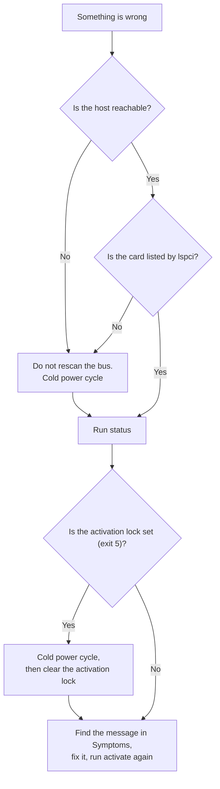
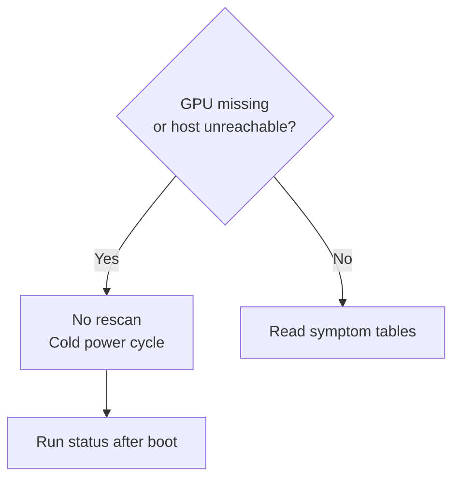
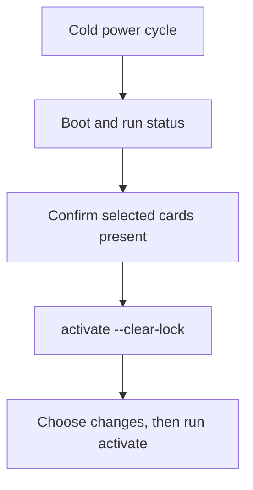

# Recovery

This page helps you get a host working again when a card disappears, `activate` stops, or a VM does not start.
Terms such as PF, VF, livepatch, the activation lock and cold power cycle are explained in the [Glossary](glossary.md).
You need SSH or a console on the host.
You also need a way to power the machine off and on, such as IPMI, a smart plug or the power button.
Recovery never needs a reinstall of the operating system.
The package gives you three ways back:

- Runtime changes end with a power cycle.
- [Turn features off](#turn-features-off) switches single features off.
- [`uninstall`](#remove-geforce-sriov) removes the package and restores NVIDIA's original driver module from its backup.

Read this page before you need it.
Set up SSH access so you can read logs when the screen is dead.
Also set up netconsole, which sends the kernel log over the network, or a serial console if you have one.
Before installing, run `geforce-sriov install --dry-run`.

## If something goes wrong

The most common problems and the first thing to try.
Each links to the full explanation. See the [Symptoms](#symptoms) table below for many more.

| Problem | First fix |
|---|---|
| A card is missing from `lspci`, or the host does not answer | Power the machine fully off and on. Do **not** reboot or rescan the bus. See [the one rule](#the-one-rule) |
| `activate` or the boot unit exits 5, or `status` says the activation lock is set | After a cold power cycle, run `geforce-sriov status`, then `sudo geforce-sriov activate --clear-lock` and `sudo geforce-sriov activate`. See [The activation lock](#the-activation-lock) |
| After a kernel update, `status` shows a `kernel hook:` line, or `activate` refuses because `nvidia.ko` is not the build geforce-sriov installed | Run `sudo geforce-sriov rebuild --kernel <release>`, then power-cycle. See [After a kernel update](installation.md#after-a-kernel-update) |
| A VM does not start, or the start fails with an error about the vGPU type | Run `geforce-sriov check`. Put the VM on a lower VF or pick a smaller vGPU type. See [Choosing a vGPU type](configuration.md#choosing-a-vgpu-type) |
| The guest driver fails (`RmInitAdapter failed` on Linux, Code 43 on Windows) | Install the vGPU guest driver for your card and set `RMSetVgpuGspPluginOffloadMode=0` in the guest. See [Guests](installation.md#guests) |
| The screen stays blank after `activate` on the boot display GPU | Log in over SSH and follow the one rule. Do **not** rebind the display by hand. See [The console of the boot display GPU](#the-console-of-the-boot-display-gpu) |

## Where to start

Start with `geforce-sriov status`.
It names each card's next step and ends with the host checks.
If the host is unreachable or a card is missing from `lspci`, you cannot run it yet.
Do a cold power cycle first.



### Reboot or power-off

A reboot restarts the operating system without necessarily removing power from the card.
A cold power cycle switches the machine off, so the card loses power and starts from a clean state.
Several failures leave a card in a state that only a power loss clears, which is why this page keeps asking for one:

| Situation | What you need | Why |
|---|---|---|
| A card is missing from `lspci`, or the host cannot be reached | Full power-off, then on | A GPU that stops answering PCI config reads comes back only after a full power-off |
| `activate` or the boot unit exits 5, or the activation lock is set | Full power-off, then on | The earlier activation stopped partway, so the state of the card is unknown |
| You changed `vfs`, `ari` or `msix`, or `install` put a new patched NVIDIA module in place | Full power-off, then on | The `geforce_sriov` module fixes its parameters when it loads, and it must load before `nvidia` |
| After `uninstall` | Full power-off, then on | The loaded modules and the cards keep their state until then |
| `activate` refused or stopped before it removed a card (exit 3): a program holds the GPU, a VM still has a vGPU, or a display manager is in the way | No power cycle: fix it and run `activate` again | Nothing was changed for that card |

## The one rule

If a card disappears from `lspci` after activation, or the host cannot be reached, power the machine fully off and on.
This requires a cold power cycle, not a reboot.
Do not rescan the PCI bus or warm-reboot repeatedly.
Rescanning a bus whose GPU has left it can take the kernel down.
A GPU that stops answering PCI config reads comes back only after a full power-off.



Keep SSH access, and netconsole or a serial console if available, so you can read logs remotely.

## Symptoms

| Symptom | Cause | What to do |
|---|---|---|
| `activate` or the boot unit exits with status 5: `activation lock … is set` | An earlier activation did not finish | Power the machine off and on, run `geforce-sriov status`, then `sudo geforce-sriov activate --clear-lock`. See [The activation lock](#the-activation-lock) |
| `activate`: `… is bound to driver '<driver>', not nvidia; activation removes only an NVIDIA-bound card` | A driver other than `nvidia` holds the card, for example `vfio-pci` | Unbind the card from that driver or remove what binds it, then run `activate` again |
| `activate`: `refused, nothing changed: modprobe geforce_sriov exited with … while NVIDIA's driver … was already bound`, or `status` warns that `nvidia` loads from `modules-load.d` or the initramfs | Something loads `nvidia` before the livepatch unit, so the livepatch cannot reveal MSI-X on that boot | Remove `nvidia` from those lists, rebuild the initramfs, then power the machine off and on |
| `status`, `check` or `activate`: `NVIDIA's driver … is not guaranteed to work; confirmed versions: 580.159.01.` (`activate` adds `geforce-sriov: ` before it and `; continuing` after it), or `install`: `NVIDIA's driver … is not guaranteed to work. Confirmed versions: 580.159.01. Continuing uses best effort; input and safety checks still apply.` | The host driver version is not 580.159.01, the only confirmed version. Other versions are **not guaranteed to work** | `status` prints an ordinary `driver:` line and its exit status does not change. `check` and `activate` continue. `install` builds best effort when it finds the code it patches. `setup` asks first, default no, and `--allow-unsupported-driver` answers yes. `install --dry-run` prints nothing about the version. For a confirmed host, use 580.159.01. See [Supported software stack](installation.md#supported-software-stack) |
| `status`: `NVIDIA driver … the identity hook passes this version through unchanged` | A host driver version other than 580.159.01 that the hook does not know. It is **not guaranteed to work** | Install a host driver version the hook acts on. 580.159.01 is the confirmed one. On this version the hook changes nothing, so no vGPU types appear |
| `install`: `refused: module .text differences are not the eight expected offsets; first unexpected offset: …`, or `… are not the eight expected offsets and the one that the Ada placement change adds; first unexpected offset: …` (a build with an Ada card selected), or `… are not the offsets the patch tool reported for this build; first unexpected offset: …` (a driver version with no recorded offsets), or `module .text sizes differ; first unexpected offset: …` | The module the driver step built differs from the installed stock module somewhere other than the expected offsets. A tree for another driver version, another compiler or other module options compile differently | The driver step changed none of NVIDIA's files. Keep the stock module, or use `--driver=skip` and follow [The manual path](driver-patch.md#the-manual-path). See [Compare with a stock build](driver-patch.md#compare-with-a-stock-build) |
| `install`: `refused: the installed module … is already this build, but … is missing or wrong. Reinstall the stock module first, or install with --driver=skip to keep this module as it is` | The installed `nvidia.ko` already has this build's `.text`, but the modprobe option, the patched plugin copy or this kernel's backup of the stock module is missing or wrong. A missing record, or one written for another kernel, is repaired once those are in place. A plugin copy from an earlier install with only the plugin placement change is replaced | Put NVIDIA's stock `nvidia.ko` back, then run `install` again. See [Reverting](driver-patch.md#reverting). For a module you patched by hand, run `install --driver=skip` |
| `activate` refuses, or `status` warns: ``… is an earlier copy without the Ada framebuffer change. Run `sudo geforce-sriov install` again …`` | The plugin copy is the one an earlier version of geforce-sriov made. It has only the plugin placement change, `7ddfad45…` | Run `sudo geforce-sriov install` again. It replaces the copy with the patched plugin copy, `aa4fdeb5…`. Then run `sudo geforce-sriov activate` with no VM running |
| `status` shows `SR-IOV: not presented` (exit 1) | Not activated this boot, or activation failed. Expected after `install` until the first boot that activates the card | Follow the next step `status` prints, and read `journalctl -b -u geforce-sriov-livepatch.service -u geforce-sriov-activate.service` |
| One of several selected cards is refused, and nothing is changed | `activate` checks every selected card first and changes nothing when one fails | Fix that card, or run `install --device` without it to activate the others |
| `status` or `activate` reports BAR0 unassigned, or a card came back from the rescan without BAR0 | The bridge windows above the card are too small | Follow [the one rule](#the-one-rule). Enable *Above 4G decoding* in the firmware or boot with `pci=realloc`. Skip activation (`geforce_sriov.skip`) until BAR0 is assigned again |
| `activate`: `not enough MMIO resources for SR-IOV`, or `status` reports no VF BAR assigned | The bridge window above the card is too small for the VF BARs. geforce-sriov never resizes the windows of a switch or of bridges further up | Enable *Above 4G decoding* in firmware, or boot with `pci=realloc` |
| Kernel log `geforce_sriov: first VF offset … ; refusing` (module not loaded), or `VF layout for … requested VFs … SR-IOV is not set up on this PF` | The card's VF layout does not fit its own slot, or its NumVFs register does not take the kernel's value | If `vfs` is above the default of 4, set it to 4 or lower or remove the line, then power the machine off and on. Otherwise no setting helps, so remove the card from `bdfs` |
| Kernel log `unexpected VF layout after SR-IOV setup` | The card reported another layout at VF enable than at setup | Disable the VFs, power the machine off and on, and do not rely on that card's VFs |
| VF enable fails after a vendor livepatch service, such as Ubuntu Livepatch, applied a cumulative "replace" livepatch | Such a patch silently disables `geforce_sriov` | Disable the vendor livepatch service, then power the machine off and on |
| `<BDF> (10de:<id>) is not in the device table` from `install --dry-run`, `install --device`, `setup`, `activate` or `check` | The card's ID is not listed | Select only cards that `geforce-sriov devices` lists. See [Supported cards](devices.md) |
| `/etc/geforce-sriov/config: line N: unknown key 'KEY'` (a key that contains `vf`, such as `experimental_vfs`, adds `; the VF count key is vfs (vfs=1..16, default 4)`) | The config holds a key geforce-sriov does not have | Delete or correct that line in `/etc/geforce-sriov/config`, then run the command again |
| Ada card: NVIDIA's stock proprietary host module does not take the card | NVIDIA's stock module refuses Ada cards on a vGPU host | Run `install` without `--driver=skip`. It makes the three host-object revisions and, with an Ada card selected, the VM video memory change. Then it rebuilds `nvidia.ko`, loaded with `NVreg_EnableGpuFirmware=0`. See [What install does](driver-patch.md#what-install-does). With `--driver=skip`, do it by hand: see [The manual path](driver-patch.md#the-manual-path) and [Ada host stack](ada.md#host-stack) |
| Ada card: Linux shows 4 VFs, but a vGPU on any VF after the first fails with `NV_ERR_OUT_OF_RANGE` (`0x5B`) | The loaded `nvidia.ko` lacks the VF-count revision | Run `install` again. On the manual path, build the module from an object that carries all three revisions, then install it. With an Ada card selected, the object also needs the VM video memory change. See [Revisions](driver-patch.md#revisions). Then power the machine off and on |
| `install --dry-run` or `status`: `[WARN]` that the selection mixes Ada with another generation | The host module forces every card bound to it to 4 VFs. See [Combining generations](devices.md#combining-generations) | Nothing to fix. The warning does not stop `install` or `activate`. Select cards of one generation to avoid it |
| `activate` reports that a selected card is not bound to `nvidia` | NVIDIA's host driver is not loaded | `modprobe nvidia`, wait, and run `activate` again |
| `modprobe nvidia` fails or loads nothing | A modprobe.d rule such as `install nvidia /bin/false` blocks it | `modprobe --ignore-install nvidia`, or remove the rule |
| `Unit nvidia-vgpud.service not found` (or `nvidia-vgpu-mgr.service`) | NVIDIA's unit files are not installed | See [NVIDIA's vGPU daemon units](installation.md#nvidias-vgpu-daemon-units) |
| VFs exist but no vGPU types appear | `nvidia-vgpud` started before the VFs, or the hook is off | Run `activate`, which restarts both daemons in order. If the patched plugin copy is not installed, run `sudo geforce-sriov install` first. Then check `identity=on` and the hook log lines |
| `status`: `<file> sets LD_PRELOAD for nvidia-vgpud and overrides the geforce-sriov identity hook. …` (or `nvidia-vgpu-mgr`) | Another drop-in of that unit preloads its own library, and systemd keeps the last `LD_PRELOAD`, so the identity hook is not loaded | Remove that drop-in, or point its `LD_PRELOAD` at the hook path `status` names, then run `systemctl daemon-reload` and `activate` with no VM running |
| VM does not start, or the start fails with an error about the vGPU type | The type does not fit the free memory, or the VFs or daemons are not ready. On an Ada card whose loaded module lacks the VM video memory change, with a large type, the VF's fixed range of video memory ends near the top of the card's memory. `activate` names such VFs after it sets the types | Run `geforce-sriov check`, put the VM on a lower VF or pick a smaller type, and make the daemons ready with `activate`. Install the patched plugin copy first with `sudo geforce-sriov install`. See [Choosing a vGPU type](configuration.md#choosing-a-vgpu-type) |
| `check` reports `NOT READY … type=<old> expected=<new>` after `type_ada` or `type_ampere` changed | The config names a new type and the VFs still carry the old one | Stop the VMs on that card, write `0` to `nvidia/current_vgpu_type` of each of its VFs while `nvidia-vgpu-mgr` runs, then run `activate` |
| Windows guest shows Code 43 | The guest has a bare-metal or Data Center driver instead of the vGPU guest build, or lacks `RMSetVgpuGspPluginOffloadMode=0` | Install the vGPU guest driver listed for your card and set the DWORD. See [Guests](installation.md#guests) |
| `activate` refuses: `nvidia.ko for … is not the driver step's build …`, or `nvidia.ko for … is not known to be the driver step's build: … records kernel …` | The record does not name the installed `nvidia.ko` for the running kernel. DKMS may have rebuilt the stock module after a kernel update, or the record was made on another kernel | Run `sudo geforce-sriov install` on this kernel. It rewrites the record when the installed module is this build. Then power the machine off and on. See [After a kernel or NVIDIA driver update](driver-patch.md#after-a-kernel-or-nvidia-driver-update). With no record at all (`--driver=skip`), `activate` only warns |
| `status`, `check` or `activate`: `the running nvidia module (build-id …) is not the installed one (…); power the machine off and on to load it` | The installed `nvidia.ko` is the driver step's build, and the running `nvidia` module is not. This happens, for example, when `install` or the driver step puts a new build in place without a power cycle | Power the machine off and on, so the installed build is loaded. Until then `status` exits 1, and `activate` warns and continues on the loaded module |
| `activate`: `type <N> is not in nvidia/creatable_vgpu_types …; nothing written. The driver keeps the vGPU types it registered first after a boot, so after a change of identity or professional counterpart, power the machine off and on` | NVIDIA's `nvidia_vgpu_vfio` keeps the type table of each GPU's first registration until the next boot. Neither a PF re-probe nor a daemon restart refreshes it, so after a change of identity or target the old table stays | Power the machine off and on, then run `activate` again |
| `uninstall` exits 1 and prints `NVIDIA's module was not restored: …` | Restoring NVIDIA's `nvidia.ko`, plugin link or modprobe file did not complete, or `uninstall` refused to run `geforce-sriov-driver` because it changed since install | `uninstall` kept `geforce-sriov-driver` and every backup in `/var/lib/geforce-sriov/stock/`. The message gives the reason and two ways to finish. Fix the reason, then run `geforce-sriov-driver --restore`. Or copy `/var/lib/geforce-sriov/stock/<kernel release>/nvidia.ko` over the installed `nvidia.ko` and run `depmod -a <kernel release>`. See [Reverting](driver-patch.md#reverting) for the plugin link and the modprobe file, and [Remove geforce-sriov](#remove-geforce-sriov) |
| Guest GPU work stalls | The stock `nvidia.ko` is loaded. DKMS rebuilt it after an update | Run `sudo geforce-sriov rebuild --kernel RELEASE` for this kernel. See [After a kernel update](installation.md#after-a-kernel-update). On the manual path, re-apply the [driver patch](driver-patch.md#after-a-kernel-or-nvidia-driver-update) |
| `rebuild` or `install`: `refused: NVIDIA's own module for <release> is not built yet (modinfo -k <release> -n nvidia finds none). Install the headers of that kernel, build NVIDIA's module with `dkms install nvidia/<version> -k <release>` …` | DKMS did not build NVIDIA's own module for that kernel, for example because its headers were missing. geforce-sriov patches NVIDIA's module, so that module must exist first. Nothing was changed | Install that kernel's headers. Run `sudo dkms install nvidia/<version> -k <kernel>` or `dkms autoinstall -k <kernel>`. Then run `sudo geforce-sriov rebuild --kernel <kernel>` |
| `rebuild`: `refused: the Linux driver package that an earlier install kept is missing: <path>. NVIDIA's files are as they were. …`, or the same for `NVIDIA's public kernel module source`, or `… that an earlier install kept was changed since: …` | The kept copy of the Linux driver package or of the public kernel module source was deleted or altered. A kept file that was altered is **not** used or run. Nothing was changed (exit 3) | Run `sudo ./geforce-sriov install` in the source folder with the option the message names: `--companion-file PATH` or `--companion-source DIR` for the Linux driver package, or `--nvkms-source PATH`. That keeps the input again, and `rebuild` works afterwards |
| `rebuild`: `refused: this build needs the Linux driver package, and no earlier install kept one …` | The config asks for the display or host CUDA build, but the install that built NVIDIA's module kept no Linux driver package. Nothing was changed | Run `sudo ./geforce-sriov install` in the source folder with `--companion-file PATH` or `--companion-source DIR` |
| `install`: `refused, nothing changed: <bindir>/geforce-sriov is the installed copy, and install runs from the source folder it was built in. …` | `install` needs the source tree, which the installed copy does not carry | After a kernel update, run `sudo geforce-sriov rebuild`. To change the installation, run `sudo ./geforce-sriov install` in the source folder |
| `install` or `rebuild`: `geforce-sriov-driver: refused: <module> is a module geforce-sriov built for <kernel> earlier, and … holds no backup of NVIDIA's own module, so there is nothing to put back at an uninstall. …` | The installed `nvidia.ko` is one geforce-sriov built, and its backup of NVIDIA's own module is missing, so a later `uninstall` could not restore it. Nothing was changed (exit 3) | Run the `dkms install --force nvidia/<version> -k <kernel>` command the message prints, then the command again |
| `install`: `geforce-sriov-driver: refused: an earlier run was interrupted while it installed its files, and it can be neither completed nor undone: <reason>. Nothing was changed, and <journal> is kept. …` | A power loss or kill stopped the commit of `nvidia.ko`, the plugin copy and the record. The next run finishes or undoes it, but it refuses when a file was changed in the meantime, because it cannot tell which state is right | Check the file the reason names, or reinstall NVIDIA's vGPU host driver so that NVIDIA's own files are back. Then delete `/var/lib/geforce-sriov/driver-build.gs-new`, the journal the message names and the install's record of its file changes, and run `install` again |
| `nvidia-vgpud` fails its start check | `check --daemon-ready` refused: the activation lock is set, a selected card is missing, its VFs are not all enabled and bound to `nvidia`, or a BAR is unassigned | Run `geforce-sriov check --daemon-ready` to read the reason, then `geforce-sriov activate` with no VM running |
| No NVIDIA driver is loaded after a boot with `geforce_sriov.skip` | That switch skips both boot units, and the package stops udev from loading `nvidia` | Run `modprobe nvidia` if you need the driver, or boot without the switch. See [Turn features off](#turn-features-off) |
| The desktop or login screen does not start on the boot display GPU while the host desktop is off. The X server log says it failed to load the `nvidia` module | An old `/etc/X11/xorg.conf`, such as one left by a desktop NVIDIA driver, names `Driver "nvidia"`. NVIDIA's vGPU host package has no X driver, so X cannot start | Move the old `/etc/X11/xorg.conf` away and start the display manager again. X then picks its generic `modesetting` driver on its own and needs no configuration |
| `<bdf> is not the GPU that was selected` (from `activate`, `check`, `check --daemon-ready` or the early boot unit; nothing was written to any GPU) | A different card sits at the address `install` recorded in `/var/lib/geforce-sriov/selection`, for example after a card was moved or replaced | Run the command the message prints to select the cards that are there now. Two identical boards cannot be told apart |
| `<bdf> is the boot display GPU, and the installed build of NVIDIA's module has no display modules` (from `activate`) | The boot display GPU is selected, but the installed build was made without the display modules, so releasing the console would leave the host with none | Run one of the commands the message prints: the build again with the display modules, or `sudo geforce-sriov rebuild`. Then power the machine off and on. Or select another GPU instead |
| The first VM on a card that is not the boot display GPU does not start. The vGPU manager log has `NVOS status 0x51` | The display modules drive a monitor on that card, and its first VF can fail to start | Set `display=boot` in `/etc/geforce-sriov/config`, run `sudo geforce-sriov rebuild`, then power the machine off and on. Only the boot display GPU then has KMS |
| An Ada VM does not start. The vGPU manager log has `Failed to alloc guest FB memory`, `NVOS status 0x51` and `vmiope_process_configuration failed with 0x1a`, and the kernel `start failed. status: 0x1` | An Ada VM needs one contiguous free piece of video memory of its size, and the card has none because it is full or fragmented. With 2112 MiB free in one piece a 2 GiB VM starts. Split into two pieces of 1056 MiB, it does not. See [VM video memory](ada.md#vm-video-memory) | Stop or close the host programs that use that card's video memory, then start the VM again. It starts once memory is freed |
| `install`: `refused: the VMs of an Ada card cannot be placed from free video memory with driver <version>: <reason>. Install NVIDIA's vGPU host driver 580.159.01, the recommended confirmed version, and run this again; nothing was installed` (exit 3) | An Ada card is selected, and `install` cannot make the VM video memory change on this host driver version | Install driver 580.159.01, then run `install` again. No option skips the check. `install` does not build a module without the change. See [VM video memory](ada.md#vm-video-memory) |
| `status`: ``kernel hook: the automatic build for kernel … failed (…); run `sudo geforce-sriov rebuild --kernel …` `` | The build that the kernel hook ran after a kernel update did not finish | Run the command the line prints. A successful `rebuild` for that kernel clears the report; the log is in `/var/lib/geforce-sriov/kernel-hook-logs/` |
| `refused, nothing changed: another version of geforce-sriov than 0.4.1 is installed on this host` (exit 3) from `install`, `setup` or `uninstall` | Another version of geforce-sriov is installed, and every version change is an uninstall, a power cycle and an install | Follow the commands the message prints. See [Upgrading](installation.md#upgrading) |
| The login screen does not appear after an install with the host desktop | NVIDIA's graphics driver could not start the display server | Log in on a text console or over SSH, run `sudo ./geforce-sriov install --no-host-desktop` from the source folder, then restart the display manager. See [Host desktop](installation.md#host-desktop) |

`activate` and `check` act on every selected Ada or Ampere card.
After a manager restart or a re-probe of any card's PF, do this:

1. Stop the VMs on every card.
2. Set their VFs' types to `0`.
3. Run `activate` again.

A udev rule or a service that writes `on` to the VFs is no replacement.

Running `activate` on a host that is already active does not disturb running VMs.
It changes nothing when every VF is ready.
Otherwise it only sets the missing types and VF power state, or loads a missing display or CUDA module, without restarting the daemons or re-probing a GPU.
After a run that stopped halfway, the leftover `/run/geforce-sriov/activating` file makes `activate` take the full path again.

`activate` sets the activation lock before it removes a card and around each PF re-probe.
If a PF does not come back to `nvidia`, it exits 5, leaves the lock set and powers none of that card's VFs.
See [The activation lock](#the-activation-lock) for recovery.
Any other stop after it has restarted NVIDIA's daemons exits 1.
To undo the VF power and type settings, see [Turn features off](#turn-features-off).
To change the selected GPUs or the display setting, run `sudo geforce-sriov install` from the installed copy.
Use `--device BDF ...` and name every GPU, or use `--disable-d3cold`, `--display` or `--no-display`.

The supported generations are Ampere and Ada. See [Ampere](ampere.md) and [Ada](ada.md).

## activate and check

| Situation | Cause | What to do |
|---|---|---|
| `activate` exits with status 3 | A check failed and nothing was changed | Fix what the message names and run `activate` again |
| `activate` exits with status 5 | The activation lock was set, or the PF did not come back to `nvidia` after the re-probe | Power the machine off and on, run `geforce-sriov status`, then `sudo geforce-sriov activate --clear-lock`. See [The activation lock](#the-activation-lock) |
| `activate` refuses: `each VF below has a vGPU type set, and restarting NVIDIA's vGPU daemons would clear it and end any VM that uses it:`, one line per VF | A vGPU type is set on a VF, and the manager restart would clear it and end any VM that uses it | Stop the VMs that use those VFs and run the `for f in …; do echo 0 > /sys/bus/pci/devices/$f/nvidia/current_vgpu_type; done` line the refusal prints. It names every such VF, also those past the eighth that the list only counts. Then run `activate` again |
| `activate` refuses because a GPU that is not selected has VFs enabled | The daemon restart is host-wide | Stop the VMs on that GPU and disable its VFs with NVIDIA's `sriov-manage -d <PF>`, then run `activate` again |
| A leftover `/run/geforce-sriov/activating` marker: `status` prints `activate: /run/geforce-sriov/activating exists (activate is running or did not finish)` and exits 1, and `check` reports NOT READY until `activate` succeeds | An earlier `activate` did not finish, or one is running | When no `activate` is running: stop every VM that uses a vGPU and run `activate` again. The leftover file does not block it, and a successful run removes it. Start no VM until `check` passes |
| `activate` refuses because of `driver_override` on a PF | A `driver_override` is set on the PF | `echo > /sys/bus/pci/devices/<PF>/driver_override`, then run `activate` again |
| `status`: a card under `NVIDIA GPUs that are not selected` shows `driver none, driver_override=geforce-sriov-released` | NVIDIA's driver could not start that card at boot, so geforce-sriov released it. No driver binds it | Nothing is needed. To ask `nvidia` to bind it again until the next boot: `echo > /sys/bus/pci/devices/<BDF>/driver_override`, then `echo <BDF> > /sys/bus/pci/drivers_probe`. A card the driver still cannot start stays without a driver. With VFs on the host, run `geforce-sriov check` afterwards. See [A GPU that NVIDIA's driver cannot start](installation.md#a-gpu-that-nvidias-driver-cannot-start) |
| `activate` exits with status 1, `unbindLock` not granted (`activate stopped at <PF> …`) | A program still holds the GPU, such as `nvidia-smi` loops, `nvidia-persistenced` or a CUDA program. The cards before it were already re-probed and powered, but `check` reports `NOT READY` for every card until `activate` succeeds | Stop it. Then read `nvidia/current_vgpu_type` of every VF and write `0` to any that is not `0`, because `activate` sets a type on every VF and refuses while one is set. Run `activate` again |
| `check` reports `NOT READY` with `power/control=auto` or `runtime_status=suspended` | A manager restart or a PF re-probe put VFs back to `auto`, and a re-probe on one card did so for the other cards' VFs too | Start no VM. Stop the VMs on every card, set every VF's type to `0`, and run `activate` again |

## The activation lock

The activation lock prevents activation from running again after an unfinished attempt until you have done a cold power cycle and cleared it.
`geforce-sriov activate` writes `/var/lib/geforce-sriov/prepare-attempt` before it changes a card's bus state and removes it once every selected card is back in a known state.
The file stays if activation is interrupted, for example by a reset or power loss, or if a card does not come back.
While it exists:

- the boot unit and `geforce-sriov activate` refuse to run and exit with status 5.
- `geforce-sriov livepatch --boot` refuses to load when the lock is from this boot or has an unknown boot ID. A lock from an earlier boot does not block that early load.
- `geforce-sriov status` reports it as a failure.

To clear the lock:

1. Power the machine off and on.
2. Boot and run `geforce-sriov status`.
   Check that every selected card is present.
3. Run `geforce-sriov activate --clear-lock`.
   It refuses with status 5 if the unfinished attempt was made in the current boot.
   It can only detect a changed boot ID, not whether the reboot was a full power-off.
   You must ensure the machine was powered fully off.
4. Decide what to change, then run `geforce-sriov activate`. See [Turn features off](#turn-features-off).



If activation is refused after it had already unbound the card's HDMI audio function, it rebinds that function to `snd_hda_intel`, but only if the function is still present, unbound and the same device.
Otherwise it prints `residual state: …` and leaves the function alone.

## The console of the boot display GPU

The boot display GPU is the card that shows the startup screen and the text console.
If it is selected, `activate` hands the firmware framebuffer to NVIDIA's display modules before it removes the card.
It refuses the card, with nothing changed, when the installed build of NVIDIA's module has no display modules.
A failure can leave the console released:

- If `activate` stops before the removal is attempted, it prints why, for example `<BDF>: its console is in use: …`, and removes nothing.
- After the removal is attempted, `activate` never rebinds the framebuffer, because the BARs may have moved.
  The console stays released until the next boot.
  Do not rebind it by hand.

While `activate` works on the boot display GPU, the monitor can go blank. After a failure it can stay blank until the next boot.
SSH and the journal keep working, so run `geforce-sriov status` and read the journal from another machine.
Stopping the display manager ends the running desktop session, so save your work first. The boot unit never stops it.
Do not rebind the console or rescan the bus by hand.

A card that does not come back follows [the one rule](#the-one-rule): cold power cycle, and do not rescan again.

## Logs

- Boot units, also printed on the console: `journalctl -b -u geforce-sriov-livepatch.service -u geforce-sriov-activate.service`
- Driver step of `install`, including NVIDIA's build: `/var/lib/geforce-sriov/driver-step.log`
- Kernel module: `journalctl -k -b | grep geforce_sriov`
- Identity hook: `journalctl -b -u nvidia-vgpud.service | grep geforce-sriov-hook`
- NVIDIA daemons: `journalctl -b -u nvidia-vgpud.service -u nvidia-vgpu-mgr.service`
- Current state: `geforce-sriov status`

### Expected messages

These messages can appear during normal operation and do not indicate a failure.
The wording of NVIDIA's and QEMU's messages can differ on other versions.

| When | Message | What it means |
|---|---|---|
| `install --dry-run` before `install` | `[INFO] config: … absent` and `[WARN] livepatch module geforce_sriov for the running kernel not found …` | Nothing is installed |
| `install` | DKMS `Sign command:`, `Signing key:` and `Public certificate (MOK):` lines | DKMS signs the module with its own key |
| `activate` (kernel log) | `VF BAR … can't assign` | Transient during the rescan. `status` reports the final state |
| [`activate`](installation.md#activate), creating the VFs | `sriov-manage: … echo: write error: No such device`, once per card | Printed by NVIDIA's script. `activate` judges the result from sysfs |
| `activate`, creating the VFs (kernel log) | `pci-pf-stub <PF>: driver left SR-IOV enabled after remove` | `sriov-manage` moves the card through `pci-pf-stub` on its way to `nvidia` |
| `activate`, creating the VFs (kernel log) | `snd_hda_intel <PF audio function>: GPU sound probed, but not operational: please add a quirk to driver_denylist` | The card's HDMI audio function is left without a driver. vGPU does not use it |
| `activate`, creating the VFs | `/dev/nvidia0`, `/dev/nvidiactl` … appear | `sriov-manage` runs `nvidia-smi -pm 1`, which turns on persistence mode |
| [`activate`](installation.md#activate) | `nvidia-vgpud` shows `inactive (dead)` with `status=0/SUCCESS`, and the hook lines appear twice | NVIDIA's unit is one-shot, and starting `nvidia-vgpu-mgr` runs `nvidia-vgpud` again |
| VM start | `kvm: -device vfio-pci,host=<VF>,…: warning: vfio <VF>: Could not enable error recovery for the device` | Printed by QEMU for each VF. On Proxmox, `qm start` prints it |
| VM start | `kvm: -device vfio-pci,host=<VF>,…: warning: VFIO dma-buf not supported in kernel: PCI BAR IOMMU mappings may fail` | Printed by QEMU for each VF. On Proxmox, `qm start` prints it |
| A guest driver loads | `nvidia-vgpu-mgr` journal: a few `error: vmiop_log: …` lines ending in `Failed to set guest license state in host` | Logged by NVIDIA's manager. Licensing is outside this project |

## Turn features off

To skip both boot units for one boot, add `geforce_sriov.skip` to the kernel command line for that boot.
In GRUB, press `e` on the entry and append it to the `linux` line.
Neither unit runs.
That boot has no NVIDIA driver at all, for every NVIDIA GPU, because the package keeps udev from loading it. Run `modprobe nvidia` if you need it.

Each switch below lives in `/etc/geforce-sriov/config` and is read by the next `livepatch` and `activate` run:

| Symptom or wish | Change |
|---|---|
| VF enable or `nvidia-vgpu-mgr` start does not complete on your host | `ari=off` turns off the revealed ARI capability. Try it first |
| `pci=noari` is on the kernel command line | Nothing. The CLI notices it and loads the module with `ari=0` |
| The kernel scans every slot below the port, with `pci=pcie_scan_all` or an x86 platform quirk | Nothing. ARI stays off automatically, and SR-IOV and the VF count are unaffected |
| PF interrupts misbehave, or after any PF reset or AER recovery | `msix=off`. A PF reset re-hides MSI-X and silently stops its interrupts until the next cold boot |
| Ada card misbehaves with more than 1 VF | `vfs=1` or `geforce-sriov install --vfs 1`, then power the machine off and on |
| You want fewer VFs per card | Set `vfs=N` below the default of 4, or run `geforce-sriov install --vfs N`, then power the machine off and on. `activate` creates the configured count |
| Stop the identity rewrite | `identity=off`. Every ioctl then passes through unchanged |
| Undo the VF power setting | `echo auto > /sys/bus/pci/devices/<VF>/power/control`. No reboot needed. On Ada, re-attaching a VM after a stop then fails again in the guest with `RmInitAdapter failed! (0x11:0x45)` |
| Undo the VF type | With the VM stopped: `echo 0 > /sys/bus/pci/devices/<VF>/nvidia/current_vgpu_type` |
| Draw the host desktop on the CPU again | Run `sudo ./geforce-sriov install --no-host-desktop` from the source folder. This also sets `host_desktop=off` and removes the graphics libraries it installed, with no rebuild and no power cycle. Restart the display manager afterwards. See [Host desktop](installation.md#host-desktop) |
| Remove NVIDIA's CUDA libraries and `nvidia-uvm` from the host | Run `sudo ./geforce-sriov install --no-host-cuda` from the source folder. It builds the module without `nvidia-uvm` and removes the CUDA library and its loader and modprobe files. `rebuild` does **not** remove them. See [Host CUDA](installation.md#host-cuda) |
| Leave the display build out | Set `display=off` and run `sudo geforce-sriov rebuild`, or run `sudo geforce-sriov install --no-display`. This builds NVIDIA's module again, and the console of the boot display GPU is no longer handed over |
| Get fixed Ada VM slots back | geforce-sriov has no setting for it. Run `sudo geforce-sriov uninstall`, power the machine off and on, then install the previous release, 0.3.0. With fixed slots, a host program in the slot of a stopped VM keeps that VM from starting, even when it holds only a little memory there. See [VM video memory](ada.md#vm-video-memory) |
| Back to NVIDIA's stock files | Point `libnvidia-vgpu.so` back at `libnvidia-vgpu.so.580.159.01` and put back your stock `nvidia.ko`, then power the machine off and on. See [Reverting](driver-patch.md#reverting). The stock module refuses the Ada card on a vGPU host |

You can record the two kernel switches at install time with `geforce-sriov install --ari=off --msix=off`, which also takes `--vfs N`.
Module parameters are fixed when the module loads, so to change them, power the machine off and on.

### Remove geforce-sriov

```sh
sudo geforce-sriov uninstall
```

`uninstall` works in this order:

1. With `--unload`, the module is unloaded first: the livepatch is disabled, its transition is awaited, then `rmmod geforce_sriov` runs.
   Nothing is removed if any of the following conditions holds. Powering the machine off and on is the alternative:
   - a GPU on the host has active VFs;
   - an activation was interrupted, so the card state is unknown.

   Without `--unload`, the livepatch stays loaded until the next boot, which is then an ordinary boot.
2. `geforce-sriov-livepatch.service` and `geforce-sriov-activate.service` are disabled and the DKMS
   module removed.
3. The driver step is undone. See [Reverting](driver-patch.md#reverting).
   - The stock `nvidia.ko` is restored while the installed module is still the one `install` wrote.
   - `libnvidia-vgpu.so` points back at `libnvidia-vgpu.so.580.159.01`.
   - `/etc/modprobe.d/geforce-sriov-nvidia.conf` is removed.

   Once the stock module is back, the running kernel's backup in `/var/lib/geforce-sriov/stock/` is removed.
   `/var/lib/geforce-sriov/build/` and `/var/lib/geforce-sriov/stock/` are also removed when empty.
   Other kernels' backups stay.
   Each is named with a `restore <kernel release>: cp … && depmod -a <kernel release>` line that puts NVIDIA's module back for that kernel.

   If restoration fails, `uninstall` removes the other installed files but keeps `geforce-sriov-driver` and every backup in `/var/lib/geforce-sriov/stock/`.
   It prints `NVIDIA's module was not restored: <reason>`, gives two ways to finish by hand, and exits 1.

   `uninstall` runs `geforce-sriov-driver --restore` only if the script is unchanged since install.
   If the script changed, `uninstall` keeps it but does not run it.
   The message tells you to check the script, or restore the installed copy with `geforce-sriov install` and run `uninstall` again.
4. Only installed files whose SHA-256 is unchanged are deleted.
   That list includes:
   - the kernel hook in `/etc/kernel/postinst.d` and `/etc/kernel/header_postinst.d`
   - the apt snippet `/etc/apt/apt.conf.d/99geforce-sriov`
   - the `kernel-install` plugin
   - the pacman hook and the hook script
   - NVIDIA's CUDA and graphics libraries and their loader files, and the X output-class file
   - the other modprobe files
   - the card selection record `/var/lib/geforce-sriov/selection`

   For the others, including an edited `/etc/geforce-sriov/config`, it prints `kept … (changed since install)`.
   It also removes the driver step's log `/var/lib/geforce-sriov/driver-step.log`, the kernel hook's logs and failure reports, and `/var/lib/geforce-sriov/` itself when nothing is left in it.
5. The activation lock `/var/lib/geforce-sriov/prepare-attempt`, if set, is kept, because an unfinished
   activation still needs a cold power cycle. `geforce-sriov activate --clear-lock` clears it
   afterwards, and a later `install` warns while it is set.
6. The version stamp `/var/lib/geforce-sriov/format` goes last, and only when every step above succeeded.
   When a step failed, the stamp stays, so run `uninstall` again after you fix the cause. A stamp that stayed does not make `install` of the same version refuse.

## What not to do

- Do not unload `nvidia`, `nvidia_vgpu_vfio` or `geforce_sriov` while VFs exist.
- Do not write `sriov_numvfs` by hand. NVIDIA requires its `sriov-manage` script, and the VF count
  must stay within the presented count.
- Do not reset the PF with MSI-X in use, for example through `/sys/bus/pci/devices/<PF>/reset`.
- Do not unbind the boot display's framebuffer, remove the card or rescan its bus yourself.
  `activate` hands the console over itself, after its own checks.
- Do not treat IOMMU groups split by an ACS override as isolation between guests. It changes the
  kernel's grouping, not what the hardware can reach.
