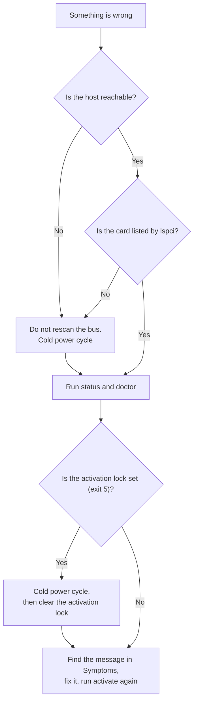
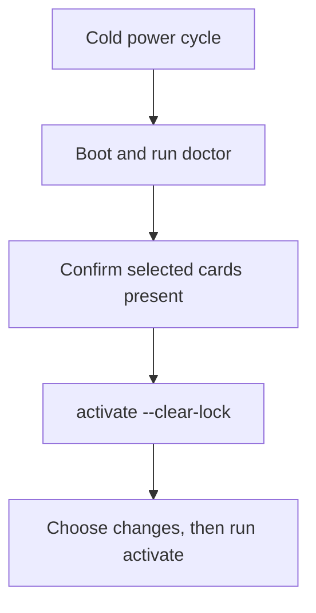

# Recovery

This page helps you get a host working again when a card disappears, `activate` stops, or a VM does not start.
Terms such as PF, VF, livepatch, the activation lock and cold power cycle are explained in the [Glossary](glossary.md).
You need SSH or a console on the host, and a way to power the machine off and on (IPMI, a smart plug or the power button).
Recovery never needs a reinstall of the operating system.
The package gives you three ways back: runtime changes end with a power cycle, [Turn features off](#turn-features-off) switches single features off, and [`uninstall`](#remove-the-package) removes the package and puts NVIDIA's original driver module back from its backup.
Read this page before you need it, and set up SSH access (plus netconsole, which sends the kernel log over the network, or a serial console if you have one) so you can read logs when the screen is dead.

## If something goes wrong

The most common problems and the first thing to try.
Each links to the full explanation, and the [Symptoms](#symptoms) table below covers many more.

| Problem | First fix |
|---|---|
| A card is missing from `lspci`, or the host does not answer | Power the machine fully off and on, **not** a reboot, and do **not** rescan the bus ([the power-cycle rule](#the-one-rule)) |
| `activate` or the boot unit exits 5, or `status` says the activation lock is set | After a cold power cycle, run `geforce-sriov doctor`, then `sudo geforce-sriov activate --clear-lock` and `sudo geforce-sriov activate` ([The activation lock](#the-activation-lock)) |
| After a kernel update, `activate` refuses because `nvidia.ko` is not the build geforce-sriov installed | Run `sudo geforce-sriov rebuild`, then power-cycle ([After a kernel update](installation.md#after-a-kernel-update)) |
| A VM does not start, or the start fails with an error about the vGPU type | Run `geforce-sriov check`, put the VM on a lower VF or pick a smaller vGPU type ([Choosing a vGPU type](installation.md#choosing-a-vgpu-type)) |
| The guest driver fails (`RmInitAdapter failed` on Linux, Code 43 on Windows) | Install the vGPU guest driver for your card and set `RMSetVgpuGspPluginOffloadMode=0` in the guest ([Guests](installation.md#guests)) |
| On an Ada card, a stopped VM fails to start (`error getting device from group … Input/output error`) while a host program uses the card | Run `geforce-sriov status` and read the `framebuffer slots` line of that card ([Symptoms](#symptoms)) |
| The screen stays blank after `activate` on the boot display GPU | Log in over SSH and follow the power-cycle rule, and do **not** rebind the display by hand ([The boot display GPU](#the-boot-display-gpu)) |

## Where to start

Start with `geforce-sriov status` and `geforce-sriov doctor`: `status` names each card's next step.
If the host is unreachable or a card is missing from `lspci`, you cannot run them yet, so do a cold power cycle first.



### Reboot or power-off

A reboot restarts the operating system without necessarily removing power from the card.
A cold power cycle switches the machine off, so the card loses power and starts from a clean state.
Several failures leave a card in a state that only a power loss clears, which is why this page keeps asking for one:

| Situation | What you need | Why |
|---|---|---|
| A card is missing from `lspci`, or the host cannot be reached | Full power-off, then on | A GPU that stops answering config cycles (reads of its PCI config space, the register block that identifies and controls it) comes back only after a full power-off |
| `activate` or the boot unit exits 5, or the activation lock is set | Full power-off, then on | The earlier activation stopped partway, so the state of the card is unknown |
| You changed `vfs`, `ari` or `msix`, or `install` put a new patched NVIDIA module in place | Full power-off, then on | The livepatch module (`geforce_sriov`) fixes its parameters when it loads, and the livepatch (the `geforce_sriov` kernel module that reveals the SR-IOV feature the card hides, see the [Glossary](glossary.md)) must load before `nvidia` |
| After `uninstall` | Full power-off, then on | The loaded modules and the cards keep their state until then |
| A program holds the GPU, a VM still has a vGPU, or a display manager is in the way | No power cycle: fix it and run `activate` again | `activate` stopped before it changed the card |

<a name="the-one-rule"></a>

## If the host hangs

If a card disappears from `lspci` after activation, or the host cannot be reached, power the machine fully off and on.
You need a cold power cycle here, **not** a reboot.
Do **not** rescan the PCI bus, and do **not** warm-reboot repeatedly.
Rescanning a bus whose GPU has left it can take the kernel down, and a GPU that stops answering config cycles comes back only after a full power-off.

The rule is host-wide: it applies to the whole machine, whichever card misbehaved.
Other pages call it the power-cycle rule and link here.

## Symptoms

Find the message you see in the first column.
The third column says what the message means, so you can judge whether the fix applies to your host.
Generation-specific behaviour is in [Ampere](ampere.md) and [Ada](ada.md).

A few terms in the table, in short:

- BAR: an address range on the PCI bus through which the CPU reaches the card's memory or registers. BAR0 is the main register block, and access through these ranges is called MMIO. The PCI bridges above the card must reserve address ranges (bridge windows) large enough for its BARs and its VFs' BARs.
- *Above 4G decoding*: a BIOS/UEFI setting that lets the bus assign addresses above 4 GB, which large cards need. `pci=realloc` is a kernel option that makes Linux assign the ranges again.
- AER: PCIe's error reporting and recovery mechanism.
- DKMS: the framework that rebuilds NVIDIA's kernel module for each new kernel. It builds a stock `nvidia.ko`, without this package's changes.
- `LD_PRELOAD`: a setting that makes a process load a given library first. The identity hook (see the [Glossary](glossary.md)) gets into NVIDIA's `nvidia-vgpud` this way.
- Plugin: NVIDIA's `libnvidia-vgpu.so`, the library that `nvidia-vgpu-mgr` loads to run vGPUs. The patched plugin copy is a copy of it that `install` changed ([Byte patches](driver-patch.md#byte-patches) lists the placement patch and the framebuffer patch).

| Symptom | What to do | Why |
|---|---|---|
| `activate` or the boot unit exits with status 5: `activation lock … is set` | Cold power cycle, run `geforce-sriov doctor`, then `sudo geforce-sriov activate --clear-lock` and `sudo geforce-sriov activate` ([The activation lock](#the-activation-lock)) | An earlier activation did not finish |
| `activate` refuses: `no D3cold consent in the config for laptop GPU …` | Run `geforce-sriov setup` and answer yes, or run the `install` command the message prints, which ends with `--disable-d3cold` ([Consent](laptops.md#consent)) | A laptop GPU is kept from powering down (D3cold, the idle state that erases its VF setup) while `activate` works on it, which costs battery life, so the config must record your consent (`d3cold=off`). `activate` refuses before it writes anything |
| `doctor` warns that `nvidia` loads from `modules-load.d`, `/etc/modules` or the initramfs | Remove `nvidia` from those lists, rebuild the initramfs, then power the machine off and on | Something loads `nvidia` before the livepatch unit, so it can bind a selected card first |
| The desktop or login screen does not start on the boot display GPU, and the X server log says it failed to load the `nvidia` module | Move the old `/etc/X11/xorg.conf` away and start the display manager again. X then picks its generic `modesetting` driver on its own and needs no configuration | An old `xorg.conf`, for example one left by a desktop NVIDIA driver, names `Driver "nvidia"`, but NVIDIA's vGPU host package has no X driver. X (the graphical display server) therefore cannot start |
| Ada card: a stopped VM does not start again, QEMU says `vfio 0000:03:00.N: error getting device from group NN: Input/output error`, and the host journal shows `Failed to alloc guest FB memory` from `nvidia-vgpu-mgr` | Run `geforce-sriov status`. If the `framebuffer slots` line of that card says a slot is not held, stop the host programs that use the card, start the VM, and run `sudo geforce-sriov activate` while no VM start is pending. The line names the reason, for example `fb_slots=off` or a driver that was built without this protection (`sudo geforce-sriov install` builds it in) | The VM's framebuffer slot, its range of the card's VRAM, was not held, and a host program took the memory while the VM was stopped ([Reserved VM memory](ada.md#reserved-vm-memory)) |
| `activate` refuses because a display manager is using a selected GPU | Stop the manager yourself, or run `sudo geforce-sriov activate --stop-display-manager`, which starts it again afterwards ([Boot display card](installation.md#boot-display-card)) | The display manager is the service that shows the graphical login. The display modules (NVIDIA's `nvidia-modeset` and `nvidia-drm`) cannot be reloaded while a session holds the card |
| `install` or `doctor` fails because the display or host CUDA build lacks a file it needs | Pass the missing files ([Boot display card](installation.md#boot-display-card), [Host CUDA](installation.md#host-cuda)) | The build needs NVIDIA's second driver package (`--companion-file` or `--companion-source`), and for display also NVIDIA's public kernel module source (`--nvkms-source`) |
| `doctor`: `[WARN] NVIDIA's driver … is not supported`, or `activate`: `NVIDIA's driver … is not supported; continuing` | Both commands warn and continue. To stay on the tested version, use 580.159.01 ([Supported software stack](installation.md#supported-software-stack)) | The host driver version is not 580.159.01. Only that version is confirmed to work, and others are not guaranteed to work |
| `doctor`: `NVIDIA driver … the identity hook passes this version through unchanged` | Nothing to fix, but expect no vGPU types for the cards on that driver | The host driver is a version other than 580.159.01 that the hook does not know, so it passes the version through unchanged |
| `install`: `refused: module .text differences are not …; first unexpected offset: …` or `module .text sizes differ; first unexpected offset: …` | `install` changed none of NVIDIA's files. Keep the stock `nvidia.ko`, or use `--driver=skip` and follow [The manual path](driver-patch.md#the-manual-path) ([Compare with a stock build](driver-patch.md#compare-with-a-stock-build)) | The `nvidia.ko` that `install` built differs from the installed stock `nvidia.ko` in its `.text` (the code section) somewhere other than the expected offsets. A tree for another driver version, another compiler or other options for `nvidia.ko` compile differently |
| `install`: `refused: the installed module … is already this build, but … is missing or wrong. Reinstall the stock module first, or install with --driver=skip to keep this module as it is` | Put NVIDIA's stock `nvidia.ko` back ([Reverting](driver-patch.md#reverting)), then run `install` again. For an `nvidia.ko` you patched by hand, run `install --driver=skip` | The installed `nvidia.ko` already has this build's `.text`, but the modprobe option, the patched plugin copy or this kernel's backup of the stock `nvidia.ko` is missing or wrong |
| `install`: `geforce-sriov-driver: refused: an earlier run was interrupted while it installed its files, and it can be neither completed nor undone: <reason>. Nothing was changed, and <journal> is kept. …` | Check the file the reason names, or reinstall NVIDIA's vGPU host driver so that NVIDIA's own files are back. Then delete the journal (`/var/lib/geforce-sriov/driver-build.gs-new`, the install's record of its file changes) and run `install` again | A power loss or kill stopped the commit of `nvidia.ko`, the plugin copy and record. The next run finishes or undoes it, but it refuses when a file was changed in the meantime, because it cannot tell which state is right |
| `activate` refuses, or `doctor` warns: ``… is an earlier copy without the Ada framebuffer change. Run `sudo geforce-sriov install` again …`` | Run `sudo geforce-sriov install` again, which replaces it with the patched plugin copy (`aa4fdeb5…`), then `sudo geforce-sriov activate` with no VM running | The plugin copy is the one an earlier version of this package made, with only the placement patch (`7ddfad45…`) |
| `status` shows `SR-IOV: not presented` (exit 1) | Follow the next step `status` prints, and read `journalctl -b -u geforce-sriov-livepatch.service -u geforce-sriov-activate.service` | The livepatch is not loaded this boot, or activation failed. Expected after `install` until the first boot or activation |
| One of several selected cards is refused, and nothing is changed | Fix that card, or remove it from `bdfs` to bring up the others | `activate` checks every selected card first and changes nothing when one fails |
| `doctor` or `activate` reports BAR0 unassigned, or a card came back from the rescan without BAR0 | Follow [the power-cycle rule](#the-one-rule), then enable *Above 4G decoding* in the BIOS/UEFI setup or boot with `pci=realloc`, and skip the boot units (`geforce_sriov.skip`) until BAR0 is assigned again | The bridge windows above the card are too small, so it got no address range for its main registers |
| `activate`: `not enough MMIO resources for SR-IOV`, or `status`/`doctor` report no VF BAR assigned | Enable *Above 4G decoding* in the BIOS/UEFI setup, or boot with `pci=realloc` | The bridge window above the card is too small for the VF BARs (one address range per VF). The package **never** resizes the windows of a switch or of bridges further up |
| Kernel log `geforce_sriov: first VF offset … ; refusing` (the livepatch module is not loaded), or `VF layout for … requested VFs … SR-IOV is not set up on this PF` | If `vfs` is above the default of 4, set it back to 4 or lower (or remove the line), then power the machine off and on. Otherwise no setting helps: remove the card from `bdfs` | The card's VF layout (where the VFs sit on the bus) does not fit its own slot, or its NumVFs register (where the kernel writes how many VFs to enable) does not take the kernel's value |
| Kernel log `unexpected VF layout after SR-IOV setup` | Disable the VFs, cold power cycle, and do not rely on that card's VFs | The card reported another layout at VF enable than at setup |
| VF enable fails after a vendor livepatch service (for example Ubuntu Livepatch) applied a cumulative "replace" livepatch | Disable the vendor livepatch service, then power the machine off and on | Such a patch replaces every other livepatch, including this package's, and silently disables `geforce_sriov` |
| `<BDF> (10de:<id>) is not in the device table` from `doctor`, `install --device`, `setup`, `activate` or `check` | Select only cards that `geforce-sriov devices` lists ([Supported cards](devices.md)) | The card's PCI ID (`10de` is NVIDIA's vendor ID, then the device ID) is not listed, for example a Blackwell card |
| `/etc/geforce-sriov/config: line N: unknown key 'experimental_vfs'; delete this line` (or `'twin_id'`) | Delete that line from `/etc/geforce-sriov/config`, then run the command again | The config holds a key that geforce-sriov does not have |
| Ada card: NVIDIA's stock proprietary host `nvidia.ko` does not take the card | Run `install` without `--driver=skip`: it makes the three host-object byte patches and rebuilds `nvidia.ko`, loaded with `NVreg_EnableGpuFirmware=0`, which turns off GSP, the GPU's firmware processor ([Install steps](driver-patch.md#what-install-does)). With `--driver=skip`, do it by hand ([The manual path](driver-patch.md#the-manual-path), [NVIDIA host driver setup on Ada](ada.md#nvidia-host-driver-setup)) | NVIDIA's stock module refuses Ada on a vGPU host (`rm_is_supported_device` returns `NV_ERR_NOT_SUPPORTED`) |
| Ada card: Linux shows 4 VFs, but a vGPU on any VF after the first fails with `NV_ERR_OUT_OF_RANGE` (`0x5B`) | Run `install` again, or on the manual path build `nvidia.ko` from an object that carries all three byte patches ([Byte patches](driver-patch.md#byte-patches)) and install it. Then power the machine off and on | The loaded `nvidia.ko` lacks the VF-count patch |
| `doctor`: `[WARN]` that the selection mixes Ada with another generation | Nothing to fix. The warning does not stop `install` or `activate`. Select cards of one generation to avoid it | NVIDIA's patched module forces every Turing, Ampere or Ada card bound to it to 4 VFs ([Combining generations](devices.md#combining-generations)) |
| `activate` reports that a selected card is not bound to `nvidia` | `modprobe nvidia`, wait, and run `activate` again | NVIDIA's host driver is not loaded |
| `modprobe nvidia` fails or loads nothing | `modprobe --ignore-install nvidia`, then remove the rule, because the livepatch unit loads `nvidia` itself | A modprobe.d rule `install nvidia /bin/false` blocks it, for example a hold file left by 0.2.x |
| `Unit nvidia-vgpud.service not found` (or `nvidia-vgpu-mgr.service`) | See [NVIDIA's vGPU daemon units](installation.md#nvidias-vgpu-daemon-units) | NVIDIA's unit files are not installed |
| VFs exist but no vGPU types appear | Run `activate`, which restarts both daemons in order. If the patched plugin copy is not installed, run `sudo geforce-sriov install` first. Then check `identity=on` and the hook log lines | `nvidia-vgpud` started before the VFs, or the hook is off |
| `nvidia-vgpud` fails its start check | Run `geforce-sriov check --daemon-ready` to read the reason, then `geforce-sriov activate` with no VM running ([activate](installation.md#activate)) | `check --daemon-ready` refused: the activation lock is set, a selected card is missing, its VFs are not all enabled and bound to `nvidia`, or a BAR is unassigned |
| `doctor`: `nvidia is held back at boot by <file>. …` | Remove the file `doctor` names, then power the machine off and on | A file in `/etc/modprobe.d/` holds `nvidia` back, so the livepatch unit cannot load the driver and `activate` refuses |
| No NVIDIA driver is loaded after a boot with `geforce_sriov.skip` | Run `modprobe nvidia` if you need the driver, or boot without the switch ([Turn features off](#turn-features-off)) | That switch skips both boot units, and the package keeps udev (the service that loads drivers for detected hardware) from loading `nvidia` |
| `doctor`: `<file> sets LD_PRELOAD for nvidia-vgpud and overrides the geforce-sriov identity hook. …` (or `nvidia-vgpu-mgr`) | Remove that drop-in, or point its `LD_PRELOAD` at the hook path `doctor` names, then run `systemctl daemon-reload` and `activate` with no VM running | Another drop-in of that unit preloads its own library, and systemd keeps the last `LD_PRELOAD`, so the identity hook is not loaded |
| VM does not start, or the start fails with an error about the vGPU type | Run `geforce-sriov check`, put the VM on a lower VF or pick a smaller type ([Choosing a vGPU type](configuration.md#choosing-a-vgpu-type)), and make the daemons ready with `activate` (install the patched plugin copy first with `sudo geforce-sriov install`) | The type does not fit the free memory, or the VFs or daemons are not ready. On an Ada card with a large type, the VF's framebuffer slot (its range of the card's VRAM) ends near the top of the card's memory; `activate` names such VFs after it sets the types |
| `check` reports `NOT READY … type=<old> expected=<new>` after `type_ada` or `type_ampere` changed | Stop the VMs on that card, write `0` to `nvidia/current_vgpu_type` of each of its VFs while `nvidia-vgpu-mgr` runs, then run `activate` | The config names a new type and the VFs still carry the old one |
| Windows guest shows Code 43 | Install the vGPU guest driver listed for your card and set the DWORD (a Windows registry value) ([Guests](installation.md#guests)) | The guest has a bare-metal or Data Center driver instead of the vGPU guest build, or lacks `RMSetVgpuGspPluginOffloadMode=0` |
| `activate` refuses: `nvidia.ko for … is not the build geforce-sriov installed …`, or `nvidia.ko for … is not known to be the build geforce-sriov installed: …` | Run `sudo geforce-sriov rebuild`, which builds NVIDIA's patched module for this kernel again and rewrites the record, then power-cycle ([After a kernel update](installation.md#after-a-kernel-update)). The `build:` line of `status` and the message of `doctor`, `check` and `activate` name the same command. With no record at all (`--driver=skip`), `activate` only warns | The record does not name the installed `nvidia.ko` for the running kernel, for example because DKMS rebuilt the stock `nvidia.ko` after a kernel update, or the record was made on another kernel |
| `rebuild` or `install`: `refused: NVIDIA's own module for <release> is not built yet (modinfo -k <release> -n nvidia finds none). Install the headers of that kernel, build NVIDIA's module with `dkms install nvidia/<version> -k <release>` …` | Install that kernel's headers, run `sudo dkms install nvidia/<version> -k <kernel>` (or `dkms autoinstall -k <kernel>`), then `sudo geforce-sriov rebuild --kernel <kernel>` | DKMS did not build NVIDIA's own module for that kernel, for example because its headers were missing. geforce-sriov patches NVIDIA's module, so that module must exist first. Nothing was changed |
| `rebuild`: `geforce-sriov-driver: refused: NVIDIA's second package that an earlier install kept is missing: <path>. NVIDIA's files are as they were. Run `geforce-sriov install` in the source folder with --companion-file PATH (or --companion-source DIR); that keeps it again`, or the same for `NVIDIA's public kernel module source` with `--nvkms-source PATH` | Run `sudo ./geforce-sriov install` in the source folder with the option the message names. That keeps the input again, and `rebuild` works afterwards | The copy of the second NVIDIA driver package or the kernel module source that an earlier install kept was deleted. Nothing was changed (exit 3) |
| `rebuild`: `… that an earlier install kept was changed since: <path> has SHA-256 <now>, and the file that was kept had <kept>. …` or `… declares version <now>, and the one that was kept declared <kept>. …` | The same: run `install` in the source folder with that input | The kept file was altered or replaced since it was kept, so it is **not** used or run. Nothing was changed (exit 3) |
| `rebuild`: `geforce-sriov-driver: refused: this build needs NVIDIA's second package, and no earlier install kept one …` | The same: run `install` in the source folder with `--companion-file PATH` (or `--companion-source DIR`) | The config asks for the display or host CUDA build, but the install that built NVIDIA's module kept no second driver package. Nothing was changed |
| `install`: `refused, nothing changed: <bindir>/geforce-sriov is the installed copy, and install runs from the source folder it was built in. …` | After a kernel update, run `sudo geforce-sriov rebuild`. To change the installation, run `sudo ./geforce-sriov install` in the source folder | `install` needs the source tree, which the installed copy does not carry |
| `install` or `rebuild`: `geforce-sriov-driver: refused: <module> is a module geforce-sriov built for <kernel> earlier, and … holds no backup of NVIDIA's own module, so there is nothing to put back at an uninstall. Put NVIDIA's module back first (`dkms install --force nvidia/<version> -k <kernel>`), then run this again` | Run the `dkms install --force` command the message prints, then the command again | The installed `nvidia.ko` is one geforce-sriov built, and its backup of NVIDIA's own module is missing, so a later `uninstall` could not restore it. Nothing was changed (exit 3) |
| `doctor`, `status`, `check` or `activate`: `the running nvidia module (build-id …) is not the installed one (…); power the machine off and on to load it` | Cold power cycle, so the installed build is loaded. Until then `status` exits 1, and `activate` warns and continues on the loaded module | The installed `nvidia.ko` is the build `install` made, and the running `nvidia` module is not, for example after `install` put a new build in place without a power cycle |
| `activate`: `type <N> is not in nvidia/creatable_vgpu_types …; nothing written. The driver keeps the vGPU types it registered first after a boot, so after a change of identity or professional counterpart, power the machine off and on` | Cold power cycle, then run `activate` again | NVIDIA's `nvidia_vgpu_vfio` keeps the type table of each GPU's first registration until the next boot. Neither a PF re-probe nor a daemon restart refreshes it, so after a change of identity or professional counterpart the old table stays |
| `uninstall` exits 1 and prints `NVIDIA's module was not restored: …` | `uninstall` kept `geforce-sriov-driver` and every backup in `/var/lib/geforce-sriov/stock/`. The message gives the reason and the two ways to finish: fix the reason, then run `geforce-sriov-driver --restore`, or copy `/var/lib/geforce-sriov/stock/<kernel release>/nvidia.ko` over the installed `nvidia.ko` and run `depmod -a <kernel release>`. [Reverting](driver-patch.md#reverting) covers the plugin link and the modprobe file ([Remove the package](#remove-the-package)) | Restoring NVIDIA's `nvidia.ko`, the plugin link or the modprobe file did not complete, or `uninstall` refused to run `geforce-sriov-driver` because it changed since install |
| Guest GPU work stalls | Run `sudo geforce-sriov rebuild` for this kernel ([After a kernel update](installation.md#after-a-kernel-update)). On the manual path, re-apply the [driver patch](driver-patch.md#after-a-kernel-or-nvidia-driver-update) | The stock `nvidia.ko` is loaded (DKMS rebuilt it after an update) |

## activate and check

`activate` and `check` act on every selected Ada or Ampere card, and a restart of NVIDIA's daemons affects all of them.
After a manager restart or a re-probe (making the driver take over the card again) of any card's PF (its physical function, the card itself):

1. Stop the VMs on every card.
2. Set their VFs' types to `0`.
3. Run `activate` again.

A udev rule or a service that writes `on` to the VFs is not a replacement.

Running `activate` on a host that is already active does not disturb running VMs.
It changes nothing when every VF is ready, and otherwise it only sets the missing types and VF power state (or loads a missing display or CUDA module) without restarting the daemons or re-probing a GPU.
After a run that stopped halfway, the leftover `/run/geforce-sriov/activating` file makes `activate` take the full path again.

| Situation | What to do | Why |
|---|---|---|
| `activate` exits with status 3 | Fix what the message names and run `activate` again | A check failed and nothing was changed |
| `activate` exits with status 5 | Cold power cycle, run `geforce-sriov doctor`, then `sudo geforce-sriov activate --clear-lock` and `sudo geforce-sriov activate` ([The activation lock](#the-activation-lock)) | The activation lock was set, or an operation did not finish in time (a write, a bind, a module load), or the PF did not come back to `nvidia` after the re-probe. Exit 5 always leaves the activation lock set |
| `activate` refuses: `each VF below has a vGPU type set, and restarting NVIDIA's vGPU daemons would clear it and end any VM that uses it:`, one line per VF | Stop the VMs that use those VFs, run the `for f in …; do echo 0 > /sys/bus/pci/devices/$f/nvidia/current_vgpu_type; done` line the refusal prints (it names every such VF, also those past the eighth that the list only counts), then run `activate` again | A vGPU type is set on the host, and the manager restart that a full activation needs would clear it. A host that is already active does not reach this refusal |
| `activate` refuses because a GPU that is not selected has VFs enabled | Stop the VMs on that GPU and disable its VFs with NVIDIA's `sriov-manage -d <PF>`, then run `activate` again | The daemon restart is host-wide |
| A leftover `/run/geforce-sriov/activating` marker: `doctor` warns `/run/geforce-sriov/activating exists: geforce-sriov activate is running or did not finish; check reports NOT READY until activate succeeds`, `status` prints `activate: /run/geforce-sriov/activating exists (activate is running or did not finish)` and exits 1 | When no `activate` is running: stop every VM that uses a vGPU and run `activate` again. The leftover file does not block it, and a successful run removes it. Start no VM until `check` passes | An earlier `activate` did not finish, or one is running |
| `activate` refuses because of `driver_override` on a PF | `echo > /sys/bus/pci/devices/<PF>/driver_override`, then run `activate` again | A `driver_override` (a sysfs setting that forces which driver a device binds to) is set on the PF |
| `activate` refuses or stops with `NVIDIA's driver did not grant unbindLock …` | Stop the program it names, or any program that uses the GPU (`nvidia-smi` loops, `nvidia-persistenced`, a CUDA program, a desktop session). Then read `nvidia/current_vgpu_type` of every VF and write `0` to any that is not `0`, because `activate` sets a type on every VF and refuses while one is set. Run `activate` again | NVIDIA's driver grants the lock (`unbindLock`, a file under `/proc/driver/nvidia/gpus/<BDF>/`) only while no program holds the GPU. Before a card is removed, `activate` has changed nothing for it, and the run exits 3 when no earlier card was changed. At the re-probe, the cards before it were already re-probed and powered, so `check` reports `NOT READY` for every card until `activate` succeeds |
| `check` reports `NOT READY` with `power/control=auto` or `runtime_status=suspended` | Start no VM. Stop the VMs on every card, set every VF's type to `0`, and run `activate` again | A manager restart or a PF re-probe put VFs back to `auto` (the kernel may then suspend them to save power), and a re-probe on one card did so for the other cards' VFs too |

If a PF does not come back to `nvidia`, `activate` exits 5, leaves the activation lock set and powers none of that card's VFs.
Recover as in [The activation lock](#the-activation-lock).
Any other stop after `activate` has restarted NVIDIA's daemons exits 1.
To undo the VF power and type settings, see [Turn features off](#turn-features-off).

<a name="the-guard"></a>

## The activation lock

The activation lock is the single marker that stops `activate` from running again after an unfinished attempt, until you have done a cold power cycle and cleared it.
`geforce-sriov activate` keeps `/var/lib/geforce-sriov/prepare-attempt` (the file keeps its 0.2.x name) while an activation is incomplete or uncertain, and removes it once every selected card is back in a known state.
The file stays if activation is interrupted, for example by a reset or power loss, if an operation did not finish in time, or if a card does not come back.
Exit status 5 always means the activation lock is set.
While it exists:

- `geforce-sriov activate` and the activate unit refuse to run and exit with status 5.
- The livepatch unit still loads the livepatch after a power cycle, and the activation lock stays set.
- Guest autostart is blocked, because `check` reports NOT READY.
- `geforce-sriov doctor` and `status` report it.

To clear the activation lock:

1. Cold power cycle.
2. Boot and run `geforce-sriov doctor`.
   Every selected card should be present.
   `doctor` reports the activation lock as a failure until you clear it.
3. Run `geforce-sriov activate --clear-lock`.
   It prints the activation lock's contents and then `activation lock cleared.`
   It refuses (status 5) and leaves the activation lock in place if the unfinished attempt was made in the current boot, or if this boot's ID cannot be read.
   It can only see that the boot ID changed, not whether the reboot was a full power-off, so make sure the machine was powered fully off.
4. Run `geforce-sriov activate` to bring the cards up, after deciding what to change (see [Turn features off](#turn-features-off)).



`uninstall` keeps a set activation lock, because an unfinished activation still needs a cold power cycle.
After `uninstall`, a later `install` warns while the activation lock is set, and `activate --clear-lock` clears it.

If activation is refused after it had already unbound the card's HDMI audio function, it rebinds that function to `snd_hda_intel` when the function is still present, unbound and the same device.
Otherwise it prints `residual state: …` and leaves the function alone.

## The boot display GPU

On the boot display GPU (the card that shows the BIOS/UEFI screen at power-on and drives the host's display), `activate` moves the screen over to NVIDIA's display modules while it enables the VFs.
A failure in that phase leaves the activation lock set, and the display can stay blank until the next boot.
SSH and the journal keep working.
Do **not** rebind the display or rescan the card by hand.
Follow [the power-cycle rule](#the-one-rule) and [The activation lock](#the-activation-lock).

## Logs

- Boot units: `journalctl -b -u geforce-sriov-livepatch.service -u geforce-sriov-activate.service` (also printed on the console)
- NVIDIA module build of `install`: `/var/lib/geforce-sriov/driver-step.log`
- Livepatch module: `journalctl -k -b | grep geforce_sriov`
- Identity hook: `journalctl -b -u nvidia-vgpud.service | grep geforce-sriov-hook`
- NVIDIA daemons: `journalctl -b -u nvidia-vgpud.service -u nvidia-vgpu-mgr.service`
- Current state: `geforce-sriov status` and `geforce-sriov doctor`

### Expected messages

These messages can appear during normal operation and do not indicate a failure.
The wording of NVIDIA's and QEMU's messages can differ on other versions.

| When | Message | Meaning |
|---|---|---|
| `doctor` before `install` | `[INFO] config: … absent`, `[INFO] livepatch module geforce_sriov for the running kernel is not built yet; install builds it with DKMS`, and `[INFO]` lines for the boot units and the vGPU daemon drop-in that are not installed yet | Nothing is installed |
| `doctor` after a kernel update, before `rebuild` | `[WARN] livepatch module geforce_sriov for the running kernel not found under /lib/modules/$(uname -r) (geforce-sriov install builds it with DKMS)` | The host has an install, but no livepatch module is built for the running kernel yet. Run `sudo geforce-sriov rebuild` ([After a kernel update](installation.md#after-a-kernel-update)) |
| `install` | DKMS `Sign command:`, `Signing key:` and `Public certificate (MOK):` lines | DKMS signs the livepatch module (`geforce_sriov`) with its own key |
| `activate` (kernel log) | `VF BAR … can't assign` | Transient during the rescan; `status` reports the final state |
| [`activate`](installation.md#activate), creating the VFs | `sriov-manage: … echo: write error: No such device`, once per card | Printed by NVIDIA's script. `activate` checks the result in sysfs |
| `activate`, creating the VFs (kernel log) | `pci-pf-stub <PF>: driver left SR-IOV enabled after remove` | `sriov-manage` moves the card through `pci-pf-stub` on its way to `nvidia` |
| `activate`, creating the VFs (kernel log) | `snd_hda_intel <PF audio function>: GPU sound probed, but not operational: please add a quirk to driver_denylist` | The card's HDMI audio function is left without a driver; vGPU does not use it |
| `activate`, creating the VFs | `/dev/nvidia0`, `/dev/nvidiactl` … appear | `sriov-manage` runs `nvidia-smi -pm 1` (persistence mode) |
| [`activate`](installation.md#activate) | `nvidia-vgpud` shows `inactive (dead)` with `status=0/SUCCESS`, and the hook lines appear twice | NVIDIA's unit is one-shot, and starting `nvidia-vgpu-mgr` runs `nvidia-vgpud` again |
| VM start | `kvm: -device vfio-pci,host=<VF>,…: warning: vfio <VF>: Could not enable error recovery for the device` | Printed by QEMU for each VF (`qm start` on Proxmox). VFIO is the Linux mechanism that gives a VM direct access to a device, and the message refers to AER |
| VM start | `kvm: -device vfio-pci,host=<VF>,…: warning: VFIO dma-buf not supported in kernel: PCI BAR IOMMU mappings may fail` | Printed by QEMU for each VF (`qm start` on Proxmox). The IOMMU is the hardware that keeps each VM's device access separate |
| VM start and stop | `nvidia-vgpu-mgr` journal: `NVOS status 0x56` with an assertion backtrace, a few `error: vmiop_log: …` lines ending in `Failed to set guest license state in host`, and at shutdown `Failed to reset guest's license info in host` | Logged by NVIDIA's manager at every VM start and stop, and harmless with this host driver setup. Licensing is outside this project |

## Turn features off

To skip both boot units for one boot, add `geforce_sriov.skip` to the kernel command line for that boot.
In GRUB, press `e` on the entry and append it to the `linux` line.
The units do not run, and no NVIDIA driver is loaded that boot, for every NVIDIA GPU; run `modprobe nvidia` if you need it.

Every other switch lives in `/etc/geforce-sriov/config` and is read by the next boot or the next `activate`:

| Symptom or wish | Change |
|---|---|
| VF enable or `nvidia-vgpu-mgr` start does not complete on your host | `ari=off` turns off the revealed ARI capability. Try it first |
| `pci=noari` is on the kernel command line | Nothing. `activate` and the livepatch unit notice it and load the livepatch module with `ari=0` |
| The kernel scans every slot below the port (`pci=pcie_scan_all`, or an x86 platform quirk) | Nothing. ARI stays off automatically, and SR-IOV and the VF count are unaffected |
| PF interrupts misbehave, or after any PF reset or AER recovery | `msix=off`. A PF reset re-hides MSI-X (the card's interrupt mechanism) and silently stops its interrupts until the next cold boot |
| Ada card misbehaves with more than 1 VF | `vfs=1` (or `geforce-sriov install --vfs 1`), then a cold boot |
| You want fewer VFs per card | Set `vfs=N` below the default of 4, or run `geforce-sriov install --vfs N`, then cold-boot. `activate` creates the configured count |
| Host CUDA misbehaves | `geforce-sriov install --no-host-cuda`, then a cold boot |
| Host programs need the whole Ada card, or holding the framebuffer slots misbehaves | `fb_slots=off`, then `sudo geforce-sriov activate`; no reboot needed. A stopped VM can then fail to start while a host program uses its memory. `sudo geforce-sriov rebuild` afterwards also builds NVIDIA's module without that code, which takes a cold boot |
| Stop the identity rewrite | `identity=off`. Every ioctl (request that a program sends to the driver) then passes through unchanged |
| Undo the VF power setting | `echo auto > /sys/bus/pci/devices/<VF>/power/control`; no reboot needed. On Ada, re-attaching a VM after a stop then fails again in the guest with `RmInitAdapter failed! (0x11:0x45)` |
| Undo the VF type | With the VM stopped: `echo 0 > /sys/bus/pci/devices/<VF>/nvidia/current_vgpu_type` |
| Back to NVIDIA's stock files | Point `libnvidia-vgpu.so` back at `libnvidia-vgpu.so.580.159.01` and put back your stock `nvidia.ko` ([Reverting](driver-patch.md#reverting)), then power the machine off and on. The stock `nvidia.ko` refuses the Ada card on a vGPU host |

You can record the same switches at install time with `geforce-sriov install --ari=off --msix=off`, which also takes `--vfs N`.
The parameters of the livepatch module are fixed when it loads, so after changing them, power the machine off and on.

### Remove the package

Use this when you want the host back without geforce-sriov.
It does not need a reinstall of the operating system.
The [installation guide](installation.md#uninstall) lists the steps; this section describes what the command does, in order.

```sh
sudo geforce-sriov uninstall
```

1. With `--unload`, `uninstall` unloads the livepatch module (`geforce_sriov`) first: it disables the livepatch, waits for its transition, then runs `rmmod geforce_sriov`.
   It removes nothing if any of the following holds, and powering the machine off and on is the alternative:
   - a GPU named in the livepatch module's `bdfs` or the config has active VFs;
   - the loaded livepatch module's `bdfs` parameter cannot be read or parsed;
   - an activation was interrupted this boot.

   Without `--unload`, the livepatch stays loaded until the next boot.
2. `uninstall` disables `geforce-sriov-livepatch.service` and `geforce-sriov-activate.service` and removes the `geforce_sriov` DKMS module.
3. It puts NVIDIA's files back: it restores the stock `nvidia.ko` while the installed `nvidia.ko` is still the one `install` wrote, points `libnvidia-vgpu.so` back at `libnvidia-vgpu.so.580.159.01`, and removes the modprobe files `install` wrote (`geforce-sriov-nvidia.conf`, `geforce-sriov-autoload.conf`, `geforce-sriov-uvm.conf`) ([Reverting](driver-patch.md#reverting), [Modprobe files](installation.md#modprobe-files)).

   `uninstall` restores NVIDIA's module for every kernel that geforce-sriov built for. Once it is back, `uninstall` removes the backups it used in `/var/lib/geforce-sriov/stock/`, the kept build inputs in `/var/lib/geforce-sriov/inputs/`, and `/var/lib/geforce-sriov/build/` and `/var/lib/geforce-sriov/stock/` when they are empty.
   A backup that was not put back stays.
   Each is named with a `restore <kernel release>: cp … && depmod -a <kernel release>` line that puts NVIDIA's module back for that kernel.

   If restoration fails, `uninstall` removes the other installed files but keeps `geforce-sriov-driver` and every backup in `/var/lib/geforce-sriov/stock/`.
   It prints `NVIDIA's module was not restored: <reason>`, gives two ways to finish by hand, and exits 1.

   `uninstall` runs `geforce-sriov-driver --restore` only if the script is unchanged since install.
   If the script changed, `uninstall` keeps it but does not run it, and the message tells you to check the script, or to restore the installed copy with `geforce-sriov install` and run `uninstall` again.
4. It deletes **only** installed files whose SHA-256 is unchanged.
   For the others, including an edited `/etc/geforce-sriov/config`, it prints `kept … (changed since install)`.
   It also removes the build log `/var/lib/geforce-sriov/driver-step.log`, and `/var/lib/geforce-sriov/` itself when nothing is left in it.
5. It keeps the activation lock `/var/lib/geforce-sriov/prepare-attempt`, if set ([The activation lock](#the-activation-lock)).
   It also keeps a `--driver-file` extraction in `/var/lib/geforce-sriov/nvidia/`, names it, and prints the `rm -r` command that deletes it, because geforce-sriov no longer uses it.
6. It removes a leftover hold file from 0.2.x if unchanged and keeps it if modified, as in step 4.
   `uninstall` names a hold you created yourself so you can remove it if nothing else needs it.

When it finishes, power the machine off and on: the loaded modules and the cards keep their state until then.

## What not to do

- Do **not** unload `nvidia`, `nvidia_vgpu_vfio` or `geforce_sriov` while VFs exist.
- Do **not** write `sriov_numvfs` by hand.
  NVIDIA requires its `sriov-manage` script, and the VF count must stay within the presented count (`sriov_numvfs` is the sysfs file that sets the VF count).
- Do **not** reset the PF (`/sys/bus/pci/devices/<PF>/reset`) with MSI-X in use.
- Do **not** unbind the boot display's framebuffer, remove the card or rescan its bus yourself. `activate` does it with its own checks.
- Do **not** treat IOMMU groups split by an ACS override as isolation between guests.
  An IOMMU group is a set of devices the hardware cannot separate, and an ACS override is a kernel option that splits the groups anyway. It changes the kernel's grouping, not what the hardware can reach.
