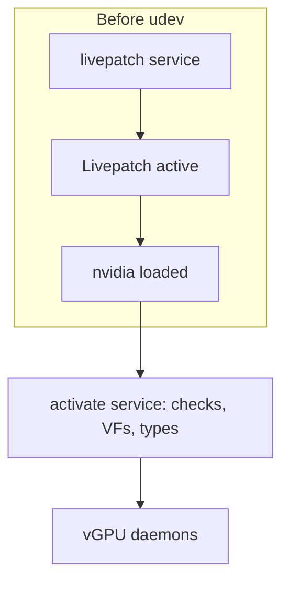
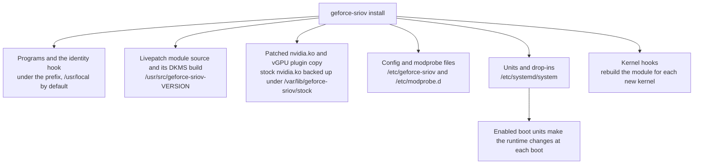
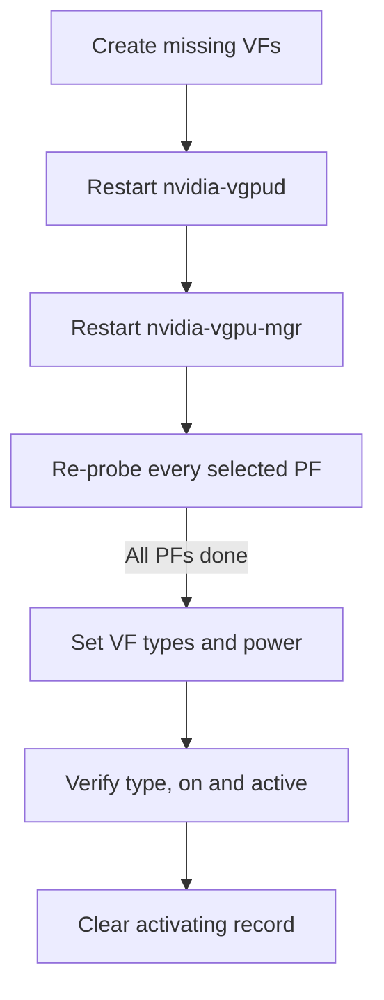
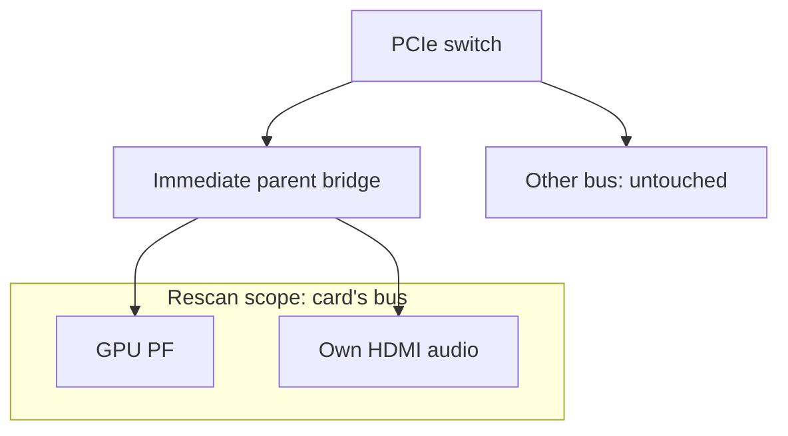
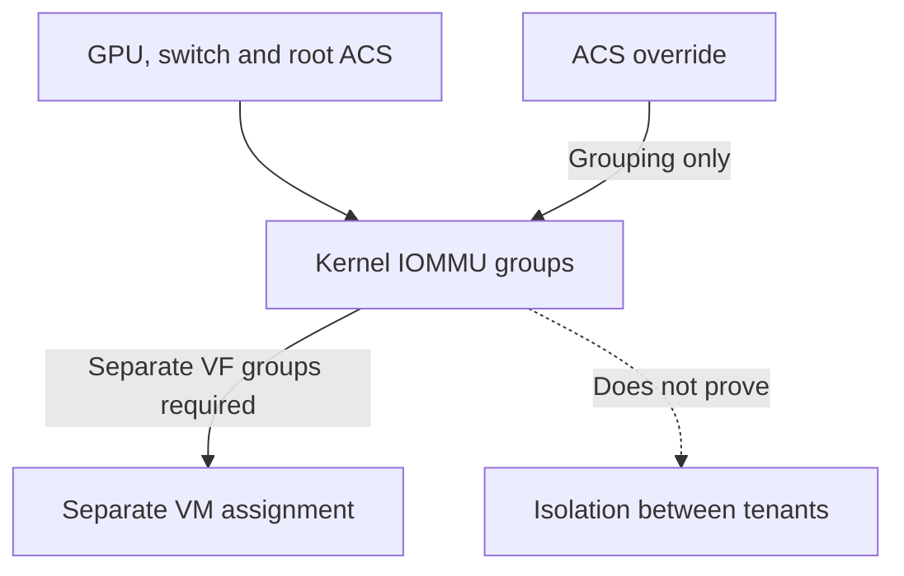
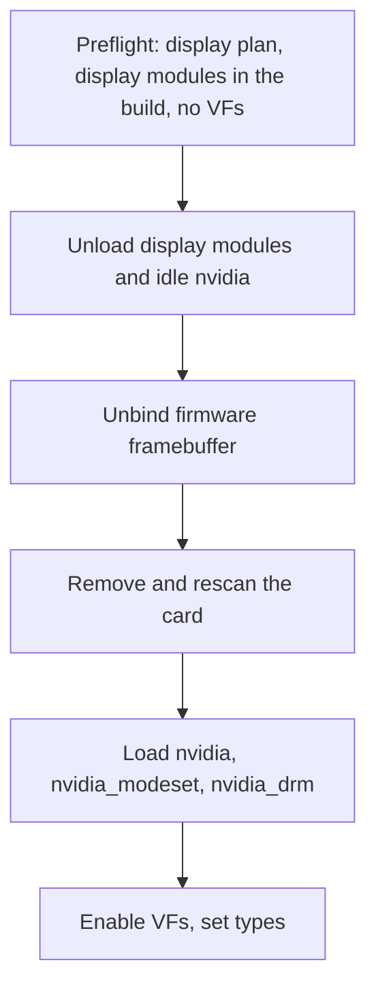
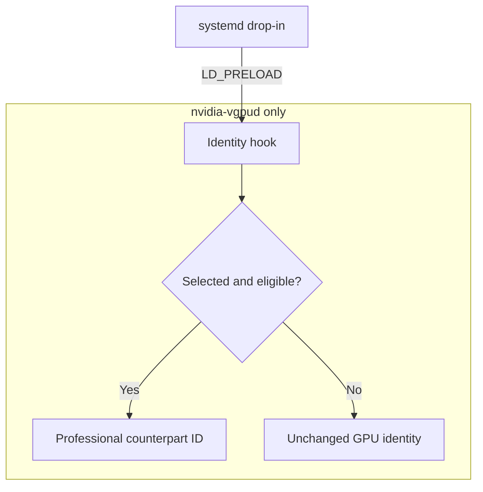

# Technical reference

This page expands on the [README](../README.md): what each component does, what activation does to a card, and how each PCI layout is handled.
Ampere and Ada are supported.
See [Ampere](ampere.md) and [Ada](ada.md).

Commands and exit codes are in [Configuration and commands](configuration.md#commands).
Config file keys and parsing rules are in the [configuration reference](configuration.md#configuration-file).

## How it works

See the README's [How it works](../README.md#how-it-works) for the short version, and [Capability positions per generation](devices.md#capability-positions-per-generation) for the default of 4 VFs (virtual functions: the lightweight PCI devices SR-IOV adds to a card, each of which can back one vGPU).
The full sequence has five steps:

1. The `geforce_sriov` module, a livepatch built by DKMS (which rebuilds it for each new kernel), exposes the hidden SR-IOV feature of the cards you list to the kernel.
   It reports 4 VFs by default ([configurable](configuration.md#configuration-file)) and also reveals ARI and MSI-X (see the [Glossary](glossary.md)).
2. The kernel reads every PCI device before any module loads.
   The livepatch boot unit therefore loads the module, and then `nvidia`, before udev can bind a selected card.
   A card that does not yet show SR-IOV, for example on the first `activate` after `install`, is removed and rescanned by activation, on its own bus only.
   The bridge is kept awake and the card's HDMI audio function is unbound first ([What activation does](#what-activation-does)).
3. `geforce-sriov activate` runs NVIDIA's `sriov-manage` for each selected card that has no VFs and checks that every VF came up bound to NVIDIA's driver.
4. `nvidia-vgpud` offers vGPU types (the vGPU profiles, each with a fixed memory size, such as RTXA6000-4Q) only for cards in NVIDIA's list, which has no GeForce cards.
   The identity hook, loaded only into `nvidia-vgpud` through a systemd drop-in, changes the device ID in the driver's answer to the professional card of the card's generation (an Ampere card becomes an RTX A6000, an Ada card an RTX 6000 Ada).
   It leaves the XML file, the vGPU manager and licensing alone.
5. On 580.159.01, guest CUDA work can stall because NVIDIA's closed driver object switches off the GPU's scheduler.
   `install` applies the scheduler, probe gate and VF count revisions to a copy of your own `nv-kernel.o_binary`, and the two plugin changes to a copy of your own vGPU plugin.
   It rebuilds NVIDIA's module and, for a build without the display modules, requires its `.text` to differ from the stock module only at the expected offsets ([Install details](#install-details)).
   A kernel update runs it again by itself, through the kernel hook `install` places in `/etc/kernel/postinst.d` and the apt snippet that covers headers installed after the image ([After a kernel update](installation.md#after-a-kernel-update)).
   No NVIDIA file is distributed here ([driver-patch.md](driver-patch.md)).

On the automatic path, the livepatch precedes driver binding, and activation follows:



## Changes and reversibility

This section lists what the package changes, where each change lives and what ends it.
See the [README](../README.md#safety-and-reversibility) for the short version.

geforce-sriov is software only.
It needs no hardware change, and it does **not** flash the ROM (the vBIOS), the card's firmware or anything else persistent on the card.
The `geforce_sriov` module changes two runtime register settings: the MSI-X hide bit of the GPU and the ARI Forwarding Enable bit of the PCIe port above it.
Both are held only while the host runs, and neither is written to firmware, so a power cycle without the boot units leaves neither of them set.

### Runtime changes

These changes exist only in the running system.
The boot units that `install` enables make them again at each boot, and nothing makes them without those units or a manual `activate`.

| Change | Made by | What it is |
|---|---|---|
| MSI-X setting on the GPU | The `geforce_sriov` module, at load, with `msix=on` | Clears bit 29 of the GPU's configuration register at offset `0x41C`, the bit NVIDIA uses to unlink MSI-X from the capability chain. Any PF reset sets it again ([The kernel module](#the-kernel-module)) |
| ARI forwarding on the PCIe port | The PCI core, or `geforce_sriov` when the kernel does not find the hidden capability on its own | Sets the ARI Forwarding Enable bit in the port's Device Control 2 register, only when the port supports it |
| The livepatch | `geforce-sriov-livepatch.service`, or `activate` | Replaces three kernel functions in the running kernel (`pci_find_ext_capability`, `pci_read_config_word` and `pci_write_config_word`), and acts only on the cards in `bdfs` |
| Removal and rescan of a card's empty bus | `activate` | Lets the kernel read the card again with the livepatch in place |
| VFs and vGPU types | `activate`, through NVIDIA's `sriov-manage` and sysfs | Creates the VFs and sets each VF's type |
| Power settings | `activate` | Sets `power/control` to `on` for the card, its bridge and its VFs. On a laptop GPU, with `d3cold=off` in the config, it also writes `0` to `d3cold_allowed`. When `activate` stops before the removal, it gives these back |
| Module block and run files | `activate` | `/run/modprobe.d/zz-geforce-sriov-enable.conf` and `/run/geforce-sriov/`, both on a memory-backed directory |
| The boot display framebuffer | `activate`, on the boot display GPU only | Hands the firmware framebuffer (the video memory the BIOS/UEFI set up for the boot screen) to NVIDIA's display modules ([The boot display GPU](#the-boot-display-gpu)) |

One runtime change leaves a file on disk on purpose.
The activation lock, `/var/lib/geforce-sriov/prepare-attempt`, marks an activation that is incomplete or in an uncertain state.
The activation lock stays after an interrupted activation, and after `uninstall`, until you clear it ([The activation lock](recovery.md#the-activation-lock)).

### Files on disk



| Files | Where | `uninstall` |
|---|---|---|
| `geforce-sriov`, `geforce-sriov-patch`, `geforce-sriov-driver`, the `gs-driver-*.sh` helpers, the `driver-patches/` directory | `<prefix>/bin/` | Removes them |
| The identity hook `libgeforce_sriov.so` and `config.example` | `<prefix>/lib/geforce-sriov/`, `<prefix>/share/geforce-sriov/` | Removes them |
| The `geforce_sriov` source and the DKMS registration | `/usr/src/geforce-sriov-<version>/` | Runs `dkms remove` and removes the files |
| The patched `nvidia.ko`, with the display and `nvidia-uvm` modules when built | Where NVIDIA's own module lives, usually `/lib/modules/<release>/updates/dkms/` | Puts NVIDIA's module back from the backup, and removes added modules, while they still match the build record |
| The patched plugin copy `libnvidia-vgpu.so.<version>.geforce-sriov` and the `libnvidia-vgpu.so` link | NVIDIA's library directory | Points the link back at NVIDIA's own plugin and removes the copy while it is the one `install` made |
| The backup of NVIDIA's module, the build records and the kept build inputs | `/var/lib/geforce-sriov/stock/<release>/`, `driver-build`, `driver-builds/<kernel>`, `inputs/` | Removes them after a successful restore |
| `/etc/geforce-sriov/config` | `/etc/geforce-sriov/` | Removes it while unchanged |
| `geforce-sriov-nvidia.conf`, `geforce-sriov-autoload.conf`, and with host CUDA `geforce-sriov-uvm.conf` | `/etc/modprobe.d/` | Removes the ones `install` wrote while unchanged |
| The two boot units, the `nvidia-vgpud` drop-in and the guest-autostart drop-ins | `/etc/systemd/system/` | Disables the units and removes the files while unchanged |
| The kernel hooks and the apt snippet `/etc/apt/apt.conf.d/99geforce-sriov`, or the `kernel-install` plugin or the pacman hook with the `geforce-sriov-kernel-hook` script | `/etc/kernel/postinst.d/`, `/etc/kernel/header_postinst.d/`, `/etc/apt/apt.conf.d/`, `/etc/kernel/install.d/`, `/etc/pacman.d/hooks/`, `<prefix>/bin/` | Removes the ones `install` wrote while unchanged |
| NVIDIA's CUDA libraries for host CUDA, their links and `geforce-sriov-cuda.conf` | `<prefix>/lib/geforce-sriov/cuda/`, `/etc/ld.so.conf.d/geforce-sriov-cuda.conf` | Removes each file and link while it is unchanged, then runs `ldconfig` |
| NVIDIA's graphics libraries and X modules for the host desktop, their loader file, the EGL, Vulkan and X output-class files and the `nvidia-drm_gbm.so` link | `<prefix>/lib/geforce-sriov/gl/`, `<prefix>/lib/geforce-sriov/xorg/`, `/etc/ld.so.conf.d/geforce-sriov-gl.conf` and the paths in [What install adds](installation.md#what-install-adds) | Removes each file and link while it is unchanged, then runs `ldconfig` |
| The install manifest and the driver log | `/var/lib/geforce-sriov/` | Removes them, and the directory when nothing else is in it |

`install` records each file it writes with its SHA-256 in `/var/lib/geforce-sriov/installed-files`.
`uninstall` removes a file only while it still matches that record, and a directory only when it is empty.
It keeps a changed file and says so, and it **never** touches a file the manifest does not list.

Restoring NVIDIA's module is stricter.
`geforce-sriov-driver --restore` puts the stock `nvidia.ko` back **only** while the installed `nvidia.ko` is still the one `install` wrote, and **only** from a backup whose SHA-256 matches the one in the build record.
If either check fails it keeps the installed `nvidia.ko` and the backup, `uninstall` exits 1, and the message names the manual commands.
Without `--kernel`, `--restore` (which `uninstall` runs) restores every kernel that has a build record, one after the other. A backup that was not put back stays, with a printed command for it ([Uninstall](installation.md#uninstall)).

Two things stay by design: the `--driver-file` extraction in `/var/lib/geforce-sriov/nvidia/<version>/` stays until you delete it (`uninstall` names the directory and prints the `rm -r` command), and the driver NVIDIA's installer put on the host stays until you remove it with NVIDIA's `nvidia-uninstall`.

If you disable the boot units but leave the files, no NVIDIA driver loads at boot, because `geforce-sriov-autoload.conf` still keeps udev from loading it.
Run `modprobe nvidia` by hand, or run `uninstall`, which removes that file.

### Undoing an activation

The package never disables VFs, so the simplest complete undo is to power the machine off and on.
A boot without `geforce_sriov` is an ordinary boot.
A boot with `geforce_sriov.skip` on the kernel command line has no NVIDIA driver: neither unit runs, and the package's autoload file keeps udev from loading `nvidia` ([Turn features off](recovery.md#turn-features-off)).
`uninstall --unload` disables the livepatch, waits for the transition and runs `rmmod`; it refuses while a listed card has VFs, while the `bdfs` parameter of `geforce_sriov` cannot be read, or after an interrupted activation.
A card that was rescanned keeps using the revealed capability until it is removed and rescanned again, so in practice, power the machine off and on ([recovery.md](recovery.md)).

## What activation does

`geforce-sriov activate` brings the selected cards from a cold, NVIDIA-bound or already-enabled state to VFs that are ready for a VM.
The boot unit `geforce-sriov-activate.service` runs `activate --boot` after `geforce-sriov-livepatch.service` has loaded the livepatch and `nvidia` before udev.
The kernel's first enumeration of each selected card therefore already sees the revealed capabilities, and no removal is needed.
A run by hand before the first power cycle loads the livepatch itself and removes and rescans each card that does not yet show SR-IOV.
Patching and installing NVIDIA's module ([driver-patch.md](driver-patch.md), and for Ada the [Ada host stack](ada.md)) and installing the livepatch module ([Install details](#install-details)) happen beforehand and are not part of activation.

`install` writes the activate unit's `TimeoutStartSec` as an upper bound of activation with every wait, write and process at its own limit: for each selected card and each VF the sum of those limits, plus the steps that run once, plus 10 %, at least 900 s (3050 s for 1 card with 4 VFs, 10981 s for 8, 38173 s for 32).
Normal activation takes seconds per card, so the value matters only in a real hang, when activation ends through its own limits first.
Activation also extends the timeout with `EXTEND_TIMEOUT_USEC` over `$NOTIFY_SOCKET` before each step that can wait, by that step's own limit plus 30 s. Outside the unit nothing is sent.
The selection and the VF count change through `install`, which rewrites the unit.

Activation runs in five phases:

1. A read-only preflight checks the activation lock, the selection, whether the card at each selected address is the card that was recorded (`<bdf> is not the GPU that was selected` stops the run before anything is written; `livepatch --boot` makes the same check before it loads `geforce_sriov`), the driver and build identity, the clients of each GPU, the display plan and the resource fit of every selected card.
   If any selected card has a laptop row and the config lacks `d3cold=off`, activation refuses the entire run before waking a GPU or writing anything (exit 3).
   The refusal includes the `install` command needed to record D3cold consent ([Consent](laptops.md#consent)).
   A refusal changes nothing, and `--dry-run` stops here and prints the plan.
2. Quiesce: it stops the display manager only with `--stop-display-manager` (the boot unit never does), then writes the activation lock and `/run/geforce-sriov/activating`.
3. Power and reveal: it wakes the cards, loads the livepatch or reuses the loaded one when its parameters are exactly the configured ones, hands the firmware framebuffer of a boot display GPU over, and loads `nvidia` (and, with the display build, `nvidia_modeset` and then `nvidia_drm`).
4. Empty-bus resize, for each card that shows no SR-IOV or has no VF BAR assigned: it removes the card, rescans its bus once, and verifies what came back.
5. Enable and finish: it enables the VFs, loads `nvidia_vgpu_vfio`, restarts the vGPU daemons, re-probes each PF, then sets and reads back each VF's type and power.

Phase 3 wakes a card that has a laptop row or whose `power/runtime_status` reads `suspended`.
It sets `power/control` to `on` on the card and the bridge above it, and reads the bridge setting back before it goes on.
On laptop rows only, it also writes `0` to the card's `d3cold_allowed`.
If a write does not finish or a card does not answer, activation gives back what it changed.

Phase 4 removes a card only when all of these hold:

- It is function `.0`, an NVIDIA display controller listed in `geforce-sriov devices`.
- It is bound to `nvidia` or to no driver.
  The only other bound function in its slot, if any, is its own HDMI audio on `snd_hda_intel`, which activation unbinds first.
- No VFs exist on its bus and no other device shares the bus.
- Its parent is a PCI bridge with a `pci_bus/<bus>/rescan` file and a readable `power/control`.
- BAR0 is assigned.
- The VF BARs fit the bridge windows above it ([PCI resources](#pci-resources)).

Removal then runs in this order:

1. The bridge is held awake, because a bridge that runtime-suspends during the rescan loses the card.
2. The card's own HDMI audio function is unbound.
3. The activation lock is updated to the step, `remove-rescan:<BDF>`.
4. A PF bound to `nvidia` is removed only after NVIDIA's `unbindLock` is granted, which the driver does only while no program holds the GPU.
   A boot display GPU with the display stack loaded skips the lock, because its own display modules hold it.
5. With SIGINT, SIGTERM, SIGHUP and SIGQUIT blocked, the card's other functions are removed, then the card itself, each within a bounded wait.
6. The bus must be empty.
   Activation then writes the bridge's `rescan` once and never retries it.
   The global `/sys/bus/pci/rescan` is never used, no other device is removed, and a bus shared with another device is refused.
7. Activation waits for the card to return with the same vendor and device ID and for `sriov_totalvfs` to appear.
   On a laptop row, it writes `0` to the card's `d3cold_allowed` again.
   During the rescan the kernel may log `VF BAR … can't assign` messages before it settles; only the final state counts.
8. It checks what the card now offers:
   - `sriov_totalvfs` must be between 1 and `vfs` (4 by default).
   - BAR0 and at least one VF BAR must be assigned; otherwise enabling VFs fails with `not enough MMIO resources for SR-IOV` ([PCI resources](#pci-resources)).
   - With `msix` on, the MSI-X capability must be linked.
   - With `ari` on and a bridge that supports ARI Forwarding, `ari_enabled` reads 1; otherwise activation prints a note and goes on.

A card that does not come back follows the rule in [recovery.md](recovery.md#the-one-rule): a cold power cycle (power the machine fully off and on, not a reboot), and no second rescan.
Activation exits 5 and leaves the activation lock set.

When a selected card has no VFs, phase 5 runs NVIDIA's `sriov-manage -e` for it, with `nvidia` already bound to it.
`sriov-manage` is NVIDIA's own script and the only VF enable method NVIDIA supports.
It needs `lspci` and `setpci`.
While it runs, it:

- may stop `nvidia-xid-logd` briefly;
- moves the card through `pci-pf-stub` while it sets the VF count;
- rebinds the card to `nvidia` and binds the slot's other functions to `nvidia`;
- runs `nvidia-smi -pm 1`.

Its exit status is not reliable, so the CLI checks that every VF came up bound to `nvidia`.
The VF count is never written to `sriov_numvfs` directly, because `sriov-manage` also moves the card through pci-pf-stub and handles binding.
The count cannot exceed the presented one.

The vGPU daemons are started only after the VFs exist, in the order given in the [installation guide](installation.md#cold-boot).
On Ada and Ampere cards, `activate` restarts them ([activate and the VF power gate](#activate-and-the-vf-power-gate)).

geforce-sriov never disables VFs, so the simplest complete undo is to power the machine off and on.
A boot without the module, or with `geforce_sriov.skip` on the kernel command line while the units are installed, is an ordinary boot.
`uninstall --unload` disables the livepatch, waits for the transition and runs `rmmod`; it refuses while any GPU has active VFs or an activation was interrupted.
A card that was rescanned keeps using the revealed capability until it is removed and rescanned again, so in practice, power the machine off and on ([recovery.md](recovery.md)).

## Components

| Path | What it is | License |
|---|---|---|
| `geforce-sriov` (`src/`) | CLI: inspection, install, activation, uninstall | MIT |
| `kernel/geforce_sriov.c` | Livepatch module (DKMS `geforce-sriov/0.4.0`) | GPL-2.0-only OR MIT |
| `hook/libgeforce_sriov.so` | `LD_PRELOAD` identity hook for `nvidia-vgpud` only | MIT |
| `driver/geforce-sriov-patch` | Patcher for the user's own `nv-kernel.o_binary` | MIT |
| `systemd/` | `geforce-sriov-livepatch.service`, `geforce-sriov-activate.service`, the `nvidia-vgpud` drop-in and the guest-autostart drop-in | MIT |
| `scripts/` | The driver step (`geforce-sriov-driver`, with its libraries and the version table) and the kernel hook script | MIT |

## The kernel module

The kernel module `geforce_sriov` is a livepatch that replaces some of the kernel's PCI config accessors so the kernel sees the hidden SR-IOV feature of the cards you choose.
It acts only on the functions in its required `bdfs` parameter.
The CLI sets the switches from the config's `on`/`off` values (as `0`/`1`) and passes `vfs=N` when the config sets a count.
The module:

- Returns the hidden SR-IOV capability (config offset `0xBCC`) from `pci_find_ext_capability()`.
- Reports TotalVFs and InitialVFs as `vfs` (1–16, default 4), never more than the card's hardware TotalVFs.
  On an Ada card that reports 1 the ceiling is 4, from the VF-count revision of the host module.
  NVIDIA's patched driver uses at most 4 VFs per card.
  NVIDIA's driver does not use these 16-bit reads; on Ada it reads through a BAR0 mirror that no config accessor sees.
- With `ari=1` (default), presents the hidden ARI capability (`0xC14`, only if its Next Function Number
  is non-zero) and turns on ARI Forwarding in the GPU's immediate upstream bridge when it supports it.
  - ARI decoding in the GPU hardware does not work, which is why `vfs` defaults to 4 with or
    without ARI.
  - ARI Forwarding stays off when the kernel scans every slot below a port (`pci=pcie_scan_all` or a
    platform quirk), because the card's 3-bit function decode would answer device numbers of 1 and
    above as alias devices.
- With `msix=1` (default), clears config `0x41C` bit 29 so the MSI-X capability of the PF (the physical function, the card itself) is linked.
  A natively linked MSI-X is left alone.
  The bit is volatile: any PF reset (function-level reset, GPU reset, AER recovery) hides MSI-X again and stops PF interrupts until the next cold boot.
  Use `msix=off` if you need PF resets.
- Checks where the VFs would land: each must fall on a free function 1–7 of the PF's own slot.
  At load, the card's reported values are used.
  During the rescan the kernel tries every count from `vfs` down to 1, and a bad layout at any count, or a NumVFs register that does not read back, leaves that card with no SR-IOV (kernel log: `VF layout for … requested VFs`).
  A passing check does not prove the card provides that many working VFs.
- Validates every listed card before patching anything and refuses to load, with nothing patched, when:
  - a listed address is missing or not a table card;
  - the SR-IOV header does not match, or the hardware TotalVFs is 0;
  - the VF layout check fails (kernel log: `first VF offset … ; refusing`).

The module never removes, rescans, resets or binds a device, and it has no device table that could autoload it.
The CLI removes and rescans the card once the livepatch is active, holding the upstream bridge awake because a bridge that runtime-suspends during the rescan loses the card.
The step-by-step sequence is in [What activation does](#what-activation-does).

## Requirements in detail

- x86_64 Linux 6.8 or later with `CONFIG_LIVEPATCH`, `CONFIG_PCI_IOV` and `pci_dev_is_disconnected()`
  exported in `<linux/pci.h>` (6.9, or a stable backport).
  - Clang LTO (`CONFIG_LTO_CLANG`, full or thin) is refused at build time, because the kernel's SR-IOV
    code may then use inlined copies of the config accessors the module replaces.
  - Also needed: kernel headers for the running kernel release, `dkms`, `systemd`, `pciutils`, a C
    compiler and `make`. Install them with your distribution's package manager. A live `install`
    refuses and names whichever of them is missing, and `activate` refuses to create VFs without
    `lspci` and `setpci`.
- IOMMU enabled (for example `intel_iommu=on iommu=pt`).
- NVIDIA vGPU-KVM host driver, proprietary flavour, supporting every selected card: installed by you,
  or from NVIDIA's `.run` package with `install --driver-file PATH --accept-nvidia-license`.
  - The host and guest drivers must match the
    [supported software stack](installation.md#supported-software-stack). Only 580.159.01 is confirmed.
    On another host driver version, `install` builds best effort when the patch anchors are found, and prints that the driver is **not guaranteed to work** (`setup` asks first; `--allow-unsupported-driver` answers yes).
    On an Ada card, an unrecorded version also needs the code window of the placement change exactly once; otherwise it stops ([Ada VM placement](#ada-vm-placement)).
    Other guest driver versions are **not guaranteed to work**.
    On the manual path (`--driver=skip`), `status`, `check` and `activate` print the same notice for another host driver version and continue.
  - The hook acts only on the builds whose layout it knows ([hook/README.md](../hook/README.md)) and
    passes other builds through unchanged.
  - `nvidia-vgpud.service` and `nvidia-vgpu-mgr.service` must exist; `install --dry-run` and `status` warn when either is
    missing.
  - Ada needs the module with the three host-object revisions and GSP off, and the Ada placement revision
    ([Ada host stack](ada.md#host-stack); [NVIDIA driver flavour](devices.md#nvidia-driver-flavour)).
- Select every card you will use in `bdfs`. Loading `nvidia` binds every NVIDIA card on the host,
  and geforce-sriov cannot restrict that.
- Each selected GPU:
  - is function 0 with a PCI bridge directly above it;
  - shares its bus with no other device;
  - does not already present SR-IOV (another livepatch or a patched kernel);
  - is not bound to a driver other than `nvidia` when activation starts.
- The boot display device is handled inside activation: its console is handed to NVIDIA's display modules, and it is refused unless the installed build has them
  ([The boot display GPU](#the-boot-display-gpu)).
- `nvidia` must not load from `modules-load.d`, `/etc/modules` or the initramfs, because it then binds the
  card before the livepatch loads. `status` warns when it finds it there (built initramfs images are not inspected).
- Enough bridge window space for BAR0 and the VF BARs ([PCI resources](#pci-resources)).
- `/var/lib` and the install prefix on the root filesystem or on a volume the initramfs activates. The
  boot unit runs before `systemd-udevd`, so a filesystem that needs udev would make it wait forever.

## Install details

A live install copies the binaries to `--prefix` (default `/usr/local`), the hook to `$PREFIX/lib/geforce-sriov/` and the module source to `/usr/src/geforce-sriov-0.4.0/`, then runs `dkms add/build/install` and installs the boot units.
`install` writes:

- `installed-files` (every file it recorded), `format` (the version stamp) and `selection` (the identity of each selected card), in `/var/lib/geforce-sriov/`;
- the kernel hook, `/etc/kernel/postinst.d/geforce-sriov` and `/etc/kernel/header_postinst.d/geforce-sriov`, for each of those directories that exists, and the apt snippet `/etc/apt/apt.conf.d/99geforce-sriov` (it runs the hook with `--retry` after dpkg); on a `kernel-install` host without `/etc/kernel/postinst.d`, the plugin `/etc/kernel/install.d/90-geforce-sriov.install`; on a pacman host, the hook `/etc/pacman.d/hooks/90-geforce-sriov.hook` (it runs the hook script with `--retry`); the hook script `geforce-sriov-kernel-hook` beside the program for those two;
- the modprobe files `geforce-sriov-autoload.conf` and, with host CUDA, `geforce-sriov-uvm.conf` ([Modprobe files](installation.md#modprobe-files); 0.4.0 writes no `geforce-sriov-display.conf`).

The driver step writes `driver-build`, `inputs/` and `driver-step.log` in `/var/lib/geforce-sriov/`, and the modprobe file `geforce-sriov-nvidia.conf`; none of them exist with `--driver=skip`.
The kernel hook creates `kernel-hook-logs/` and `kernel-hook-failed/` in `/var/lib/geforce-sriov/` when it first runs.

A rerun of the same version builds it with DKMS as a trial first.
Another registered version of `geforce-sriov` makes `install` refuse (exit 3, nothing written) until that version's own `uninstall` has run.
The refusal looks only at files, the DKMS registration and the boot units; the message also tells you to power the machine off and on before installing again ([Upgrading](installation.md#upgrading)).
Every file is recorded with its SHA-256 in `/var/lib/geforce-sriov/installed-files`, and a rerun leaves identical files alone (`unchanged <path>`).

- It refuses a `vfs` above a selected card's ceiling ([Configuration file](configuration.md#configuration-file)).
- It warns for a `vfs` above 4 and an activation lock left by an unfinished activation.
- Without `--device`, nothing is selected and the units are not enabled.
  `setup` selects the card itself when exactly one card is eligible.
- It refuses (exit 3) an existing `/etc/geforce-sriov/config` it did not write (edit it yourself or remove it) and a `DESTDIR` with a symlink in its path.
  It stops (exit 1) rather than overwrite any other existing file it does not own.
  `--prefix` may contain only letters, digits and `/._+-`.
- Once it has written anything, a failure or a refusal exits 1, not 3.
  Exit 3 means nothing changed.

Unless `--driver=skip` is given, a live install then runs the driver step
([What install does](driver-patch.md#what-install-does)):

- It accepts the host object and the vGPU plugin when each matches the whole-file SHA-256 recorded for 580.159.01.
  Another version's object or plugin is admitted best effort when every code window of its revisions is found exactly once; the build is then recorded as `confirmation=unconfirmed`.
  A file whose windows are missing is refused (exit 3, before the first write), and the reason names the missing window ([Supported inputs](driver-patch.md#supported-inputs)).
  For the recorded version, the revised object, the plugin after its first change and the patched plugin copy must match their recorded digests too.
- It also refuses before the first write when the module, the kernel headers, a tool or the plugin is
  missing, or when the `.text` of a module cannot be read.
- After the build it checks the module.
  A build without the display modules is compared by `.text` with the installed stock module.
  For a build of 580.159.01 for Ampere only, the differing offsets must be exactly the eight recorded `.text`-relative offsets (`0x14a7c4`-`0x14a7c7`, `0xa16708`, `0xa16709`, `0xd8966f`, `0xd89670`).
  A build with an Ada card selected adds one more, `0xf7c06`, the Ada placement change.
  For an unrecorded version the offsets are the ones the patch tool reported for that build.
  Any other difference, or `.text` sections of different sizes, refuses (exit 3) and names the first unexpected offset.
  A display build is not compared by `.text`, because a reviewed source patch changes it on purpose.
  It is checked by the digest of its object chain (the recorded endpoint for a confirmed version) and by the display revision in the finished module.
- Identical `.text` means the installed module already is this build.
  When the modprobe option and the patched plugin copy are in place and this kernel's backup of the stock module differs from the build at exactly the expected offsets, the step writes the record of the build for this kernel and exits 0.
  It replaces a record that is missing or names another kernel or module.
  A copy from an earlier install with only the placement change counts as in place and is replaced with the patched plugin copy.
  Otherwise it refuses (exit 3), asks you to reinstall the stock module first, and names `--driver=skip`, which keeps the installed module as it is.
- A rerun on a host already installed for this kernel changes nothing when the patched plugin copy is
  in place, and otherwise replaces the plugin copy and points `libnvidia-vgpu.so` at it.
- When the installed module is NVIDIA's open flavour (licence `Dual MIT/GPL`), the step refuses before writing.
  Remove NVIDIA's driver, for example with `nvidia-uninstall`, install the vGPU host package again with `--kernel-module-type=proprietary`, then run `install` again.
- A failure after the first write restores what it replaced.
  `geforce-sriov-driver --dry-run` prints the planned commands, including the `.text` comparison, and builds nothing.
- `geforce-sriov-driver --restore` and `uninstall` act on the backup only when the installed module is ours.
  A module with another build-id is not ours, so `--restore` removes the older backup and its record and succeeds.
  The recorded build-id with other bytes (a signed copy) stays, and `uninstall` exits 1.
  `install` after NVIDIA's package replaced `nvidia.ko` takes the module found as the new backup.

Only after the driver step succeeds (or with `--driver=skip`) does `install` write the `nvidia-vgpud`
drop-in and `/etc/geforce-sriov/config` (`bdfs=`, `identity=on`, `identity_force_host=on`, `vfs=N`
with `--vfs N`, and `d3cold=off` with `--disable-d3cold`), and enable the units for the next boot without starting them.
`install --device` without `--disable-d3cold` removes `d3cold=off` from the config and prints one line confirming the removal.

`--driver-file PATH`, `--accept-nvidia-license`, `--nvidia-source DIR` and `--disable-d3cold` are described in
[One command from a clean host](installation.md#one-command-from-a-clean-host).

To stage into a directory instead, with nothing changed outside it:

```sh
DESTDIR=/tmp/stage ./geforce-sriov install --prefix /usr --device 0000:01:00.0
```

Staging records `--device` addresses unchecked, checks no devices, and rejects `--config`,
`--sysfs-root` and `--driver-file` (exit 2). The target host is told to run
`geforce-sriov install --dry-run`.

### Host CUDA libraries

A CUDA program needs `nvidia-uvm` in the kernel and NVIDIA's CUDA library in userspace.
NVIDIA's vGPU host package has no `libcuda`; the second package has it, in its own version (580.159.03 beside the 580.159.01 host driver, which works).
With `host_cuda=on`, `install` therefore installs these files from the second package, as far as the package has them. They are the libraries NVIDIA's own installer installs for CUDA:

| Library | What it is for |
|---|---|
| `libcuda.so.<version>` | The CUDA driver library that every CUDA program loads |
| `libnvidia-ptxjitcompiler.so.<version>` | Loaded by `libcuda` when a program gives it a kernel as PTX |
| `libnvidia-nvvm.so.<version>`, `libnvidia-nvvm70.so.4` | Loaded by `libcuda` for NVVM IR and link-time optimisation |
| `libnvidia-gpucomp.so.<version>` | Loaded by `libcuda` under exactly this name |
| `libcudadebugger.so.<version>` | Loaded by `libcuda` when a CUDA debugger attaches |

- They go into `<prefix>/lib/geforce-sriov/cuda/`, each with the link the loader follows (`libcuda.so.1`, for example) and `libcuda.so`, as NVIDIA's installer makes them.
- `/etc/ld.so.conf.d/geforce-sriov-cuda.conf` names that directory, and `install` runs `ldconfig`. No environment variable is needed.
- The directory is the package's own, so a `libcuda` that another package or the user installed is never replaced. The loader searches the directories of `ld.so.conf.d` in the order of the file names, which puts this one before the distribution's; `install` and `status` ask `ldconfig -p` which `libcuda.so.1` programs get, and warn when it is another one.
- `libnvidia-ml`, which `nvidia-smi` uses, is **not** taken from the second package: the host package has its own, and that library checks the driver's version.
- Every file and link is in the install manifest with its digest or target. `uninstall` and `install --no-host-cuda` remove each one while it is unchanged; `rebuild` leaves them alone, because they do not depend on the kernel.

### Kept inputs and `rebuild`

A display or host CUDA build needs the second NVIDIA driver package and, for the display, NVIDIA's public kernel module source, and a build for another kernel needs them again.
After a successful driver step, `install` therefore keeps them in `/var/lib/geforce-sriov/inputs/`, which is owned by root and not writable by group or others:

- `companion/<name>`: the second driver package, a file or a tree as it was given.
- `nvkms/<name>`: the public source, an archive or a tree.
- `index`: `key=value` lines with `nvidia_source` and, per input, its path, kind (file or directory), SHA-256 for a file, declared version and where it came from.
- The host kernel tree is kept by path only, and only while every file in it belongs to root and is not writable by group or others. It is NVIDIA's own `/usr/src/nvidia-<version>` or the extraction `install` keeps under `/var/lib/geforce-sriov/nvidia/`.

`install` without input options passes `--retained` to the driver step, so a display or host CUDA build is made from the kept inputs, and `install --dry-run` and `setup` do not ask for an input that is kept.
`geforce-sriov rebuild [--kernel RELEASE]` runs the same driver step, `geforce-sriov-driver --retained --kernel <release>` with `--display` or `--no-display` and `--host-cuda` or `--no-host-cuda` as the config selects, from the installed copy.
The kernel hook runs `rebuild --kernel` for each new kernel ([After a kernel update](installation.md#after-a-kernel-update)).
`--kernel` builds for an installed kernel that is not running yet, so one power cycle is enough after a kernel update.
The driver step refuses before its first change (exit 3) when a kept input is missing, when its digest or declared version differs from what was kept, when the index does not say whether an input is a file or a directory, or when a kept host tree now has a file that another user owns or that group or others can write to. In each case the message names the `install` option that keeps the input again.
`install` run from the installed copy, which has `geforce-sriov-driver` beside it and no source tree, refuses and names `rebuild`.

The published record `driver-build` names one kernel.
The record of every other kernel is kept in `/var/lib/geforce-sriov/driver-builds/<kernel>` and becomes the published record again when a run is for that kernel, so a rerun for a kernel whose build is installed finds its record and builds nothing, whichever kernel was built last.
An `nvidia.ko` that the script built is never copied into `stock/<kernel>`: when the installed `nvidia.ko` is such a build and no backup of NVIDIA's own module exists, the run refuses before any change, because an uninstall would have nothing to put back.

### Journaled commit of the driver build

`geforce-sriov-driver`, the script that does the driver build, replaces several files at once: each built module, the plugin copy and its link, the modprobe file and the build record (`/var/lib/geforce-sriov/driver-build`).
A power loss or a `SIGKILL` can stop it between any two of them, so the commit is journaled and the next run can tell what happened:

1. Everything the commit needs goes under `/var/lib/geforce-sriov` first and is synced: the built modules, the patched plugin, and a copy of each file as it is before the commit (`txn/`).
   These copies belong to this commit. The stock backups under `stock/` are a different set: they hold NVIDIA's own files for `--restore`.
2. The journal `driver-build.gs-new` is written. It holds the record to publish and `journal_*` lines that name the staged files. From here on the commit is recoverable.
3. Each file is installed under a temporary `.gs-new` name, synced and renamed, so an installed file is always complete, old or new. Modules of the earlier build that this build drops are touched last, so once they are touched the commit can always be finished and never has to be undone.
4. The record is published last, and then the journal and `txn/` are removed.

A run that finds a journal first finishes that commit from the staged files. When a staged file is gone, it puts back the files as they were from the copies in `txn/`; the earlier record was never touched, so it describes that state again.
A file that is neither what the commit found nor what it built was changed by someone else since. In that case, and when a needed copy is missing, the run changes nothing, keeps the journal and stops (see [Symptoms](recovery.md#symptoms) for the message and the two ways out).
With `--dry-run`, the script only reports that an interrupted install exists.

## status and install --dry-run

`status` shows the state of each selected card and names its next step, then prints the host checks that apply after install.
`install --dry-run` prints the host checks that apply before install and changes nothing.
`BDF` in the [command list](configuration.md#commands) is a physical function `dddd:bb:ss.0` as named in `/sys/bus/pci/devices`.
The domain has 4–8 lowercase hex digits (more than 4 only without leading zeros, at most `7fffffff`).
On `status`, `--sysfs-root PATH` points at a copy of a sysfs tree and `--config PATH` at another config file; commands that change the system reject both.
The host checks (tools, activation lock, boot units, module autoload) are skipped with `--sysfs-root`.

Each check is one line marked `OK`, `INFO`, `WARN` or `FAIL`.
`install --dry-run` prints every line, and exits 3 when one is a `FAIL`.
`status` prints only `INFO`, `WARN` and `FAIL` lines, under `Other host checks (OK lines are not shown):`, and exits 1 when one is a `FAIL`.
`FAIL` means `install` or `activate` would refuse, or that the host needs action before it can work.
`WARN` means a degraded setup or that a later step will refuse, for example:

- a missing `lspci`;
- an unassigned BAR;
- a shared IOMMU group;
- a selection that mixes Ada with another generation;
- a missing `nvidia-vgpud.service` or `nvidia-vgpu-mgr.service`.

For a `--device` the config does not select, `install --dry-run` shows what the hook will do with the settings `install --device` writes.
With `--nvidia-source DIR`, `--driver-file PATH` or `--disable-d3cold`, it assesses the host as `install` will leave it.
`--disable-d3cold` requires at least one laptop GPU among those assessed; otherwise, `install --dry-run` exits 2.
A laptop GPU without D3cold consent fails because `activate` would refuse it; recorded consent or consent planned with `--disable-d3cold` is reported as information.
Without a config file, the config line says the selected devices come from `--device` when one is given, and otherwise that defaults apply and no device is selected.

Before install the checks cover the config summary, kernel headers, a C compiler and `make`, NVIDIA's kernel source tree (and the extraction of `--driver-file`, and whether `nouveau` is loaded), `dkms` and `systemctl`, the build inputs for the display build and host CUDA, the selected cards, laptop consent, generation notes, the identity plan and a warning when no GPU is selected.
Before and after install they cover kernel livepatch support, `sriov-manage`, NVIDIA's `nvidia-vgpud` and `nvidia-vgpu-mgr` unit files, `lspci` and `setpci`, modprobe.d conflicts, each card's answers and power state, laptop host checks and mixed generations.
After install they also cover the module and livepatch state, IOMMU groups, `pci=noari`, the livepatch module for the running kernel, kernels with NVIDIA's module but no livepatch module, the activation lock, `nvidia` loaded at boot, the identity hook against the loaded driver version, `LD_PRELOAD` drop-ins, the boot units, the vGPU plugin link, missing device nodes, the display and host CUDA requests against the installed build, the host desktop, display clients and the display manager, config file permissions, and for each card ARI forwarding, BAR0 and the VF BAR, IOMMU peers, VFs that share the PF's group, MSI-X, whether the resources fit, a driver other than `nvidia` bound to the card, and the identity mapping.

The checks compare the build-id of the installed `nvidia.ko` with the driver step's record (`/var/lib/geforce-sriov/driver-build`).
With no record and no install manifest (`/var/lib/geforce-sriov/installed-files`), they print `[INFO] NVIDIA's module has not been built on this host yet; install builds it`.
The build-id identifies the module's contents, so a loaded module whose build-id differs from the installed one is another module, for example after a reinstall without a power cycle.
When the installed `nvidia.ko` is the driver step's build and NVIDIA's driver is loaded, they read the loaded module's build-id from `/sys/module/nvidia/notes/.note.gnu.build-id`.
If it is not the installed one, they warn `the running nvidia module (build-id <12 hex digits>) is not the installed one (<12 hex digits>); power the machine off and on to load it`.
When the installed `nvidia.ko` is not the driver step's build, nothing is said about the loaded module.

`status` adds the same sentence to the line of each Ada or Ampere card, and its first next step is then `next: power the machine off and on (the running nvidia module is not the installed one)`, without the next steps that lead to `activate`.
`status` then exits 1.
`check` adds the sentence to its `nvidia.ko` line without changing its exit status, and `activate` prints it as `geforce-sriov: warning: …` and goes on.
After an install, `setup` does not bring the GPUs up while it holds, and tells you to power the machine off and on.

The checks read the drop-ins of `nvidia-vgpud` and `nvidia-vgpu-mgr` in systemd's unit directories.
Each `.conf` file other than the package's own `geforce-sriov.conf` that sets `LD_PRELOAD` in an `Environment=` line gets `[WARN] <file> sets LD_PRELOAD for <unit> and overrides the geforce-sriov identity hook. Remove it or point it at <hook path>.`, where the hook path is the one `geforce-sriov.conf` preloads.
systemd reads a unit's drop-ins in file name order and the last `LD_PRELOAD` wins.
In `nvidia-vgpud.service.d`, a file read before `geforce-sriov.conf` is not named, and neither is a file whose `LD_PRELOAD` list (colons or blanks) still holds the hook.

`activate` keeps `/run/geforce-sriov/activating` from its first change until it succeeds.
While that file exists, `status` prints `activate: /run/geforce-sriov/activating exists (activate is running or did not finish)` with the next step, to stop every VM that uses a vGPU and run `activate` (left out when the running `nvidia` module is not the installed one), and exits 1.

`status` exits 0 only when all of these hold:

- every selected GPU presents 1 to `vfs` VFs with no BAR known to be unassigned, and every VF is on `nvidia` with its type, `power/control=on` and `runtime_status=active`;
- no host check is a `FAIL`;
- `/run/geforce-sriov/activating` does not exist;
- the running `nvidia` module is not seen to be a different build from the installed driver step's build;
- the installed build matches the display and host CUDA requests of the config.

It prints `VF resources: unknown (resource file unreadable)` when the `resource` file cannot be read, so exit 0 then does not prove the BARs are assigned.
It ends with `N of N selected GPU(s) have every VF ready.`

## activate and the VF power gate

`activate` takes the host from cards that show SR-IOV to VFs that are ready for a VM.
It creates the VFs, restarts NVIDIA's vGPU daemons, sets each VF's vGPU type and keeps each VF powered on, which is the VF power gate.
Ampere and Ada are the supported generations ([Ampere](ampere.md), [Ada](ada.md)).
See [Ada bring-up differences](ada.md#bring-up-differences), [The VF power gate](ada.md#the-vf-power-gate) and [Commands](configuration.md#commands) for details.

`activate` refuses (exit 3, nothing changed) unless:

- NVIDIA's driver is loaded with `EnableGpuFirmware: 0`, and
  `libnvidia-vgpu.so` resolves to the patched plugin copy (SHA-256 `aa4fdeb5…`; the earlier Ada-only
  copy is refused, and so is an earlier copy with only the placement change, `7ddfad45…`, with a
  message to run `install` again);
- every VF of the selected cards is on `nvidia`, and no selected PF has a `driver_override` other than
  empty or `nvidia`;
- the installed `nvidia.ko` is the build `install` recorded in `/var/lib/geforce-sriov/driver-build`
  for the running kernel (with no record at all it only warns);
- `--type`, if given, is not used on a mixed Ada and Ampere selection (it sets one type on every card,
  and 942 is not creatable on the Ampere target nor 525 on the Ada target; omit it and set
  `type_ada` and `type_ampere` in the config, or select one generation in `bdfs`, whose
  other-generation cards then run without VFs);
- every card in scope is in the device table, and no NVIDIA VF on the host has a vGPU type;
- no GPU outside `bdfs` has VFs enabled, because the daemon restart is host-wide.

On 580.159.01 the GSP-off and plugin checks above refuse.
Another host driver version is **not guaranteed to work** ([Supported software stack](installation.md#supported-software-stack)); on one, `activate` prints `geforce-sriov: NVIDIA's driver X is not guaranteed to work; confirmed versions: 580.159.01.; continuing`, those two checks only warn, and the run continues.
On such a host nothing stops a GSP or plugin mismatch before a guest starts, so the mismatch surfaces at guest start.
The stack of each generation is in [Ampere](ampere.md#host-stack) and [Ada](ada.md#host-stack).

`activate` then writes `/run/geforce-sriov/activating`, restarts `nvidia-vgpud` and `nvidia-vgpu-mgr`, re-probes each selected PF (an unbind and bind, never a removal or rescan; those happen earlier, in [What activation does](#what-activation-does)), and sets the type and `power/control=on` on every VF, gated on the readback `on`/`active`.
The type of a card is `N` with `--type`, else `type_ada` or `type_ampere` from the config, else 942 on Ada and 525 on Ampere.
Only then is `activating` removed.

The VF steps run after every card's re-probe, because re-probing one card's PF resets the other cards' VFs to `power/control=auto`.
After any re-probe, stop the VMs and run `activate` again; this covers the whole host.
A run on a host that is already active changes nothing when every VF is ready.
Otherwise it only finishes what is missing (types, VF power, a display or CUDA module) without restarting the daemons or re-probing a GPU, so running VMs are not disturbed.
`--dry-run` checks and prints the steps.

The daemon restart is host-wide, and every selected PF must finish its re-probe before any VF type or power setting is written:



After that, `activate` checks how each Ada card's VFs fit in its memory.
The fixed slots below exist only while the loaded `nvidia.ko` lacks the Ada placement change ([Ada VM placement](#ada-vm-placement)); with it, a VM takes a free piece of memory instead.
VF k (0 for the first, in VF order) has the fixed framebuffer slot `[k × (P − 32), (k + 1) × (P − 32))` MiB, where P is the `profileSize` of the card's type in `/usr/share/nvidia/vgpu/vgpuConfig.xml`.
A VF whose slot ends near the top of the card's memory can be refused when its VM starts, even alone on an empty card, while the type write succeeds.

For each Ada card with a VF whose slot ends above 75% of `memory.total` (from `nvidia-smi --query-gpu=pci.bus_id,memory.total --format=csv,noheader,nounits`), `activate` prints one line that names those VFs.
75% is a threshold for the hint, not an exact limit.
`activate` prints this line only for an Ada card whose first VF does not read `Not Applicable` in `nvidia/placement_id`, that is, whose loaded module lacks the Ada placement change; with the change there is no fixed slot and no line ([Ada VM placement](#ada-vm-placement)).
A `placement_id` file that cannot be read does not remove the line.
The line does not change the exit status.
A missing or unreadable XML file gives no line, and neither does an `nvidia-smi` that is missing, fails or runs longer than 5 s (it is then killed).
Ampere cards have no such slot limit and get no line ([Choosing a vGPU type](configuration.md#choosing-a-vgpu-type)).

The type must be listed in the VF's `nvidia/creatable_vgpu_types`.
NVIDIA's `nvidia_vgpu_vfio` keeps the type table of each GPU's first registration after a boot, and neither the PF re-probe nor a daemon restart refreshes it.
When the type is missing, `activate` exits 1 and writes no type.
Its message starts `type <N> is not in nvidia/creatable_vgpu_types` and ends `The driver keeps the vGPU types it registered first after a boot, so after a change of identity or professional counterpart, power the machine off and on`.

- Exit 1: a step after the checks failed, including an `unbindLock` that was not granted. `activating`
  stays, so `check` passes no card until `activate` succeeds.
- Exit 5: the activation lock of an unfinished activation was already set, so nothing was changed;
  or a PF did not come back to `nvidia`, and the lock stays set.

`check` is the read-only gate before every VM start: no root, no lock.
On a laptop GPU, its read of the PF and VF config space resumes a suspended device.
It prints one `OK` or `NOT READY` line per VF.
It is a point-in-time read: it does not read the plugin and does not stop a later re-probe or daemon restart.

- Exit 0: every VF of every selected card is on `nvidia` with `power/control=on`, `runtime_status=active` and the expected type, chosen as `activate` chooses it.
  Each VF of a laptop GPU must also answer a config read at offset `0x08`.
- Exit 1: anything else, or `/run/geforce-sriov/activating` or the activation lock exists.
- Exit 3: an invalid or empty config, no selected card, a `--device` that is not selected, a card in
  scope that is missing or not in the device table, or `--type` on a mixed selection.
  `--device` can narrow the run to one generation.

## Multiple GPUs and PCI topology

Up to 32 physical functions can be selected. The table shows what geforce-sriov does in each layout:

| Layout | Behaviour |
|---|---|
| One selected GPU with a PCI bridge directly above it | The basic layout |
| Several selected GPUs | `activate` checks every card first, and one failing card refuses the whole run (exit 3, nothing changed). Cards are then brought up one at a time and a failure stops the run |
| Some GPUs selected, others not | Unselected GPUs are never removed or rescanned, given SR-IOV by the kernel module, rewritten by the hook or forced to HOST. The rebuilt `nvidia.ko` applies to them too, because its VF-count and scheduler revisions are not per-card ([Combining generations](devices.md#combining-generations)) |
| Identical cards, only some selected | The hook tells them apart by PCI address ([The identity hook](#the-identity-hook)). If the driver does not answer its address queries, it falls back to the device ID only when every NVIDIA GPU with that ID is selected; otherwise the ID stays unchanged and a log line says why |
| Different models in one host | Each card uses its own table row and its generation's target, all under the one installed host driver, which must support every selected card. `install --dry-run` and `status` note that Ada needs the modified host stack ([Ada host stack](ada.md#host-stack)) |
| Several Ada cards | Each uses its own row, and each presents 4 VFs. `activate` and `check` act on every selected Ada card |
| Ada card with a non-Ada card on the same host module ([Combining generations](devices.md#combining-generations)) | The VF-count revision applies to every TU/GA/AD card bound to the module, so each presents 4 VFs, and one plugin copy serves both generations. `install --dry-run` and `status` warn once and never refuse |
| GPU on a PCIe switch downstream port | Remove/rescan, the held-awake bridge and ARI Forwarding use the GPU's immediate parent bridge. The switch's upstream link is shared, so throughput can differ; the VF count does not |
| GPU on a bus shared with an unrelated device | Refused by `install --device`, `install --dry-run` and `activate`, because removing the bus would touch the other device |
| Boot display GPU (`boot_vga` 1) | Handled inside `activate`: its console is handed to NVIDIA's display modules before the card is removed, and it is refused unless the installed build has them ([The boot display GPU](#the-boot-display-gpu)) |
| GPU on a root bus with no PCI bridge above it | Refused: the bridge-scoped rescan is not possible |
| Other functions in the GPU's slot | Refused: the module refuses to load when a planned VF function (1–7) is used by another device. The hook skips a card whose slot has a second NVIDIA display function ("ambiguous slot"). The card's own audio function is expected |
| One RM device object spanning several GPUs (grouped or SLI-style) | Not supported: the hook reports HOST only when the device object has exactly one subdevice |
| PCI domain above `ffff` (for example behind Intel VMD) | Accepted as sysfs prints it, 4–8 hex digits up to `7fffffff` |

For a GPU behind a PCIe switch, the shared upstream link sits outside the card's rescan scope:



An unrelated device on the card's bus makes this layout ineligible.

### PCI resources

Each GPU needs BAR0 and, once SR-IOV is presented, its VF BARs assigned inside the bridge windows above
it. geforce-sriov never writes resources, and a rescan can only resize the card's own bridge window.

- `VF BAR … can't assign` messages during the rescan can be ignored. Only the final state counts.
- `install --dry-run` and `status` warn when BAR0 or every VF BAR is unassigned. `activate` refuses a card whose
  BAR0 is unassigned, and stops when a card comes back from the rescan without the BAR0 it had.
- Enabling *Above 4G decoding* in firmware, or booting with
  [`pci=realloc`](https://docs.kernel.org/admin-guide/kernel-parameters.html), may give the windows
  enough room.
- Only assignment is checked, not size. *Resizable BAR* settings change how much window space is
  left.

### IOMMU groups and ACS

VFs can be assigned to separate VMs only when the IOMMU puts them in separate groups, which depends on ACS support in the GPU, the switch ports and the root ports.
`status` reports each card's group.
A group holding only the card's own functions (and its immediate bridge) is information, while other devices in the group, or a VF sharing its PF's group, are warned about.

This is the kernel's grouping and says nothing about isolation between tenants, so check the actual VF groups before assigning VFs.
An ACS override patch changes the grouping, not the hardware's isolation ([VFIO documentation](https://docs.kernel.org/driver-api/vfio.html)).

PCI rescan scope and IOMMU grouping answer different questions:



## The boot display GPU

The boot display GPU needs its own steps because the host is already using it.
It is the GPU your machine uses to show its startup screen (the BIOS or UEFI messages you see before Linux loads) and the Linux text console (`boot_vga` 1), and that console scans out of one of its BARs.
A remove and rescan can move those BARs.
`activate` therefore hands the console over inside its own transaction, and selecting the card needs no separate setting.

- The preflight refuses the card (exit 3, nothing changed) when the installed build of NVIDIA's module has no display modules, because releasing the console would leave the host with none.
  The message names the commands that fix it: the build again with the display modules, or `sudo geforce-sriov rebuild`.
- The preflight lists what the handoff would interrupt: the display manager, the holders of the display modules, the DRM and framebuffer nodes of the selected cards, processes holding NVIDIA, DRM or framebuffer nodes, and logged-in sessions.
  An unreadable source counts as a client, never as none.
- A display manager that holds a selected GPU is stopped only with `--stop-display-manager`, and started again at the end.
  Without it, `activate` refuses.
  The boot unit never stops a display manager and never prompts.
- `nvidia_drm`, `nvidia_modeset` and an idle `nvidia` that udev loaded at boot are unloaded, and only while no GPU on the host has VFs.
  Otherwise `activate` refuses and asks for a power cycle, so that every selected GPU is brought up in one run.
- The card's firmware framebuffer is unbound, and activation checks that only this card's framebuffer was released and that nothing else refuses.
  It refuses with `<BDF>: its console is in use: …` when something else uses the console.
- After the card is removed and rescanned, activation loads `nvidia`, `nvidia_modeset` and then `nvidia_drm` with `modeset=1`, `fbdev=1` and `gpu_allow` naming only the boot display GPU.
- `display=on` is limited to the boot display GPU while a card serves VFs.
  With no selected boot display GPU, no display stack is loaded, and `activate` says so.



Once the removal has been attempted, even if the remove write reported an error, activation never rebinds the framebuffer, because the BARs may have moved.
The console stays released for the rest of the boot.
A card that does not come back follows the [recovery](recovery.md#the-one-rule) rule: cold power cycle, and do not rescan again.
See [The console of the boot display GPU](recovery.md#the-console-of-the-boot-display-gpu).

## Ada VM placement

An Ada card reports homogeneous placements, which gives each VF a fixed slot at the bottom of the card's video memory.
A host program in the slot of a stopped VM then blocks that VM.
One byte patch, the row `ada-placement` (row 6 of `geforce-sriov-patch ada`, after `vf-count`), makes the card report `Homogeneous Placements: Not Supported`, so an Ada VM takes one contiguous free piece of video memory when it starts, as on Ampere.
The user-facing description is in [VM video memory](ada.md#vm-video-memory).

### The change

- File `nvidia/nv-kernel.o_binary` of 580.159.01, file offset `0xd3a86` in `_nv042355rm` (`+0x7f6`), 1 byte, `01` to `00`.
  It is the immediate of the only store of 1 to `homogeneousPlacementSupported`.
- The input digest is `946b27b8bcf0f08285335f47904516860c65b726619e5a36d89785981c70ba29` (the output of `vf-count`) and the output digest is `20eaebcac4f5220d21f64bcd5145143abe8f806a25cb9e249088a1b98df7d157`.
  With the display revision on top, the endpoint is `48fd6ddd2df13a1131a98facd4a80be1d6d17877eb900f3c945dfa483347627b`.
- The one changed `.text` offset of the module is `0xf7c06`.

### When it runs

The CLI passes `--ada-selected` to the driver step when a selected GPU is Ada (`install`, `install --device`, `rebuild` and the kernel hook).
There is no config key and no option.
A config line that sets a placement key is refused as an ordinary `unknown key`.
The step applies the revision for Ada only or Ada with Ampere (the module is shared), and does not apply it for Ampere only.
`install` records the result in `/var/lib/geforce-sriov/driver-build`:

| Key | Meaning |
|---|---|
| `ada_placement` | `1` when the build carries the Ada placement change, `0` when not. A build for another value than the selection asks for is built again by the next `install` or `rebuild` |
| `client_accept` | The version of the second package's libraries the build accepts ([The host desktop](#the-host-desktop)); absent when the patch is not in the build |

### Admission

- Digest first: for the recorded driver, the input digest must give the output digest, and the build is `confirmation=confirmed-inputs`.
- Another digest: the step is admitted only when the 24-byte code window (19 bytes before the changed byte, the byte, and 4 bytes after it) occurs exactly once in `.text`, counting the original and the rewritten form together.
  The build is then `confirmation=unconfirmed`.
- A window that is not found, or found more than once, stops the step: exit 3, nothing installed, no fallback to fixed slots, and no option that skips the check.
  The text is: `refused: the VMs of an Ada card cannot be placed from free video memory with driver <version>: <reason>. Install NVIDIA's vGPU host driver 580.159.01, the recommended confirmed version, and run this again; nothing was installed`.
  The reason is `the code window of the placement change was not found in the driver` or `the code window of the placement change was found more than once in the driver` for an unrecorded driver, and `the placement change did not apply to the driver` for a recorded one.
- The change is made for 580.159.01: the window holds a structure size, a field offset and a jump distance of that version.

### status and check

Neither runs `nvidia-smi`, which can hang.
Each reads `/sys/bus/pci/devices/<vf>/nvidia/placement_id` of every VF of each selected Ada card with VFs enabled and prints one line (`status` indented, `check` as `INFO <pf>:`):

- `VM video memory: taken from free memory when a VM starts (placement_id: Not Applicable)`
- `VM video memory: fixed slots (placement_id 0, 2, 4, 6): the loaded nvidia.ko does not carry the Ada placement change. Run sudo geforce-sriov install, then power the machine off and on`
- `VM video memory: placement_id could not be read`

The line tells and does not judge.
Ampere cards print no line.
`Homogeneous Placements` in `nvidia-smi -q` is a manual check.

### What it costs

- A VM needs one contiguous free piece of its size.
  With 2112 MiB free in one piece a 2 GiB VM starts; split into two pieces of 1056 MiB it does not.
  A full or fragmented card refuses the VM, not the host program: `nvidia-vgpu-mgr` logs `Failed to alloc guest FB memory`, `NVOS status 0x51` and `vmiope_process_configuration failed with 0x1a`, and the VM starts again once memory is freed.
- A slot can no longer be chosen by hand.
- Every Ada VF shows placement `Not Applicable`.
- There is no switch to go back.
  To get fixed slots, uninstall, power cycle and install the previous release (0.3.0).

## The host desktop

With the display build in effect and the second NVIDIA package given, `install` can also put NVIDIA's graphics libraries on the host, so the desktop on the boot display GPU is drawn by the GPU.
Usage is in [Host desktop](installation.md#host-desktop); the same mechanism installs the host CUDA libraries ([Host CUDA](installation.md#host-cuda)).

### Files

NVIDIA's host package has no graphics libraries, so they come from the second package.
They go into directories of geforce-sriov's own, so no file of a distribution package is replaced:

- `<prefix>/lib/geforce-sriov/gl/`: the libraries (GLX, EGL, GBM, Vulkan) and their soname links;
- `<prefix>/lib/geforce-sriov/xorg/`: the X driver and its GLX module;
- `/etc/ld.so.conf.d/geforce-sriov-gl.conf`: names the library directory to the loader;
- the small files that say where the libraries are, in `/etc/glvnd/egl_vendor.d`, `/etc/egl/egl_external_platform.d`, `/etc/vulkan/icd.d` and `/usr/share/nvidia` (NVIDIA's application profiles);
- one link, `nvidia-drm_gbm.so`, in libgbm's `gbm` backend directory, when libgbm has one;
- `/etc/X11/xorg.conf.d/geforce-sriov-nvidia-drm-outputclass.conf`: NVIDIA's output-class file with the module path added.

NVIDIA's copies of libglvnd are not installed.
The X modules and the output-class file go in before the EGL and GBM files and come out after them, so NVIDIA's EGL is never reachable without X being on NVIDIA's X driver.
A set that cannot be installed is one warning, not a failed install.
If another NVIDIA graphics driver owns files in these places, `install` installs nothing and says so.
`install --no-host-desktop` and `uninstall` remove exactly what the manifest lists; no rebuild is needed.

### The version check

NVIDIA's host driver 580.159.01 refuses libraries of another version, and the second package is 580.159.03.
`driver-patches/client-accept.patch` is a source patch of `nvidia/nv.c`.
It hands a strict version request, whose string is exactly the version of the second package, to NVIDIA's own check as a relaxed one.
That check still runs and still requires the same major version.
Every other client is checked as before, and `nvidia-smi`, NVML and the vGPU manager send 580.159.01.
The build records `client_accept=<version>`, and `modinfo` shows `gs_client_accept`.
The patch is applied in a display build whose second package is of another version than the host's.

### Which GPUs X opens

The output-class file carries `Option "ProbeAllGpus" "false"`, which tells NVIDIA's X driver not to probe every NVIDIA GPU.
This is the behaviour on X11 with a boot display GPU and an Ada card selected for VMs:

- With `ProbeAllGpus` false, the X log probes only the boot display GPU.
- Xorg and the window manager still hold the Ada device node open.
- The Ada card's `memory.used` stays at 1 MiB.

The output-class file is for X11.
To run X on another NVIDIA GPU too, edit or remove the file; `install` writes it again, so a lasting change is `install --no-host-desktop`.

## The identity hook

`nvidia-vgpud` accepts only GPUs listed in NVIDIA's `vgpuConfig.xml`, which has no GeForce IDs.
The hook, loaded into `nvidia-vgpud` only and never `nvidia-vgpu-mgr`, presents each selected card under its professional counterpart's device ID, matched by PCI address, and leaves every other GPU unchanged.
It changes nothing else: no vGPU type lists, manager, license or XML.
Gates, query counts and log lines are in [hook/README.md](../hook/README.md).

The preload boundary is the `nvidia-vgpud` process, not the whole NVIDIA stack:


