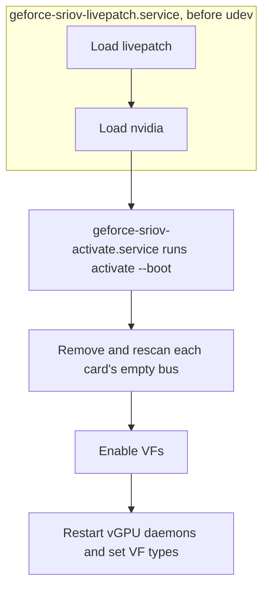
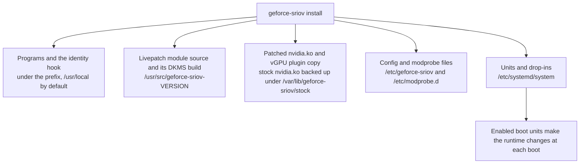
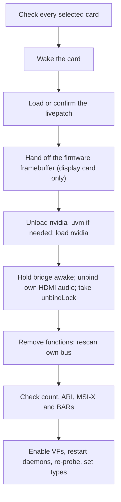
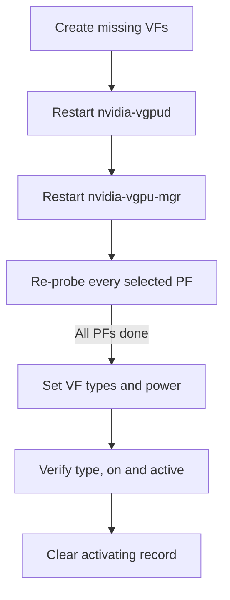
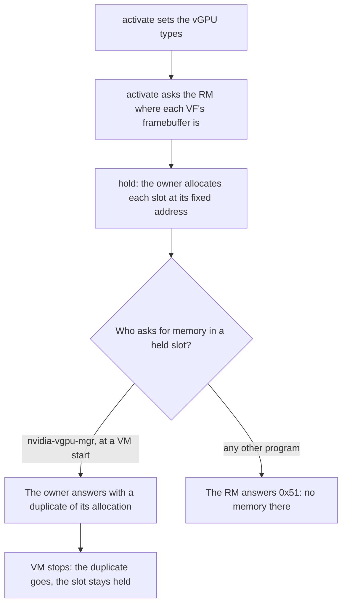
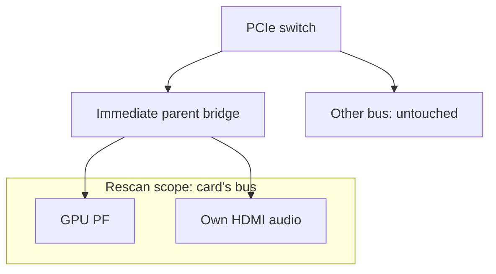
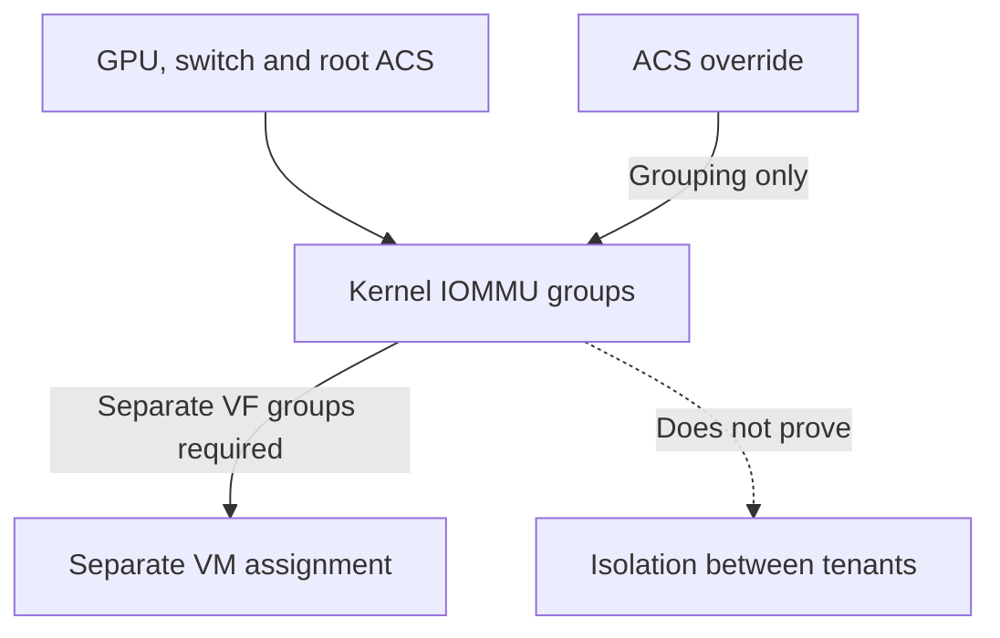
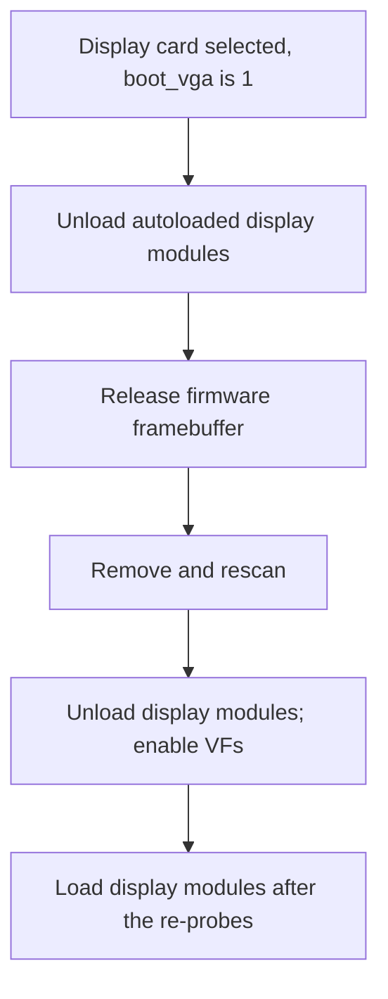
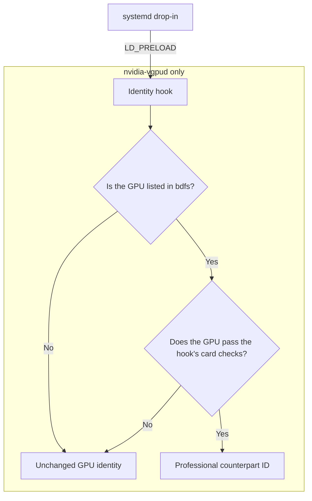

# Technical reference

This page describes how geforce-sriov works at the PCI, kernel and driver level, and what it changes on the host.
It assumes you are comfortable with PCI configuration space, sysfs and kernel modules.
Procedures are in [Installation](installation.md) and [Configuration and commands](configuration.md), the latter also being the home of the [command list and exit codes](configuration.md#commands) and the [config file keys and parsing rules](configuration.md#configuration-file).
The [Glossary](glossary.md) defines project terms.

Ampere and Ada are supported ([Ampere](ampere.md), [Ada](ada.md)).
Blackwell GPUs are **not** expected to work with the current implementation; references to Blackwell in these docs are for experiments only.

## How it works

Ampere and Ada boards keep an SR-IOV capability in PCI config space that NVIDIA hides from the PCI core, and NVIDIA's vGPU software lists no GeForce device ID.
geforce-sriov makes the capability visible to the kernel with a livepatch, creates the VFs through NVIDIA's `sriov-manage`, and presents each selected PF to `nvidia-vgpud` under the device ID of its professional counterpart.
The README's [How it works](../README.md#how-it-works) gives the short version, and [Capability positions per generation](devices.md#capability-positions-per-generation) lists the config-space offsets and explains the default of 4 VFs.

The full sequence has five steps:

1. Reveal the capability.
   The `geforce_sriov` module, a livepatch built by DKMS for each kernel, replaces `pci_find_ext_capability`, `pci_read_config_word` and `pci_write_config_word` for the PFs in `bdfs`.
   It exposes the hidden SR-IOV capability (config offset `0xBCC`) and reports 4 VFs by default ([configurable](configuration.md#configuration-file)).
   It also presents the hidden [ARI](glossary.md) capability (`0xC14`), enables ARI Forwarding on the upstream port, and clears the MSI-X hide bit (config `0x41C`, bit 29) ([The kernel module](#the-kernel-module)).
2. Make the kernel look again.
   The PF is enumerated at boot before the livepatch is loaded, so the PCI core never saw its hidden SR-IOV state.
   After the livepatch and `nvidia` are loaded, `geforce-sriov activate` removes the PF and asks the bridge above it to rescan only that PF's bus, which runs the SR-IOV setup again with the patch in place.
   The bridge is held awake and the PF's HDMI audio function is unbound first.
   The livepatch unit loads `geforce_sriov` and `nvidia` before udev starts ([Activation sequence](#what-activate-does-to-a-card)).
3. Create the VFs.
   `activate` runs NVIDIA's `sriov-manage` for each selected PF that has no VFs and checks that every VF came up bound to `nvidia`.
4. Present the card to the vGPU daemon.
   `nvidia-vgpud` offers vGPU types only for devices listed in NVIDIA's `vgpuConfig.xml`, which has no GeForce IDs. NVIDIA also calls a vGPU type a profile; each has a fixed [framebuffer](glossary.md) size, and the number in a name such as RTXA6000-4Q is that size in GB.
   The identity hook, preloaded only into `nvidia-vgpud` by a systemd drop-in, changes the device ID in the driver's reply to that of the professional card of the PF's generation (an RTX A6000 for Ampere, an RTX 6000 Ada for Ada).
   It leaves the XML file, the vGPU manager and licensing alone.
5. Patch the host driver copy.
   On 580.159.01, guest CUDA work can stall because a PMU-service callback in NVIDIA's closed object disables the GPU's runlist scheduler.
   `install` applies the scheduler, probe gate and VF count byte patches to a copy of your own `nv-kernel.o_binary`, and the two plugin changes to a copy of your own vGPU plugin.
   It rebuilds NVIDIA's module and checks the result against the recorded build ([driver-patch.md](driver-patch.md#what-install-does)).
   For a build without display modules, the `.text` of the rebuilt `nvidia.ko` has to differ from that of the stock `nvidia.ko` at exactly the expected offsets, which are the eight recorded ones for 580.159.01.
   Run `geforce-sriov rebuild` after every kernel update ([Kept inputs and `rebuild`](#kept-inputs-and-rebuild)).
   No NVIDIA file is distributed here ([driver-patch.md](driver-patch.md)).

On the automatic path, the livepatch and `nvidia` are loaded first, and `activate` then prepares each card and creates its VFs:



## Changes and reversibility

This section lists what the package changes, where each change lives and what ends it.
The [README](../README.md#safety-and-reversibility) has the short version.

geforce-sriov is software only.
It needs no hardware change, and it does **not** flash the ROM (the vBIOS), the card's firmware or anything else persistent on the card.
The `geforce_sriov` module changes two runtime register settings: the MSI-X hide bit of the GPU and the ARI Forwarding Enable bit of the PCIe port above it.
Both are held only while the host runs, and neither is written to firmware.
A cold boot with both boot units disabled shows that neither setting survives a power cycle.
On an RTX 4070 SUPER and an RTX 3080, config `0x41C` read `0x20b60500` (bit 29 set, MSI-X hidden) and the root ports' Device Control 2 read `0x0000` (ARI Forwarding off).
NVIDIA's `nvidia` module was loaded by hand during that readback, so it does not clear the bit on its own.
With the units enabled, the same registers read `0x00b60500` and `0x0020`.

### Runtime changes

These changes exist only in the running system.
The boot units that `install` enables make them again at each boot, and nothing makes them without those units or a manual `activate`.

| Change | Made by | What it is |
|---|---|---|
| MSI-X setting on the GPU | The `geforce_sriov` module, at load, with `msix=on` | Clears bit 29 of the GPU's configuration register at offset `0x41C`, the bit NVIDIA uses to unlink MSI-X from the capability chain. `geforce_sriov` reads it back and puts it back if a later check of the load fails. It does not set it again when it is unloaded |
| ARI forwarding on the PCIe port | The PCI core, or `geforce_sriov` when the kernel does not find the hidden capability on its own | Sets the ARI Forwarding Enable bit in the port's Device Control 2 register, only when the port reports that it supports it. `geforce_sriov` has no code that clears it |
| The livepatch | `geforce-sriov-livepatch.service`, or `activate` | Replaces three kernel functions in the running kernel (`pci_find_ext_capability`, `pci_read_config_word` and `pci_write_config_word`), and acts only on the cards in `bdfs` |
| Removal and rescan of a card's empty bus | `activate` | Lets the kernel read the card again with the livepatch in place |
| VFs and vGPU types | `activate`, through NVIDIA's `sriov-manage` and sysfs | Creates the VFs and sets each VF's type |
| Power settings | `activate` | Sets `power/control` to `on` for the card, its bridge and its VFs. On a laptop GPU it also writes `0` to `d3cold_allowed`. When `activate` stops before the removal, it gives these back |
| Module block and run files | `activate` | `/run/modprobe.d/zz-geforce-sriov-enable.conf` and `/run/geforce-sriov/`, both on a memory-backed directory |
| The boot display framebuffer | `activate`, on the boot display GPU only | Hands the firmware framebuffer (the video memory the BIOS/UEFI set up for the boot screen) to NVIDIA's display modules ([The boot display GPU](#the-boot-display-gpu)) |

One runtime change leaves a file on disk on purpose.
The activation lock, `/var/lib/geforce-sriov/prepare-attempt`, marks an activation that is incomplete or in an uncertain state.
A full activation writes it before its first structural change and removes it when the run finishes.
A rerun on a host that is already active changes nothing when everything is ready.
Otherwise it only finishes what is missing (types, VF power, a display or CUDA module) without restarting the daemons or re-probing a GPU, and it writes the activation lock only if an operation becomes uncertain.
The activation lock stays after an interrupted activation, and after `uninstall`, until you clear it ([The activation lock](recovery.md#the-activation-lock)).

### Files on disk



| Files | Where | `uninstall` |
|---|---|---|
| `geforce-sriov`, `geforce-sriov-patch`, `geforce-sriov-driver`, the `gs-driver-*.sh` helpers, the `driver-patches/` directory | `<prefix>/bin/` | Removes them |
| The identity hook `libgeforce_sriov.so` and `config.example` | `<prefix>/lib/geforce-sriov/`, `<prefix>/share/geforce-sriov/` | Removes them |
| The `geforce_sriov` source and the DKMS registration | `/usr/src/geforce-sriov-<version>/` | Runs `dkms remove` and removes the files |
| The patched `nvidia.ko`, with the display and `nvidia-uvm` modules when built | Where NVIDIA's own module lives, usually `/lib/modules/<release>/updates/dkms/` | Puts NVIDIA's module back from the backup, and removes added modules, while they still match the build record |
| NVIDIA's CUDA libraries for host CUDA, their links and `geforce-sriov-cuda.conf` | `<prefix>/lib/geforce-sriov/cuda/`, `/etc/ld.so.conf.d/geforce-sriov-cuda.conf` | Removes each file and link while it is unchanged, then runs `ldconfig` |
| The backup of NVIDIA's module and the build records | `/var/lib/geforce-sriov/stock/<release>/`, `/var/lib/geforce-sriov/driver-build`, `/var/lib/geforce-sriov/driver-builds/<kernel>` | Removes them after a successful restore |
| The kept build inputs | `/var/lib/geforce-sriov/inputs/` | Removes them once NVIDIA's files are back ([Kept inputs and `rebuild`](#kept-inputs-and-rebuild)) |
| The patched plugin copy `libnvidia-vgpu.so.<version>.geforce-sriov` and the `libnvidia-vgpu.so` link | NVIDIA's library directory | Points the link back at NVIDIA's own plugin and removes the copy while it is the one `install` made |
| `/etc/geforce-sriov/config` | `/etc/geforce-sriov/` | Removes it while unchanged |
| `geforce-sriov-nvidia.conf`, `geforce-sriov-autoload.conf`, `geforce-sriov-uvm.conf` | `/etc/modprobe.d/` | Removes the ones `install` wrote while unchanged ([Modprobe files](#modprobe-files)) |
| The two boot units, the `nvidia-vgpud` drop-in and the guest-autostart drop-ins | `/etc/systemd/system/` | Disables the units and removes the files while unchanged |
| The install manifest and the driver log | `/var/lib/geforce-sriov/` | Removes them, and the directory when nothing else is in it |

`install` records each file it writes with its SHA-256 in `/var/lib/geforce-sriov/installed-files`.
`uninstall` removes a file only while it still matches that record, and a directory only when it is empty.
It keeps a changed file and says so, and it **never** touches a file the manifest does not list.

Restoring NVIDIA's module is stricter.
`geforce-sriov-driver --restore` puts the stock `nvidia.ko` back **only** while the installed `nvidia.ko` is still the one `install` wrote, and **only** from a backup whose SHA-256 matches the one in the build record.
If either check fails it keeps the installed `nvidia.ko` and the backup, `uninstall` exits 1, and the message names the manual commands.
Without `--kernel`, `--restore` (which `uninstall` runs) restores every kernel that has a build record, one after the other. A backup that was not put back stays, with a printed command for it ([Uninstall](installation.md#uninstall)).

Two things stay by design: the `--driver-file` extraction in `/var/lib/geforce-sriov/nvidia/<version>/` stays until you delete it (`uninstall` names the directory and prints the `rm -r` command), and the driver NVIDIA's installer put on the host stays until you remove it with NVIDIA's `nvidia-uninstall`.

If you disable the boot units but leave the files, no NVIDIA driver loads at boot, because `geforce-sriov-autoload.conf` still keeps udev from loading it.
Run `modprobe nvidia` by hand, or run `uninstall`, which removes that file.

<a name="what-activate-does-to-a-card"></a>

## Activation sequence

`geforce-sriov activate` takes each selected card from the state in which the kernel found it at boot to VFs that are ready for a VM.
The kernel read the card's PCI configuration before the livepatch was loaded, so the physical function (PF) does not show SR-IOV yet.
`activate` therefore removes the card and rescans its bus so that the kernel reads it again, and then enables the VFs.
Patching and installing NVIDIA's module ([driver-patch.md](driver-patch.md), and for Ada the [NVIDIA host driver setup on Ada](ada.md#nvidia-host-driver-setup)) and installing the livepatch module ([Install details](#install-details)) happen beforehand and are not part of `activate`.

The livepatch unit, `geforce-sriov-livepatch.service`, runs `geforce-sriov livepatch --boot --load-driver` before `systemd-udevd`.
It loads `geforce_sriov` and, once the livepatch is active, `nvidia`.
`geforce-sriov-activate.service` then runs `activate --boot`.
A card that already shows SR-IOV with its VF BARs assigned, as on a second run, skips the removal and rescan.

Before it changes anything, `activate` checks every selected card and refuses the whole run (exit 3) if one fails.
It also:

- writes the activation lock, `/var/lib/geforce-sriov/prepare-attempt`, before its first structural change (a full activation; see [Changes and reversibility](#changes-and-reversibility) for the rerun case).
  The activation lock is a file that records an unfinished or uncertain run, and it blocks the next activation until you clear it ([The activation lock](recovery.md#the-activation-lock)).
  The file keeps the name it had in earlier releases;
- writes `/run/geforce-sriov/activating` until the run succeeds;
- blocks signals during the remove and rescan;
- undoes the power changes it made when it stops before a removal.

A removal done by hand has **none** of that protection.
The steps for each selected card are:



1. Check that the card is free.
   `activate` stops before changing a card that needs the removal and rescan, unless all of these hold:
   - It is function `.0`, an NVIDIA display controller listed in `geforce-sriov devices`.
   - No driver other than `nvidia` is bound to it.
     The only other bound function in its slot, if any, is its own HDMI audio on `snd_hda_intel`.
   - No VFs exist on its bus and no other device shares the bus.
   - Its parent is a PCI bridge with a `pci_bus/<bus>/rescan` file.
   - BAR0 is assigned.

   A selected card that is the boot display is accepted ([The boot display GPU](#the-boot-display-gpu)).
   If a card has a laptop row in the device table, `activate` refuses the whole run before writing anything unless the config records D3cold consent as `d3cold=off` ([Consent](laptops.md#consent)).
2. Wake the card.
   D3cold is the deepest PCI power state, in which a device is fully powered off and cannot answer.
   `activate` wakes a card that has a laptop row or whose `power/runtime_status` reads `suspended`, so that it stays out of D3cold during the run.
   It sets `power/control` to `on` on the card and on the bridge above it and, on laptop rows only, writes `0` to the card's `d3cold_allowed`.
   It then waits up to 5 seconds for the card to leave the suspended state.
   If it does not, `activate` restores the power settings it changed and stops before any removal.
3. Load or confirm the livepatch.
   If `geforce_sriov` is not loaded, `activate` loads it with `bdfs` and the config's switches passed as `0`/`1` (and `vfs=N` when the config sets a VF count).
   `geforce_sriov` cannot see `pci=noari`, so `activate` passes `ari=0` when the kernel command line has it.
   It waits up to 10 seconds for the livepatch to be active (`/sys/kernel/livepatch/geforce_sriov/enabled` is 1 and `transition` is 0).
   Module parameters cannot change while `geforce_sriov` is loaded, so `geforce_sriov` loaded with other parameters refuses the run: power the machine off and on ([module parameters](configuration.md#module-parameters)).
   `activate` also refuses when `nvidia` is loaded and the livepatch is not, because the driver may already have bound the card.
4. Hand off the firmware framebuffer.
   This applies only to a card selected for display ([The boot display GPU](#the-boot-display-gpu)).
5. Prepare the modules.
   When a card needs removal and `nvidia_uvm` is loaded, `activate` unloads it first, and only when no VF exists and no CUDA program is running.
   It then loads `nvidia` if it is not loaded, and the display modules when a display card is selected.
6. Hold the bridge above the card awake.
   A bridge that runtime-suspends during the rescan loses the card, so `activate` sets its `power/control` to `on` and waits until `runtime_status` reports `active` (or `unsupported`, meaning runtime power management is off).
7. Unbind the card's own HDMI audio function from `snd_hda_intel`.
   If anything else is bound in the slot, the run stops.
   Removing an audio function that was active this boot can log a blocked DMAR fault (late audio DMA); unbinding first does not prevent it.
8. Ask NVIDIA's driver for its unbindLock.
   NVIDIA's driver waits without limit while a program holds the GPU, and that wait would block every later PCI removal on the host.
   `unbindLock` is the driver's own answer to whether the GPU is free, so `activate` removes a card bound to `nvidia` only after the lock reads back as granted.
   If it is not, `activate` gives the audio function back and removes nothing, and it names a program that holds a GPU node when it finds one.
   The run exits 3 when no card was changed before this one, and 1 when an earlier card already was.
   The boot display card is exempt, because the display modules `activate` has just loaded count as a client of the GPU.
9. Remove the card's functions and rescan only its bus.
   Every other function in the slot is removed, then the card itself, waiting up to 5 seconds for each to disappear.
   The rescan goes through the bridge above the card and covers only the card's own bus.
   The global `/sys/bus/pci/rescan` is **never** used, no other device is removed, and a bus shared with another device is refused.
   `activate` then waits up to 15 seconds for the card to return with the same vendor and device ID, and for `sriov_totalvfs` to appear.
   On a laptop row, it writes `0` to the card's `d3cold_allowed` again.
   During the rescan the kernel may log `VF BAR … can't assign` messages before it settles; only the final state counts.
   A card that does not come back follows the rule in [recovery.md](recovery.md#the-one-rule): a cold power cycle (power the machine fully off and on, not a reboot), and **no** second rescan.
10. Check what the card now offers.
    - `sriov_totalvfs` has to be between 1 and `vfs` (4 by default).
      A value outside that range means the VFs are not enabled.
    - `ari_enabled` reads 1 with `ari=1`, when the bridge supports ARI Forwarding.
    - MSI-X has to be linked when `msix=1`.
    - BAR0 has to be assigned, and at least one VF BAR has to be assigned.
      Otherwise enabling VFs fails with `not enough MMIO resources for SR-IOV` ([PCI resources](#pci-resources)).

After every selected card has been checked, `activate` enables the VFs, restarts NVIDIA's daemons, re-probes each card and sets the VF types, as described below and in [activate and the VF power gate](#activate-and-the-vf-power-gate).
When the display modules are loaded, `activate` unloads them for the VF enable and loads them again after every re-probe.
It unloads them only while no affected GPU has VFs.
On success it removes `/run/geforce-sriov/activating` and the activation lock, and starts the display manager again if it stopped it.

When a selected card has no VFs, `activate` runs NVIDIA's `sriov-manage -e` for it, with `nvidia` already bound to it.
`sriov-manage` is NVIDIA's own script and the only VF enable method NVIDIA supports.
It needs `lspci` and `setpci`.
While it runs, it:

- may stop `nvidia-xid-logd` briefly;
- moves the card through `pci-pf-stub` while it sets the VF count;
- rebinds the card to `nvidia` and binds the slot's other functions to `nvidia`;
- runs `nvidia-smi -pm 1`.

Its exit status is not reliable, so the CLI checks that every VF came up bound to `nvidia`.
The VF count is **never** written to `sriov_numvfs` directly, because `sriov-manage` also moves the card through `pci-pf-stub` and handles binding.
The count cannot exceed the presented one.

The vGPU daemons are started only after the VFs exist, in the order given in the [installation guide](installation.md#cold-boot).
On Ada and Ampere cards, `activate` restarts them ([activate and the VF power gate](#activate-and-the-vf-power-gate)).

### Undoing an activation

The package never disables VFs, so the simplest complete undo is to power the machine off and on.
A boot without `geforce_sriov` is an ordinary boot.
A boot with `geforce_sriov.skip` on the kernel command line has no NVIDIA driver: neither unit runs, and the package's [autoload file](#modprobe-files) keeps udev from loading `nvidia` (see the units table in [Configuration and commands](configuration.md#systemd-units)).
`uninstall --unload` disables the livepatch, waits for the transition and runs `rmmod`; it refuses while a listed card has VFs, while the `bdfs` parameter of `geforce_sriov` cannot be read, or after an interrupted activation.
A card that was rescanned keeps using the revealed capability until it is removed and rescanned again, so in practice, power the machine off and on ([recovery.md](recovery.md)).

## Components

| Path | What it is | License |
|---|---|---|
| `geforce-sriov` (`src/`) | CLI: inspection, install, early livepatch load, card activation and VF bring-up, uninstall | MIT |
| `kernel/geforce_sriov.c` | Livepatch module (DKMS `geforce-sriov/<version>`) | GPL-2.0-only OR MIT |
| `hook/libgeforce_sriov.so` | `LD_PRELOAD` identity hook for `nvidia-vgpud` only | MIT |
| `driver/geforce-sriov-patch` | Patcher for the user's own `nv-kernel.o_binary` | MIT |
| `systemd/` | `geforce-sriov-livepatch.service`, `geforce-sriov-activate.service`, an `nvidia-vgpud` drop-in and guest-autostart drop-ins | MIT |

## The kernel module

The kernel module `geforce_sriov` is a livepatch that replaces three exported kernel functions, so that the PCI core sees the SR-IOV capability Ampere and Ada boards keep in config space outside the extended capability chain.
It acts only on the PFs in its required `bdfs` parameter, which it validates against the device table; for every other device the replacements return what the kernel's own functions return.
The CLI sets the switches from the config's `on`/`off` values (as `0`/`1`) and passes `vfs=N` when the config sets a count.

### `pci_find_ext_capability()`

- Returns the hidden SR-IOV capability (config offset `0xBCC`) when the chain has none and that offset holds a version 1 SR-IOV header.
- With `ari=1` (default), returns the hidden ARI capability (`0xC14`) for an ARI lookup, only if its Next Function Number is non-zero.
  The SR-IOV lookup made by `pci_iov_init()` also sets ARI Forwarding Enable in Device Control 2 of the GPU's immediate upstream port, when the port's Device Capabilities 2 reports ARI support.
  This covers kernels whose `pci_configure_ari()` inlines its ARI lookup and never reaches the replaced function.
  - ARI decoding in the GPU hardware does **not** work, which is why `vfs` defaults to 4 with or without ARI.
  - ARI Forwarding stays off when the kernel scans every slot below a port (`pci=pcie_scan_all` or a platform quirk), because the card's 3-bit function decode would answer device numbers of 1 and above as alias devices.

### `pci_read_config_word()`

- `sriov_init()` and `sriov_enable()` read TotalVFs and InitialVFs through it.
  For a validated PF these reads return `vfs` (1 to 16, default 4), never more than the hardware TotalVFs.
  On an Ada card that reports 1, the ceiling is 4, from the VF-count patch of the patched `nvidia.ko`.
  The reported value also sizes the VF BAR reservation in the bridge windows ([PCI resources](#pci-resources)).
  User-space reads (`lspci`, `setpci`, sysfs `config`) take another path and still show the hardware values.
  NVIDIA's driver does not use these 16-bit reads; on Ada it reads through a BAR0 mirror that no config accessor sees, and NVIDIA's patched driver uses at most 4 VFs per card.
- During `sriov_init()` only, it guards where the VFs land.
  `compute_max_vf_buses()` writes NumVFs from TotalVFs down to 1 and reads First VF Offset and VF Stride after each write.
  For a listed PF those two reads return 0, which makes the kernel drop the PF's SR-IOV state, when NumVFs does not read back the value the kernel wrote or when that many VFs would not all fall on free functions 1 to 7 of the PF's own slot.
  A bad layout at any count from `vfs` down to 1 therefore leaves that card with no SR-IOV (kernel log: `VF layout for … requested VFs`).
  After the device is registered the reads return hardware values and a bad layout is only logged.
  A passing check does **not** prove the card provides that many working VFs.

### `pci_write_config_word()`

- Writes exactly what it is given, for every device and register.
  For a listed PF that is not yet registered, it also records the NumVFs value the kernel writes, so the layout guard checks the count the kernel asked for rather than what the register reads back.

### MSI-X (`msix=1`, default)

- At load, for each listed PF whose MSI-X is not linked, `geforce_sriov` validates the MSI-X capability at its table offset and clears config `0x41C` bit 29, the bit NVIDIA uses to unlink MSI-X from the capability chain.
  It reads the bit back and checks that the chain now links MSI-X; any other failed check restores the bit and refuses the load.
  It does not touch `struct pci_dev`: the PCI core finds MSI-X on its own when the CLI removes and rescans the PF.
  A natively linked MSI-X is left alone.
- The bit is volatile: any PF reset (function-level reset, secondary-bus reset, AER recovery) hides MSI-X again and stops PF interrupts until the next cold boot.
  Use `msix=off` if you need PF resets.

### Load-time validation

Before patching anything, `geforce_sriov` validates every listed card and refuses to load, with nothing patched, when:

- a listed address is missing or not a table card;
- the SR-IOV header does not match, or the hardware TotalVFs is 0;
- the VF layout check fails at load (kernel log: `first VF offset … ; refusing`).

`geforce_sriov` **never** removes, rescans, resets or binds a device, and it has no device table that could autoload it.
`activate` removes and rescans the card once the livepatch is active, holding the upstream bridge awake because a bridge that runtime-suspends during the rescan loses the card.
The step-by-step sequence is in [Activation sequence](#what-activate-does-to-a-card).

## Requirements in detail

The user-facing prerequisites are in [Before you start](installation.md#before-you-start).
This is the exact set the tools check:

- x86_64 Linux 6.8 or later with `CONFIG_LIVEPATCH`, `CONFIG_PCI_IOV` and `pci_dev_is_disconnected()`
  exported in `<linux/pci.h>` (6.9, or a stable backport).
  - Clang LTO (`CONFIG_LTO_CLANG`, full or thin) is refused at build time, because the kernel's SR-IOV
    code may then use inlined copies of the config accessors the livepatch replaces.
  - Also needed: kernel headers for the running kernel release, `dkms`, `systemd`, `pciutils`, a C
    compiler and `make`. A live `install` refuses and names whichever of them is missing, and `activate` refuses to create VFs without `lspci` and `setpci`.
- IOMMU enabled (for example `intel_iommu=on iommu=pt`).
- NVIDIA vGPU-KVM host driver, proprietary flavour, supporting every selected card: installed by you,
  or from NVIDIA's `.run` package with `install --driver-file PATH --accept-nvidia-license`.
  - Host driver 580.159.01 (vGPU software 19.5) and the guest drivers in the [software stack](installation.md#supported-software-stack) are the recommended, tested versions.
    Other host and guest driver versions are not guaranteed to work.
    `setup` can try another host version on a best-effort basis after asking (the default answer is no), `--allow-unsupported-driver` answers yes, and `install` names the version.
    On the manual path (`--driver=skip`), `doctor`, `check` and `activate` warn about another host version and continue.
  - The hook acts only on the builds whose layout it knows ([hook/README.md](../hook/README.md)) and
    passes other builds through unchanged.
  - `nvidia-vgpud.service` and `nvidia-vgpu-mgr.service` need to exist; `doctor` warns when either is
    missing.
  - Ada needs `nvidia.ko` with the three host-object byte patches and GSP off
    ([NVIDIA host driver setup on Ada](ada.md#nvidia-host-driver-setup); [NVIDIA driver flavour](devices.md#nvidia-driver-flavour)).
- Every card you will use is selected in `bdfs`. Loading `nvidia` binds every NVIDIA card on the host,
  and the package cannot restrict that.
- Each selected GPU:
  - is function 0 with a PCI bridge directly above it;
  - shares its bus with no other device;
  - does not already present SR-IOV (another livepatch or a patched kernel);
  - is bound to no driver other than `nvidia` when `activate` removes it.
- The boot display GPU may be selected ([Boot display card](installation.md#boot-display-card)).
- `nvidia` **must not** load from `modules-load.d`, `/etc/modules` or the initramfs, since it may bind the
  card before the livepatch is loaded. `doctor` warns when it finds it there (built initramfs images are
  not inspected), and `activate` then refuses until you power the machine off and on without it.
- Enough bridge window space for BAR0 and the VF BARs ([PCI resources](#pci-resources)).
- `/var/lib` and the install prefix on the root filesystem or on a volume the initramfs activates. The
  livepatch unit runs before `systemd-udevd`, so a filesystem that needs udev would make it wait forever.

### Recommended stack in detail

The [software stack table](installation.md#supported-software-stack) lists the recommended versions.
For the recommended host driver, `install` produces and expects these:

| Part | Detail |
|---|---|
| Host driver | NVIDIA vGPU software 19.5, host driver 580.159.01, vGPU-KVM proprietary build, in CPU-side mode with `NVreg_EnableGpuFirmware=0` ([GSP](glossary.md) not used) |
| vGPU plugin | The patched plugin copy `install` makes from the 580.159.01 stock plugin: two changes, SHA-256 `aa4fdeb5…` |
| Host module | NVIDIA's module `nvidia.ko` built from the 580.159.01 object with the three byte patches ([Byte patches](driver-patch.md#byte-patches)) |

`setup` and `install` set the GSP option and place the plugin copy, so none of this is a manual step unless you use `--driver=skip` ([The manual path](driver-patch.md#the-manual-path)).

## Install details

A live install copies the binaries to `--prefix` (default `/usr/local`), the hook to `$PREFIX/lib/geforce-sriov/` and the `geforce_sriov` source to `/usr/src/geforce-sriov-<version>/`, then runs `dkms add/build/install` and installs the units and drop-ins ([Systemd units](configuration.md#systemd-units)).
If DKMS has other `geforce-sriov` versions, `install` builds this version as a trial before removing them from DKMS.
After installing this version, it removes each old source tree under `/usr/src` only if it installed every file in that tree.
After a successful cleanup, only this version remains registered.
For each version it leaves in place, `install` prints one warning with instructions for removing it by hand.
Every file is recorded with its SHA-256 in `/var/lib/geforce-sriov/installed-files`, and a rerun leaves identical files alone (`unchanged <path>`).

Argument and config handling:

- It refuses a `vfs` above a selected card's ceiling ([Configuration file](configuration.md#configuration-file)).
- It warns for a `vfs` above 4 and for an activation lock left by an unfinished activation.
- Without `--device`, nothing is selected and the units are not enabled.
  `setup` selects the card itself when exactly one card is eligible.
- It refuses (exit 3) an existing `/etc/geforce-sriov/config` it did not write (edit it yourself or remove it) and a `DESTDIR` with a symlink in its path.
  It stops (exit 1) rather than overwrite any other existing file it does not own.
  `--prefix` may contain only letters, digits and `/._+-`.
- Once it has written anything, a failure or a refusal exits 1, not 3.
  Exit 3 means nothing changed.

Unless `--driver=skip` is given, a live install then builds NVIDIA's module and the patched plugin copy ([Install steps](driver-patch.md#what-install-does)):

- It admits the host object and the vGPU plugin by the whole-file SHA-256 recorded for 580.159.01, the version confirmed to work ([Supported inputs](driver-patch.md#supported-inputs)).
  A file with another digest is a best-effort attempt that is not guaranteed to work: the patcher admits each byte patch by the anchors it finds in the object, and `install` refuses (exit 3, before the first write) when it cannot find a patch site, naming what it found.
  For 580.159.01 the patched object, the plugin after its first change and the patched plugin copy must match their recorded digests too.
- It also refuses before the first write when `nvidia.ko`, the kernel headers, a tool or the plugin is
  missing, or when the `.text` of `nvidia.ko` cannot be read.
- For a build without display modules, after the build it compares the `.text` of the installed stock `nvidia.ko` with that of the built `nvidia.ko` and requires the differing offsets to be exactly the expected ones.
  For the recorded 580.159.01 object these are the eight `.text`-relative offsets `0x14a7c4` to `0x14a7c7`, `0xa16708`, `0xa16709`, `0xd8966f` and `0xd89670`.
  For another host version admitted by anchors, they are the offsets the patch tool reports for that build, and the comparison is just as exact.
  Any other difference, or `.text` sections of different sizes, refuses (exit 3) and names the first unexpected offset.
- Identical `.text` means the installed `nvidia.ko` already is this build.
  When the modprobe option and the patched plugin copy are in place and this kernel's backup of the stock `nvidia.ko` differs from the build at exactly the expected offsets, `install` writes the record of the build for this kernel and exits 0.
  It replaces a record that is missing or names another kernel or another `nvidia.ko`.
  A copy from an earlier install with only the placement patch counts as in place and is replaced with the patched plugin copy.
  Otherwise it refuses (exit 3), asks you to reinstall the stock `nvidia.ko` first, and names `--driver=skip`, which keeps the installed `nvidia.ko` as it is.
- A rerun on a host already patched for this kernel changes nothing when the patched plugin copy is
  in place, and otherwise replaces the plugin copy and points `libnvidia-vgpu.so` at it.
- When the installed `nvidia.ko` is NVIDIA's open flavour (licence `Dual MIT/GPL`), `install` refuses before writing.
  Remove NVIDIA's driver, for example with `nvidia-uninstall`, install the vGPU host package again with `--kernel-module-type=proprietary`, then run `install` again.
- A failure after the first write restores what it replaced.
  `geforce-sriov-driver --dry-run` prints the planned commands, including the `.text` comparison, and builds nothing.

Only after the build succeeds (or with `--driver=skip`) does `install` write the `nvidia-vgpud` drop-in and `/etc/geforce-sriov/config` (`bdfs=`, `identity=on`, `identity_force_host=on`, `display=` and `host_cuda=`, `vfs=N` with `--vfs N`, and `d3cold=off` with `--disable-d3cold`), and enable the units for the next boot without starting them.
The units are `geforce-sriov-livepatch.service`, which loads the livepatch and `nvidia` before udev, and `geforce-sriov-activate.service`.
The `nvidia-vgpud` drop-in refuses to start the daemon until `check --daemon-ready` passes, and the guest-autostart drop-ins make VM autostart wait for activation.
A hold file for `nvidia` left by 0.2.x (`nvidia-manual-load.conf`) is removed when unchanged; a changed one is kept and `doctor` warns about it.
`install --device` without `--disable-d3cold` removes `d3cold=off` from the config and prints one line confirming the removal.

`--driver-file PATH`, `--accept-nvidia-license`, `--nvidia-source DIR` and `--disable-d3cold` are described in [Automated setup](installation.md#automated-setup).
`--display`, `--no-display`, `--host-cuda` and `--no-host-cuda` select the display and host CUDA builds.
`--companion-file PATH` or `--companion-source DIR` names the second NVIDIA driver package, and `--nvkms-source PATH` the public NVKMS source ([Boot display card](installation.md#boot-display-card), [Host CUDA](installation.md#host-cuda)).

To stage into a directory instead, with nothing changed outside it:

```sh
DESTDIR=/tmp/stage ./geforce-sriov install --prefix /usr --device 0000:01:00.0
```

Staging records `--device` addresses unchecked, checks no devices, and rejects `--config`,
`--sysfs-root` and `--driver-file` (exit 2). The steps to run on the target are
printed, starting with `doctor`.

### Host CUDA libraries

A CUDA program needs `nvidia-uvm` in the kernel and NVIDIA's CUDA library in userspace.
NVIDIA's vGPU host package has no `libcuda`; the second package has it, in its own version (580.159.03 beside the 580.159.01 host driver, which works).
With `host_cuda=on`, `install` therefore installs these files from the second package, as far as the package has them. They are the libraries NVIDIA's own installer installs for CUDA:

| Library | What it is for |
|---|---|
| `libcuda.so.<version>` | The CUDA driver library that every CUDA program loads |
| `libnvidia-ptxjitcompiler.so.<version>` | Loaded by `libcuda` when a program gives it a kernel as PTX |
| `libnvidia-nvvm.so.<version>`, `libnvidia-nvvm70.so.4` | Loaded by `libcuda` for NVVM IR and link-time optimisation |
| `libnvidia-gpucomp.so.<version>` | Loaded by `libcuda` under exactly this name |
| `libcudadebugger.so.<version>` | Loaded by `libcuda` when a CUDA debugger attaches |

- They go into `<prefix>/lib/geforce-sriov/cuda/`, each with the link the loader follows (`libcuda.so.1`, for example) and `libcuda.so`, as NVIDIA's installer makes them.
- `/etc/ld.so.conf.d/geforce-sriov-cuda.conf` names that directory, and `install` runs `ldconfig`. No environment variable is needed.
- The directory is the package's own, so a `libcuda` that another package or the user installed is never replaced. The loader searches the directories of `ld.so.conf.d` in the order of the file names, which puts this one before the distribution's; `install` and `doctor` ask `ldconfig -p` which `libcuda.so.1` programs get, and warn when it is another one.
- `libnvidia-ml`, which `nvidia-smi` uses, is **not** taken from the second package: the host package has its own, and that library checks the driver's version.
- Every file and link is in the install manifest with its digest or target. `uninstall` and `install --no-host-cuda` remove each one while it is unchanged; `rebuild` leaves them alone, because they do not depend on the kernel.
- A second package given as its `kernel` directory alone has no libraries. `install` then warns, and host CUDA programs do not start until `install` is run again with the whole package.

### Kept inputs and `rebuild`

A display or host CUDA build needs the second NVIDIA driver package and, for the display, NVIDIA's public kernel module source, and a build for another kernel needs them again.
After a successful driver step, `install` therefore keeps them in `/var/lib/geforce-sriov/inputs/`, which is owned by root and not writable by group or others:

- `companion/<name>`: the second driver package, a file or a tree as it was given.
- `nvkms/<name>`: the public source, an archive or a tree.
- `index`: `key=value` lines with `nvidia_source` and, per input, its path, kind (file or directory), SHA-256 for a file, declared version and where it came from.
- The host kernel tree is kept by path only, and only while every file in it belongs to root and is not writable by group or others. It is NVIDIA's own `/usr/src/nvidia-<version>` or the extraction `install` keeps under `/var/lib/geforce-sriov/nvidia/`.

A rerun of `install` with the inputs on a host installed before this change keeps them without building anything.

`install` without input options passes `--retained` to the driver step, so a display or host CUDA build is made from the kept inputs, and `doctor` and `setup` do not ask for an input that is kept.
`geforce-sriov rebuild [--kernel RELEASE]` runs the same driver step, `geforce-sriov-driver --retained --kernel <release>` with `--display` or `--no-display` and `--host-cuda` or `--no-host-cuda` as the config selects, from the installed copy.
`--kernel` builds for an installed kernel that is not running yet, so one power cycle is enough after a kernel update.
The driver step refuses before its first change (exit 3) when a kept input is missing, when its digest or declared version differs from what was kept, when the index does not say whether an input is a file or a directory, or when a kept host tree now has a file that another user owns or that group or others can write to. In each case the message names the `install` option that keeps the input again.
`install` run from the installed copy, which has `geforce-sriov-driver` beside it and no source tree, refuses and names `rebuild`.
DKMS is not hooked: a hook of geforce-sriov could run before NVIDIA's own module for the new kernel is built, and a failing hook would fail the installation of the kernel package.

The published record `driver-build` names one kernel.
The record of every other kernel is kept in `/var/lib/geforce-sriov/driver-builds/<kernel>` and becomes the published record again when a run is for that kernel, so a rerun for a kernel whose build is installed finds its record and builds nothing, whichever kernel was built last.
An `nvidia.ko` that the script built is never copied into `stock/<kernel>`: when the installed `nvidia.ko` is such a build and no backup of NVIDIA's own module exists, the run refuses before any change, because an uninstall would have nothing to put back.

### Journaled commit of the driver build

`geforce-sriov-driver`, the script that does the driver build, replaces several files at once: each built module, the plugin copy and its link, the modprobe file and the build record (`/var/lib/geforce-sriov/driver-build`).
A power loss or a `SIGKILL` can stop it between any two of them, so the commit is journaled and the next run can tell what happened:

1. Everything the commit needs goes under `/var/lib/geforce-sriov` first and is synced: the built modules, the patched plugin, and a copy of each file as it is before the commit (`txn/`).
   These copies belong to this commit. The stock backups under `stock/` are a different set: they hold NVIDIA's own files for `--restore`.
2. The journal `driver-build.gs-new` is written. It holds the record to publish and `journal_*` lines that name the staged files. From here on the commit is recoverable.
3. Each file is installed under a temporary `.gs-new` name, synced and renamed, so an installed file is always complete, old or new. Modules of the earlier build that this build drops are touched last, so once they are touched the commit can always be finished and never has to be undone.
4. The record is published last, and then the journal and `txn/` are removed.

A run that finds a journal first finishes that commit from the staged files. When a staged file is gone, it puts back the files as they were from the copies in `txn/`; the earlier record was never touched, so it describes that state again.
A file that is neither what the commit found nor what it built was changed by someone else since. In that case, and when a needed copy is missing, the run changes nothing, keeps the journal and stops ([Symptoms](recovery.md#symptoms) has the message and the two ways out).
With `--dry-run`, the script only reports that an interrupted install exists.

### Modprobe files

`install` writes these files in `/etc/modprobe.d/`, and `uninstall` removes each one while it is unchanged:

| File | Written when | What it does |
|---|---|---|
| `geforce-sriov-nvidia.conf` | `install` builds NVIDIA's module (not with `--driver=skip`) and no other file already sets the option to `0` | Turns GSP firmware off for `nvidia`, which `activate` requires |
| `geforce-sriov-autoload.conf` | A GPU is selected | Maps the PCI class aliases of NVIDIA display devices to `off`, so that udev does not load `nvidia` or `nvidia_drm` for them. The livepatch unit loads `nvidia`, and `activate` loads `nvidia_drm` |
| `geforce-sriov-uvm.conf` | `host_cuda` is `on` | Sets `uvm_disable_hmm=1` for `nvidia_uvm`, so that any autoload of `nvidia_uvm` gets the option |

The autoload file is written exactly when a GPU is selected, which is when `install` enables the two boot units.
`install` without a selection removes an unchanged copy left by an earlier install, because nothing would then load NVIDIA's driver at boot.
The autoload file covers every NVIDIA GPU on the host, selected or not.
If the livepatch unit does not run, for example on a boot with `geforce_sriov.skip` or with the units disabled, no NVIDIA driver loads for any NVIDIA GPU; run `modprobe nvidia` by hand when the driver is needed.
During the VF enable window `activate` also writes `/run/modprobe.d/zz-geforce-sriov-enable.conf`, to keep `nvidia_drm` and `nvidia_uvm` from autoloading.
It is left as a comment-only file afterwards and is gone after a reboot.

## doctor and status

`doctor` checks the host, and `status` shows the state of each selected card and names its next step.
`BDF` in the [command list](configuration.md#commands) is a physical function `dddd:bb:ss.0` as named in `/sys/bus/pci/devices`.
The domain has 4 to 8 lowercase hex digits (more than 4 only without leading zeros, at most `7fffffff`).
`--sysfs-root` points `doctor` and `status` at a copy of a sysfs tree; commands that change the system reject it.

`doctor` prints one line per check, marked `OK`, `INFO`, `WARN` or `FAIL`.
`FAIL` means the host cannot be brought up as configured, and `doctor` then exits 3.
`WARN` means a degraded setup or that a later step will refuse, for example:

- a missing `lspci`;
- an unassigned BAR;
- a shared IOMMU group;
- a selection that mixes Ada with another generation;
- a host driver version other than 580.159.01, which is not guaranteed to work.

### Assessing a planned install

For a `--device` the config does not select, `doctor` shows what the hook will do with the settings `install --device` writes.
With `--nvidia-source DIR`, `--driver-file PATH` or `--disable-d3cold`, it assesses the host as `install` will leave it.
`--display`, `--no-display`, `--host-cuda`, `--no-host-cuda`, `--companion-file`, `--companion-source` and `--nvkms-source` do the same for the display and host CUDA builds, and a build that lacks the second NVIDIA driver package or the NVKMS source it needs fails.
`--disable-d3cold` needs at least one laptop GPU among those assessed; otherwise, `doctor` exits 2.
A laptop GPU without D3cold consent fails; recorded consent or consent planned with `--disable-d3cold` is reported as information.
`--config FILE` points `doctor` and `status` at another config file.
Host checks (tools, activation lock, boot unit, module autoload) are skipped with `--sysfs-root`.
Without a config file, the config line says the selected devices come from `--device` when one is given, and otherwise that defaults apply and no device is selected.

### Loaded `nvidia` module versus installed `nvidia.ko`

`doctor` compares the build-id of the installed `nvidia.ko` with the record `install` made of its own build (`/var/lib/geforce-sriov/driver-build`).
With no record and no install manifest (`/var/lib/geforce-sriov/installed-files`), it prints `[INFO] NVIDIA's module has not been built on this host yet; install builds it`.
The build-id identifies the contents of `nvidia.ko`, so a loaded `nvidia` module whose build-id differs from the installed one is another build, for example after a reinstall without a power cycle.
When the installed `nvidia.ko` is the build `install` made and NVIDIA's driver is loaded, `doctor` reads the loaded module's build-id from `/sys/module/nvidia/notes/.note.gnu.build-id`.
If it is not the installed one, it warns `the running nvidia module (build-id <12 hex digits>) is not the installed one (<12 hex digits>); power the machine off and on to load it`.
When the installed `nvidia.ko` is not that build, nothing is said about the loaded module.

`status` adds the same sentence to the line of each Ada or Ampere card, and its first next step is then `next: power the machine off and on (the running nvidia module is not the installed one)`, without the next steps that lead to `activate`.
`status` then exits 1.
`check` adds the sentence to its `nvidia.ko` line without changing its exit status, and `activate` prints it as `geforce-sriov: warning: …` and goes on.
When `check` is not ready, `setup` runs `doctor` and `install`, then stops before `activate` and asks you to power the machine off and on, then run `setup` again.
It exits 0, because the install itself completed.

### Overrides and holds

`doctor` also looks for a hold of `nvidia` in `/etc/modprobe.d/` (a `blacklist nvidia` line and an `install nvidia /bin/false` line).
It warns that the livepatch unit cannot load the driver while the hold exists, and names the file, or the two lines to remove when they are in other files.

`doctor` also reads the drop-ins of `nvidia-vgpud` and `nvidia-vgpu-mgr` in systemd's unit directories.
Each `.conf` file other than the package's own `geforce-sriov.conf` that sets `LD_PRELOAD` in an `Environment=` line gets `[WARN] <file> sets LD_PRELOAD for <unit> and overrides the geforce-sriov identity hook. Remove it or point it at <hook path>.`, where the hook path is the one `geforce-sriov.conf` preloads.
systemd reads a unit's drop-ins in file name order and the last `LD_PRELOAD` wins.
In `nvidia-vgpud.service.d`, a file read before `geforce-sriov.conf` is not named, and neither is a file whose `LD_PRELOAD` list (colons or blanks) still holds the hook.

### The activating marker in doctor and status

`activate` keeps `/run/geforce-sriov/activating` from its first change until it succeeds.
While that file exists, `doctor` warns `/run/geforce-sriov/activating exists: geforce-sriov activate is running or did not finish; check reports NOT READY until activate succeeds`.
`status` prints `activate: /run/geforce-sriov/activating exists (activate is running or did not finish)` with the next step, to stop every VM that uses a vGPU and run `activate` (left out when the running `nvidia` module is not the installed one), and exits 1.

`status` exits 0 only when all of these hold:

- every VF of every selected GPU is ready, as `check` judges it, and no BAR is known to be unassigned;
- `/run/geforce-sriov/activating` does not exist and the activation lock is clear;
- the running `nvidia` module is not seen to be a different build from the installed build, and the installed build is the one `display` and `host_cuda` ask for.

It prints `BAR assignment: not confirmed` when the `resource` file cannot be read completely, so exit 0 does **not** prove the BARs are assigned.

## activate and the VF power gate

`activate` takes each selected card from boot to VFs that are ready for a VM.
It takes the following steps for each card:

- creates the VFs;
- restarts NVIDIA's vGPU daemons;
- sets each VF's vGPU type;
- keeps each VF powered on (`power/control=on`, `runtime_status=active`), which is the VF power gate.

See [Ada bring-up differences](ada.md#bring-up-differences), [The VF power gate](ada.md#the-vf-power-gate) and [Commands](configuration.md#commands) for details.

### Preconditions

`activate` refuses (exit 3, nothing changed) unless:

- NVIDIA's driver is loaded with `EnableGpuFirmware: 0`, and
  `libnvidia-vgpu.so` resolves to the patched plugin copy (SHA-256 `aa4fdeb5…`; the earlier Ada-only
  copy is refused, and so is an earlier copy with only the placement patch, `7ddfad45…`, with a
  message to run `install` again);
- every VF of the selected cards is on `nvidia`, and no selected PF has a `driver_override` other than
  empty or `nvidia`;
- the installed `nvidia.ko` is the build `install` recorded in `/var/lib/geforce-sriov/driver-build`
  for the running kernel (with no record at all it only warns);
- `--type`, if given, is not used on a mixed Ada and Ampere selection (it sets one type on every card,
  and 942 is not creatable on the Ampere professional counterpart nor 525 on the Ada one; omit it and set
  `type_ada` and `type_ampere` in the config, or select one generation in `bdfs`, whose
  other-generation cards then run without VFs);
- every card in scope is in the device table, and no NVIDIA VF on the host has a vGPU type;
- no GPU outside `bdfs` has VFs enabled, because the daemon restart is host-wide.

On 580.159.01 the GSP-off and plugin checks above refuse.
Another host driver version is not guaranteed to work ([Supported software stack](installation.md#supported-software-stack)); on one, `activate` warns about the version, those two checks only warn, and the run continues.
On such a host nothing stops a GSP or plugin mismatch before a guest starts, so the mismatch surfaces at guest start.
The stack of each generation is in [Ampere](ampere.md#nvidia-host-driver-setup) and [Ada](ada.md#nvidia-host-driver-setup).

### Daemon restart, re-probe and types

`activate` then restarts `nvidia-vgpud` and `nvidia-vgpu-mgr`, re-probes each selected PF (the re-probe unbinds and rebinds the driver and never removes or rescans), and sets the type and `power/control=on` on every VF, gated on the readback `on`/`active`.
In a full activation it has written the activation lock and `/run/geforce-sriov/activating` before its first structural change, and the steps up to the VF enable are in [Activation sequence](#what-activate-does-to-a-card).
The type of a card is `N` with `--type`, else `type_ada` or `type_ampere` from the config, else 942 on Ada and 525 on Ampere.
Only after all of that is `activating` removed.

The VF steps run after every card's re-probe, because re-probing one card's PF resets the other cards' VFs to `power/control=auto`.
After any re-probe, stop the VMs and run `activate` again; this covers the whole host.
`--dry-run` checks and prints the steps.

The daemon restart is host-wide, and every selected PF must finish its re-probe before any VF type or power setting is written:



### Ada framebuffer slots

After that, `activate` checks how each Ada card's VFs fit in its memory.
VF k (0 for the first, in VF order) has the fixed framebuffer slot `[k × (P - 32), (k + 1) × (P - 32))` MiB, where P is the `profileSize` of the card's type in `/usr/share/nvidia/vgpu/vgpuConfig.xml`.
A VF whose slot ends near the top of the card's memory can be refused when its VM starts, even alone on an empty card, while the type write succeeds.

For each Ada card with a VF whose slot ends above 75% of `memory.total` (from `nvidia-smi --query-gpu=pci.bus_id,memory.total --format=csv,noheader,nounits`), `activate` prints one line that names those VFs.
75% is a threshold for the hint, not an exact limit.
The line does not change the exit status.
A missing or unreadable XML file gives no line, and neither does an `nvidia-smi` that is missing, fails or runs longer than 5 s (it is then killed).
Ampere cards have no such slot limit and get no line ([Choosing a vGPU type](configuration.md#choosing-a-vgpu-type)).

<a name="the-framebuffer-slot-owner"></a>

### The framebuffer slot owner

On Ada, the plugin asks NVIDIA's driver (the RM) for each guest's framebuffer at a fixed address, the VF's slot.
The RM's heap treats the slot of a stopped VM as free, so a host allocation could land there, and the next start of that VM failed with `NVOS status 0x51` and `Failed to alloc guest FB memory`.
Ampere takes another path and has no fixed slots.

The owner is a small piece of open-layer code, `gs-fb-owner.c`, that `install` builds into `nvidia.ko`.
It keeps each slot allocated under a kernel client of its own, and gives the plugin a duplicate of that allocation when a VM starts:



- **The hook.** One call before and one after `rm_ioctl()` in the open layer's `nvidia_ioctl()`, plus calls at module init and exit, at the close of a control file and in `nv_pci_remove()`. NVIDIA's closed object is not changed by it.
- **Holding.** `activate` asks the RM for the placement of each VF's framebuffer (the control the plugin itself uses), checks that the answers are whole, aligned, inside the card and do not overlap, and writes one `hold` per slot. This happens after the types are set and before `nvidia_uvm` is loaded, so no host CUDA program can be earlier.
- **Handing out.** A request is answered only when all of this is true: it comes from the vGPU manager, for a client and a device the owner saw that process create, as a class `0x40` allocation with the plugin's flags, for exactly one held slot that no duplicate is recorded for. The plugin receives the reply it would have received from the RM.
- **Who the manager is.** A process named `nvidia-vgpu-mgr`, in the host's PID namespace, with `CAP_SYS_ADMIN`. It is **not** identified by its program file: a module with NVIDIA's licence cannot read a task's executable safely on a kernel with preemptible RCU, because the helpers it would need are exported for GPL modules only. A manager that runs in a container or under systemd `PrivatePIDs=` is therefore refused while slots are held, and a root process of the host that takes the manager's name can obtain the slot of a stopped VM.
- **When in doubt, the owner lets go.** Any request of the manager's that overlaps a held slot and is not exactly the expected one makes the owner free that slot, and the request then goes to the RM as it did before 0.3.0. A slot that was given up is held again by the next `activate`. Every other caller is left to the RM, which refuses the range.
- **Nothing is cleared by the owner.** The memory of a stopped VM is not scrubbed while it is held.

#### The two-stage build

`install` first builds and verifies `nvidia.ko` as before, without the owner.
It then adds the owner to the same tree, builds again, and accepts the result only when nothing but the owner changed:

- the owner's three files are the ones recorded for this driver version, and every hunk of its patch matched exactly once;
- NVIDIA's closed object is the same file, and no object file changed except the two patched sources, the owner and what is linked from them;
- every function of the closed object that can be followed by name has the same bytes in both modules (relocations and data are not compared);
- the module defines the owner's entry points and imports no kernel symbol beyond a recorded list;
- the ABI check passes.

If any of this fails, the verified module without the owner is installed, `install` prints one warning, and the build record gives the reason (`fb_owner=0`, `fb_owner_reason=`).
With a host driver version other than 580.159.01 the owner is built as it is, on a best-effort basis.

#### The proc file

`/proc/driver/nvidia/geforce-sriov-fb` exists when the loaded module carries the owner. It is readable and writable by root only.

| Write | Effect |
|---|---|
| `hold <PF> <offset> <size> <align>` (hex) | Hold one slot |
| `release <PF>`, `release all` | Free the owner's allocations and close the card. A running VM keeps its memory |

Reading it lists each slot as `held` (with `dups 1` while its VM runs), `given-up` with the reason, or `failed` with the RM's status.
A `tracking` line shows how many clients and devices of the vGPU manager the owner has on record (of 2048), and how many records it dropped or could not make.
`activate` writes these commands itself, and releases every slot before it unloads or re-probes anything, because the owner has the card open while it holds a slot.

#### `fb_slots` and limits

- `fb_slots=off` makes `activate` release the slots and hold none, and makes `install` and `rebuild` build the module without the owner.
- The slots stay allocated while the VMs are stopped. With four VFs of type 942 on an RTX 4070 SUPER that is about 7.9 of 12 GiB, so host programs can use about 4 GiB.
- On an Ada card that is also the boot display GPU, the display modules allocate memory before the slots can be held. That combination has not been tested, and work on it is planned after 0.3.0.
- Tested with host driver 580.159.01 on an RTX 4070 SUPER. Other host driver builds are best effort.

### Type registration and exit codes

The type must be listed in the VF's `nvidia/creatable_vgpu_types`.
NVIDIA's `nvidia_vgpu_vfio` keeps the type table of each GPU's first registration after a boot, and neither the PF re-probe nor a daemon restart refreshes it.
When the type is missing, `activate` exits 1 and writes no type.
Its message starts `type <N> is not in nvidia/creatable_vgpu_types` and ends `The driver keeps the vGPU types it registered first after a boot, so after a change of identity or professional counterpart, power the machine off and on`.

- Exit 1: a step after the checks failed, including an `unbindLock` that was not granted after an earlier card had already been changed (exit 3 when nothing had been). `activating`
  stays, so `check` passes no card until `activate` succeeds.
- Exit 5: the activation lock of an unfinished activation was already set, so nothing was changed;
  or a PF did not come back to `nvidia`, and the activation lock stays set.

### check

`check` is the read-only gate before every VM start: no root, no lock.
On a laptop GPU, its read of the PF and VF config space resumes a suspended device.
It prints one `OK` or `NOT READY` line per VF.
It is a point-in-time read: it does not read the plugin and does not stop a later re-probe or daemon restart.

- Exit 0: every VF of every selected card is on `nvidia` with `power/control=on`, `runtime_status=active` and the expected type, chosen as `activate` chooses it.
  Each VF of a laptop GPU also has to answer a config read at offset `0x08`.
- Exit 1: anything else, or `/run/geforce-sriov/activating` or the activation lock exists.
- Exit 3: an invalid or empty config, no selected card, a `--device` that is not selected, a card in
  scope that is missing or not in the device table, or `--type` on a mixed selection.
  `--device` can narrow the run to one generation.

## Multiple GPUs and PCI topology

Up to 8 physical functions can be selected. The table shows what the package does in each layout:

| Layout | Behaviour |
|---|---|
| One selected GPU with a PCI bridge directly above it | The basic layout |
| Several selected GPUs | `activate` checks every card first, and one failing card refuses the whole run (exit 3, nothing changed). Cards are then removed and rescanned one at a time and a failure stops the run |
| Some GPUs selected, others not | Unselected GPUs are never removed, rescanned, given SR-IOV by the livepatch module, rewritten by the hook or forced to HOST. The rebuilt `nvidia.ko` applies to them too, because its VF-count and scheduler byte patches are not per-card ([Combining generations](devices.md#combining-generations)) |
| Identical cards, only some selected | The hook tells them apart by PCI address ([The identity hook](#the-identity-hook)). If the driver does not answer its address queries, it falls back to the device ID only when every NVIDIA GPU with that ID is selected; otherwise the ID stays unchanged and a log line says why |
| Different models in one host | Each card uses its own table row and its generation's professional counterpart, all under the one installed host driver, which must support every selected card. `doctor` notes that Ada needs the modified NVIDIA host driver setup ([NVIDIA host driver setup on Ada](ada.md#nvidia-host-driver-setup)) |
| Several Ada cards | Each uses its own row, and each presents 4 VFs. `activate` and `check` act on every selected Ada card |
| Ada card with a non-Ada card on the same host driver ([Combining generations](devices.md#combining-generations)) | The VF-count patch applies to every TU/GA/AD card bound to the patched `nvidia.ko`, so each presents 4 VFs, and one plugin copy serves both generations. `doctor` warns once and never refuses |
| GPU on a PCIe switch downstream port | Remove/rescan, the held-awake bridge and ARI Forwarding use the GPU's immediate parent bridge. The switch's upstream link is shared, so throughput can differ; the VF count does not |
| GPU on a bus shared with an unrelated device | Refused by `install --device`, `doctor` and `activate`, because removing the bus would touch the other device |
| Boot display GPU (`boot_vga` 1) | Supported. It can serve VFs and its display (text console or desktop) stays on it; `activate` hands its firmware framebuffer to the display modules ([The boot display GPU](#the-boot-display-gpu)) |
| GPU on a root bus with no PCI bridge above it | Refused: the bridge-scoped rescan is not possible |
| Other functions in the GPU's slot | Refused: `geforce_sriov` refuses to load when a planned VF function (1 to 7) is used by another device. The hook skips a card whose slot has a second NVIDIA display function ("ambiguous slot"). The card's own audio function is expected |
| One RM device object spanning several GPUs (grouped or SLI-style) | Not supported. RM, NVIDIA's Resource Manager, represents a GPU to a program as a device object, and the hook reports HOST only when the device object has exactly one subdevice |
| PCI domain above `ffff` (for example behind Intel VMD) | Accepted as sysfs prints it, 4 to 8 hex digits up to `7fffffff` |

For a GPU behind a PCIe switch, the shared upstream link sits outside the card's rescan scope:



An unrelated device on the card's bus makes this layout ineligible.

### PCI resources

Each GPU needs BAR0 and, once SR-IOV is presented, its VF BARs assigned inside the bridge windows above it.
The VF BAR reservation is sized from the TotalVFs the livepatch reports, not from the hardware value.
The package never writes resources, and a rescan can only resize the card's own bridge window.

- `VF BAR … can't assign` messages during the rescan can be ignored. Only the final state counts.
- `doctor` and `status` warn when BAR0 or every VF BAR is unassigned. `activate` refuses a card whose
  BAR0 is unassigned, and stops when a card comes back from the rescan without the BAR0 it had.
- Enabling *Above 4G decoding* in the BIOS/UEFI settings, or booting with
  [`pci=realloc`](https://docs.kernel.org/admin-guide/kernel-parameters.html), may give the windows
  enough room.
- Only assignment is checked, not size. *Resizable BAR* settings change how much window space is
  left.

### IOMMU groups and ACS

VFs can be assigned to separate VMs only when the IOMMU puts them in separate groups (an IOMMU group is a set of devices the IOMMU cannot tell apart), which depends on ACS (Access Control Services, the PCIe feature that lets the IOMMU separate devices) support in the GPU, the switch ports and the root ports.
`doctor` reports each card's group.
A group holding only the card's own functions (and its immediate bridge) is information, while other devices in the group, or a VF sharing its PF's group, are warned about.

This is the kernel's grouping and says nothing about isolation between tenants, so check the actual VF groups before assigning VFs.
An ACS override patch changes the grouping, not the hardware's isolation ([VFIO documentation](https://docs.kernel.org/driver-api/vfio.html)).

PCI rescan scope and IOMMU grouping answer different questions:



## The boot display GPU

The boot display GPU is the GPU that shows the BIOS/UEFI screen at power-on and then drives the host's display, the Linux text console or a graphical desktop (`boot_vga` is 1).
It can serve VFs, and its display (text console or desktop) stays on it while it does. Both use the same display driver, `nvidia-drm` with `modeset=1` and `fbdev=1`.
What the display build needs, and how to select it, is in [Boot display card](installation.md#boot-display-card).
This section describes what `activate` does for such a card.



- Selection: the `display` key decides.
  With `auto` or `on`, a selected card whose `boot_vga` is 1 is a display card, and a card whose `boot_vga` cannot be read is not.
  Display output goes **only** to the boot display GPU, even with `display=on`: on another card the setting is ignored, and `activate` says so.
- Handoff: at boot the console is drawn into a firmware framebuffer, a memory region the firmware set up before Linux started.
  Before it removes a display card, `activate` unloads `nvidia_drm`, `nvidia_modeset` and `nvidia_uvm` if udev autoloaded them, and `nvidia` when nothing uses it.
  It then unbinds the card's own firmware framebuffer from its platform driver and waits up to 5 seconds for the release.
  It stops, without releasing anything, when another framebuffer, DRM device or console uses the card.
  A card with no firmware framebuffer of its own, or whose console `nvidia-drm` already drives, as on a second run, has nothing to hand off.
- Never given back: a release is **not** given back once the removal was attempted, even if the remove write reported an error, because the card's BARs may have moved.
  A card that does not come back follows the [recovery](recovery.md#the-one-rule) rule: cold power cycle, and do **not** rescan again.
- Display modules: `activate` loads `nvidia_modeset`, then `nvidia_drm` with `modeset=1` and `fbdev=1`, limited to the display GPU.
  It unloads them only while no affected GPU has VFs, and loads them again after every re-probe.
- Display manager: when a display manager holds the card and the modules must be unloaded or loaded, `activate` refuses unless `--stop-display-manager` is given.
  It then stops the manager and starts it again once activation has finished.
  The boot unit **never** stops one.

## The identity hook

`nvidia-vgpud` accepts only GPUs listed in NVIDIA's `vgpuConfig.xml`, which has no GeForce IDs.
The hook, loaded into `nvidia-vgpud` only and **never** `nvidia-vgpu-mgr`, presents each selected card under its professional counterpart's device ID, matched by PCI address, and leaves every other GPU unchanged.
It changes nothing else: no vGPU type lists, manager, license or XML.
Gates, query counts and log lines are in [hook/README.md](../hook/README.md).

The preload boundary is the `nvidia-vgpud` process, not the whole NVIDIA stack:



### Subsystem IDs and capability offsets in the device table

- A card also reports a PCI subsystem ID, which identifies the board maker's model. The hook leaves the card's own subsystem ID alone, because `vgpuConfig.xml` has one `<pgpu>` entry per supported card, and the entries of both professional counterparts use subsystem ID `0x0`, which matches any ID.
- Each device-table row's capability offsets (the byte positions of the card's optional features in its PCI config space) come from public raw dumps of the config space of cards with that ID ([Capability positions](devices.md#capability-positions-per-generation)). The laptop and embedded rows without a dump use their generation's offsets ([Laptop support](laptops.md#ids-without-a-dump)).
- The `geforce_sriov` module re-reads and validates the feature entry at each offset on the running card, and does nothing when it does not match ([The kernel module](#the-kernel-module)).
