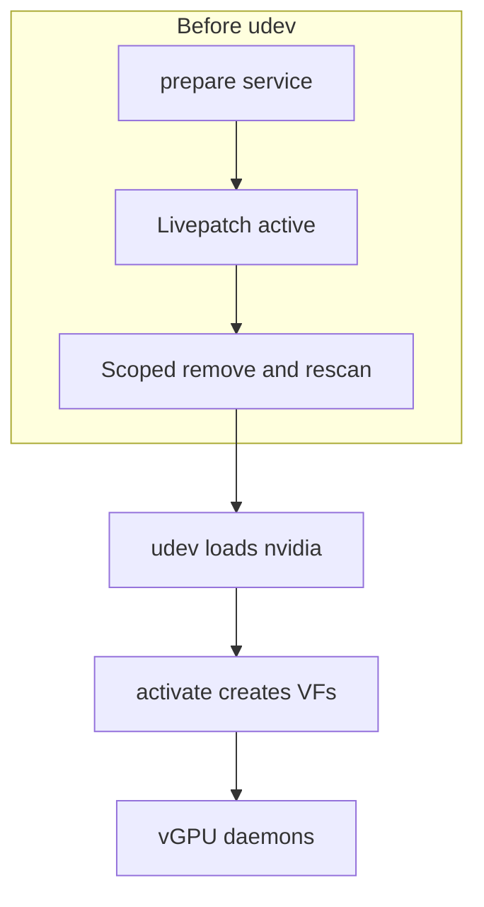
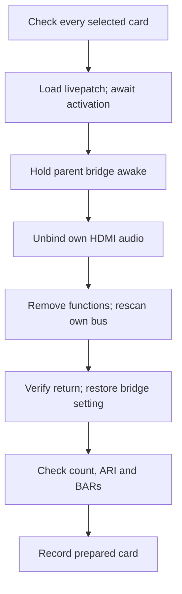
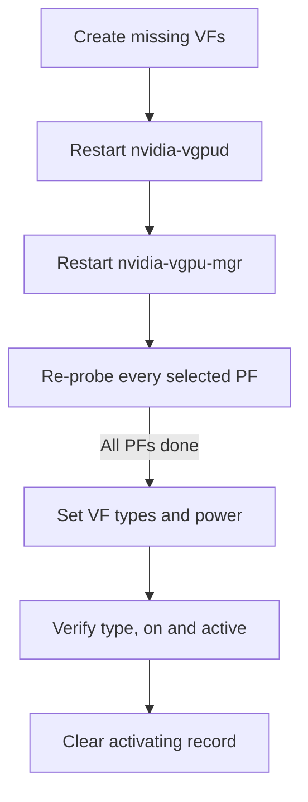
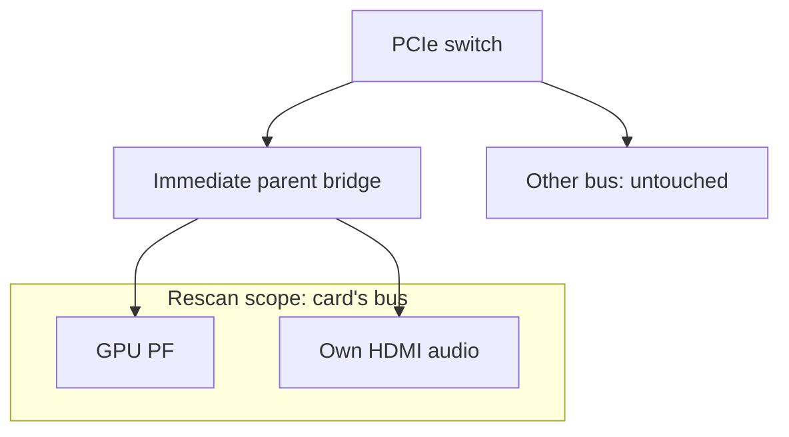
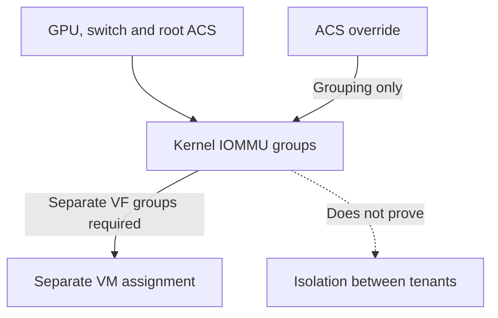
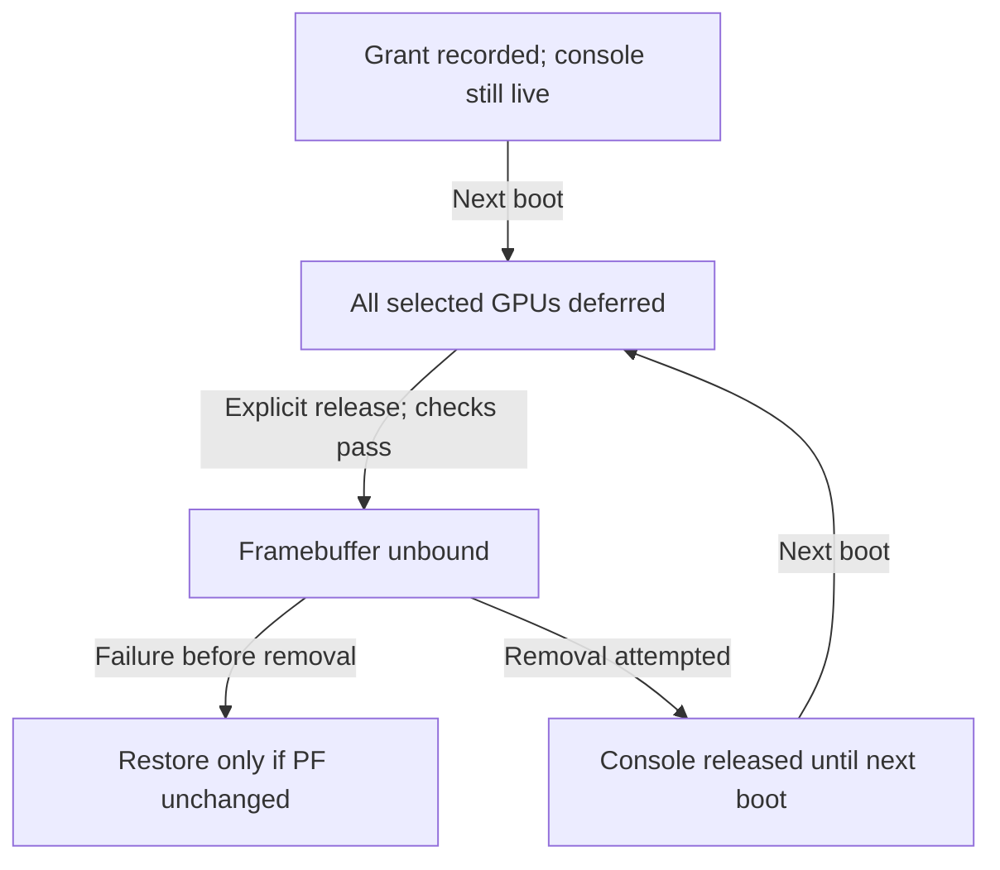
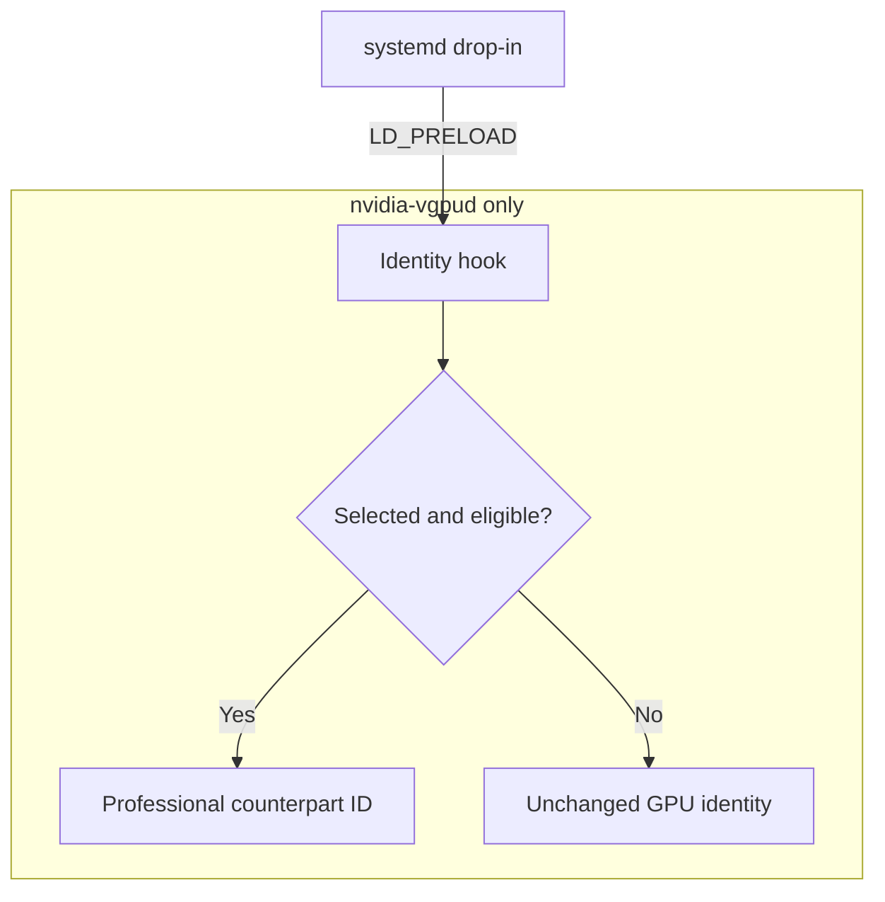

# Technical reference

This page expands on the [README](../README.md): what each component does, what `prepare` does to a card, and how each PCI layout is handled.
Ampere and Ada are supported.
Blackwell GPUs are not expected to work with the current implementation; references to Blackwell in these docs are for experiments only.
See [Ampere](ampere.md) and [Ada](ada.md).

Commands and exit codes are in [Configuration and commands](configuration.md#commands).
Config file keys and parsing rules are in the [configuration reference](configuration.md#configuration-file).

## How it works

The README's [How it works](../README.md#how-it-works) gives the short version, and [Capability positions per generation](devices.md#capability-positions-per-generation) explains the default of 4 VFs (virtual functions: the lightweight PCI devices SR-IOV adds to a card, each of which can back one vGPU).
The full sequence has five steps:

1. The `geforce_sriov` module, a livepatch built by DKMS (which rebuilds it for each new kernel), exposes the hidden SR-IOV feature of the cards you list to the kernel.
   It reports 4 VFs by default ([configurable](configuration.md#configuration-file)) and also reveals ARI and MSI-X (see the [Glossary](glossary.md)).
2. The kernel reads every PCI device before any module loads.
   After loading the module, the boot unit therefore removes the card and asks the bridge above it to rescan only that card's bus.
   The bridge is kept awake and the card's HDMI audio function is unbound first.
   All of this runs before udev and NVIDIA's services start ([What prepare does](#what-prepare-does)).
3. `geforce-sriov activate` runs NVIDIA's `sriov-manage` for each selected card that has no VFs and checks that every VF came up bound to NVIDIA's driver.
4. `nvidia-vgpud` offers vGPU types (the vGPU profiles, each with a fixed memory size, such as RTXA6000-4Q) only for cards in NVIDIA's list, which has no GeForce cards.
   The identity hook, loaded only into `nvidia-vgpud` through a systemd drop-in, changes the device ID in the driver's answer to the professional card of the card's generation (an Ampere card becomes an RTX A6000, an Ada card an RTX 6000 Ada).
   It leaves the XML file, the vGPU manager and licensing alone.
5. On 580.159.01, guest CUDA work can stall because NVIDIA's closed driver object switches off the GPU's scheduler.
   `install` applies the scheduler, probe gate and VF count revisions to a copy of your own `nv-kernel.o_binary`, and the two plugin changes to a copy of your own vGPU plugin.
   It rebuilds NVIDIA's module and requires its `.text` to differ from the stock module at exactly the eight recorded offsets.
   Run it again after every kernel update.
   No NVIDIA file is distributed here ([driver-patch.md](driver-patch.md)).

On the automatic path, PCI preparation precedes driver binding:



## What prepare does

`geforce-sriov prepare` gets each selected card ready for SR-IOV before NVIDIA's driver touches it: it loads the module, then removes and rescans the card so the kernel reads it again.
The boot unit `geforce-sriov-prepare.service` runs it before `systemd-udevd`, before anything has bound the card.
`geforce-sriov activate` follows once udev has loaded `nvidia`.
Patching and installing NVIDIA's module ([driver-patch.md](driver-patch.md), and for Ada the [Ada host stack](ada.md)) and installing the livepatch module ([Install details](#install-details)) happen beforehand and are not part of `prepare`.

Before it changes anything, `prepare` checks every selected card.
It also:

- writes a guard that blocks the next boot's preparation if a run does not finish;
- blocks signals during the remove and rescan;
- undoes its changes when it refuses.

A preparation done by hand has none of that.

For each selected card, the steps are:

1. Check that the card is free.
   If any selected card has a laptop row and the config lacks `d3cold=off`, `prepare` refuses the entire run before deferring, waking a GPU or writing anything (exit 3).
   The refusal includes the `install` command needed to record D3cold consent ([Consent](laptops.md#consent)).
   `prepare` wakes the card if it has a laptop row or its `power/runtime_status` reads `suspended`.
   A laptop card that reports active must first answer a config read.
   It sets `power/control` to `on` on both the card and the bridge above it.
   On laptop rows only, it also writes `0` to the card's `d3cold_allowed`.
   It then waits up to 5 seconds for a sysfs config read to return the card's ID in D0.
   If the card does not answer, `prepare` refuses the entire run and restores the power settings it changed on every card.
   When a card is refused or fails after the module loaded, `prepare` also restores power settings for any cards it did not remove.
   The card is refused unless all of these hold:
   - It is function `.0`, an NVIDIA display controller listed in `geforce-sriov devices`.
   - It is not the boot display, unless a console release is granted
     ([The boot display GPU](#the-boot-display-gpu)).
   - No driver is bound to it.
     The only bound function in its slot, if any, is its own HDMI audio on `snd_hda_intel`.
   - No VFs exist on its bus and no other device shares the bus.
   - It does not already show `sriov_totalvfs`.
     That would mean another kernel change presents SR-IOV, and the package does not stack on it.
   - Its parent is a PCI bridge with a `pci_bus/<bus>/rescan` file and a readable `power/control`.
   - BAR0 is assigned.
2. Load `geforce_sriov` with `bdfs` and the config's switches passed as `0`/`1` (and `vfs=N` when the config sets a VF count).
   The module cannot see `pci=noari`, so `prepare` passes `ari=0` when the kernel command line has it.
   The parameters cannot be changed while the module is loaded, so to change them, power the machine off and on ([module parameters](configuration.md#module-parameters)).
   `prepare` then waits up to 15 seconds for the livepatch to be active (`/sys/kernel/livepatch/geforce_sriov/enabled` is 1 and `transition` is 0).
   If `modprobe` fails, nothing was changed, and the kernel log names the reason.
3. Hold the bridge above the card awake.
   A bridge that runtime-suspends during the rescan loses the card, so `prepare` saves the current `power/control` setting, sets it to `on`, and waits until `runtime_status` reports `active` (or `unsupported`, meaning runtime power management is off).
4. Unbind the card's own HDMI audio function from `snd_hda_intel`.
   If anything else is bound in the slot, the run stops.
   Removing an audio function that was active this boot can log a blocked DMAR fault (late audio DMA); unbinding first does not prevent it.
5. Remove the card's functions and rescan only its bus.
   Every other function in the slot is removed, then the card itself, waiting up to 5 seconds for each to disappear.
   The rescan goes through the bridge above the card and covers only the card's own bus.
   The global `/sys/bus/pci/rescan` is never used, no other device is removed, and a bus shared with another device is refused.
   `prepare` then waits up to 10 seconds for the card to return with the same vendor and device ID and for `sriov_totalvfs` to appear.
   It restores the bridge's saved setting except on laptop rows, where the bridge stays at `on` for the session.
   On a laptop row, it also writes `0` to the card's `d3cold_allowed` again.
   During the rescan the kernel may log `VF BAR … can't assign` messages before it settles; only the final state counts.
   A card that does not come back follows the rule in [recovery.md](recovery.md#the-one-rule): a cold power cycle (power the machine fully off and on, not a reboot), and no second rescan.
6. Check what the card now offers:
   - `sriov_totalvfs` must be between 1 and `vfs` (4 by default).
     A value outside that range means the VFs are not enabled.
   - `ari_enabled` reads 1 with `ari=1`, when the bridge supports ARI Forwarding.
   - BAR0 must be assigned, and at least one VF BAR must be assigned.
     Otherwise enabling VFs fails with `not enough MMIO resources for SR-IOV` ([PCI resources](#pci-resources)).

The result is recorded in `/run/geforce-sriov/prepared/<BDF>`.
`activate` refuses a card without that record.

The guard detects an unfinished run, and signals are blocked during removal and rescan.
The diagram shows successful preparation:



When a selected card has no VFs, `activate` runs NVIDIA's `sriov-manage -e` for it, with `nvidia` already bound to it.
`sriov-manage` is NVIDIA's own script and the only VF enable method NVIDIA supports.
It needs `lspci` and `setpci`.
While it runs, it:

- may stop `nvidia-xid-logd` briefly;
- moves the card through `pci-pf-stub` while it sets the VF count;
- rebinds the card to `nvidia` and binds the slot's other functions to `nvidia`;
- runs `nvidia-smi -pm 1`.

Its exit status is not reliable, so the CLI checks that every VF came up bound to `nvidia`.
The VF count is never written to `sriov_numvfs` directly, because `sriov-manage` also moves the card through pci-pf-stub and handles binding.
The count cannot exceed the presented one.

The vGPU daemons are started only after the VFs exist, in the order given in the [installation guide](installation.md#cold-boot).
On Ada and Ampere cards, `activate` restarts them ([activate and the VF power gate](#activate-and-the-vf-power-gate)).

The package never disables VFs, so the simplest complete undo is to power the machine off and on.
A boot without the module, or with `geforce_sriov.skip` on the kernel command line while the unit is installed, is an ordinary boot.
`uninstall --unload` disables the livepatch, waits for the transition and runs `rmmod`; it refuses while any listed card has VFs or was prepared this boot.
A card that was rescanned keeps using the revealed capability until it is removed and rescanned again, so in practice, power the machine off and on ([recovery.md](recovery.md)).

## Components

| Path | What it is | License |
|---|---|---|
| `geforce-sriov` (`src/`) | CLI: inspection, install, preparation, VF bring-up, uninstall | MIT |
| `kernel/geforce_sriov.c` | Livepatch module (DKMS `geforce-sriov/0.2.2`) | GPL-2.0-only OR MIT |
| `hook/libgeforce_sriov.so` | `LD_PRELOAD` identity hook for `nvidia-vgpud` only | MIT |
| `driver/geforce-sriov-patch` | Patcher for the user's own `nv-kernel.o_binary` | MIT |
| `systemd/` | `geforce-sriov-prepare.service`, `geforce-sriov-activate.service` and an `nvidia-vgpud` drop-in | MIT |

## The kernel module

The kernel module `geforce_sriov` is a livepatch that replaces some of the kernel's PCI config accessors so the kernel sees the hidden SR-IOV feature of the cards you choose.
It acts only on the functions in its required `bdfs` parameter.
The CLI sets the switches from the config's `on`/`off` values (as `0`/`1`) and passes `vfs=N` when the config sets a count.
The module:

- Returns the hidden SR-IOV capability (config offset `0xBCC`) from `pci_find_ext_capability()`.
- Reports TotalVFs and InitialVFs as `vfs` (1–16, default 4), never more than the card's hardware TotalVFs.
  On an Ada card that reports 1 the ceiling is 4, from the VF-count revision of the host module.
  NVIDIA's patched driver uses at most 4 VFs per card.
  NVIDIA's driver does not use these 16-bit reads; on Ada it reads through a BAR0 mirror that no config accessor sees.
- With `ari=1` (default), presents the hidden ARI capability (`0xC14`, only if its Next Function Number
  is non-zero) and turns on ARI Forwarding in the GPU's immediate upstream bridge when it supports it.
  - ARI decoding in the GPU hardware does not work, which is why `vfs` defaults to 4 with or
    without ARI.
  - ARI Forwarding stays off when the kernel scans every slot below a port (`pci=pcie_scan_all` or a
    platform quirk), because the card's 3-bit function decode would answer device numbers of 1 and
    above as alias devices.
- With `msix=1` (default), clears config `0x41C` bit 29 so the MSI-X capability of the PF (the physical function, the card itself) is linked.
  A natively linked MSI-X is left alone.
  The bit is volatile: any PF reset (function-level reset, GPU reset, AER recovery) hides MSI-X again and stops PF interrupts until the next cold boot.
  Use `msix=off` if you need PF resets.
- Checks where the VFs would land: each must fall on a free function 1–7 of the PF's own slot.
  At load, the card's reported values are used.
  During the rescan the kernel tries every count from `vfs` down to 1, and a bad layout at any count, or a NumVFs register that does not read back, leaves that card with no SR-IOV (kernel log: `VF layout for … requested VFs`).
  A passing check does not prove the card provides that many working VFs.
- Validates every listed card before patching anything and refuses to load, with nothing patched, when:
  - a listed address is missing or not a table card;
  - the SR-IOV header does not match, or the hardware TotalVFs is 0;
  - the VF layout check fails (kernel log: `first VF offset … ; refusing`).

The module never removes, rescans, resets or binds a device, and it has no device table that could autoload it.
The CLI removes and rescans the card once the livepatch is active, holding the upstream bridge awake because a bridge that runtime-suspends during the rescan loses the card.
The step-by-step sequence is in [What prepare does](#what-prepare-does).

## Requirements in detail

- x86_64 Linux 6.8 or later with `CONFIG_LIVEPATCH`, `CONFIG_PCI_IOV` and `pci_dev_is_disconnected()`
  exported in `<linux/pci.h>` (6.9, or a stable backport).
  - Clang LTO (`CONFIG_LTO_CLANG`, full or thin) is refused at build time, because the kernel's SR-IOV
    code may then use inlined copies of the config accessors the module replaces.
  - Also needed: kernel headers for the running kernel release, `dkms`, `systemd`, `pciutils`, a C
    compiler and `make`. Install them with your distribution's package manager. A live `install`
    refuses and names whichever of them is missing, and `activate` refuses to create VFs without
    `lspci` and `setpci`.
- IOMMU enabled (for example `intel_iommu=on iommu=pt`).
- NVIDIA vGPU-KVM host driver, proprietary flavour, supporting every selected card: installed by you,
  or from NVIDIA's `.run` package with `install --driver-file PATH --accept-nvidia-license`.
  - The host and guest drivers must match the
    [supported software stack](installation.md#supported-software-stack). `install` accepts only host
    driver 580.159.01 and refuses any other version, and other guest driver versions are not
    supported. On the manual path (`--driver=skip`), other host driver versions are not supported
    either: `doctor`, `check` and `activate` warn and continue.
  - The hook acts only on the builds whose layout it knows ([hook/README.md](../hook/README.md)) and
    passes other builds through unchanged.
  - `nvidia-vgpud.service` and `nvidia-vgpu-mgr.service` must exist; `doctor` warns when either is
    missing.
  - Ada needs the module with the three host-object revisions and GSP off
    ([Ada host stack](ada.md#host-stack); [NVIDIA driver flavour](devices.md#nvidia-driver-flavour)).
- Select every card you will use in `bdfs`. Loading `nvidia` binds every NVIDIA card on the host,
  and the package cannot restrict that.
- Each selected GPU:
  - is function 0 with a PCI bridge directly above it;
  - shares its bus with no other device;
  - does not already present SR-IOV (another livepatch or a patched kernel);
  - is not bound to a display driver during preparation.
- The boot display device is refused unless its console release is granted
  ([The boot display GPU](#the-boot-display-gpu)).
- `nvidia` must not load from `modules-load.d`, `/etc/modules` or the initramfs, since it may bind the
  card first. `doctor` warns when it finds it there (built initramfs images are not inspected), and
  `prepare` then refuses.
- Enough bridge window space for BAR0 and the VF BARs ([PCI resources](#pci-resources)).
- `/var/lib` and the install prefix on the root filesystem or on a volume the initramfs activates. The
  boot unit runs before `systemd-udevd`, so a filesystem that needs udev would make it wait forever.

## Install details

A live install copies the binaries to `--prefix` (default `/usr/local`), the hook to `$PREFIX/lib/geforce-sriov/` and the module source to `/usr/src/geforce-sriov-0.2.2/`, then runs `dkms add/build/install` and installs the boot units.
If DKMS has other `geforce-sriov` versions, `install` builds this version as a trial before removing them from DKMS.
After installing this version, it removes each old source tree under `/usr/src` only if it installed every file in that tree.
After a successful cleanup, only this version remains registered.
For each version it leaves in place, `install` prints one warning with instructions for removing it by hand.
Every file is recorded with its SHA-256 in `/var/lib/geforce-sriov/installed-files`, and a rerun leaves identical files alone (`unchanged <path>`).

- It refuses a `vfs` above a selected card's ceiling ([Configuration file](configuration.md#configuration-file)).
- It warns for a `vfs` above 4 and a guard left by an unfinished preparation.
- Without `--device`, nothing is selected and the units are not enabled.
  `setup` selects the card itself when exactly one card that is not the boot display is eligible.
- It refuses (exit 3) an existing `/etc/geforce-sriov/config` it did not write (edit it yourself or remove it) and a `DESTDIR` with a symlink in its path.
  It stops (exit 1) rather than overwrite any other existing file it does not own.
  `--prefix` may contain only letters, digits and `/._+-`.
- Once it has written anything, a failure or a refusal exits 1, not 3.
  Exit 3 means nothing changed.

Unless `--driver=skip` is given, a live install then runs the driver step
([What install does](driver-patch.md#what-install-does)):

- It accepts the host object and the vGPU plugin only when each matches the whole-file SHA-256 recorded for 580.159.01, and refuses (exit 3, before the first write) any other file, naming the digest it found ([Supported inputs](driver-patch.md#supported-inputs)).
  The revised object, the plugin after its first change and the patched plugin copy must match their recorded digests too.
- It also refuses before the first write when the module, the kernel headers, a tool or the plugin is
  missing, or when the `.text` of a module cannot be read.
- After the build it compares the `.text` of the installed stock module with that of the built module and requires the differing offsets to be exactly the eight recorded `.text`-relative offsets (`0x14a7c4`-`0x14a7c7`, `0xa16708`, `0xa16709`, `0xd8966f`, `0xd89670`).
  Any other difference, or `.text` sections of different sizes, refuses (exit 3) and names the first unexpected offset.
- Identical `.text` means the installed module already is this build.
  When the modprobe option and the patched plugin copy are in place and this kernel's backup of the stock module differs from the build at exactly the eight offsets, the step writes the record of the build for this kernel and exits 0.
  It replaces a record that is missing or names another kernel or module.
  A copy from an earlier install with only the placement change counts as in place and is replaced with the patched plugin copy.
  Otherwise it refuses (exit 3), asks you to reinstall the stock module first, and names `--driver=skip`, which keeps the installed module as it is.
- A rerun on a host already prepared for this kernel changes nothing when the patched plugin copy is
  in place, and otherwise replaces the plugin copy and points `libnvidia-vgpu.so` at it.
- When the installed module is NVIDIA's open flavour (licence `Dual MIT/GPL`), the step refuses before writing.
  Remove NVIDIA's driver, for example with `nvidia-uninstall`, install the vGPU host package again with `--kernel-module-type=proprietary`, then run `install` again.
- A failure after the first write restores what it replaced.
  `geforce-sriov-driver --dry-run` prints the planned commands, including the `.text` comparison, and builds nothing.

Only after the driver step succeeds (or with `--driver=skip`) does `install` write the `nvidia-vgpud`
drop-in and `/etc/geforce-sriov/config` (`bdfs=`, `identity=on`, `identity_force_host=on`, `vfs=N`
with `--vfs N`, and `d3cold=off` with `--disable-d3cold`), and enable the units for the next boot without starting them.
With `--hold-nvidia`, it also writes `/etc/modprobe.d/nvidia-manual-load.conf`.
`install --device` without `--disable-d3cold` removes `d3cold=off` from the config and prints one line confirming the removal.

`--driver-file PATH`, `--accept-nvidia-license`, `--nvidia-source DIR`, `--hold-nvidia` and `--disable-d3cold` are described in
[One command from a clean host](installation.md#one-command-from-a-clean-host).

To stage into a directory instead, with nothing changed outside it:

```sh
DESTDIR=/tmp/stage ./geforce-sriov install --prefix /usr --device 0000:01:00.0
```

Staging records `--device` addresses unchecked, checks no devices, and rejects `--config`,
`--sysfs-root` and `--driver-file` (exit 2). The steps to run on the target are
printed, starting with `doctor`.

## doctor and status

`doctor` checks the host, and `status` shows the state of each selected card and names its next step.
`BDF` in the [command list](configuration.md#commands) is a physical function `dddd:bb:ss.0` as named in `/sys/bus/pci/devices`.
The domain has 4–8 lowercase hex digits (more than 4 only without leading zeros, at most `7fffffff`).
`--sysfs-root` points `doctor` and `status` at a copy of a sysfs tree; commands that change the system reject it.

`doctor` prints one line per check, marked `OK`, `INFO`, `WARN` or `FAIL`.
`FAIL` means `prepare` would refuse (exit 3).
`WARN` means a degraded setup or that a later step will refuse, for example:

- a missing `lspci`;
- an unassigned BAR;
- a shared IOMMU group;
- a selection that mixes Ada with another generation;
- a host driver version other than 580.159.01, which is not supported.

For a `--device` the config does not select, `doctor` shows what the hook will do with the settings `install --device` writes.
With `--nvidia-source DIR`, `--driver-file PATH`, `--boot-display-release BDF`, `--hold-nvidia` or `--disable-d3cold`, it assesses the host as `install` will leave it.
`--hold-nvidia` requires a console release already granted in the config or planned with `--boot-display-release`; otherwise, `doctor` exits 2.
With this option, a missing hold file is reported as information rather than a warning, because `install` writes it.
`--disable-d3cold` requires at least one laptop GPU among those assessed; otherwise, `doctor` exits 2.
A laptop GPU without D3cold consent fails because `prepare` would refuse it; recorded consent or consent planned with `--disable-d3cold` is reported as information.
`--config FILE` points `doctor` and `status` at another config file.
Host checks (tools, guard, boot unit, module autoload) are skipped with `--sysfs-root`.
Without a config file, the config line says the selected devices come from `--device` when one is given, and otherwise that defaults apply and no device is selected.

`doctor` compares the build-id of the installed `nvidia.ko` with the driver step's record (`/var/lib/geforce-sriov/driver-build`).
With no record and no install manifest (`/var/lib/geforce-sriov/installed-files`), it prints `[INFO] the driver step has not run on this host; install runs it`.
The build-id identifies the module's contents, so a loaded module whose build-id differs from the installed one is another module, for example after a reinstall without a power cycle.
When the installed `nvidia.ko` is the driver step's build and NVIDIA's driver is loaded, `doctor` reads the loaded module's build-id from `/sys/module/nvidia/notes/.note.gnu.build-id`.
If it is not the installed one, it warns `the running nvidia module (build-id <12 hex digits>) is not the installed one (<12 hex digits>); power the machine off and on to load it`.
When the installed `nvidia.ko` is not the driver step's build, nothing is said about the loaded module.

`status` adds the same sentence to the line of each Ada or Ampere card, and its first next step is then `next: power the machine off and on (the running nvidia module is not the installed one)`, without the next steps that lead to `activate`.
`status` then exits 1.
`check` adds the sentence to its `nvidia.ko` line without changing its exit status, and `activate` prints it as `geforce-sriov: warning: …` and goes on.
When `check` is not ready, `setup` stops before `prepare` and `activate` with exit 3 and `setup: the running nvidia module is not the installed one. Power the machine off and on, then run setup again.`

With an installed config that grants no console release, `doctor` also looks for a hold of `nvidia` in `/etc/modprobe.d/` (a `blacklist nvidia` line and an `install nvidia /bin/false` line) and warns `nvidia is held back at boot by <file>, and no console release is granted. activate will refuse. Remove <file> (docs/installation.md#returning-to-automatic-preparation)`.
For any file other than `nvidia-manual-load.conf`, or when the two lines are in two files, it says ``Remove the `blacklist nvidia` and `install nvidia /bin/false` lines from <file>`` instead.

`doctor` also reads the drop-ins of `nvidia-vgpud` and `nvidia-vgpu-mgr` in systemd's unit directories.
Each `.conf` file other than the package's own `geforce-sriov.conf` that sets `LD_PRELOAD` in an `Environment=` line gets `[WARN] <file> sets LD_PRELOAD for <unit> and overrides the geforce-sriov identity hook. Remove it or point it at <hook path>.`, where the hook path is the one `geforce-sriov.conf` preloads.
systemd reads a unit's drop-ins in file name order and the last `LD_PRELOAD` wins.
In `nvidia-vgpud.service.d`, a file read before `geforce-sriov.conf` is not named, and neither is a file whose `LD_PRELOAD` list (colons or blanks) still holds the hook.

`activate` keeps `/run/geforce-sriov/activating` from its first change until it succeeds.
While that file exists, `doctor` warns `/run/geforce-sriov/activating exists: geforce-sriov activate is running or did not finish; check reports NOT READY until activate succeeds`.
`status` prints `activate: /run/geforce-sriov/activating exists (activate is running or did not finish)` with the next step, to stop every VM that uses a vGPU and run `activate` (left out when the running `nvidia` module is not the installed one), and exits 1.

`status` exits 0 only when all of these hold:

- every selected GPU was prepared this boot and presents 1 to `vfs` VFs with no BAR known to be unassigned;
- `/run/geforce-sriov/activating` does not exist;
- the running `nvidia` module is not seen to be a different build from the installed driver step's build.

It prints `BAR assignment: not confirmed` when the `resource` file cannot be read completely, so exit 0 does not prove the BARs are assigned.

## activate and the VF power gate

`activate` takes the host from prepared cards to VFs that are ready for a VM.
It creates the VFs, restarts NVIDIA's vGPU daemons, sets each VF's vGPU type and keeps each VF powered on, which is the VF power gate.
Ampere and Ada are the supported generations ([Ampere](ampere.md), [Ada](ada.md)).
See [Ada bring-up differences](ada.md#bring-up-differences), [The VF power gate](ada.md#the-vf-power-gate) and [Commands](configuration.md#commands) for details.

`activate` refuses (exit 3, nothing changed) unless:

- NVIDIA's driver is loaded with `EnableGpuFirmware: 0`, and
  `libnvidia-vgpu.so` resolves to the patched plugin copy (SHA-256 `aa4fdeb5…`; the earlier Ada-only
  copy is refused, and so is an earlier copy with only the placement change, `7ddfad45…`, with a
  message to run `install` again);
- every VF of the selected cards is on `nvidia`, and no selected PF has a `driver_override` other than
  empty or `nvidia`;
- the installed `nvidia.ko` is the build `install` recorded in `/var/lib/geforce-sriov/driver-build`
  for the running kernel (with no record at all it only warns);
- `--type`, if given, is not used on a mixed Ada and Ampere selection (it sets one type on every card,
  and 942 is not creatable on the Ampere target nor 525 on the Ada target; omit it and set
  `type_ada` and `type_ampere` in the config, or select one generation in `bdfs`, whose
  other-generation cards then run without VFs);
- every card in scope is in the device table, and no NVIDIA VF on the host has a vGPU type;
- no GPU outside `bdfs` has VFs enabled, because the daemon restart is host-wide.

On 580.159.01 the GSP-off and plugin checks above refuse.
Another host driver version is not supported ([Supported software stack](installation.md#supported-software-stack)); on one, `activate` reports the version as not supported, those two checks only warn, and the run continues.
On such a host nothing stops a GSP or plugin mismatch before a guest starts, so the mismatch surfaces at guest start.
The stack of each generation is in [Ampere](ampere.md#host-stack) and [Ada](ada.md#host-stack).

`activate` then writes `/run/geforce-sriov/activating`, restarts `nvidia-vgpud` and `nvidia-vgpu-mgr`, re-probes each selected PF (never removing or rescanning), and sets the type and `power/control=on` on every VF, gated on the readback `on`/`active`.
The type of a card is `N` with `--type`, else `type_ada` or `type_ampere` from the config, else 942 on Ada and 525 on Ampere.
Only then is `activating` removed.

The VF steps run after every card's re-probe, because re-probing one card's PF resets the other cards' VFs to `power/control=auto`.
After any re-probe, stop the VMs and run `activate` again; this covers the whole host.
`--dry-run` checks and prints the steps.

The daemon restart is host-wide, and every selected PF must finish its re-probe before any VF type or power setting is written:



After that, `activate` checks how each Ada card's VFs fit in its memory.
VF k (0 for the first, in VF order) has the fixed framebuffer slot `[k × (P − 32), (k + 1) × (P − 32))` MiB, where P is the `profileSize` of the card's type in `/usr/share/nvidia/vgpu/vgpuConfig.xml`.
A VF whose slot ends near the top of the card's memory can be refused when its VM starts, even alone on an empty card, while the type write succeeds.

For each Ada card with a VF whose slot ends above 75% of `memory.total` (from `nvidia-smi --query-gpu=pci.bus_id,memory.total --format=csv,noheader,nounits`), `activate` prints one line that names those VFs.
75% is a threshold for the hint, not an exact limit.
The line does not change the exit status.
A missing or unreadable XML file gives no line, and neither does an `nvidia-smi` that is missing, fails or runs longer than 5 s (it is then killed).
Ampere cards have no such slot limit and get no line ([Choosing a vGPU type](configuration.md#choosing-a-vgpu-type)).

The type must be listed in the VF's `nvidia/creatable_vgpu_types`.
NVIDIA's `nvidia_vgpu_vfio` keeps the type table of each GPU's first registration after a boot, and neither the PF re-probe nor a daemon restart refreshes it.
When the type is missing, `activate` exits 1 and writes no type.
Its message starts `type <N> is not in nvidia/creatable_vgpu_types` and ends `The driver keeps the vGPU types it registered first after a boot, so after a change of identity or target, power the machine off and on`.

- Exit 1: a step after the checks failed, including an `unbindLock` that was not granted. `activating`
  stays, so `check` passes no card until `activate` succeeds.
- Exit 5: the guard of an unfinished preparation or re-probe was already set, so nothing was changed;
  or a PF did not come back to `nvidia`, and the guard stays set.

`check` is the read-only gate before every VM start: no root, no lock.
On a laptop GPU, its read of the PF and VF config space resumes a suspended device.
It prints one `OK` or `NOT READY` line per VF.
It is a point-in-time read: it does not read the plugin and does not stop a later re-probe or daemon restart.

- Exit 0: every VF of every selected card is on `nvidia` with `power/control=on`, `runtime_status=active` and the expected type, chosen as `activate` chooses it.
  Each VF of a laptop GPU must also answer a config read at offset `0x08`.
- Exit 1: anything else, or `/run/geforce-sriov/activating` or the guard exists.
- Exit 3: an invalid or empty config, no selected card, a `--device` that is not selected, a card in
  scope that is missing or not in the device table, or `--type` on a mixed selection.
  `--device` can narrow the run to one generation.

## Multiple GPUs and PCI topology

Up to 8 physical functions can be selected. The table shows what the package does in each layout:

| Layout | Behaviour |
|---|---|
| One selected GPU with a PCI bridge directly above it | The basic layout |
| Several selected GPUs | `prepare` checks every card first, and one failing card refuses the whole run (exit 3, nothing changed). Cards are then prepared one at a time and a failure stops the run. `activate` also checks every selected card before it changes anything |
| Some GPUs selected, others not | Unselected GPUs are never prepared, given SR-IOV by the kernel module, rewritten by the hook or forced to HOST. The rebuilt `nvidia.ko` applies to them too, because its VF-count and scheduler revisions are not per-card ([Combining generations](devices.md#combining-generations)) |
| Identical cards, only some selected | The hook tells them apart by PCI address ([The identity hook](#the-identity-hook)). If the driver does not answer its address queries, it falls back to the device ID only when every NVIDIA GPU with that ID is selected; otherwise the ID stays unchanged and a log line says why |
| Different models in one host | Each card uses its own table row and its generation's target, all under the one installed host driver, which must support every selected card. `prepare` does not check the driver. `doctor` notes that Ada needs the modified host stack ([Ada host stack](ada.md#host-stack)) |
| Several Ada cards | Each uses its own row, and each presents 4 VFs. `activate` and `check` act on every selected Ada card |
| Ada card with a non-Ada card on the same host module ([Combining generations](devices.md#combining-generations)) | The VF-count revision applies to every TU/GA/AD card bound to the module, so each presents 4 VFs, and one plugin copy serves both generations. `doctor` warns once and never refuses |
| GPU on a PCIe switch downstream port | Remove/rescan, the held-awake bridge and ARI Forwarding use the GPU's immediate parent bridge. The switch's upstream link is shared, so throughput can differ; the VF count does not |
| GPU on a bus shared with an unrelated device | Refused by `install --device`, `doctor` and `prepare`, because removing the bus would touch the other device |
| Boot display GPU (`boot_vga` 1) | Refused unless the config grants its console release. With the grant, the boot unit defers and `prepare --release-console=BDF` prepares the whole selection by hand ([The boot display GPU](#the-boot-display-gpu)) |
| GPU on a root bus with no PCI bridge above it | Refused: the bridge-scoped rescan is not possible |
| Other functions in the GPU's slot | Refused: the module refuses to load when a planned VF function (1–7) is used by another device. The hook skips a card whose slot has a second NVIDIA display function ("ambiguous slot"). The card's own audio function is expected |
| One RM device object spanning several GPUs (grouped or SLI-style) | Not supported: the hook reports HOST only when the device object has exactly one subdevice |
| PCI domain above `ffff` (for example behind Intel VMD) | Accepted as sysfs prints it, 4–8 hex digits up to `7fffffff` |

For a GPU behind a PCIe switch, the shared upstream link sits outside the card's rescan scope:



An unrelated device on the card's bus makes this layout ineligible.

### PCI resources

Each GPU needs BAR0 and, once SR-IOV is presented, its VF BARs assigned inside the bridge windows above
it. The package never writes resources, and a rescan can only resize the card's own bridge window.

- `VF BAR … can't assign` messages during the rescan can be ignored. Only the final state counts.
- `doctor` and `status` warn when BAR0 or every VF BAR is unassigned. `prepare` refuses a card whose
  BAR0 is unassigned, and stops when a card comes back from the rescan without the BAR0 it had.
- Enabling *Above 4G decoding* in firmware, or booting with
  [`pci=realloc`](https://docs.kernel.org/admin-guide/kernel-parameters.html), may give the windows
  enough room.
- Only assignment is checked, not size. *Resizable BAR* settings change how much window space is
  left.

### IOMMU groups and ACS

VFs can be assigned to separate VMs only when the IOMMU puts them in separate groups, which depends on ACS support in the GPU, the switch ports and the root ports.
`doctor` reports each card's group.
A group holding only the card's own functions (and its immediate bridge) is information, while other devices in the group, or a VF sharing its PF's group, are warned about.

This is the kernel's grouping and says nothing about isolation between tenants, so check the actual VF groups before assigning VFs.
An ACS override patch changes the grouping, not the hardware's isolation ([VFIO documentation](https://docs.kernel.org/driver-api/vfio.html)).

PCI rescan scope and IOMMU grouping answer different questions:



## The boot display GPU

The boot display GPU needs its own path because the host is already using it.
It is the GPU your machine uses to show its startup screen (the BIOS or UEFI messages you see before Linux loads) and the Linux text console (`boot_vga` 1), and that console scans out of one of its BARs.
A remove and rescan can move those BARs, so every command refuses this GPU unless a console release is granted.
`prepare`, when it performs one, and `doctor`, while one is granted, print what it means:

> Console release: the Linux console on that GPU stays detached until the next boot, and the monitor
> may keep the last frame or lose signal. Logs continue in the journal and over SSH. See
> docs/installation.md#what-the-opt-in-changes.

A grant releases nothing by itself.
`install --boot-display-release` records it and prints a note.
The note explains that the manual commands or `setup` release the console after the power cycle, and that `setup` asks again first.
It warns that the monitor may then go blank or freeze until the following boot, and asks you to set up and test SSH or a serial console before the power cycle.

In a first install run by `setup`, its question `Allow releasing the console of <BDF> after the next boot? [y/N]` explains the grant instead, and `setup` passes `--release-note-shown` to `install`, which then leaves its note out.
`setup` then asks whether `install` should create the hold file.
Unless the user accepts or a file in `/etc/modprobe.d/` already holds `nvidia` back, it passes `--hold-note-shown` and displays the hold notice itself after installation.
If a laptop GPU is selected, `setup` then shows the D3cold notice and asks for consent.
Answering yes passes `--disable-d3cold` to `doctor` and `install`; declining stops `setup` before any step (exit 3).

Grant it together with the other GPUs to prepare.
`--boot-display-release` must name a GPU also given with `--device`, and the config then holds `boot_display_release=`:

```sh
sudo ./geforce-sriov install --device 0000:02:00.0 --device 0000:01:00.0 --boot-display-release 0000:01:00.0
# or: sudo make install DEVICES="0000:02:00.0 0000:01:00.0" BOOT_DISPLAY_RELEASE="0000:01:00.0"
```

Running `install --device …` again without the option removes the grant.
The full walkthrough is in [Boot display card](installation.md#boot-display-card).
The commands enforce these rules:

- At boot, `prepare --boot` prepares none of the selected GPUs and changes nothing, because loading the module would touch the boot display while its console is live.
  It records the deferral in `/run/geforce-sriov/deferred` and exits 0.
  While that file exists, the `nvidia-vgpud` drop-in (`AssertPathExists=!/run/geforce-sriov/deferred`) makes `nvidia-vgpud` and units requiring it, such as `nvidia-vgpu-mgr`, fail to start.
  `status` exits 1 and prints `deferred` with the commands to run.
- The package keeps `nvidia` from loading at boot only with your permission.
  Accepting the hold prompt in `setup`, or passing `install --hold-nvidia`, creates `/etc/modprobe.d/nvidia-manual-load.conf`.
  Otherwise, you must prevent `nvidia` from loading at boot yourself.
  The package does not change NVIDIA's services or the kernel command line.
  You keep `nvidia` from loading before `prepare` (for example `blacklist nvidia` and `install nvidia /bin/false` in a modprobe.d file, then `modprobe --ignore-install nvidia` afterwards), and keep `nvidia-persistenced`, `nvidia-vgpu-mgr` and similar services from starting.
  If something binds a selected GPU first, `prepare` refuses that card.
- Reach the host over SSH or a serial console, and be able to cold power cycle it.
- After each boot, as root: `prepare --release-console=0000:01:00.0`, `modprobe --ignore-install nvidia`, `activate`, `check`, or `setup`, which asks once and runs those four.
  Without an answer (no terminal, `--no-prompt`, end of input) `setup` refuses with the commands (exit 3, nothing changed), and with NVIDIA's driver already loaded it stops before `prepare` (exit 3).
  `--release-console` must name exactly the GPUs `boot_display_release` lists, or `prepare` refuses (exit 3, nothing changed).

`prepare` checks every selected GPU before changing anything.
It releases a console only when the card's own `simple-framebuffer.N` is its only user.
It refuses (exit 3, nothing changed) when:

- a firmware framebuffer cannot be attributed to the PF or is of another kind (`efi-framebuffer`, `vesa-framebuffer`, …);
- another fb or DRM device uses the card;
- the legacy VGA text console is bound;
- an early `efifb` console is registered;
- anything but the framebuffer's `BOOTFB` region sits inside one of the card's BARs in `/proc/iomem`.

It also refuses a boot display whose BARs `/proc/iomem` lists five or more levels deep (for example behind two PCIe switches), since it cannot then determine what uses the BAR.

It then writes the guard, unbinds the framebuffer, loads `geforce_sriov` once for every selected GPU and prepares them card by card.
It records each release in `/run/geforce-sriov/prepared/<BDF>` (`console_release=`) and, once every GPU is prepared, removes `deferred`.
After that, load the vGPU host driver and run `activate`, which creates the VFs and then starts the daemons, as in the [installation guide](installation.md#cold-boot).

If `prepare` fails before the card's removal was attempted, it gives the console back, but only while the PF is the same unbound device with the same resources.
Once removal has been attempted, even if the remove write reported an error, the console stays released for the rest of the boot because the BARs may have moved.
A card that does not come back follows the [recovery](recovery.md#the-one-rule) rule: cold power cycle, and do not rescan again.

With the grant retained, each boot repeats the deferred preparation path:



`activate` accepts the boot display GPU only with this boot's release record and the grant still in the config.
To return to automatic preparation, run `install --device` with only the other GPUs selected.
If `/etc/modprobe.d/nvidia-manual-load.conf` was created by `setup` or `install --hold-nvidia` and is unchanged, installation removes it.
Any other hold is left in place and reported so you can remove it manually ([Returning to automatic preparation](installation.md#returning-to-automatic-preparation)).
The next boot is then an ordinary one, and the console stays on the boot display.

## The identity hook

`nvidia-vgpud` accepts only GPUs listed in NVIDIA's `vgpuConfig.xml`, which has no GeForce IDs.
The hook, loaded into `nvidia-vgpud` only and never `nvidia-vgpu-mgr`, presents each selected card under its professional counterpart's device ID, matched by PCI address, and leaves every other GPU unchanged.
It changes nothing else: no vGPU type lists, manager, license or XML.
Gates, query counts and log lines are in [hook/README.md](../hook/README.md).

The preload boundary is the `nvidia-vgpud` process, not the whole NVIDIA stack:


